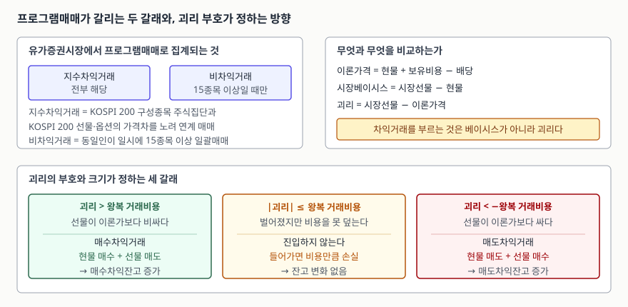

> 예제의 지수 `가나200`과 지수값·이자율·배당·거래비용은 계산 절차를 보이려고 만든
> 값이다. 실재하는 지수·종목과 관계가 없다.

## 들어가며

장중에 시세 화면을 켜 두면 아래쪽에 "프로그램 순매수 3,240억"처럼 숫자가 하나 뜬다.
오전에는 매도였다가 오후에 매수로 돌아서기도 하고, 어떤 날은 장 막판 10분에
수천억이 한꺼번에 들어온다. 이 숫자를 보고 대부분은 "기관이 들어온다", "외국인이
판다"는 식으로 방향을 읽으려 한다. 즉 **누군가가 주가를 어떻게 보는지**의 신호로
읽는 것이다.

그런데 프로그램 순매수의 상당 부분은 주가 전망과 아무 상관이 없다. 지수가 오르든
내리든 손익이 같도록 설계된 거래이기 때문이다. 방향을 읽으려고 보면 하루에도 몇
번씩 뒤집히는 숫자를 따라다니게 되고, 그래서 매번 늦는다. 이 숫자는 전망이 아니라
**선물 가격과 현물 가격의 차이가 거래비용을 넘겼다는 사실**의 기록이다. 그 차이를
무엇과 비교해 재는지, 어느 선을 넘을 때 주문이 나가는지를 알면 숫자가 바뀌는 자리도
같이 보인다.

## 개념 — 프로그램매매는 전략 이름이 아니라 집계 구분이다

한국거래소는 프로그램매매를 "시장분석, 투자시점 판단, 주문제출 등을 컴퓨터로
처리하는 거래기법"으로 설명한다. 다만 실제로 집계에 들어가는 범위는 그 설명보다
좁고 구체적이다. 유가증권시장에서는 **모든 지수차익거래**와, **동일인이 일시에
KOSPI 구성종목 중 15종목 이상을 거래하는 비차익거래**가 프로그램매매로 분류된다.
코스닥시장은 종목 수 기준이 10종목이다.

여기서 두 가지가 갈린다.

- **지수차익거래**는 KOSPI 200 구성종목 주식집단과 KOSPI 200 선물·옵션의 가격차를
  노리고 둘을 연계해 매매하는 것이다. 두 매매가 동시에 일어날 필요는 없고,
  주식집단을 먼저 사고 선물을 나중에 팔아도 차익거래다.
- **비차익거래**는 차익거래가 아니면서 종목 수 기준을 넘긴 일괄매매다. 인덱스
  펀드가 설정·환매에 맞춰 바스켓을 통째로 사고파는 것이 여기 들어간다.

중요한 것은 이 구분이 **투자자의 의도를 묻지 않는다**는 점이다. 15종목을 한꺼번에
주문하면 그 이유가 무엇이든 비차익 프로그램매매로 집계된다. "프로그램 순매수"라는
숫자가 하나의 의견이 아닌 이유가 여기 있다. 성격이 전혀 다른 두 흐름이 한 칸에
더해져 있다.

## 구조 — 베이시스가 아니라 괴리를 본다



> **출처**: [한국거래소 규정포털 — 유가증권시장 프로그램매매](https://regulation.krx.co.kr/contents/RGL/03/03010404/RGL03010404.jsp), [코스닥시장 프로그램매매호가 일시 효력정지제도(Sidecar)](https://regulation.krx.co.kr/contents/RGL/03/03020403/RGL03020403.jsp)

세 가지 값이 자주 섞여 쓰인다. 구분해 두면 뒤가 쉬워진다.

| 이름 | 계산 | 무엇을 말하는가 |
|---|---|---|
| 선물 이론가격 | 현물 + 보유비용 − 배당 | 현물을 만기까지 들고 가는 비용을 반영한 값 |
| 시장베이시스 | 시장 선물가격 − 현물 | 선물과 현물이 실제로 얼마나 벌어져 있는가 |
| 괴리 | 시장 선물가격 − 이론가격 | 그 벌어진 폭이 비용으로 설명되고 **남는** 부분 |

차익거래를 부르는 것은 베이시스가 아니라 괴리다. 금리가 높으면 베이시스는
가만히 있어도 커진다. 이론가격이 같이 커지기 때문에 괴리는 변하지 않고, 아무
주문도 나가지 않는다. 베이시스만 보고 "선물이 비싸졌다"고 읽으면 여기서 틀린다.

## 동작 원리 — 지수가 어디로 가든 손익이 같은 구조

이론가격은 보유비용모형으로 구한다. 전국투자자교육협의회의 설명을 그대로 쓰면
주가지수선물의 이론가격은 **현물가격에 보유비용을 더하고 배당을 뺀 값**이다.
주식을 만기까지 들고 있으려면 그 돈을 빌리는 비용이 들지만, 들고 있는 동안
배당을 받으므로 순비용은 그만큼 줄어든다.

괴리가 양수이면, 즉 시장 선물가격이 이론가격보다 높으면 **현물을 사고 선물을
파는** 매수차익거래가 성립한다. 이 포지션을 만기까지 들고 가면 만기 지수가
얼마가 되든 손익이 같다. 만기에 선물은 현물 지수로 정산되므로, 현물에서 번
만큼을 선물에서 잃고 그 반대도 마찬가지다. 남는 것은 진입 시점에 이미 정해진
네 항목 — 괴리, 배당, 조달비용, 거래비용 — 뿐이다.

그래서 **차익거래의 손익은 주가 방향이 아니라 진입 시점의 괴리가 정한다.**
프로그램 순매수가 늘었다는 사실에서 "주가가 오를 것으로 본다"는 뜻을 읽을 수
없는 이유다. 오히려 읽을 수 있는 것은 반대쪽이다. 매수차익잔고가 쌓였다는 것은
**언젠가 그만큼 현물을 되팔 예정**이라는 뜻이다.

## 실습 예제

가상 지수 `가나200`을 놓고 이론가격부터 잔고 경로까지 계산한다. 전체 소스:
[`code/index_arbitrage.py`](code/index_arbitrage.py) · 실행 기록:
[`code/output.txt`](code/output.txt)

```python
def theoretical_price(spot, rate, days, dividend):
    """보유비용모형. 현물을 만기까지 들고 가는 비용에서 그동안 받을 배당을 뺀다."""
    carry = spot * rate * days / 365
    return spot + carry - dividend, carry


def buy_arbitrage_pnl(futures, terminal_spot):
    spot_pnl = terminal_spot - SPOT              # 현물 매수 손익
    futures_pnl = futures - terminal_spot        # 선물 매도 손익
    funding = SPOT * RATE * DAYS / 365           # 현물 매수대금 조달비용
    return {
        "현물 손익": spot_pnl,
        "선물 손익": futures_pnl,
        "배당 수취": DIVIDEND,
        "조달비용": -funding,
        "거래비용": -COST,
    }
```

현물 420.00, 연 이자율 3.20%, 만기까지 73일, 잔존기간 배당 1.40포인트를 넣으면
이론가격이 나온다.

```text
[선물 이론가격 = 현물 + 보유비용 - 배당]
  보유비용 = 420.00 x 0.0320 x 73/365 =    2.688
  이론가격 = 420.00 + 2.688 - 1.40 =  421.288
  이론베이시스 = 이론가격 - 현물 =    1.288
```

시장 선물가격을 셋으로 바꿔 넣으면 어느 쪽이 성립하는지가 갈린다. 왕복 거래비용은
0.35포인트로 뒀다.

```text
[시장 선물가격별 괴리와 판정]
    구분  시장선물 시장베이시스     괴리   괴리율  판정
  -------------------------------------------------------------------------------------
  고평가    422.80        2.800    1.512   0.359%  매수차익거래 (현물매수 + 선물매도)
  저평가    420.10        0.100   -1.188  -0.282%  매도차익거래 (현물매도 + 선물매수)
  균형권    421.40        1.400    0.112   0.027%  진입 안 함 (괴리가 거래비용 미만)
```

두 번째 줄을 본다. 시장베이시스는 +0.100으로 **양수**인데 판정은 매도차익거래다.
선물이 현물보다 비싼데도 "싸다"고 보는 것이다. 이론베이시스가 1.288이므로, 선물이
현물보다 0.100만 비싼 것은 이론보다 1.188 싼 상태다. 베이시스의 부호만으로는 아무
것도 결정되지 않는다는 말이 이 한 줄이다.

매수차익거래를 만기까지 들고 갔을 때의 손익을 만기 지수 두 값으로 나눠 계산하면
방향 중립이 숫자로 확인된다.

```text
[매수차익거래를 만기까지 보유 — 만기 지수를 바꿔도 손익이 같다]
  진입 시 시장선물 422.80 / 이론가격 421.288 / 괴리 +1.512
  항목           만기지수 390.00   만기지수 450.00
  ------------------------------------------------
  현물 손익              -30.000            30.000
  선물 손익               32.800           -27.200
  배당 수취                1.400             1.400
  조달비용                -2.688            -2.688
  거래비용                -0.350            -0.350
  ------------------------------------------------
  합계                     1.162             1.162
  1계약 손익 = 1.162 포인트 x 250,000원 = 290,500원
```

지수가 30포인트 빠진 쪽에서 현물은 −30.000을 찍지만 선물이 +32.800으로 받아낸다.
30포인트 오른 쪽은 부호만 바뀐다. 합계 1.162는 양쪽이 같고, 이 값은 괴리
1.512에서 거래비용 0.350을 뺀 것과 정확히 일치한다. 만기 지수는 식에서 소거된다.

괴리가 비용에 못 미치는 균형권에서 억지로 들어가면 어떻게 되는지도 같이 찍는다.

```text
[균형권에서 억지로 들어갔을 때]
  시장선물 421.40 / 괴리 +0.112 / 왕복 거래비용 0.35
  합계 = -0.238 포인트 — 괴리가 비용을 못 덮어 손실로 끝난다.
```

마지막으로 괴리가 날마다 달라질 때 매수차익잔고가 쌓였다가 만기에 풀리는 과정이다.

```text
[매수차익잔고 — 괴리가 비용을 넘을 때 쌓고 만기에 전부 푼다]
    잔존일     현물     선물    이론가     괴리  신규진입     청산     잔고
  -------------------------------------------------------------------------
         5   420.00   420.55   420.088    0.462       1.3      0.0      1.3
         4   418.20   418.72   418.270    0.450       1.3      0.0      2.6
         3   422.60   423.25   422.654    0.596       1.7      0.0      4.3
         2   424.10   424.33   424.136    0.194       0.0      0.0      4.3
         0   423.00   423.00   423.000    0.000       0.0      4.3      0.0
```

잔존 2일에 주목한다. 현물이 424.10으로 그 주에 가장 높은데 신규진입은 0이다.
현물이 올라도 괴리가 0.194로 비용에 못 미치면 주문이 나가지 않는다. 그리고 만기일에
닷새 동안 쌓인 4.3단위가 한 번에 청산된다. 이날 현물 매도 물량은 그날의 주가
전망에서 나온 것이 아니라 **앞선 사흘의 괴리가 예약해 둔 것**이다.

## 실무에서 주의할 점

**첫째, 프로그램 순매수를 방향 신호로 읽지 않는다.** 한 칸에 더해져 있는 두 흐름의
성격이 다르다. 지수차익거래 쪽은 지수 방향에 걸지 않는 거래이고, 비차익거래 쪽은
인덱스 펀드 자금 유출입처럼 그날의 시황과 무관한 사정으로 움직이는 경우가 많다.
굳이 나눠 본다면 거래소가 차익·비차익을 구분해 공표하므로 둘을 따로 봐야 하고,
그래도 "왜 들어왔는지"까지는 숫자에 적혀 있지 않다.

**둘째, 잔고는 이미 예약된 반대매매다.** 매수차익잔고가 크다는 것은 그만큼의
현물이 언젠가 시장에 되팔린다는 뜻이다. 선물·옵션 만기일 전후에 수급이 평소와
다르게 움직이는 구조적 이유가 이것이고, 잔고 수준은 거래소가 공표한다. 다만
잔고가 크다고 해서 그날 지수가 내린다는 보장은 없다. 반대쪽에서 새로 쌓는 물량이
상쇄할 수도 있기 때문이다.

**셋째, 거래비용의 변화가 임계를 바꾼다.** 위 계산에서 비용 0.35를 0.10으로 낮추면
균형권으로 분류됐던 0.112짜리 괴리도 진입 대상이 된다. 수수료·세제·차입 여건이
바뀌면 같은 괴리에서 다른 결론이 나온다는 뜻이다. 그래서 "괴리율 몇 % 이상이면
차익거래가 들어온다"는 식의 고정된 기준선은 쓸 수 없다. 기준은 거래 주체마다 다르다.

**넷째, 제도가 프로그램 호가를 멈추는 구간이 있다.** 유가증권시장은 기준종목 가격이
기준가 대비 5% 이상 상승 또는 하락한 상태가 1분간 지속되면 프로그램매매 호가의
효력을 5분간 정지한다(사이드카). 코스닥시장은 코스닥150선물이 6% 이상 변동하고
코스닥150지수가 직전 거래일 종가 대비 3% 이상 변동하는 조건이 동시에 1분간
이어질 때 발동한다. 정지 중에 접수된 호가는 5분이 지난 뒤 접수 순서대로 가격
결정에 참여하고, 정규시장에만 적용된다. 급변동 구간에서 프로그램 수급이 끊겼다가
한 번에 재개되는 자리가 여기다.

## 정리

- 프로그램매매는 전략 이름이 아니라 집계 구분이다. 모든 지수차익거래와, 유가증권시장
  기준 15종목 이상의 비차익거래가 여기 들어간다.
- 차익거래를 부르는 것은 베이시스가 아니라 괴리다. 괴리는 시장 선물가격에서
  보유비용모형으로 구한 이론가격을 뺀 값이고, 그 절대값이 왕복 거래비용을 넘어야
  주문이 나간다.
- 차익거래를 만기까지 들고 가면 손익이 만기 지수와 무관하다. 예제에서 만기 지수를
  390과 450으로 바꿔도 합계는 1.162로 같았고, 이는 괴리에서 비용을 뺀 값이다.
- 매수차익잔고는 앞으로의 현물 매도 예약이다. 만기일 수급이 평소와 달라지는 구조적
  이유가 여기 있다.
- 비용이 달라지면 같은 괴리에서 다른 결론이 나온다. 고정된 괴리율 기준선은 없다.

## 참고 자료

- [한국거래소 규정포털 — 유가증권시장 프로그램매매](https://regulation.krx.co.kr/contents/RGL/03/03010404/RGL03010404.jsp) — 프로그램매매의 범위, 지수차익거래 네 가지 유형, 사이드카 발동요건
- [한국거래소 규정포털 — 코스닥시장 프로그램매매호가 일시 효력정지제도(Sidecar)](https://regulation.krx.co.kr/contents/RGL/03/03020403/RGL03020403.jsp) — 코스닥 발동요건과 해제요건
- [한국거래소 규정포털 — 코스닥시장 프로그램매매 관련 공시제도](https://regulation.krx.co.kr/contents/RGL/03/03020404/RGL03020404.jsp)
- [전국투자자교육협의회 — 선물 이론가격과 보유비용](https://kcie.or.kr/mobile/guide/2/25/web_view?content_idx=1077) — 주가지수선물 이론가격 = 현물가격 + (보유비용 − 배당)
- [자본시장과 금융투자업에 관한 법률 제393조(업무규정)](https://www.law.go.kr/법령/자본시장과금융투자업에관한법률/제393조) — 거래소 증권시장업무규정의 법적 근거
