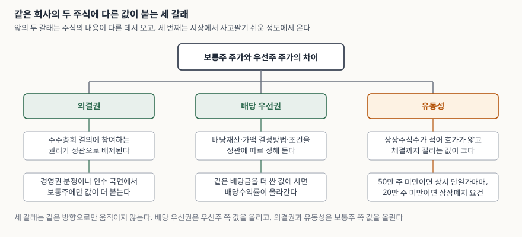
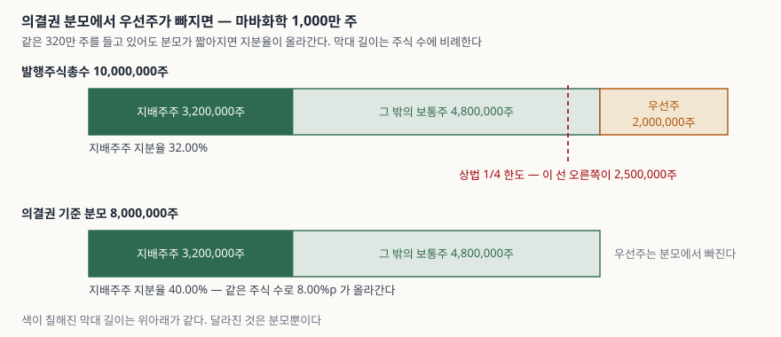

> 예제의 회사 `마바화학`과 그 숫자는 계산 원리를 보이려고 만든 가상 값이다. 실제 기업·종목과 관계가 없다.

## 들어가며

증권사 앱에서 회사 이름을 검색하면 같은 이름이 둘 나올 때가 있다. 뒤에 `우`가 붙은 쪽은 주가가 한참 낮다. 같은 회사가 발행한 주식인데, 한쪽은 20,000원이고 한쪽은 12,000원이다. 회사가 둘로 나뉜 것도 아니고 실적이 따로 집계되는 것도 아닌데 값이 40%나 벌어져 있다.

이 차이를 "우선주는 원래 싸다"로 넘기면 더 볼 것이 없어진다. 그런데 이 40%는 세 가지 서로 다른 것이 겹쳐 만든 값이고, 셋이 같은 방향으로 움직이지도 않는다. 하나는 우선주 값을 올리고 둘은 내린다. 어느 쪽이 얼마나 끌어당기고 있는지는 회사마다 다르고, 같은 회사도 해마다 달라진다.

## 개념

상법은 회사가 "이익의 배당, 잔여재산의 분배, 주주총회에서의 의결권의 행사, 상환 및 전환 등에 관하여 내용이 다른" 주식을 발행할 수 있게 한다(제344조 제1항). 이런 주식을 **종류주식**이라 하고, 그중 배당을 먼저 받는 대신 의결권이 빠진 것을 흔히 우선주라 부른다. 회사가 정관으로 각 종류주식의 내용과 수를 정해야 한다는 점(같은 조 제2항)이 중요하다. **우선주의 조건은 법이 정해 주는 것이 아니라 그 회사 정관에 적혀 있다.**

| 갈래 | 어느 쪽 값을 올리는가 | 근거 |
|---|---|---|
| 의결권 | 보통주 | 상법 제344조의3 — 정관으로 의결권 배제·제한 |
| 배당 우선권 | 우선주 | 상법 제344조의2 — 정관으로 배당재산·가액·조건을 정함 |
| 유동성 | 보통주 | 발행주식수 차이와 거래소의 매매·퇴출 제도 |

배당 우선권만 놓고 보면 우선주가 더 비싸야 한다. 실제로 시장에서 우선주가 더 싸게 거래되는 쪽이 많은 것은 나머지 둘이 반대로 끌어당기기 때문이다.

우선주는 발행 시기에 따라 조건이 갈린다. **구형우선주**는 보통주 배당금에 액면 기준 가산율(흔히 1%p)을 더해 받는다. 보통주 배당이 없으면 가산분만 받는다. **신형우선주**는 액면 기준 **최저배당률**을 정관에 정해 보장받는다. 여기에 누적적인지(못 받은 배당이 다음 해로 넘어가는지), 참가적인지(보통주보다 많이 배당할 때 추가로 참여하는지)가 더 붙는다. 이 네 축이 조합되므로 "우선주"라는 이름만으로는 조건을 알 수 없고, 정관이나 증권신고서를 봐야 한다.

## 구조



> **출처**: [상법 제344조 종류주식](https://casenote.kr/%EB%B2%95%EB%A0%B9/%EC%83%81%EB%B2%95/%EC%A0%9C344%EC%A1%B0) · [제344조의2 이익배당, 잔여재산분배에 관한 종류주식](https://casenote.kr/%EB%B2%95%EB%A0%B9/%EC%83%81%EB%B2%95/%EC%A0%9C344%EC%A1%B0%EC%9D%982) · [제344조의3 의결권의 배제·제한에 관한 종류주식](https://casenote.kr/%EB%B2%95%EB%A0%B9/%EC%83%81%EB%B2%95/%EC%A0%9C344%EC%A1%B0%EC%9D%983) (제3자 전재, 2012.4.15. 시행) · 원문 발행처 [국가법령정보센터](https://www.law.go.kr/) · 유동성 갈래의 수치는 [금융위원회 보도자료 「우선주 시장관리를 강화하여 투자자를 보다 효과적으로 보호하겠습니다」(2020.7.9.)](https://www.fsc.go.kr/no010101/74442)

왼쪽 두 갈래는 **주식의 내용**이 다른 데서 온다. 정관에 적힌 조건이고, 회사가 바꾸지 않는 한 그대로 있다. 세 번째 갈래는 다르다. 주식의 내용과 무관하게 **시장에서 사고팔기 쉬운 정도**가 값에 붙는다. 우선주는 보통주보다 발행주식수가 적은 것이 보통이고, 적으면 호가가 얇아져 원하는 값에 체결되지 않는다.

## 동작 원리

### 배당 우선권은 할인율과 곱해져 수익률이 된다

배당 우선권이 값에 반영되는 경로는 단순하다. **더 받는 배당금**을 **더 싼 값**으로 나누면 배당수익률이 두 번 올라간다.

```text
[3] 할인율이 커질수록 우선주 배당수익률은 어떻게 움직이는가
  보통주 주가 20,000원 · 보통주 주당배당금 800원 · 구형우선주 주당배당금 850원 고정
        할인율(%)        우선주 주가          보통주 배당수익률(%)          우선주 배당수익률(%)      차이(%p)
             0        20,000                  4.00                  4.25        0.25
            10        18,000                  4.00                  4.72        0.72
            20        16,000                  4.00                  5.31        1.31
            30        14,000                  4.00                  6.07        2.07
            40        12,000                  4.00                  7.08        3.08
            50        10,000                  4.00                  8.50        4.50
            60         8,000                  4.00                 10.62        6.62
```

할인율이 0일 때 수익률 차이는 0.25%p뿐이다. 액면 5,000원의 1%, 곧 50원만 더 받는 데서 오는 차이다. 그런데 할인율이 40%가 되면 차이가 3.08%p로 벌어진다. 배당금 차이는 그대로 50원인데도 그렇다. **벌어진 3.08%p 중 0.25%p만 배당 우선권이 만든 것이고 나머지는 할인이 만든 것이다.** 우선주 배당수익률이 높다는 사실을 배당 조건이 좋다는 뜻으로 읽으면 안 되는 이유가 여기 있다.

### 구형과 신형은 해에 따라 뒤바뀐다

가산율과 최저배당률은 작동하는 구간이 다르다. 가산율은 보통주 배당금에 얹히므로 보통주 배당이 클수록 같이 커지고, 최저배당률은 바닥을 깔아 두는 것이라 보통주 배당이 작을 때만 뜻이 있다.

```text
[2] 배당이 많은 해와 적은 해 — 구형과 신형이 뒤바뀐다
  호황 — 보통주 주당배당금 800원
    구분                             주당배당금        주가        배당수익률(%)              배당총액
    보통주                              800    20,000            4.00     6,400,000,000
    구형우선주 (액면 +1%p)                  850    12,000            7.08     1,700,000,000
    신형우선주 (최저배당률 2%)                 800    12,000            6.67     1,600,000,000

  부진 — 보통주 주당배당금 30원
    구분                             주당배당금        주가        배당수익률(%)              배당총액
    보통주                               30    20,000            0.15       240,000,000
    구형우선주 (액면 +1%p)                   80    12,000            0.67       160,000,000
    신형우선주 (최저배당률 2%)                 100    12,000            0.83       200,000,000
```

보통주 배당이 800원인 해에는 구형이 850원으로 신형의 800원을 앞선다. 보통주 배당이 30원으로 줄면 구형은 80원까지 내려가지만, 신형은 액면 5,000원의 2%인 100원을 그대로 받는다. 순서가 뒤집힌다. 뒤집히는 지점은 간단히 구해진다. 가산분 50원과 최저배당금 100원이 같아지는 보통주 배당금, 곧 **50원**이다. 그 아래에서는 신형이 많고 위에서는 구형이 많다.

이 예제의 신형우선주는 비참가적이라 보통주보다 많이 받지 못한다. 참가적이라면 보통주 배당이 커질 때 추가로 참여하므로 호황 구간의 순서도 달라진다. 누적적이면 못 받은 배당이 다음 해로 넘어가 한 해의 숫자만으로는 비교가 안 된다. 조건을 확인하지 않고 "우선주는 배당을 더 받는다"로 묶으면 네 경우 중 하나만 맞는 말이 된다.

### 의결권은 빠지는 쪽이 아니라 남는 쪽을 키운다

의결권 없는 주식은 주주총회 결의에서 분모에 들어가지 않는다. 상법 제371조 제1항이 제344조의3 제1항의 의결권 없는 주식 수를 발행주식총수에 산입하지 않는다고 정한다.



> **출처**: [상법 제371조 정족수, 의결권수의 계산](https://casenote.kr/%EB%B2%95%EB%A0%B9/%EC%83%81%EB%B2%95/%EC%A0%9C371%EC%A1%B0) (제3자 전재, 2020.12.29. 시행) · [상법 제344조의3 제2항 — 의결권 없는 종류주식 총수는 발행주식총수의 4분의 1 이내](https://casenote.kr/%EB%B2%95%EB%A0%B9/%EC%83%81%EB%B2%95/%EC%A0%9C344%EC%A1%B0%EC%9D%983) (제3자 전재) · 원문 발행처 [국가법령정보센터](https://www.law.go.kr/). 막대 길이와 지분율은 이 글의 [`code/output.txt`](code/output.txt) `[4]`에서 옮겼다.

마바화학의 지배주주는 보통주 320만 주를 들고 있다. 발행주식총수 1,000만 주로 나누면 32.00%지만, 의결권 분모 800만 주로 나누면 40.00%다. 주식을 한 주도 더 사지 않고 8.00%p가 올라간다. 회사가 우선주를 발행하는 동기 중 하나가 여기 있다. **자금은 끌어오면서 의결권 분모는 늘리지 않는다.**

그래서 상법은 한도를 둔다. 의결권이 없거나 제한되는 종류주식의 총수는 발행주식총수의 4분의 1을 넘지 못하고, 넘으면 회사가 지체 없이 한도 아래로 내리는 조치를 해야 한다(제344조의3 제2항).

```text
[5] 의결권 없는 주식의 발행한도
  현재 의결권 없는 주식 비중        20.00%
  상법 제344조의3 제2항 (1/4)                한도  25.0%  추가 발행 여력      666,667주
  자본시장법 제165조의15 제2항 (1/2)            한도  50.0%  추가 발행 여력    6,000,000주
```

한도가 분모에도 걸려 있어 계산이 한 번 꺾인다. 우선주를 더 찍으면 발행주식총수도 같이 늘기 때문에, 25%에 닿는 추가 발행 수는 단순히 250만 − 200만 = 50만 주가 아니라 666,667주다.

아래 줄은 그대로 읽으면 안 된다. 자본시장법 제165조의15는 상장법인이 **같은 조 제1항 각 호에 해당해 발행하는** 의결권 없는 주식만 1/4 한도 계산에서 빼 준다. 해외에서 주식을 발행하는 경우나, 국가기간산업 등을 경영하는 법인으로서 금융위원회가 필요하다고 인정한 경우다. 그 특례분을 합친 총수의 한도가 제2항의 1/2이다. 아무 우선주나 1/2까지 찍을 수 있다는 뜻이 아니다.

### 유동성은 제도로 한 번 더 깎인다

세 번째 갈래는 법이 아니라 거래 제도 쪽에 있다. 금융위원회는 2020년 7월 9일 우선주 시장관리 강화방안을 발표하면서 네 가지를 함께 손봤다.

| 조치 | 기준 | 시행 |
|---|---|---|
| 신규상장 요건 | 상장주식수 50만 주 → 100만 주 이상, 시가총액 20억 → 50억원 이상 | 2020년 10월 |
| 상장폐지 요건 | 상장주식수 5만 주 → 20만 주 미만, 시가총액 5억 → 20억원 미만 | 2021년 10월 |
| 상시 단일가매매 | 상장주식수 50만 주 미만 우선주, 30분 주기 | 2020년 12월 |
| 단기과열종목 지정 | 보통주 대비 가격괴리율 50% 초과 시 3거래일 단일가매매 | — |

> 값은 [금융위원회 보도자료(2020.7.9.)](https://www.fsc.go.kr/no010101/74442)에서 옮겼다. 단기과열종목 지정요건 변경의 시행 시기는 보도자료 추진일정 표에서 확인하지 못했다.

이 표를 읽는 순서가 중요하다. 상장주식수가 적은 우선주는 ① 호가가 얇아 원래 체결이 어렵고 ② 50만 주 미만이면 30분에 한 번만 체결되며 ③ 20만 주 미만이면 상장폐지 요건에 걸린다. 세 가지가 같은 방향으로 겹치므로 **발행주식수가 적을수록 할인이 깊어진다.**

네 번째 줄은 반대 방향을 겨냥한 조치다. 우선주가 보통주보다 훨씬 비싸게 거래되는 이상급등이 2020년에 문제가 됐고, 보통주 대비 가격괴리율이 50%를 넘으면 단기과열종목으로 지정해 3거래일 동안 단일가매매를 적용하도록 했다. 유동성이 얇다는 사실은 값을 깎기만 하는 것이 아니라 양쪽으로 크게 흔든다.

## 실습 예제

마바화학은 보통주 800만 주, 우선주 200만 주를 발행했고 액면가는 5,000원이다.

```python
COMMON_SHARES = 8_000_000
PREFERRED_SHARES = 2_000_000
COMMON_PRICE = 20_000
PREFERRED_PRICE = 12_000

OLD_TYPE = PreferredClass("구형우선주 (액면 +1%p)", extra_rate_on_par=0.01)
NEW_TYPE = PreferredClass("신형우선주 (최저배당률 2%)", minimum_rate_on_par=0.02)
```

두 우선주의 주당배당금을 구하는 부분이 조건 차이를 그대로 옮긴 곳이다.

```python
def dividend_per_share(self, common_dps: float) -> float:
    if self.extra_rate_on_par:
        return common_dps + PAR_VALUE * self.extra_rate_on_par
    return max(common_dps, PAR_VALUE * self.minimum_rate_on_par)
```

구형은 보통주 배당금에 더하고, 신형은 보통주 배당금과 최저배당금 중 큰 쪽을 가져간다. `max`가 비참가적 조건을 표현한다. 참가적이라면 이 자리가 `common_dps + 추가분`이 된다.

```text
[1] 마바화학의 자본 구성
  구분               주식수        주가              시가총액      지분율(%)
  보통주        8,000,000    20,000   160,000,000,000       80.00
  우선주        2,000,000    12,000    24,000,000,000       20.00
  합계        10,000,000             184,000,000,000      100.00
  보통주 대비 우선주 할인율: 40.00%
```

시가총액 1,840억원 중 우선주가 차지하는 몫은 240억원으로 13.04%다. 주식 수로는 20%인데 금액으로는 13%다. 할인율 40%가 여기에 그대로 나타난다. 시가총액을 보통주 주가로만 환산해 쓰는 자료와 두 종목을 합산한 자료가 다른 값을 내는 것도 같은 이유다.

전체 소스: [`code/`](code/)

## 실무에서 주의할 점

- **우선주의 조건은 정관에 있다.** 구형·신형, 누적·비누적, 참가·비참가의 네 축이 조합되고 회사마다 다르다. 종목명의 `우`·`우B` 같은 표기만으로는 판별되지 않는다. 사업보고서의 자본금 변동사항이나 증권신고서에서 그 종류주식의 발행 조건을 확인해야 한다.
- **배당수익률 차이를 배당 조건의 차이로 읽지 않는다.** 예제에서 수익률 차이 3.08%p 중 배당 우선권이 만든 것은 0.25%p뿐이고 나머지는 할인이 만들었다. 할인이 깊은 이유가 유동성이라면 그 수익률은 거래가 어렵다는 대가로 붙은 것이다.
- **할인율 하나로 비싸다·싸다를 판정하지 않는다.** 같은 할인율이라도 상장주식수가 300만 주인 우선주와 30만 주인 우선주는 사정이 다르다. 후자는 상시 단일가매매 대상이고 상장폐지 요건에도 가깝다.
- **의결권 쪽 요인은 평소에 값에 잘 드러나지 않는다.** 경영권 분쟁, 인수, 주주제안처럼 표가 필요해지는 국면에서만 보통주 쪽에 값이 붙는다. 평상시의 할인율을 그 국면에 그대로 대입할 수 없다.
- **제도에는 발효일이 있다.** 위 표의 기준은 2020년 7월 9일에 발표된 방안이고 진입·퇴출·단일가매매의 시행 시점이 각각 다르다. 거래 제도는 바뀌므로 지금 적용되는 요건은 한국거래소 상장규정 원문에서 확인해야 한다. 이 글을 쓰는 동안 거래소 규정집 사이트(law.krx.co.kr)는 응답하지 않아 보도자료 기준으로 적었다.
- **발행주식수와 의결권 분모를 섞지 않는다.** 지분율을 계산할 때 어느 분모를 쓰는지에 따라 같은 주식 수가 32%도 되고 40%도 된다. 공시의 지분율은 보통 의결권 있는 주식 기준이고, 시가총액 계산은 발행주식총수 기준이다.

## 정리

- 보통주와 우선주의 가격 차이는 **의결권·배당 우선권·유동성** 세 갈래가 겹쳐 만든다. 배당 우선권은 우선주 값을 올리고 나머지 둘은 내린다.
- 우선주 배당수익률이 높은 것은 배당금이 많아서보다 값이 싸서인 경우가 대부분이다. 예제에서 수익률 차이 3.08%p 중 배당 조건이 만든 몫은 0.25%p였다.
- 구형우선주(보통주 배당금 + 액면 가산율)와 신형우선주(액면 기준 최저배당률)는 작동 구간이 달라 배당 수준에 따라 순서가 뒤바뀐다. 예제의 뒤집히는 지점은 보통주 주당배당금 50원이다.
- 의결권 없는 주식은 결의의 분모에서 빠지므로(상법 제371조 제1항) 남은 보통주 보유자의 지분율이 올라간다. 그래서 상법은 발행주식총수의 1/4로 한도를 둔다(제344조의3 제2항).
- 상장주식수가 적은 우선주는 호가·매매방식·상장폐지 요건 셋이 함께 걸려 할인이 깊어진다. 반대로 가격괴리율이 커지면 단기과열종목 지정 대상이 된다.

## 참고 자료

- [상법 제344조 종류주식](https://casenote.kr/%EB%B2%95%EB%A0%B9/%EC%83%81%EB%B2%95/%EC%A0%9C344%EC%A1%B0) (제3자 전재) — 종류주식의 정의와 정관 기재 의무. 2012.4.15. 시행
- [상법 제344조의2 이익배당, 잔여재산분배에 관한 종류주식](https://casenote.kr/%EB%B2%95%EB%A0%B9/%EC%83%81%EB%B2%95/%EC%A0%9C344%EC%A1%B0%EC%9D%982) (제3자 전재) — 배당재산의 종류·가액 결정방법·배당 조건을 정관에 정하도록 한 규정
- [상법 제344조의3 의결권의 배제·제한에 관한 종류주식](https://casenote.kr/%EB%B2%95%EB%A0%B9/%EC%83%81%EB%B2%95/%EC%A0%9C344%EC%A1%B0%EC%9D%983) (제3자 전재) — 제2항의 발행주식총수 4분의 1 한도와 초과 시 조치 의무
- [상법 제371조 정족수, 의결권수의 계산](https://casenote.kr/%EB%B2%95%EB%A0%B9/%EC%83%81%EB%B2%95/%EC%A0%9C371%EC%A1%B0) (제3자 전재) — 제1항의 발행주식총수 불산입. 2020.12.29. 시행
- [자본시장과 금융투자업에 관한 법률 제165조의15 의결권이 없거나 제한되는 주식의 특례](https://casenote.kr/%EB%B2%95%EB%A0%B9/%EC%9E%90%EB%B3%B8%EC%8B%9C%EC%9E%A5%EA%B3%BC_%EA%B8%88%EC%9C%B5%ED%88%AC%EC%9E%90%EC%97%85%EC%97%90_%EA%B4%80%ED%95%9C_%EB%B2%95%EB%A5%A0/%EC%A0%9C165%EC%A1%B0%EC%9D%9815) (제3자 전재) — 1/4 한도 불산입 사유와 제2항의 1/2 총한도. 2013.8.29. 시행
- [국가법령정보센터](https://www.law.go.kr/) — 상법·자본시장법 원문 발행처
- [금융위원회 보도자료 「우선주 시장관리를 강화하여 투자자를 보다 효과적으로 보호하겠습니다」(2020.7.9.)](https://www.fsc.go.kr/no010101/74442) — 우선주 진입·퇴출 요건, 상시 단일가매매, 단기과열종목 지정요건
- [시가총액과 주가 — 주가가 싸다는 말의 뜻](../2026-10-04-market-cap-vs-share-price/index.md) — 발행주식수가 분모에 들어가는 자리
- [배당락과 권리락](../2026-10-10-ex-dividend-ex-rights/index.md) — 배당금이 주가에서 빠지는 날의 계산
