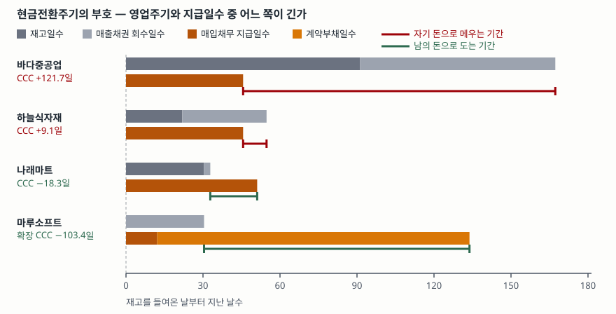

> 예제의 회사 `바다중공업`·`하늘식자재`·`나래마트`·`마루소프트`와 모든 숫자는 계산 원리를 보이려고 만든 가상 값이다. 실제 기업과 관계가 없다.

## 들어가며

동네에서 작은 가게를 하는 사람에게 장사가 어떠냐고 물으면 "남기는 남는데 통장에 돈이 없다"는 대답이 자주 돌아온다. 손익계산서상 이익은 났는데 월말마다 결제 대금이 모자라서 마이너스 통장을 쓴다. 그러면 보통은 이익률이 낮아서라고 생각하고 단가를 올리거나 비용을 줄이는 쪽을 먼저 본다. 그런데 같은 이익률로 장사하면서 통장에 현금이 쌓이는 가게도 있다. 차이는 마진이 아니라 **돈이 들어오고 나가는 순서**에 있고, 그 순서를 날수 하나로 요약한 것이 현금전환주기다.

## 개념

현금전환주기(cash conversion cycle, CCC)는 재고를 들여온 날부터 그 판매 대금을 회수하는 날까지의 기간에서, 그 재고의 매입 대금을 실제로 지급할 때까지의 기간을 뺀 날수다.

```text
현금전환주기 = 재고일수 + 매출채권 회수일수 − 매입채무 지급일수
```

세 날수는 모두 회전율의 역수에 365를 곱해 얻는다. 한국은행 기업경영분석은 회전율의 분자를 전부 매출액으로 두고, 분모에 각 항목의 기초·기말 평균잔액을 쓴다. 매출채권회전율 항목(809)은 "역수를 취하여 365일을 곱하면 평균회수기간을 계산할 수 있"다고 직접 적는다.

| 번호 | 지표 | 산식 | 해설에 붙은 경고 |
|---|---|---|---|
| 807 | 재고자산회전율 | 매출액 ÷ 재고자산 평균 | 재고를 적정수준 이하로 유지해도 높게 나온다 |
| 809 | 매출채권회전율 | 매출액 ÷ 매출채권 평균 | 판매전략을 강화하면 낮게 나올 수 있다 |
| 810 | 매입채무회전율 | 매출액 ÷ 매입채무 평균 | 신용도가 떨어져 매입기간을 짧게 받아도 높게 나온다 |

앞의 두 날수를 더한 것이 **영업주기**다. 재무제표 표시 기준서(K-IFRS 제1001호)의 정의로는 영업에 쓸 자산을 사들인 때부터 그것이 현금으로 돌아올 때까지의 기간이다(문단 68). 여기서 매입채무 지급일수를 빼는 이유는, 그 기간 동안 회사가 쓴 돈이 자기 돈이 아니라 공급처가 외상으로 빌려준 돈이기 때문이다.

그래서 현금전환주기는 **회사가 자기 돈으로 메워야 하는 날수**다. 이 값이 음수라는 것은 메울 일이 없다는 뜻을 넘어, 남의 돈이 남는다는 뜻이다. 회전율 자체의 해석과 3개년 추이는 [활동성 비율 글](../2026-10-02-activity-ratios-three-years/index.md)에서 다뤘고, 여기서는 부호가 갈리는 지점을 본다.

## 구조



> **출처**: [한국은행, 『기업경영분석』 통계정보보고서(2019.12) — 분석지표 해설 807 재고자산회전율, 809 매출채권회전율, 810 매입채무회전율](https://mods.go.kr/boardDownload.es?bid=12030&list_no=379918&seq=1) · [K-IFRS 제1001호 재무제표 표시 — 문단 68 영업주기](https://accountingwiki.co.kr/standards/1001) (제3자 전재) · [K-IFRS 제1115호 고객과의 계약에서 생기는 수익 — 문단 106 계약부채](https://accountingwiki.co.kr/standards/1115) (제3자 전재)

가로축은 재고를 들여온 날부터 지난 날수다. 위쪽 회색 막대가 영업주기, 아래쪽 주황 막대가 대금을 낼 때까지의 기간이다. 두 막대가 끝나는 날 사이가 현금전환주기이고, 회색이 더 길면 그 기간만큼 자기 돈이 나가 있어야 하므로 붉은색, 주황이 더 길면 그 기간만큼 남의 돈을 들고 있으므로 녹색이다. 마루소프트의 아래쪽 막대는 매입채무에 계약부채를 이어 붙인 것이다.

## 동작 원리

### 현금전환주기와 운전자본은 같은 정보다

세 회전율의 분자가 모두 매출액이면, 세 날수에 하루 매출을 곱한 값은 각각 매출채권·재고자산·매입채무의 평균잔액이 된다. 그래서 다음이 항등식으로 성립한다.

```text
현금전환주기 × 하루 매출 = 매출채권 + 재고자산 − 매입채무
```

오른쪽은 영업에 묶인 운전자본이다. 현금전환주기가 음수면 이 금액도 음수고, 음수인 운전자본은 **영업이 현금을 잡아먹는 대신 내놓고 있다**는 뜻이다.

### 음수는 거래 상대에게 빌린 돈이다

운전자본이 음수라는 것은 받을 돈과 쌓인 재고를 합친 것보다 낼 돈이 더 크다는 뜻이다. 회사는 그 차액만큼을 공급처의 돈으로 굴린다. 이자가 붙지 않지만 공짜는 아니다. 결제 기간을 길게 받으려면 매입 단가를 양보하거나, 그만한 구매력이 있어야 한다. 한국은행 해설이 매입채무회전율에 붙인 경고가 반대 방향에서도 성립한다. 지급일수가 길다는 사실만으로는 협상력이 좋은 것인지 결제를 미루고 있는 것인지 구별되지 않으므로, 매출채권회전율과 같이 본다.

### 선수금은 전통 산식에 잡히지 않는다

구독료나 공사 선수금을 미리 받는 회사는 고객의 돈도 쓴다. 이 돈은 매입채무가 아니라 **계약부채**로 잡힌다. 수익 기준서(K-IFRS 제1115호)는 계약부채를 "기업이 고객에게서 받은 대가에 상응하여 고객에게 재화나 용역을 이전하여야 하는 기업의 의무"로 정의한다(문단 106). 세 항목만 쓰는 전통 산식에는 이 자리가 없어서, 선수금으로 도는 회사가 현금전환주기 양수로 나오는 일이 생긴다. 산식에 계약부채일수를 빼는 항을 더하면 실제 자금 구조에 맞는다.

```text
확장 현금전환주기 = 재고일수 + 매출채권 회수일수 − 매입채무 지급일수 − 계약부채일수
```

### 성장과 역성장이 현금에 주는 방향이 뒤집힌다

회전일수가 그대로인 채 매출만 변하면 운전자본은 비례해서 움직인다.

```text
운전자본 증감 = 현금전환주기 × 하루 매출 증감
```

현금전환주기가 양수인 회사는 매출이 늘수록 운전자본이 늘어 현금이 빠진다. 성장하는 동안 계속 자금을 넣어야 한다는 뜻이다. 음수인 회사는 반대로 매출이 늘면 현금이 들어온다. 다만 이 관계는 매출이 줄 때도 그대로 뒤집혀 성립한다. 음수인 회사가 역성장하면 공급처에 낼 돈이 과거 매입분이라 먼저 나가고 들어올 돈은 줄어서, 그만큼 현금이 빠져나간다.

## 실습 예제

가상 회사 네 곳의 평균잔액을 두고 날수를 계산했다. 매입 조건과 판매 조건만 다르게 두어 부호가 갈리도록 설계한 값이다. 금액 단위는 억원이다.

전체 소스: [`code/`](code/) · 수행 기록: [`code/output.txt`](code/output.txt)

```text
[2] 회전율 (회) 과 회전일수 (일) — 분자는 셋 다 매출액
                            재고            매출채권            매입채무
                회전율      일수    회전율      일수    회전율      일수
바다중공업         4.0      91.2       4.8      76.0       8.0      45.6
하늘식자재        16.7      21.9      11.1      32.9       8.0      45.6
나래마트          12.0      30.4     150.0       2.4       7.1      51.1
마루소프트           -       0.0      12.0      30.4      30.0      12.2

[3] 현금전환주기와 영업에 묶인 운전자본
               영업주기   지급일수       CCC   하루매출   운전자본   CCC×하루매출
바다중공업        167.3       45.6     121.7       3.29      400.0          400.0
하늘식자재         54.8       45.6       9.1       5.48       50.0           50.0
나래마트           32.8       51.1     -18.3       8.22     -150.0         -150.0
마루소프트         30.4       12.2      18.2       1.64       30.0           30.0

[4] 계약부채(선수금)를 넣으면 — 전통 산식에 잡히지 않는 자금
               계약부채일수       CCC    확장 CCC   운전자본   확장 운전자본
바다중공업              0.0     121.7       121.7      400.0           400.0
하늘식자재              0.0       9.1         9.1       50.0            50.0
나래마트                0.0     -18.3       -18.3     -150.0          -150.0
마루소프트            121.7      18.2      -103.4       30.0          -170.0

[5] 매출이 늘거나 줄 때 운전자본이 움직이는 금액 (회전일수는 그대로)
                확장 CCC       매출 +20%       매출 -20%
바다중공업         121.7      +80.0 유출      -80.0 유입
하늘식자재           9.1      +10.0 유출      -10.0 유입
나래마트           -18.3      -30.0 유입      +30.0 유출
마루소프트        -103.4      -34.0 유입      +34.0 유출
```

네 회사의 매출액과 평균잔액 `[1]`, 그리고 매출채권 대 매입채무 `[6]`은 [`code/output.txt`](code/output.txt)에 있다.

`[3]`에서 현금전환주기는 121.7일, 9.1일, −18.3일, 18.2일로 갈린다. 바다중공업은 재고를 91.2일 들고 있고 대금을 76.0일 뒤에 받는데 매입 대금은 45.6일 만에 내야 해서, 121.7일치인 400억이 묶인다. 나래마트는 재고가 30.4일이고 카드 대금이 2.4일 만에 들어오는데 납품 대금은 51.1일 뒤에 내므로 −18.3일, 즉 150억이 남는다. 네 회사 모두 CCC × 하루 매출이 운전자본과 소수점 첫째 자리까지 같다.

`[4]`가 전통 산식의 빈자리다. 마루소프트는 CCC 18.2일로 바다중공업과 같은 쪽에 놓이지만, 구독료를 미리 받아 계약부채 200억을 들고 있다. 계약부채일수 121.7일을 빼면 확장 CCC는 −103.4일이고 확장 운전자본은 −170억이다. 세 항목만 보면 현금을 쓰는 회사로, 계약부채까지 보면 네 곳 중 가장 많이 남기는 회사로 읽힌다.

`[5]`에서 부호가 그대로 방향이 된다. 매출이 20% 늘면 바다중공업은 80억이 더 묶이고 나래마트는 30억이 들어온다. 매출이 20% 줄면 정확히 반대다. 나래마트는 30억, 마루소프트는 34억이 빠져나간다. 확장 CCC가 −103.4일로 가장 큰 마루소프트가 역성장에서 가장 크게 흔들린다. 음수 현금전환주기는 매출이 유지되거나 늘 때만 자금원이고, 꺾이는 순간 같은 크기의 상환 압력이 된다.

## 실무에서 주의할 점

- **분자를 맞추고 비교한다.** 한국은행 기업경영분석은 세 회전율의 분자를 모두 매출액으로 쓴다. 재고 쪽에 매출원가, 매입채무 쪽에 매입액을 쓰는 형태도 널리 쓰이는데, 매출원가로 계산하면 재고일수와 지급일수가 길게 나온다. 다른 자료의 날수와 나란히 놓기 전에 산식부터 확인한다. 분자를 바꿨을 때의 차이는 [매출채권과 재고자산 글](../../statements/2026-10-01-receivables-inventory-turnover/index.md)에서 봤다.
- **음수를 성적표로 읽지 않는다.** 현금전환주기는 사업 구조에서 나오는 값이다. 현금 매출이 많고 납품 조건이 긴 소매·플랫폼은 음수가 자연스럽고, 주문 제작으로 재고를 오래 들고 가는 업종은 양수가 자연스럽다. 구조가 다른 두 회사를 같은 날수로 줄 세우면 업종 차이를 경영 차이로 잘못 읽는다. 비교는 같은 회사의 추이나 같은 업종 안에서 한다.
- **음수 구조는 매출이 꺾일 때 반대로 작동한다.** `[5]`가 그 산술이다. 음수 현금전환주기로 도는 회사의 유동성을 볼 때는 매출 추세와 같이 본다. 성장이 멈추면 공급처에 낼 돈이 먼저 나가고 들어올 돈은 줄어든다.
- **계약부채가 있는 회사는 세 항목만으로 판단하지 않는다.** 구독·선수금 구조에서는 자금의 상당 부분이 계약부채에 있다. 재무상태표의 계약부채 잔액과 그 증감을 같이 보지 않으면, 실제로는 고객 돈으로 도는 회사를 현금이 묶인 회사로 읽게 된다.
- **지급일수가 길다는 사실만으로 협상력을 단정하지 않는다.** 한국은행 해설은 매입채무회전율이 높게 나오는 원인에 신용도 저하를 든다. 반대로 지급일수가 길어진 원인에는 협상력 강화뿐 아니라 결제 지연도 있다. 매입채무 잔액이 늘면서 매출이 제자리면 어느 쪽인지 따로 확인해야 한다.

## 정리

- 현금전환주기 = 재고일수 + 매출채권 회수일수 − 매입채무 지급일수이고, 회사가 자기 돈으로 메워야 하는 날수다.
- 현금전환주기 × 하루 매출 = 매출채권 + 재고자산 − 매입채무. 두 값은 같은 정보를 날수와 금액으로 적은 것이다.
- 음수는 거래 상대의 돈으로 영업이 돈다는 뜻이고, 예제에서 나래마트는 −18.3일로 150억이 남았다.
- 선수금은 계약부채라서 세 항목 산식에 잡히지 않는다. 마루소프트는 CCC 18.2일이지만 계약부채를 넣으면 −103.4일이다.
- 매출이 변하면 운전자본은 현금전환주기 × 하루 매출 증감만큼 움직인다. 음수 구조는 성장에서 현금을 만들고 역성장에서 같은 크기로 토해낸다.

## 참고 자료

- [한국은행, 『기업경영분석』 통계정보보고서(2019.12) — 분석지표 해설 807·809·810 회전율, 712 매출채권 대 매입채무, 713 순운전자본 대 총자본](https://mods.go.kr/boardDownload.es?bid=12030&list_no=379918&seq=1) — 통계청 정기통계품질진단 자료. 회전율 산식과 해석상 유의점
- [한국회계기준원 — 시행 중인 K-IFRS 기준서 목록](https://www.kasb.or.kr/front/board/ingAccountingList.do) — 기준서 원문(PDF·HWP) 발행처. 아래 전재 사이트는 문단을 바로 열기 위한 편의 링크다
- [K-IFRS 제1001호 재무제표 표시 — 문단 68 영업주기](https://accountingwiki.co.kr/standards/1001) (제3자 전재)
- [K-IFRS 제1115호 고객과의 계약에서 생기는 수익 — 문단 106 계약부채](https://accountingwiki.co.kr/standards/1115) (제3자 전재)
- [CFA Institute, Financial Analysis Techniques (2026 Curriculum, Level I)](https://www.cfainstitute.org/insights/professional-learning/refresher-readings/2026/financial-analysis-techniques) — 현금전환주기를 단순 비율이 아닌 유동성 척도로 분류한다
