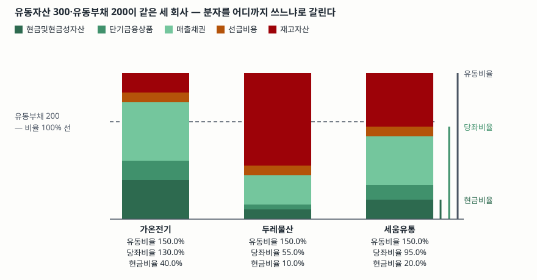

> 예제의 회사 `가온전기`·`두레물산`·`세움유통`과 모든 숫자는 계산 원리를 보이려고 만든 가상 값이다. 실제 기업과 관계가 없다.

## 들어가며

재무제표 요약 화면에는 유동비율이 한 줄로 나온다. 150%라고 적혀 있으면 1년 안에 갚을 돈의 1.5배를 1년 안에 현금이 될 자산으로 들고 있다는 뜻이니, 처음 보는 사람은 대개 거기서 판단을 끝낸다. 그런데 유동자산 300억·유동부채 200억으로 유동비율이 똑같이 150%인 세 회사를 놓고 그중 한 곳만 석 달 뒤 결제가 막힐 수 있다. 셋의 차이는 유동자산 안에서 재고가 얼마냐에 있고, 그 차이는 한 줄 아래 있는 당좌비율에서만 드러난다.

## 개념

한국은행 기업경영분석은 재무상태표 항목끼리 나눈 비율을 "자산·자본의 관계비율"로 묶고, 단기지급능력을 보는 지표를 분자의 범위만 좁혀 가며 셋 둔다.

| 번호 | 지표 | 산식 | 해설이 적은 것 |
|---|---|---|---|
| 702 | 유동비율 | 유동자산 ÷ 유동부채 × 100 | 높을수록 단기지급능력이 양호하나, 과다한 유동자산 보유는 수익성을 저해할 수 있다 |
| 703 | 당좌비율 | 당좌자산 ÷ 유동부채 × 100 | 현금화 속도가 늦거나 현금화의 불확실성이 큰 재고자산 등을 제외한다. 산성시험비율이라고도 한다 |
| 704 | 현금비율 | 현금및현금성자산 ÷ 유동부채 × 100 | 초단기 채무지급능력을 가늠한다 |

세 비율은 분모가 모두 유동부채고 분자만 다르다. 유동자산 전부, 거기서 재고자산을 뺀 당좌자산, 다시 현금및현금성자산만 남긴 것. 분자를 좁힐수록 "정말 제때 현금이 되는가"에 가까워지고, 그만큼 비율은 낮아진다.

해설의 표현을 그대로 읽어 둘 것이 하나 있다. 당좌비율 항목은 빼는 대상을 "재고자산 **등**"이라고 적는다. 재고자산이 대표적일 뿐 기준이 "현금화 속도가 늦거나 현금화의 불확실성이 큰" 항목이라는 뜻이고, 이 기준을 어디까지 적용하느냐에 따라 분자가 달라진다. 집계에서는 당좌자산을 유동자산에서 재고자산을 뺀 금액으로 잡는다.

유동·비유동을 가르는 기준 자체는 [유동과 비유동을 왜 나누는가](../../statements/2026-09-29-current-vs-noncurrent/index.md)에서, 부채비율과 묶어 본 안정성 비율은 [안정성 비율 글](../2026-10-01-leverage-and-current-ratio/index.md)에서 다뤘다.

## 구조



> **출처**: [한국은행, 『기업경영분석』 통계정보보고서(2019.12) — 분석지표 해설 702 유동비율, 703 당좌비율, 704 현금비율](https://mods.go.kr/boardDownload.es?bid=12030&list_no=379918&seq=1)

막대 하나가 한 회사의 유동자산 300억이고, 아래에서부터 현금에 가까운 순서로 쌓았다. 점선은 유동부채 200억이다. 막대가 점선을 넘은 높이만큼 비율이 100%를 넘는다. 오른쪽 세로선은 세 비율의 분자가 아래에서부터 어디까지를 덮는지 표시한 것이다. 세 막대의 전체 높이는 같지만, 붉은 재고자산 칸의 크기가 달라 당좌비율 선이 점선 위에 있기도 하고 아래에 있기도 하다.

## 동작 원리

### 두 비율의 간격은 재고 비중 그 자체다

당좌자산이 유동자산에서 재고자산을 뺀 금액이면, 두 비율을 분모가 같은 분수로 보고 빼면 바로 정리된다.

```text
유동비율 − 당좌비율 = 재고자산 ÷ 유동부채 × 100
```

두 비율을 같이 적는 이유가 여기 있다. 간격이 곧 유동부채 대비 재고 규모다. 유동비율이 같은 두 회사에서 간격이 20%p와 95%p로 벌어졌다면, 그것만으로 한쪽이 유동부채의 95%에 해당하는 재고를 안고 있다는 정보가 된다.

### 재고를 빼는 근거는 장부금액이 회수 금액이 아니라는 데 있다

매출채권은 받으면 그 금액이 현금이지만 재고는 팔려야 현금이 되고, 팔리는 금액이 장부금액과 같다는 보장이 없다. 재고자산 기준서(K-IFRS 제1002호)는 재고자산을 "취득원가와 순실현가능가치 중 낮은 금액으로 측정한다"고 정하고(문단 9), 순실현가능가치를 "통상적인 영업과정의 예상 판매가격에서 예상되는 추가 완성원가와 판매비용을 차감한 금액"으로 정의한다(문단 6). 통상적인 영업과정을 전제로 한 금액이므로, 급하게 처분해야 하는 상황에서 받을 수 있는 금액은 그보다 낮을 수 있다.

시간도 걸린다. 재고는 팔려서 매출채권이 되고 그 채권이 회수되어야 현금이 되므로 두 단계를 거친다. 그 날수가 [현금전환주기](../2026-10-13-cash-conversion-cycle-negative/index.md)의 재고일수와 매출채권 회수일수다. 재고일수가 긴 회사일수록 같은 유동비율이 더 먼 현금을 가리킨다.

### 기말의 같은 거래가 두 비율을 반대로 민다

유동자산 A, 당좌자산 Q, 유동부채 L인 회사가 기말에 현금 x로 유동부채를 갚으면 유동비율은 (A−x)/(L−x), 당좌비율은 (Q−x)/(L−x)가 된다. 분자와 분모에서 같은 금액을 빼는 것이므로, 원래 비율이 100%보다 높았으면 비율이 올라가고 낮았으면 내려간다. 차입으로 현금을 늘리면 방향이 반대다.

여기서 조건을 가르는 것은 각 비율의 분자다. 유동비율이 100%를 넘고 당좌비율이 100%에 못 미치는 회사는 같은 상환으로 유동비율은 올라가고 당좌비율은 내려간다. 재고를 많이 안고 있는 회사일수록 이 구간에 놓이기 쉽다. 기말 하루의 자금 조정으로 유동비율을 손볼 수 있다는 뜻이므로, 비율이 한 시점 잔액으로 계산된다는 사실을 같이 본다.

### 분자 정의가 바뀌면 비율도 바뀐다

당좌자산에는 선급비용처럼 현금으로 회수되지 않고 비용으로 대체되는 항목도 남는다. 유동부채를 갚는 데 쓸 수 없는 자산이므로 이것까지 빼고 보는 계산도 할 수 있는데, 그러면 당좌비율은 선급비용 ÷ 유동부채만큼 낮아진다. 어느 쪽이 맞다기보다, 출처가 다른 두 당좌비율을 나란히 놓기 전에 분자가 같은지 확인해야 한다는 뜻이다. 분자에 단기금융상품을 넣느냐로 갈리는 현금비율 쪽 사정은 [현금성자산과 단기금융상품](../../statements/2026-10-13-cash-equivalents-and-short-term-deposits/index.md)에서 봤다.

## 실습 예제

세 회사의 유동자산 합계 300억과 유동부채 200억을 같게 맞추고 구성만 다르게 뒀다. 금액 단위는 억원이다.

전체 소스: [`code/`](code/) · 수행 기록: [`code/output.txt`](code/output.txt)

```text
[1] 유동 항목 구성 — 합계와 유동부채는 세 회사가 같다 (억원)
             현금및현금성자산  단기금융상품  매출채권  재고자산  선급비용  유동자산  유동부채
가온전기                   80            40       120        40        20       300       200
두레물산                   20            10        60       190        20       300       200
세움유통                   40            30       100       110        20       300       200

[2] 세 비율 — 분자를 어디까지 쓰는가 (%)
               유동비율    당좌비율    현금비율
가온전기          150.0       130.0        40.0
두레물산          150.0        55.0        10.0
세움유통          150.0        95.0        20.0

[3] 두 비율의 간격은 재고자산 ÷ 유동부채와 같다 (%p)
              유동비율-당좌비율   재고÷유동부채
가온전기                   20.0            20.0
두레물산                   95.0            95.0
세움유통                   55.0            55.0

[5] 기말에 현금 20을 움직이면 — 같은 거래가 두 비율을 반대로 민다 (%)
           거래                      유동비율    당좌비율
가온전기   그대로                       150.0       130.0
           현금 20으로 유동부채 상환       155.6       133.3
           단기차입 20 일으킴           145.5       127.3
두레물산   그대로                       150.0        55.0
           현금 20으로 유동부채 상환       155.6        50.0
           단기차입 20 일으킴           145.5        59.1
세움유통   그대로                       150.0        95.0
           현금 20으로 유동부채 상환       155.6        94.4
           단기차입 20 일으킴           145.5        95.5

[6] 재고를 장부금액의 70%에 처분하면 (%)
               유동비율    당좌비율    처분손실
가온전기          144.0       144.0        12.0
두레물산          121.5       121.5        57.0
세움유통          133.5       133.5        33.0
```

선급비용까지 뺀 계산 `[4]`는 [`code/output.txt`](code/output.txt)에 있다. 세 회사 모두 선급비용이 20억이고 유동부채가 200억이라 당좌비율이 정확히 10%p씩 내려간다.

`[2]`에서 유동비율은 셋 다 150.0%인데 당좌비율은 130.0%, 55.0%, 95.0%로 갈린다. 두레물산은 유동자산 300억 중 190억이 재고라서, 재고를 빼면 유동부채의 절반을 갓 넘는 당좌자산만 남는다. 현금비율로 더 좁히면 40.0%, 10.0%, 20.0%다.

`[3]`이 그 차이가 어디서 왔는지를 한 줄로 보여 준다. 유동비율에서 당좌비율을 뺀 값이 재고자산 ÷ 유동부채와 세 회사 모두 소수점 첫째 자리까지 같다. 두 비율을 같이 적어 두면 재고 금액을 따로 찾지 않아도 유동부채 대비 재고 규모를 읽을 수 있다.

`[5]`에서 같은 거래가 방향을 달리한다. 현금 20억으로 유동부채를 갚으면 세 회사 모두 유동비율은 150.0%에서 155.6%로 올라간다. 당좌비율은 가온전기만 130.0%에서 133.3%로 오르고, 두레물산은 55.0%에서 50.0%로, 세움유통은 95.0%에서 94.4%로 내려간다. 당좌비율이 100%에 못 미치던 두 회사에서 방향이 뒤집힌 것이다. 단기차입을 일으키면 정확히 반대로 움직인다.

`[6]`은 재고가 장부금액대로 현금이 되지 않을 때다. 70%에 처분하면 두레물산은 손실 57억이 나고 유동비율이 150.0%에서 121.5%로 떨어진다. 처분 뒤에는 재고가 없으므로 유동비율과 당좌비율이 같은 값으로 만난다. 당좌비율은 55.0%에서 121.5%로 올랐는데, 이는 유동성이 좋아진 것이 아니라 재고가 현금으로 바뀌면서 30%를 잃은 결과다.

## 실무에서 주의할 점

- **적정 수준을 한 숫자로 정하지 않는다.** 한국은행 해설은 유동비율과 당좌비율에 표준비율을 제시하지 않는다. 표준비율을 든 것은 비유동비율과 비유동장기적합률뿐이고, 둘 다 100% 이하를 든다. "유동비율 200% 이상이 안전하다" 같은 기준선을 쓰려면 그 기준이 어느 자료의 것인지부터 밝혀야 한다.
- **업종이 다르면 비교하지 않는다.** 재고를 오래 들고 가는 업종과 현금 매출이 많은 업종은 유동자산 구성부터 다르다. 비교가 필요하면 한국은행 기업경영분석처럼 업종별로 공표된 집계를 쓰고, 같은 업종 안에서 본다.
- **기말 한 시점의 잔액이라는 점을 잊지 않는다.** `[5]`가 그 산술이다. 기말 며칠 동안의 상환이나 차입으로 비율이 움직이므로, 한 해의 값 하나보다 여러 기의 추이를 본다.
- **분자 정의를 맞추고 비교한다.** 당좌자산을 유동자산에서 재고자산만 뺀 것으로 보는지, 선급비용 같은 항목까지 뺀 것으로 보는지에 따라 값이 달라진다. 예제에서는 10%p 차이가 났다.
- **재고 평가방법이 분자와 간격을 동시에 움직인다.** 재고자산은 취득원가와 순실현가능가치 중 낮은 금액으로 측정하므로(제1002호 문단 9), 평가손실을 인식하면 유동자산과 유동비율이 내려가고 당좌비율은 그대로다. 두 비율의 간격이 좁아졌다면 재고를 줄인 것인지 평가손실을 반영한 것인지 주석에서 확인한다.

## 정리

- 유동비율·당좌비율·현금비율은 분모가 모두 유동부채고 분자만 유동자산 → 당좌자산 → 현금및현금성자산으로 좁아진다.
- 유동비율 − 당좌비율 = 재고자산 ÷ 유동부채. 두 비율의 간격이 곧 유동부채 대비 재고 규모다.
- 재고를 빼는 근거는 재고가 장부금액대로, 제때 현금이 되지 않을 수 있다는 데 있다. 예제에서 70%에 처분하자 두레물산은 57억을 잃었다.
- 기말에 현금으로 유동부채를 갚으면 비율이 100%보다 높았던 쪽만 올라간다. 같은 거래가 유동비율은 올리고 당좌비율은 내릴 수 있다.
- 한국은행 해설은 유동비율·당좌비율에 표준비율을 두지 않는다. 기준선을 쓰려면 출처를 밝힌다.

## 참고 자료

- [한국은행, 『기업경영분석』 통계정보보고서(2019.12) — 분석지표 해설 702 유동비율, 703 당좌비율, 704 현금비율, 705 비유동비율, 706 비유동장기적합률](https://mods.go.kr/boardDownload.es?bid=12030&list_no=379918&seq=1) — 통계청 정기통계품질진단 자료. 산식과 해석상 유의점, 표준비율을 둔 지표와 두지 않은 지표
- [한국회계기준원 — 시행 중인 K-IFRS 기준서 목록](https://www.kasb.or.kr/front/board/ingAccountingList.do) — 기준서 원문(PDF·HWP) 발행처. 아래 전재 사이트는 문단을 바로 열기 위한 편의 링크다
- [K-IFRS 제1002호 재고자산 — 문단 6 순실현가능가치, 문단 9 저가법](https://accountingwiki.co.kr/standards/1002) (제3자 전재)
- [K-IFRS 제1001호 재무제표 표시 — 문단 66·69 유동 항목의 분류](https://accountingwiki.co.kr/standards/1001) (제3자 전재)
