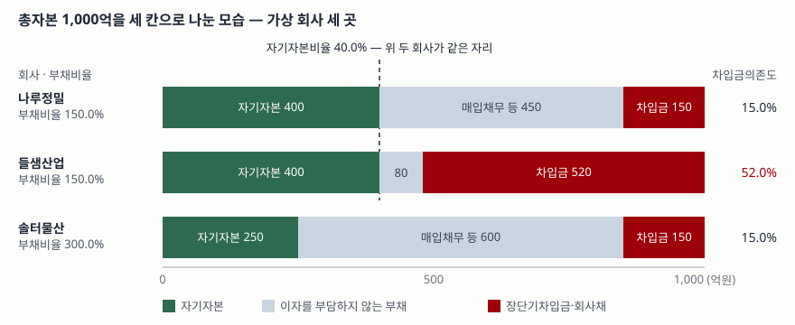

> 예제의 회사 `나루정밀`·`들샘산업`·`솔터물산`과 모든 숫자는 계산 원리를 보이려고 만든 가상 값이다. 실제 기업과 관계가 없다.

## 들어가며

기업의 재무 안정성을 한 줄로 적으라면 대개 부채비율이 나온다. 150%라고 적혀 있으면 빌린 돈이 자기 돈의 1.5배라는 뜻이고, 숫자가 내려가면 좋아졌다고 읽는다. 그런데 부채 600억 중 450억이 거래처에 아직 결제하지 않은 매입채무인 회사와, 같은 600억 중 520억이 은행 차입금과 회사채인 회사가 있다. 부채비율은 둘 다 150%다. 앞의 회사는 이자를 연 7억 조금 넘게 내고 뒤의 회사는 26억을 낸다. 부채비율만으로는 이 차이가 보이지 않고, 한국은행 기업경영분석이 안정성 지표를 여럿 두는 이유도 거기 있다.

## 개념

안정성 비율은 재무상태표 항목끼리 나눈 것이라 한 시점의 잔액을 쓴다. 한국은행 기업경영분석은 이 묶음을 "자산·자본의 관계비율"로 부르고, 재무구조를 보는 지표를 분자와 분모를 바꿔 가며 여럿 둔다.

| 번호 | 지표 | 산식 | 해설이 적은 것 |
|---|---|---|---|
| 701 | 자기자본비율 | 자기자본 ÷ 총자본 × 100 | 총자본 중 자기자본이 차지하는 비중을 나타내는 대표적인 재무구조 지표. 자기자본은 금융비용을 부담하지 않고 운용할 수 있는 자본이므로 높을수록 안정성이 높다 |
| 707 | 부채비율 | (유동부채 + 비유동부채) ÷ 자기자본 × 100 | 타인자본과 자기자본 간의 관계를 나타내는 대표적인 안정성 지표. 자기자본비율과 역(逆)의 관계에 있다 |
| 710 | 차입금의존도 | (장단기차입금 + 회사채) ÷ 총자본 × 100 | 총자본 중 외부에서 조달한 차입금 비중. 높을수록 금융비용 부담이 가중되어 수익성이 저하되고 안정성도 낮아진다 |

총자본은 자기자본과 타인자본을 더한 금액이고, 재무상태표의 차변에서 보면 총자산과 같다. 세 지표 중 둘은 분모가 총자본이고 하나는 자기자본이다.

갈라지는 지점은 분자다. 자기자본비율과 부채비율은 부채를 한 덩어리로 보고 자기자본과 견주며, 차입금의존도는 **부채 안쪽을 가른다.** 금융비용 대 부채 항목(624)이 그 기준을 적어 둔다. 기업의 부채에는 차입금처럼 이자를 부담하는 이자부부채와, 매입채무·선수금·충당금처럼 이자를 부담하지 않는 비이자부부채가 있다는 것이다. 차입금의존도의 분자는 앞쪽만 센다.

안정성 지표 전반과 업종별 수치를 함께 본 글은 [부채비율이 같은 네 회사](../2026-10-01-leverage-and-current-ratio/index.md)에, 차입금과 사채가 각각 재무상태표에 어떻게 남는지는 [유효이자율법 글](../../statements/2026-10-12-bonds-effective-interest/index.md)에 있다.

## 구조



> **출처**: [한국은행, 『기업경영분석』 통계정보보고서(2019.12) — 분석지표 해설 701 자기자본비율, 707 부채비율, 710 차입금의존도, 624 금융비용 대 부채](https://mods.go.kr/boardDownload.es?bid=12030&list_no=379918&seq=1)

막대 하나가 한 회사의 총자본 1,000억이고, 왼쪽부터 자기자본·이자를 부담하지 않는 부채·장단기차입금과 회사채 순으로 쌓았다. 초록 칸의 길이가 자기자본비율이고 붉은 칸의 길이가 차입금의존도다. 부채비율은 초록 칸을 뺀 나머지를 초록 칸으로 나눈 값이라 막대 위에서 길이로 읽히지 않는다. 위 두 회사는 초록 칸 끝이 한 점선 위에 모여 있는데도 붉은 칸이 150억과 520억으로 벌어진다.

## 동작 원리

### 자기자본비율과 부채비율은 같은 정보다

자산은 부채와 자본의 합이므로 자기자본비율을 알면 부채비율이 따라 나온다. 자기자본비율을 `e`(%)라 하면 총자본 100 중 자기자본이 `e`, 부채가 `100 − e`이므로 이렇게 된다.

```text
부채비율 = (100 ÷ 자기자본비율 − 1) × 100
```

예제 `[3]`이 세 회사에서 이 식을 검산한다. 자기자본비율 40.0%는 부채비율 150.0%와 같은 말이고, 25.0%는 300.0%와 같은 말이다. 한국은행 해설이 둘을 "역의 관계"라고 적은 것이 이 뜻이다. **같은 자료에서 두 지표를 모두 보고 있다면 새 정보는 하나뿐이다.**

### 차입금의존도는 부채를 다른 선으로 자른다

같은 부채 600억이라도 매입채무 450억과 차입금 150억으로 된 것과, 매입채무 80억과 차입금 520억으로 된 것은 성격이 다르다. 매입채무는 거래처와의 결제 조건에서 생기고 보통 이자가 붙지 않으며, 매출이 늘면 같이 늘고 줄면 같이 준다. 차입금은 계약한 날에 원금을 갚아야 하고 그때까지 이자가 붙는다.

차입금의존도는 이 차이를 지표로 끌어낸 것이고, 그래서 **자기자본비율·부채비율과 독립이다.** 예제 `[6]`이 독립이라는 것을 보여 준다. 매입채무 100억을 단기차입금으로 바꾸면 부채총계가 그대로라 자기자본비율 40.0%와 부채비율 150.0%는 꿈쩍도 하지 않는데, 차입금의존도는 15.0%에서 25.0%로 10.0%p 오르고 이자비용은 7.5억에서 12.5억으로 늘어난다.

### 차입금의존도가 수익성에 닿는 경로

한국은행 해설은 차입금의존도가 높으면 금융비용 부담이 가중되어 수익성이 저하된다고 적는데, 그 경로를 금융비용 대 매출액 항목(627)에서 식으로 풀어 둔다. 이자비용을 매출액으로 나눈 값은 세 조각의 곱으로 분해된다.

```text
금융비용 대 매출액 = 차입금평균이자율 × 차입금의존도 ÷ 총자산회전율
```

차입금의존도가 가운데 조각이다. 같은 금리와 같은 회전율에서 차입금의존도가 15.0%에서 52.0%로 올라가면 매출액 대비 이자 부담도 그 배수만큼 올라간다. 예제 `[5]`가 세 조각의 곱과 직접 계산한 값이 소수점 셋째 자리까지 맞는지 확인한다. 오른쪽 끝에 회전율이 나뉘어 있으므로, 같은 차입금을 지고도 자산을 빨리 돌리는 회사는 부담이 가볍다.

### 업종 비교에는 분모가 총자본인 쪽이 편하다

자기자본비율과 차입금의존도는 분모가 총자본이라 값이 0%와 100% 사이에 들어온다. 부채비율은 분모가 자기자본이라 자기자본이 작아질수록 커지고, [자본잠식](../../statements/2026-10-12-capital-impairment-ratio/index.md)으로 자기자본이 음수가 되면 부채비율도 음수로 찍혀 비교 자체가 불가능해진다. 업종이 다른 회사들을 한 표에 늘어놓거나 한 회사의 여러 해를 선으로 이을 때 자기자본비율 쪽이 다루기 쉬운 이유다.

다만 분모가 같다고 해서 업종을 가로질러 비교해도 된다는 뜻은 아니다. 매입채무가 많은 유통업과 설비 차입이 큰 장치산업은 같은 자기자본비율에서도 붉은 칸의 길이가 다르다. 비교는 같은 업종 안에서 하고, 업종 평균이 필요하면 공표된 집계를 그대로 인용한다.

## 실습 예제

세 회사의 총자본 1,000억과 매출액 1,200억, 영업이익 120억을 같게 맞추고 부채의 구성만 다르게 뒀다. 금액 단위는 억원이고, 차입금평균이자율은 연 5.0%로 가정했다.

전체 소스: [`code/`](code/) · 수행 기록: [`code/output.txt`](code/output.txt)

```text
[1] 총자본의 구성 — 총자본 1,000은 세 회사가 같다 (억원)
             자기자본  매입채무 등  단기차입금  장기차입금   회사채  차입금 계  부채총계   총자본
나루정밀          400          450          80          70        0        150       600    1,000
들샘산업          400           80         200         220      100        520       600    1,000
솔터물산          250          600          90          60        0        150       750    1,000

[2] 세 지표 — 같은 부채총계가 다르게 읽힌다 (%)
             자기자본비율  부채비율  차입금의존도
나루정밀             40.0     150.0          15.0
들샘산업             40.0     150.0          52.0
솔터물산             25.0     300.0          15.0

[3] 자기자본비율과 부채비율은 같은 정보다 (%)
             자기자본비율   환산한 부채비율   실제 부채비율
나루정밀             40.0             150.0           150.0
들샘산업             40.0             150.0           150.0
솔터물산             25.0             300.0           300.0

[4] 차입금에 연 5.0% 이자가 붙으면 (억원, %)
              차입금  이자비용  영업이익  이자보상비율
나루정밀         150       7.5       120       1,600.0
들샘산업         520      26.0       120         461.5
솔터물산         150       7.5       120       1,600.0

[6] 나루정밀이 매입채무 100을 단기차입금으로 바꾸면
                부채총계  자기자본비율  부채비율  차입금의존도  이자비용  이자보상비율
바꾸기 전            600          40.0     150.0          15.0       7.5       1,600.0
바꾼 뒤              600          40.0     150.0          25.0      12.5         960.0
```

`[2]`가 이 글의 요지다. 나루정밀과 들샘산업은 자기자본비율 40.0%, 부채비율 150.0%로 두 지표가 모두 같은데 차입금의존도는 15.0%와 52.0%다. 반대로 나루정밀과 솔터물산은 차입금의존도가 15.0%로 같은데 부채비율은 150.0%와 300.0%다. 세 지표를 같이 적어야 셋이 서로 다른 회사라는 것이 드러난다.

`[1]`에서 그 구조가 보인다. 솔터물산은 부채가 750억으로 가장 많지만 그중 600억이 매입채무고 차입금은 150억뿐이다. 부채비율 300.0%만 보면 셋 중 가장 불안해 보이는데, 이자를 물리는 부채만 놓고 보면 나루정밀과 같은 규모다.

`[4]`가 그 결과를 금액으로 보인다. 차입금에 연 5.0%를 물리면 들샘산업만 이자비용이 26.0억이고 나머지 둘은 7.5억이다. 영업이익이 셋 다 120억이므로 이자보상비율(629)은 1,600.0%와 461.5%로 갈린다. 솔터물산의 부채비율이 두 배라고 해서 이자 부담이 두 배인 것이 아니다.

`[6]`은 두 선이 독립이라는 것을 한 거래로 보인다. 매입채무 100억을 단기차입금으로 바꾸기만 하면 부채총계가 600억 그대로라 자기자본비율과 부채비율은 움직이지 않는데, 차입금의존도는 10.0%p 오르고 이자보상비율은 1,600.0%에서 960.0%로 내려간다. 결제 조건을 바꿔 외상 기간을 줄이고 그만큼 은행에서 빌리면 실제로 일어나는 일이다.

`[5]`의 분해 검산은 [`code/output.txt`](code/output.txt)에 있다. 차입금평균이자율 5.0%, 차입금의존도, 총자산회전율 1.20의 조합이 금융비용 대 매출액과 세 회사 모두 소수점 셋째 자리까지 일치한다.

## 실무에서 주의할 점

- **두 지표를 보고 있다고 착각하지 않는다.** 자기자본비율과 부채비율은 서로 환산되는 같은 정보다. 재무구조를 두 각도에서 보려면 분자를 다르게 자르는 차입금의존도 같은 지표를 같이 봐야 한다.
- **차입금의존도의 분자 범위를 맞춘다.** 한국은행 산식은 장단기차입금과 회사채를 센다. 리스부채나 전환사채를 포함한 다른 자료의 숫자와 나란히 놓기 전에 분자가 같은지 확인한다.
- **매입채무가 늘어 부채비율이 올라간 것과 차입이 늘어 올라간 것을 구분한다.** 앞쪽은 매출이 늘면서 같이 커지는 경우가 많고 이자가 붙지 않는다. 두 경우는 같은 부채비율 상승으로 보이므로, 차입금의존도의 추이를 같이 본다.
- **적정 수준을 한 숫자로 정하지 않는다.** 한국은행 해설은 자기자본비율·부채비율·차입금의존도에 표준비율을 제시하지 않는다. 표준비율을 든 것은 비유동비율과 비유동장기적합률뿐이고 둘 다 100% 이하를 든다. 기준선을 쓰려면 그 기준이 어느 자료의 것인지부터 밝힌다.
- **기말 한 시점의 잔액이라는 점을 잊지 않는다.** 세 지표 모두 재무상태표 잔액으로 계산되므로 기말 며칠의 상환이나 차입으로 움직인다. 한 해의 값 하나보다 여러 기의 추이를 본다.

## 정리

- 자기자본비율(701)·부채비율(707)·차입금의존도(710)는 같은 재무상태표를 서로 다른 선으로 자른다. 앞의 둘은 부채를 한 덩어리로 보고, 마지막 하나는 부채 안에서 이자부부채만 센다.
- 자기자본비율과 부채비율은 서로 환산된다. 부채비율 = (100 ÷ 자기자본비율 − 1) × 100이고, 예제의 40.0%는 150.0%와 같은 말이다.
- 차입금의존도는 그 환산식에서 나오지 않는다. 예제에서 자기자본비율과 부채비율이 똑같은 두 회사의 차입금의존도가 15.0%와 52.0%로 갈렸다.
- 차입금의존도가 수익성에 닿는 경로는 식으로 적혀 있다. 금융비용 대 매출액 = 차입금평균이자율 × 차입금의존도 ÷ 총자산회전율.
- 분모가 총자본인 지표는 0~100% 범위에 들어와 추이를 잇기 쉽다. 부채비율은 자기자본이 음수가 되면 비교가 불가능해진다.

## 참고 자료

- [한국은행, 『기업경영분석』 통계정보보고서(2019.12) — 분석지표 해설 624 금융비용 대 부채, 625 차입금평균이자율, 627 금융비용 대 매출액, 629 이자보상비율, 701 자기자본비율, 705 비유동비율, 706 비유동장기적합률, 707 부채비율, 710 차입금의존도, 801 총자산회전율](https://mods.go.kr/boardDownload.es?bid=12030&list_no=379918&seq=1) — 통계청 정기통계품질진단 자료. 산식과 해설, 이자부부채와 비이자부부채의 구분, 금융비용 대 매출액의 분해식, 표준비율을 둔 지표와 두지 않은 지표
- [한국은행, 「2024년 1/4분기 기업경영분석 결과」(2024.6.20 발표)](https://www.bok.or.kr/portal/bbs/B0000501/view.do?menuNo=201263&nttId=10084718) — 업종별·규모별 부채비율과 차입금의존도 표, 손익항목과 자산·부채 관계비율에 기초·기말 평균을 쓴다는 이용상 유의사항
- [한국회계기준원 — 시행 중인 K-IFRS 기준서 목록](https://www.kasb.or.kr/front/board/ingAccountingList.do) — 기준서 원문(PDF·HWP) 발행처
