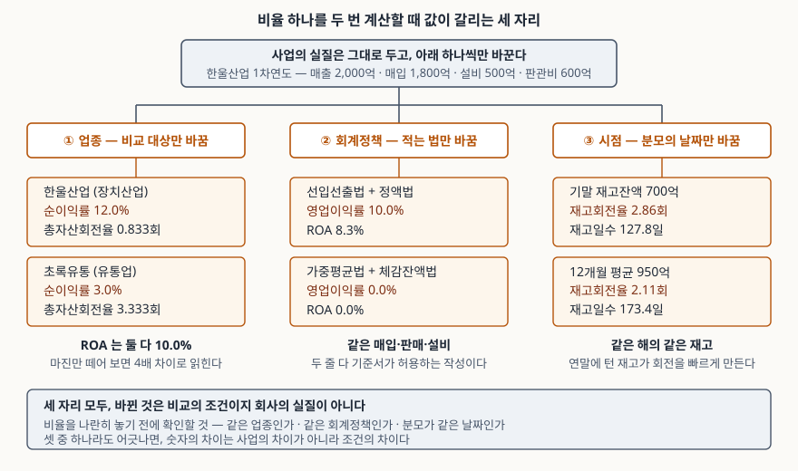

> 예제의 회사 `한울산업`·`초록유통`과 모든 숫자는 계산 원리를 보이려고 만든 가상 값이다. 실제 기업과 관계가 없다.

## 들어가며

재무제표를 처음 들여다볼 때는 비율부터 손에 잡힌다. 영업이익률, ROA, 부채비율, 재고회전율. 공식도 간단하고 계산기만 있으면 나오니, 관심 가는 회사 몇 곳의 값을 엑셀에 나란히 적어 놓고 높은 쪽과 낮은 쪽을 가른다. 그런데 그 표를 들고 다른 사람과 이야기해 보면 "그 회사는 원래 그렇다"는 대답이 자주 돌아온다. 숫자를 잘못 뽑은 것도 아닌데 비교 자체가 성립하지 않았다는 뜻이다. 비율이 틀리는 자리는 계산이 아니라 **비교의 조건**에 있고, 어긋나는 자리는 대개 셋 중 하나다.

## 개념

비율은 분자와 분모를 나눈 값이다. 그래서 비율이 다르다는 사실은 세 가지 중 하나를 뜻한다. 사업의 실질이 다르거나, 같은 실질을 **다르게 적었거나**, 같은 장부를 **다른 날짜로 끊었거나**.

분석이 쓸모 있으려면 뒤의 둘을 걷어내고 첫째만 남겨야 한다. 그런데 뒤의 둘은 잘못된 작성이 아니다. 회계기준은 같은 거래에 대해 복수의 처리를 허용하고, 어느 쪽을 고르든 적법하다. 재고자산 기준서(K-IFRS 제1002호)는 단위원가를 "선입선출법이나 가중평균법을 사용하여 결정한다"고 적어 둘을 나란히 둔다(문단 25). 유형자산 기준서(제1016호)도 정액법·체감잔액법·생산량비례법을 들고 "미래경제적효익의 예상 소비형태를 가장 잘 반영하는 방법"을 고르라고만 한다(문단 60·62).

고르는 것은 회사이고, 고른 결과가 비율에 그대로 실린다. 여기에 업종 차이와 날짜 선택을 더하면 **셋이 비율 비교가 깨지는 전부**다.

| 자리 | 무엇이 다른가 | 실질이 다른가 |
|---|---|---|
| 업종 | 분자와 분모의 크기 비례가 구조적으로 다르다 | 다르다 — 다만 우열이 아니다 |
| 회계정책 | 같은 거래를 다른 방법으로 적었다 | 같다 |
| 시점 | 같은 장부를 다른 날짜·다른 평균으로 끊었다 | 같다 |

가운데 둘은 실질이 같은데 숫자가 다른 경우라서 특히 위험하다. 틀렸다는 표시가 어디에도 붙지 않기 때문이다.

## 구조



> **출처**: [K-IFRS 제1002호 재고자산 — 문단 25·27 원가결정방법](https://accountingwiki.co.kr/standards/1002) (제3자 전재) · [K-IFRS 제1016호 유형자산 — 문단 60·62 감가상각방법](https://accountingwiki.co.kr/standards/1016) (제3자 전재) · [K-IFRS 제1008호 회계정책, 회계추정치 변경과 오류 — 문단 36 전진적용](https://accountingwiki.co.kr/standards/1008) (제3자 전재) · [한국은행, 『기업경영분석』 통계정보보고서(2019.12) — 분석지표 해설 807 재고자산회전율](https://mods.go.kr/boardDownload.es?bid=12030&list_no=379918&seq=1)

가운데 줄이 출발점이다. 매출 2,000억, 매입 1,800억, 설비 500억, 판관비 600억으로 한 해를 보낸 회사 하나. 세 갈래는 각각 비교 대상만, 적는 방법만, 분모의 날짜만 바꾼 결과다. 회사가 무엇을 사고 팔았는지는 세 갈래 어디에서도 바뀌지 않는다.

## 동작 원리

### 업종 — 마진과 회전율은 서로를 메운다

업종 차이가 가장 먼저 드러나는 곳은 듀폰 분해다. 총자산이익률은 매출액순이익률과 총자산회전율의 곱이다.

```text
ROA = (순이익 ÷ 매출액) × (매출액 ÷ 총자산)
```

오른쪽 두 항의 매출액이 약분되므로, **마진이 낮은 업종은 회전율로 메워야 같은 ROA가 나온다.** 유통업이 마진 3%로 버티는 것은 경영이 나빠서가 아니라 같은 자산으로 매출을 네 배 돌리기 때문이고, 장치산업이 마진 12%를 내는 것은 자산을 한 번도 채 못 돌리기 때문이다. 마진만 떼어 두 업종을 줄 세우면 이 구조가 통째로 사라진다. 듀폰 분해를 세 항으로 늘렸을 때 자기자본이익률이 어떻게 갈라지는지는 [듀폰 분해 글](../2026-10-02-dupont-roe-three-factors/index.md)에서 다뤘다.

유동비율도 같다. 현금으로 팔고 대금을 늦게 내는 업종은 매출채권이 거의 없고 매입채무가 크다. 유동비율의 분자는 작아지고 분모는 커지니 구조적으로 낮게 나온다. 이 구조는 [현금전환주기 글](../2026-10-13-cash-conversion-cycle-negative/index.md)에서 본 음수 운전자본과 같은 사실을 다른 비율로 적은 것이다.

### 회계정책 — 허용된 선택이 비율을 만든다

재고 쪽부터 본다. 매입 단가가 오르는 국면에서 선입선출법은 "먼저 매입·생산된 항목이 먼저 판매된다"고 보므로(문단 27) 오래된 싼 원가가 매출원가로 나가고 최근의 비싼 원가가 기말재고에 남는다. 가중평균법은 전체를 평균 내므로 그 사이에 놓인다. 매출원가가 작아지면 매출총이익률이 올라가고, 동시에 기말재고가 커지니 재고회전율은 내려간다. **한 선택이 수익성 비율과 활동성 비율을 반대 방향으로 민다.**

감가상각은 방향이 시간에 걸려 있다. 체감잔액법은 "내용연수 동안 감가상각액이 매 기간 감소하는 방법"이므로(문단 62) 초기에 많이 상각하고 뒤로 갈수록 줄어든다. 5년 합계는 정액법과 같지만 1차연도 영업이익은 갈리고, 상각이 빠른 쪽은 장부금액도 빨리 줄어 총자산이 작아진다. ROA의 분자와 분모가 **같은 방향으로** 깎이므로 두 효과가 상쇄되지 않고 어느 쪽이 클지는 숫자에 달려 있다.

리스는 자리 자체가 바뀐 경우다. 리스 기준서(제1116호)는 2019년 1월 1일 이후 최초로 시작되는 회계연도부터 적용되고(문단 C1), 리스이용자는 리스개시일에 "사용권자산과 리스부채를 인식한다"(문단 22). 그 전의 운용리스는 임차료만 비용으로 나갔으니 재무상태표에 아무것도 없었다. 지금도 단기리스와 소액 기초자산 리스는 면제를 선택할 수 있어(문단 5~8), 같은 점포를 같은 조건으로 빌려도 부채가 잡히는 회사와 안 잡히는 회사가 공존한다.

### 시점 — 저량과 유량을 나눌 때 생기는 자리

활동성 비율은 손익계산서의 **유량**(한 해 동안 쌓인 매출액)을 재무상태표의 **저량**(어느 하루의 잔액)으로 나눈다. 분자는 1년치인데 분모는 하루치라 이 둘을 맞추는 방법이 분모를 어떻게 잡느냐에 달려 있다. 기초·기말 평균을 쓰는 것이 관행이고, 한국은행 기업경영분석도 각 항목의 기초·기말 평균잔액을 분모에 둔다.

문제는 계절성이다. 연말에 재고를 털고 결산하는 회사는 12월 31일 잔액이 한 해 중 가장 낮다. 기말잔액을 그대로 분모에 넣으면 회전이 실제보다 빠르게 나오고, 기초·기말 평균을 써도 양 끝이 모두 연말이라 계절 바닥 두 개를 평균하는 셈이 된다.

시점은 시계열에서도 끊긴다. 회계추정치 변경은 **전진적용**이라 "변경이 발생한 기간과 미래기간의 손익에 포함하여 인식"하고 과거를 고치지 않는다(제1008호 문단 36). 반대로 자발적 회계정책 변경은 **소급적용**이라 비교 과거기간의 대응금액을 새 정책으로 다시 적는다(문단 19·22). 리스 기준서 전환에서 누적효과만 인식하는 방법을 고른 회사는 비교 정보를 재작성하지 않는다(문단 C5·C7). 그래서 같은 회사의 5개년 비율표 안에 **서로 다른 기준으로 계산된 구간이 섞여 있을 수 있다.**

## 실습 예제

한울산업의 1차연도 거래 한 벌을 고정해 두고, 위 세 자리만 바꿔 계산했다. 금액 단위는 억원이다.

전체 소스: [`code/`](code/) · 수행 기록: [`code/output.txt`](code/output.txt)

```text
[0] 이 글이 쓰는 한 벌의 거래 (한울산업 1차연도, 단위: 억원)
  매출액                2000  (1,000,000개 x 20만원)
  매입액                1800  (1,500,000개, 단가 10만 → 12만 → 14만원)
  판매수량          1,000,000개   기말 미판매 500,000개
  판매관리비             600  (감가상각비 제외)
  설비 취득원가          500  (내용연수 5년, 잔존가치 0)
  자본 / 리스 외 부채   1100 / 1100

[1] 업종이 다를 때 — 듀폰 분해로 본 ROA (단위: 억원)
    ROA = 매출액순이익률 x 총자산회전율
                       매출액     순이익     총자산      순이익률        총자산회전율      ROA
  한울산업(장치)            2000     240    2400    12.0%        0.833회   10.0%
  초록유통(유통)            8000     240    2400     3.0%        3.333회   10.0%

[2] 업종이 다를 때 — 유동비율 (단위: 억원)
                      현금     매출채권     재고     유동자산     매입채무     단기차입     유동부채      유동비율
  한울산업(장치)           100     300    400     800      250     150     400    200.0%
  초록유통(유통)           200      50    450     700      900     100    1000     70.0%
```

`[1]`에서 두 회사의 ROA는 10.0%로 같다. 순이익률은 12.0%와 3.0%로 네 배 차이인데, 총자산회전율이 0.833회와 3.333회로 정확히 그만큼 뒤집혀 있다. 마진만 적힌 표를 보면 초록유통은 네 배 못한 회사로 읽히고, 회전율만 적힌 표를 보면 한울산업이 네 배 못한 회사로 읽힌다. `[2]`의 유동비율 200.0%와 70.0%도 같은 구조다. 초록유통의 분모를 키운 것은 매입채무 900억이고, 그것은 대금을 늦게 내는 거래 조건에서 나온다.

```text
[3] 회계정책 ① 재고자산 원가결정방법 — 제1002호 문단 25·27 (단위: 억원)
  방법                  매출원가      기말재고       매출총이익        매출총이익률       재고회전율
  선입선출법               1100       700         900        45.0%       2.86회
  가중평균법               1200       600         800        40.0%       3.33회

[4] 회계정책 ② 감가상각방법 5년 궤적 — 제1016호 문단 62 (단위: 억원)
  연차            정액법       체감잔액법       차이        정액 장부금액        체감 장부금액
  1년차       100.0       200.0   +100.0         400.0          300.0
  2년차       100.0       120.0    +20.0         300.0          180.0
  3년차       100.0        72.0    -28.0         200.0          108.0
  4년차       100.0        54.0    -46.0         100.0           54.0
  5년차       100.0        54.0    -46.0           0.0            0.0
  5년 합계      500.0       500.0      — 총액은 같고 배분만 다르다

[5] 회계정책 ①x② 네 조합의 1차연도 — 거래는 하나다 (단위: 억원)
  재고          감가상각               매출총이익       감가상각비      영업이익       영업이익률      총자산     ROA(영업)
  선입선출        정액                   900       100.0     200.0      10.0%    2400.0       8.3%
  선입선출        체감잔액                 900       200.0     100.0       5.0%    2300.0       4.3%
  가중평균        정액                   800       100.0     100.0       5.0%    2300.0       4.3%
  가중평균        체감잔액                 800       200.0       0.0       0.0%    2200.0       0.0%
```

`[3]`에서 매출총이익률이 45.0%와 40.0%로 5%p 갈리는데, 재고회전율은 2.86회와 3.33회로 **반대 방향**이다. 선입선출법이 수익성은 좋게, 활동성은 나쁘게 보이도록 민다. 두 비율을 같이 보면서 "이익률은 높은데 재고가 안 도는 회사"로 읽으면, 읽은 것은 사업이 아니라 원가결정방법이다.

`[4]`의 5년 합계는 양쪽 다 500.0억이다. 상각은 총액을 바꾸지 않고 **연도 사이에 나누는 방식만** 정한다. 체감잔액법은 1차연도에 100.0억을 더 상각하고 3차연도부터 돌려준다.

`[5]`가 둘을 겹친 결과다. 영업이익률이 10.0%, 5.0%, 5.0%, 0.0%로 늘어선다. 가장 높은 줄과 가장 낮은 줄 사이가 10%p이고, 네 줄 모두 기준서가 허용하는 작성이다. 가운데 두 줄이 똑같이 5.0%인 것도 짚어둘 만하다. 하나는 재고를 보수적으로, 하나는 설비를 보수적으로 적어 같은 값에 닿았다. 비율만 보면 두 회사가 같아 보이지만 **무엇이 보수적인지는 정반대**다.

```text
[6] 회계정책 ③ 리스를 재무상태표에 올릴 때 — 제1116호 문단 22, 문단 5~8 (단위: 억원)
  연 리스료 100억 x 4년, 할인율 5% → 리스부채 현재가치 354.6
                                          부채      자본      부채비율      총자산     ROA(영업)
  면제 선택 — 리스료를 비용으로만                  1100.0    1100    100.0%   2400.0       8.3%
  사용권자산·리스부채 인식                       1454.6    1100    132.2%   2754.6       7.3%
```

부채비율이 100.0%와 132.2%로 32%p 갈린다. 빌린 점포도, 리스료도, 계약 기간도 같다. 2019년 이전의 운용리스는 전부 위쪽 줄이었으므로, 그 시기의 부채비율과 지금의 부채비율을 한 축에 놓으면 올라간 32%p가 차입이 늘어난 것으로 읽힌다.

```text
[7] 시점이 다를 때 ① 기말잔액과 평균잔액 — 재고에 계절성이 있는 경우 (단위: 억원)
  월별 재고잔액
       1월     2월     3월     4월     5월     6월     7월     8월     9월    10월    11월    12월
      900    950   1000   1050   1000    950    900   1000   1100   1000    850    700

  분모로 쓴 재고                      금액       재고회전율      재고일수
  기말잔액                       700.0       2.86회    127.8일
  기초·기말 평균                   775.0       2.58회    141.4일
  12개월 평균                    950.0       2.11회    173.4일

[8] 시점이 다를 때 ② 내용연수 재추정의 전진적용 — 제1008호 문단 36 (단위: 억원)
  연차            상각비      영업이익       영업이익률      비고
  1년차       100.0     200.0      10.0%  최초 추정
  2년차       100.0     200.0      10.0%  최초 추정
  3년차        50.0     250.0      12.5%  재추정 후
  4년차        50.0     250.0      12.5%  재추정 후
```

`[7]`에서 같은 해, 같은 회사의 재고일수가 127.8일과 173.4일로 45.6일 갈린다. 바꾼 것은 분모로 쓴 날짜뿐이다. 연말에 재고를 턴 회사라 기말잔액으로 재면 12개월 평균보다 회전이 35.7% 빨라 보인다. 기초·기말 평균을 써도 141.4일로, 양 끝이 모두 연말 바닥이라 계절성을 못 걷어낸다.

`[8]`은 시계열이 끊기는 자리다. 3차연도 초에 잔여 내용연수를 3년에서 6년으로 다시 추정하면 상각비가 100.0억에서 50.0억으로 줄고, 영업이익률이 10.0%에서 12.5%로 오른다. 매출도 매입도 판관비도 그대로다. 전진적용이라 1~2차연도 수치는 고쳐지지 않으므로, 4개년 비율표만 보면 3차연도부터 수익성이 개선된 회사로 읽힌다. 주석을 펴야 추정 변경이 있었다는 사실이 나온다.

## 실무에서 주의할 점

- **비율표를 만들기 전에 주석의 중요한 회계정책부터 읽는다.** `[3]`과 `[5]`가 그 이유다. 재고 원가결정방법, 감가상각방법과 내용연수, 리스 면제 선택 여부는 주석에 적혀 있고, 이 셋만 확인해도 비교 가능한 상대인지 아닌지가 걸러진다. 비율을 먼저 계산하면 어느 차이가 정책에서 왔는지 되짚을 수 없다.
- **한 선택이 비율들을 반대 방향으로 민다는 것을 전제한다.** 선입선출법은 매출총이익률을 올리면서 재고회전율을 내린다. 두 비율이 반대로 움직이는 회사를 보면 사업의 특징으로 읽기 전에 원가결정방법을 확인한다. 보수적인 정책을 쓰는 회사는 거의 모든 수익성 비율이 동시에 낮게 나오므로, 비율 여러 개가 일제히 낮다는 사실 자체는 근거가 되지 못한다.
- **"적정 수준"을 외부에서 들고 오지 않는다.** 부채비율 몇 % 이하, 유동비율 몇 % 이상 같은 기준선은 업종과 자금 구조에 따라 달라서, 출처 없이 쓰면 `[2]`의 초록유통 같은 회사를 구조적으로 위험하다고 적게 된다. 기준을 들 때는 그 기준을 낸 자료와 적용 범위를 같이 적는다. 업종별 집계가 필요하면 한국은행 기업경영분석처럼 공표된 통계를 쓴다.
- **활동성 비율은 분모의 날짜를 먼저 정하고 전 회사에 똑같이 적용한다.** `[7]`에서 45.6일이 날짜 선택만으로 생겼다. 계절성이 있는 업종이면 기말잔액은 쓰지 않는다. 분기 재무제표가 공시되는 회사라면 네 분기 평균이 기초·기말 평균보다 낫다.
- **5개년 추이에는 기준이 바뀐 해를 표시해 둔다.** 추정치 변경은 전진적용이라 과거가 그대로 남고(문단 36), 정책 변경은 소급적용이라 과거가 다시 적힌다(문단 19·22). 리스 기준서 전환에서 누적효과만 인식한 회사는 비교 정보를 재작성하지 않았다(문단 C5·C7). 추이가 꺾인 해를 발견하면 사업에서 원인을 찾기 전에 그 해에 기준이 바뀌었는지부터 본다.
- **비율은 질문을 만드는 도구이지 답이 아니다.** 셋 중 어느 것도 걸리지 않은 차이가 남았을 때, 그때 비로소 그 차이가 사업에서 왔다고 말할 수 있다. 세 자리를 걷어내는 작업이 분석의 대부분이다.

## 정리

- 비율이 다르다는 것은 실질이 다르거나, 같은 실질을 다르게 적었거나, 같은 장부를 다른 날짜로 끊었다는 뜻이다. 뒤의 둘을 걷어내야 분석이 된다.
- 업종이 다르면 마진과 회전율이 서로를 메운다. 예제의 두 회사는 순이익률이 12.0%와 3.0%로 네 배 차이지만 ROA는 둘 다 10.0%다.
- 재고 원가결정방법과 감가상각방법은 회사가 고른다. 같은 거래 한 벌에서 네 조합의 영업이익률이 10.0%, 5.0%, 5.0%, 0.0%로 나왔고 전부 적법하다.
- 리스는 재무상태표에 올라가고 안 올라가고가 갈린다. 예제에서 부채비율이 100.0%와 132.2%로 32%p 벌어졌다.
- 분모의 날짜만 바꿔도 재고일수가 127.8일과 173.4일로 갈린다. 추정치 변경은 과거를 그대로 두고 정책 변경은 과거를 다시 적으므로, 한 회사의 추이표 안에도 기준이 다른 구간이 섞인다.

## 참고 자료

- [한국회계기준원 — 시행 중인 K-IFRS 기준서 목록](https://www.kasb.or.kr/front/board/ingAccountingList.do) — 기준서 원문(PDF·HWP) 발행처. 아래 전재 사이트는 문단을 바로 열기 위한 편의 링크다
- [K-IFRS 제1002호 재고자산 — 문단 25·27 선입선출법과 가중평균법](https://accountingwiki.co.kr/standards/1002) (제3자 전재)
- [K-IFRS 제1016호 유형자산 — 문단 60·62 감가상각방법, 문단 51 잔존가치·내용연수 재검토](https://accountingwiki.co.kr/standards/1016) (제3자 전재)
- [K-IFRS 제1008호 회계정책, 회계추정치 변경과 오류 — 문단 19·22 소급적용, 문단 36 전진적용](https://accountingwiki.co.kr/standards/1008) (제3자 전재)
- [K-IFRS 제1116호 리스 — 문단 5~8 면제, 문단 22 인식, 문단 C1·C5·C7 시행일과 전환](https://accountingwiki.co.kr/standards/1116) (제3자 전재) — 2019년 1월 1일 이후 최초로 시작되는 회계연도부터 적용
- [한국은행, 『기업경영분석』 통계정보보고서(2019.12) — 분석지표 해설 807 재고자산회전율, 809 매출채권회전율](https://mods.go.kr/boardDownload.es?bid=12030&list_no=379918&seq=1) — 통계청 정기통계품질진단 자료. 회전율의 분모를 기초·기말 평균잔액으로 두는 산식과 해석상 유의점
- [CFA Institute, Financial Analysis Techniques (2026 Curriculum, Level I)](https://www.cfainstitute.org/insights/professional-learning/refresher-readings/2026/financial-analysis-techniques) — 비율 분석의 한계로 회계정책 차이와 비교 가능성을 든다
