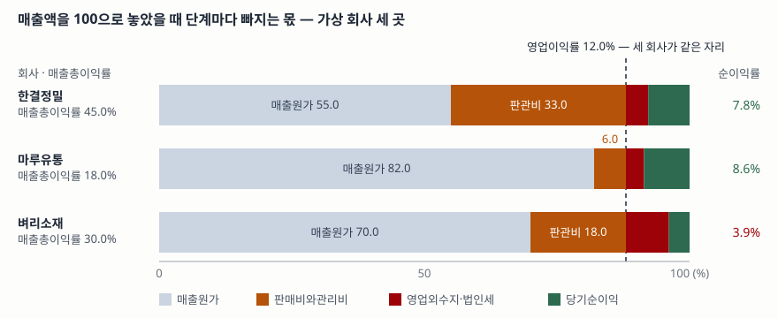

> 예제의 회사 `한결정밀`·`마루유통`·`벼리소재`와 모든 숫자는 계산 원리를 보이려고 만든 가상 값이다. 실제 기업과 관계가 없다.

## 들어가며

증권사 리포트나 기업 소개 자료를 보면 수익성을 한 줄로 요약해 둔 칸이 있다. "영업이익률 12%" 같은 것이다. 숫자가 하나뿐이면 비교도 간단해 보여서, 같은 12%인 두 회사를 놓고 수익성이 비슷하다고 정리하기 쉽다. 그런데 매출 1,000억에 영업이익 120억이 똑같은 두 회사 중 한 곳은 원가 820억을 쓰고 판관비를 60억만 쓰며, 다른 한 곳은 원가 550억에 판관비를 330억 쓴다. 영업이익이 나오기까지 돈이 빠져나간 경로가 전혀 다르고, 그 경로는 한 칸 위에 있는 매출총이익률에서만 보인다. 한 칸 아래 순이익률로 내려가면 셋의 순위가 또 바뀐다.

## 개념

손익계산서는 매출액에서 비용을 단계별로 빼면서 내려간다. 단계마다 남은 금액을 매출액으로 나눈 것이 마진이고, 어느 단계에서 나눴느냐에 따라 뜻이 달라진다.

한국은행 기업경영분석은 이 묶음을 "손익의 관계비율"로 부르고, 매출액을 분모로 쓰는 지표를 여럿 둔다.

| 번호 | 지표 | 산식 | 해설이 적은 것 |
|---|---|---|---|
| 609 | 매출액세전순이익률 | 세전순이익 ÷ 매출액 × 100 | 경영성과를 총괄적으로 표시하는 대표적 지표로, 주된 영업활동뿐 아니라 재무활동 등에서 발생한 성과도 동시에 파악한다 |
| 610 | 매출액순이익률 | 당기순이익 ÷ 매출액 × 100 | 매출액에 대한 당기순이익의 비율 |
| 611 | 매출액영업이익률 | 영업이익 ÷ 매출액 × 100 | 제조 및 판매 활동과 직접 관계된 순수한 영업이익만을 매출액과 대비한 것으로 영업효율성 측정에 유용하다 |
| 612 | 매출원가 대 매출액 | 매출원가 ÷ 매출액 × 100 | 기업원가율 또는 마진율을 측정하는 지표 |

여기서 눈여겨볼 것이 하나 있다. **작성항목에 매출총이익률이 없다.** 그 자리를 매출원가 대 매출액(612)이 대신한다. 둘은 같은 정보를 뒤집어 놓은 것이라 합이 항상 100이므로, 매출총이익률을 보고 싶으면 100에서 612를 빼면 된다. 한국은행이 원가율 쪽으로 적은 것은 이 지표를 "기업원가율"로 설명하는 데서 드러나듯, 남은 몫보다 들어간 몫을 보는 편이 비용 구조를 읽기에 곧장이기 때문이다.

단계의 경계도 정해져 있다. 매출총이익은 매출원가까지만 뺀 금액, 영업이익은 거기서 판매비와관리비를 더 뺀 금액, 세전순이익은 영업 밖에서 생긴 수익과 비용까지 반영한 금액이고, 당기순이익은 법인세비용까지 뺀 마지막 줄이다. 분모를 매출액 대신 자산이나 자본으로 둔 쪽은 [ROE와 ROA](../2026-10-01-roe-vs-roa/index.md)와 [ROE를 세 조각으로 나누기](../2026-10-02-dupont-roe-three-factors/index.md)에서 다뤘다.

## 구조



> **출처**: [한국은행, 『기업경영분석』 통계정보보고서(2019.12) — 분석지표 해설 609 매출액세전순이익률, 610 매출액순이익률, 611 매출액영업이익률, 612 매출원가 대 매출액](https://mods.go.kr/boardDownload.es?bid=12030&list_no=379918&seq=1)

막대 하나가 한 회사의 매출액 100%고, 왼쪽부터 매출원가·판매비와관리비·영업외수지와 법인세·당기순이익 순으로 쌓았다. 회색 칸이 끝나는 자리가 매출총이익의 시작이고, 주황 칸이 끝나는 자리가 영업이익의 시작이다. 세 회사의 주황 칸 끝이 한 점선 위에 모여 있는 것은 영업이익률이 12.0%로 같기 때문이고, 회색 칸이 끝나는 자리는 셋이 모두 다르다. 오른쪽 끝 초록 칸의 길이가 순이익률이다.

## 동작 원리

### 단계마다 성격이 다른 비용이 빠진다

매출원가는 판 것을 만들거나 사 오는 데 든 돈이고, 판매비와관리비는 그것을 파는 데와 회사를 굴리는 데 든 돈이다. 둘을 가르는 기준은 비용의 크기가 아니라 기능이다. 그래서 같은 영업이익률이라도 회색 칸과 주황 칸의 비중은 업종을 따라 갈린다. 사들인 물건을 그대로 파는 회사는 매출원가가 크고 판관비가 작으며, 직접 설계해 만들고 연구개발에 쓰는 회사는 반대다.

영업이익 아래에서는 성격이 또 바뀐다. 이자비용이나 외환차손처럼 영업활동 자체와는 떨어진 항목이 여기서 들어온다. 영업이익률이 같은 두 회사의 순이익률이 벌어졌다면 그 원인은 대개 이 구간에 있고, 차입이 많은 회사일수록 폭이 크다. 이자 부담을 따로 재는 지표는 [이자보상비율](../2026-10-02-interest-coverage-ratio/index.md)에서 다뤘다.

### 매출총이익률은 분류 선택에 흔들린다

K-IFRS 제1001호는 비용을 성격별로 분류할지 기능별로 분류할지 기업이 고르게 한다(문단 99). 성격별 분류는 감가상각비·원재료 구입·운송비·종업원급여처럼 비용의 성격대로 묶고 기능별로 재배분하지 않는 방식이고(문단 102), 기능별 분류는 매출원가법이라고도 부르며 **적어도 매출원가를 다른 비용과 분리해 공시하도록** 요구한다(문단 103).

여기서 두 가지가 따라 나온다. 첫째, 성격별로 분류한 회사의 손익계산서에는 매출원가 줄 자체가 없으므로 매출총이익률을 바로 읽을 수 없다. 둘째, 기능별로 분류한 회사라도 물류비나 품질관리 인건비처럼 양쪽에 담을 수 있는 비용을 어디에 넣었느냐에 따라 매출총이익률이 달라진다. 예제 `[6]`이 그 산술이다. 같은 금액을 판관비에서 매출원가로 옮기기만 해도 매출총이익률은 움직이고 영업이익률은 움직이지 않는다. 두 칸을 모두 뺀 뒤의 금액이 영업이익이기 때문이다.

한국 기준에는 영업이익을 포괄손익계산서 본문에 구분 표시하도록 하는 문단이 따로 있다(문단 한138.2). 매출총이익에는 같은 요구가 없다. 서로 다른 회사의 매출총이익률을 나란히 놓기 전에 주석에서 매출원가에 무엇을 담았는지 확인해야 하는 이유다.

### 세전순이익률은 영업이익률에 영업외수지를 더한 값이다

한국은행이 발표 자료에서 수익성 지표를 적는 방식이 이 관계를 그대로 보여 준다. 매출액영업이익률을 (A), 영업외수지를 매출액으로 나눈 값을 (B)로 적고 매출액세전순이익률을 (A+B)로 둔다. 세전순이익이 영업이익에 영업외수익을 더하고 영업외비용을 뺀 금액이므로 양변을 매출액으로 나누면 그대로 성립한다.

```text
매출액세전순이익률 = 매출액영업이익률 + (영업외수익 − 영업외비용) ÷ 매출액 × 100
```

두 지표를 같이 적어 두면 세전순이익률이 내려간 해에 그것이 본업이 나빠진 탓인지 영업 밖의 일 탓인지를 분해해 볼 수 있다. 예제 `[5]`가 세 회사에서 이 식이 맞는지 확인한다.

### 영업이익의 경계는 2027년부터 달라진다

IFRS 18은 손익계산서에 새 소계를 요구하고 그중 하나가 영업이익이며, 2027년 1월 1일 이후 시작하는 회계연도부터 적용되고 조기 적용도 허용된다. 한국에서는 K-IFRS 제1118호가 이를 받아 제1001호를 대체한다. 바뀌는 것은 산식이 아니라 **경계**다. 지금은 영업이익이 매출액에서 매출원가와 판관비를 뺀 금액이지만, 새 기준에서는 투자·재무·법인세·중단영업에 속하지 않는 나머지를 영업 범주로 묶는다. 지금 영업외로 나가 있던 항목 일부가 영업이익 안으로 들어온다는 뜻이다.

## 실습 예제

세 회사의 매출액 1,000억과 영업이익 120억을 같게 맞추고 그 위아래만 다르게 뒀다. 금액 단위는 억원이고, 법인세비용은 세전순이익의 22%로 가정했다.

전체 소스: [`code/`](code/) · 수행 기록: [`code/output.txt`](code/output.txt)

```text
[1] 손익계산서 — 매출액과 영업이익은 세 회사가 같다 (억원)
               매출액  매출원가  매출총이익    판관비  영업이익  영업외수지  세전순이익    법인세  당기순이익
한결정밀        1,000       550         450       330       120         -20         100      22.0        78.0
마루유통        1,000       820         180        60       120         -10         110      24.2        85.8
벼리소재        1,000       700         300       180       120         -70          50      11.0        39.0

[2] 세 마진 — 영업이익률만 보면 셋이 같다 (%)
             매출총이익률  영업이익률  세전순이익률  순이익률
한결정밀             45.0        12.0          10.0       7.8
마루유통             18.0        12.0          11.0       8.6
벼리소재             30.0        12.0           5.0       3.9

[3] 매출총이익률 + 매출원가 대 매출액 = 100 (%)
             매출총이익률  매출원가 대 매출액      합
한결정밀             45.0                55.0   100.0
마루유통             18.0                82.0   100.0
벼리소재             30.0                70.0   100.0

[4] 매출액을 100으로 놓고 단계마다 빠지는 몫 (%p)
             매출원가    판관비  영업외수지    법인세   남는 몫
한결정밀        -55.0     -33.0        -2.0      -2.2       7.8
마루유통        -82.0      -6.0        -1.0      -2.4       8.6
벼리소재        -70.0     -18.0        -7.0      -1.1       3.9

[6] 한결정밀이 물류비 50을 판관비에서 매출원가로 옮기면 (%)
                  매출총이익률  영업이익률  순이익률
옮기기 전                 45.0        12.0       7.8
옮긴 뒤                   40.0        12.0       7.8
차이                      -5.0        +0.0      +0.0
```

`[2]`가 이 글의 요지다. 영업이익률은 셋 다 12.0%인데 매출총이익률은 45.0%, 18.0%, 30.0%로 갈리고, 순이익률은 7.8%, 8.6%, 3.9%로 다시 갈린다. 한 칸만 보면 세 회사가 같아 보이고, 위아래를 같이 보면 셋이 전혀 다른 구조라는 것이 드러난다.

`[1]`에서 그 구조가 보인다. 마루유통은 원가 820억을 쓰고 판관비를 60억만 쓴다. 사 온 가격과 판 가격의 차이가 180억뿐이지만 그 차이를 지키는 데 드는 돈도 적다. 한결정밀은 매출총이익이 450억이나 되는데 설계와 영업에 330억을 써서 같은 영업이익에 닿는다. 매출총이익률만 보고 한결정밀의 수익성이 두 배 넘게 좋다고 읽으면 틀린다.

`[3]`은 매출총이익률과 매출원가 대 매출액(612)의 합이 세 회사 모두 100.0%로 떨어지는 것을 확인한다.

`[4]`는 매출액을 100으로 놓고 단계마다 빠지는 몫을 적은 것이다. 한결정밀은 판관비로 33.0%p가 나가는데 마루유통은 6.0%p만 나간다. 벼리소재는 영업외수지에서 7.0%p를 잃어 순이익률이 3.9%까지 내려간다. 법인세로 나가는 몫은 세전순이익이 작은 벼리소재가 1.1%p로 가장 작은데, 이것은 세 부담이 가벼워서가 아니라 과세 대상 이익 자체가 작아서다.

`[6]`은 분류를 바꿔 본 것이다. 한결정밀이 판관비에 있던 물류비 50억을 매출원가로 옮기면 매출총이익률은 45.0%에서 40.0%로 5.0%p 내려가는데 영업이익률과 순이익률은 그대로다. 회사의 실제 수익성은 아무것도 달라지지 않았고 비용을 어느 칸에 적었는지만 바뀌었다.

`[5]`의 세전순이익률 분해는 [`code/output.txt`](code/output.txt)에 있다. 세 회사 모두 영업이익률 12.0%에 영업외수지 비율을 더한 값이 세전순이익률과 소수점 첫째 자리까지 일치한다.

## 실무에서 주의할 점

- **매출총이익률을 비교하기 전에 매출원가의 범위를 맞춘다.** 기능별 분류를 택한 회사끼리도 물류비·품질관리비를 어디에 담았는지가 다를 수 있고, `[6]`처럼 그것만으로 5.0%p가 움직인다. 성격별로 분류한 회사는 매출원가 줄 자체가 없어 비교 대상이 되지 않는다.
- **적정 수준을 한 숫자로 정하지 않는다.** 한국은행 해설은 손익의 관계비율에 표준비율을 제시하지 않는다. 표준비율을 든 것은 비유동비율과 비유동장기적합률뿐이고 둘 다 100% 이하를 든다. 업종 평균이 필요하면 한국은행 기업경영분석처럼 업종별로 공표된 집계를 쓰고, 그 집계가 몇 년도 것인지 밝힌다.
- **순이익률 하나로 판단하지 않는다.** 순이익에는 자산 처분이익이나 법인세 환급처럼 그 해에만 생긴 항목이 섞인다. 영업이익률이 그대로인데 순이익률만 크게 움직였다면 그 차이가 어디서 왔는지를 영업외 항목과 법인세비용에서 확인한다.
- **영업외수지가 꾸준히 큰 마이너스면 자본구조를 같이 본다.** 벼리소재처럼 영업외로 7.0%p가 나가는 구조는 차입 규모에서 온다. 수익성 지표만으로는 원인이 보이지 않으므로 [안정성 비율](../2026-10-01-leverage-and-current-ratio/index.md)과 묶어 본다.
- **기준 변경 연도의 영업이익률은 그대로 이어 붙이지 않는다.** IFRS 18이 2027년 1월 1일 이후 시작하는 회계연도부터 적용되면서 영업 범주의 경계가 달라진다. 추이를 그릴 때 그 해 앞뒤를 같은 선으로 잇기 전에 비교 연도가 다시 작성된 것인지 확인한다.

## 정리

- 매출총이익률·영업이익률·순이익률은 분모가 모두 매출액이고, 분자가 매출원가 → 판관비 → 영업외 항목과 법인세 순으로 더 많은 비용을 뺀 금액으로 내려간다.
- 영업이익률이 같아도 매출총이익률은 크게 갈린다. 예제에서 12.0%로 같은 세 회사의 매출총이익률이 45.0%·18.0%·30.0%였다.
- 매출총이익률과 매출원가 대 매출액의 합은 100이다. 한국은행 기업경영분석은 작성항목에 매출총이익률을 두지 않고 원가율 쪽을 둔다.
- 같은 비용을 판관비에서 매출원가로 옮기면 매출총이익률만 움직이고 영업이익률은 그대로다. 비교 전에 매출원가의 범위를 맞춘다.
- 매출액세전순이익률은 매출액영업이익률에 영업외수지 ÷ 매출액을 더한 값이다. 수익성이 떨어진 해에 본업 탓인지 영업 밖의 일 탓인지를 가를 수 있다.

## 참고 자료

- [한국은행, 『기업경영분석』 통계정보보고서(2019.12) — 분석지표 해설 609 매출액세전순이익률, 610 매출액순이익률, 611 매출액영업이익률, 612 매출원가 대 매출액, 705 비유동비율, 706 비유동장기적합률](https://mods.go.kr/boardDownload.es?bid=12030&list_no=379918&seq=1) — 통계청 정기통계품질진단 자료. 작성항목 목록과 산식, 표준비율을 둔 지표와 두지 않은 지표, 매출액영업이익률 (A) + 영업외수지/매출액 (B) = 매출액세전순이익률 (A+B) 표기
- [한국회계기준원 — 시행 중인 K-IFRS 기준서 목록](https://www.kasb.or.kr/front/board/ingAccountingList.do) — 기준서 원문(PDF·HWP) 발행처. 아래 전재 사이트는 문단을 바로 열기 위한 편의 링크다
- [K-IFRS 제1001호 재무제표 표시 — 문단 99 분류방법 선택, 문단 102 성격별 분류, 문단 103 기능별 분류(매출원가법), 문단 한138.2 영업이익 구분 표시](https://accountingwiki.co.kr/standards/1001) (제3자 전재)
- [IFRS Foundation — IFRS 18 Presentation and Disclosure in Financial Statements](https://www.ifrs.org/issued-standards/list-of-standards/ifrs-18-presentation-and-disclosure-in-financial-statements/) — 2027년 1월 1일 이후 시작하는 회계연도부터 적용, 조기 적용 허용. 손익계산서에 두 개의 새 소계 요구
