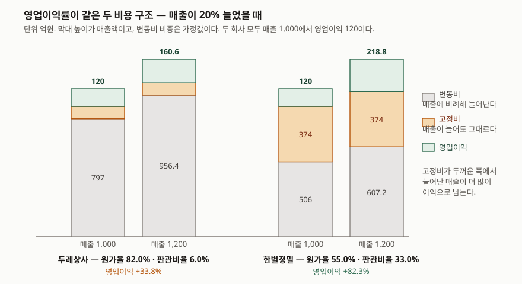

> 예제의 회사 `두레상사`·`한별정밀`·`가나전자`와 모든 숫자는 계산 원리를 보이려고 만든 가상 값이다. 실제 기업과 관계가 없다. 변동비 비중은 설명용 가정값이다.

## 들어가며

실적 발표 자료에서 "영업이익률 12%"라는 줄을 보면 거기서 멈추기 쉽다. 숫자가 하나라 비교도 간단해 보인다. 그런데 매출 1,000억에 영업이익 120억이 똑같은 두 회사 중 하나는 매출원가로 820억을 쓰고 판관비는 60억만 쓰며, 다른 하나는 원가 550억에 판관비 330억을 쓴다. 다음 해 둘 다 매출이 20% 늘었다고 하자. 앞 회사의 영업이익은 160억이 되고 뒤 회사는 218억이 된다. 같은 20% 성장에 이익 증가율이 33.8%와 82.3%로 두 배 반 차이가 난다. 올해 숫자가 같았으니 내년도 비슷할 것이라고 읽으면 이 차이를 전혀 못 본다. 그 차이는 영업이익률 한 줄 위, 매출원가율과 판관비율이 나뉘는 자리에서 생긴다.

## 개념

**매출원가율**은 매출원가를 매출액으로 나눈 값, **판관비율**은 판매비와관리비를 매출액으로 나눈 값이다. 둘을 더하면 **영업비용률**이고, 100에서 영업비용률을 빼면 영업이익률이다.

```text
매출원가율 = 매출원가 ÷ 매출액 × 100
판관비율   = 판매비와관리비 ÷ 매출액 × 100
영업이익률 = 100 − 매출원가율 − 판관비율
```

세 줄이 항등식이라는 것이 이 지표의 쓸모다. 영업이익률이 몇 %p 깎였으면 그 몇 %p는 반드시 두 비율의 변화로 나뉜다. 어디서 깎였는지 찾는 일이 뺄셈 한 번으로 끝난다.

이 두 칸이 생기는 근거는 K-IFRS 제1001호에 있다. 당기손익으로 인식한 비용은 **성격별 분류**와 **기능별 분류** 중 더 신뢰성 있고 목적적합한 정보를 주는 방법으로 분석해 표시한다(문단 99). 성격별은 감가상각비·원재료 구입·운송비·종업원급여·광고비처럼 비용의 성격으로 묶고(문단 102), 기능별은 매출원가·물류원가·관리활동원가처럼 기능으로 묶으며 **최소한 매출원가는 다른 비용과 분리해 공시**한다(문단 103). 한국 추가 문단은 여기에 더해 수익에서 매출원가와 판매비와관리비(물류원가 포함)를 차감한 영업이익을 포괄손익계산서에 구분해 표시하게 한다(문단 한138.2).

중요한 단서가 문단 103에 함께 적혀 있다. 기능별 분류는 재무제표이용자에게 더 목적적합할 수 있지만 **비용을 기능별로 배분하는 과정에 자의성과 상당한 판단이 개입될 수 있다.** 매출원가율과 판관비율을 다른 회사와 비교하기 전에 이 문장을 먼저 떠올려야 한다.

한국은행 기업경영분석은 작성항목에 매출총이익률을 두지 않고 **매출원가 대 매출액(612)** 을 둔다. 해설은 이 지표를 "기업원가율 또는 마진율을 측정하는 지표"로 적는다. 남은 몫보다 들어간 몫을 보는 편이 비용 구조를 읽기에 곧장이기 때문이다.

## 구조



> **출처**: [K-IFRS 제1001호 재무제표 표시 — 문단 99 분류방법 선택, 문단 102 성격별 분류, 문단 103 기능별 분류와 배분의 자의성, 문단 한138.2 영업이익 구분 표시](https://accountingwiki.co.kr/standards/1001) (제3자 전재, 발행처는 [한국회계기준원](https://www.kasb.or.kr/front/board/ingAccountingList.do)). 변동비와 고정비의 구분은 기준서의 분류가 아니라 이 예제가 둔 가정이다.

막대 높이가 매출액이고, 아래부터 변동비·고정비·영업이익으로 쌓았다. 매출 1,000에서 두 막대의 꼭대기 초록 칸은 똑같이 120이다. 매출이 1,200이 되면 회색 변동비 칸만 비례해 늘고 주황 고정비 칸은 그대로 있으므로, **고정비 칸이 두꺼운 쪽에서 늘어난 매출이 더 많이 초록 칸으로 간다.** 한별정밀의 고정비 칸이 두레상사보다 네 배 넘게 두껍고, 그래서 늘어난 초록 칸이 40.6과 98.8로 갈린다.

여기서 주의할 것은 변동비·고정비 구분이 **회계기준서의 분류가 아니라는 점**이다. 포괄손익계산서에는 매출원가와 판관비 두 칸만 있고, 그 안에서 무엇이 매출에 비례하는지는 적혀 있지 않다. 이 도식의 가로 경계선은 예제가 둔 가정이다. 바깥에서 재무제표만 보고 읽을 때는 매출원가율과 판관비율의 **몇 해치 움직임**으로 이 경계를 짐작하게 된다.

## 동작 원리

왜 매출원가율이 높은 쪽이 매출 증가에 둔하게 반응하는가. 매출원가는 원재료·상품매입·외주가공처럼 **판 만큼 들어가는 비용**이 대부분이라 매출과 함께 늘어난다. 판관비는 급여·임차료·감가상각비처럼 **한 해 단위로 정해 두는 비용**의 비중이 크다. 같은 영업비용률 88.0%라도 그 안의 변동비와 고정비 비율이 다르면 매출이 흔들릴 때 전혀 다르게 움직인다.

| | 매출원가 비중이 큰 구조 | 판관비 비중이 큰 구조 |
|---|---|---|
| 전형적인 사업 | 유통, 상품 중개, 수탁 가공 | 설계·연구개발, 브랜드 판매, 소프트웨어 |
| 변동비 비중 | 높다 | 낮다 |
| 매출 증가 시 | 이익이 매출과 비슷하게 는다 | 이익이 매출보다 빠르게 는다 |
| 매출 감소 시 | 비용도 같이 줄어 버틴다 | 고정비가 남아 이익이 빨리 줄어든다 |
| 손익분기점 | 낮다 | 높다 |

이 대비를 수치로 묶은 것이 영업레버리지도다. 매출이 1% 변할 때 영업이익이 몇 % 변하는가를 뜻하고, 공헌이익을 영업이익으로 나눈 값과 같다. [손익분기점과 영업레버리지](../2026-10-10-break-even-operating-leverage/index.md)에서 다룬 내용이다. 이 글은 그 레버리지가 **손익계산서 두 칸의 비율로 어느 정도까지 드러나는가**를 본다.

## 실습 예제

매출액 1,000억과 영업이익 120억을 똑같이 맞춰 영업이익률을 12.0%로 고정한 가상 회사 두 곳을 둔다.

```python
# 영업이익률을 12.0% 로 똑같이 맞췄다. 그 12.0% 에 닿는 경로가 다르다
DURE = Company("두레상사", 1000, 820, 60, 0.95, 0.30)    # 사 와서 파는 구조
HANBYEOL = Company("한별정밀", 1000, 550, 330, 0.80, 0.20)  # 설계하고 파는 구조
```

전체 소스: [`code/`](code/) · 실행 기록: [`code/output.txt`](code/output.txt)

```text
[1] 같은 영업이익률에 닿는 두 경로 (단위: 억원)
----------------------------------------------------------------------
                                  두레상사          한별정밀
매출액                            1,000.0       1,000.0
매출원가                             820.0         550.0
매출원가율(%)                          82.0          55.0
판매비와관리비                           60.0         330.0
판관비율(%)                            6.0          33.0
영업비용률(%)                          88.0          88.0
영업이익                             120.0         120.0
영업이익률(%)                          12.0          12.0

[2] 두 비용을 변동비와 고정비로 갈라 보면 (단위: 억원)
----------------------------------------------------------------------
                                  두레상사          한별정밀
매출원가 중 변동비                       779.0         440.0
매출원가 중 고정비                        41.0         110.0
판관비 중 변동비                         18.0          66.0
판관비 중 고정비                         42.0         264.0
변동비 합계                           797.0         506.0
고정비 합계                            83.0         374.0
공헌이익률(%)                          20.3          49.4
```

`[1]`에서 영업비용률은 88.0%로 둘이 같다. 그 88.0%가 82.0 + 6.0과 55.0 + 33.0으로 전혀 다르게 나뉜다. `[2]`는 그 차이가 변동비·고정비로 어떻게 번역되는지를 보인다. 고정비 합계가 83억과 374억으로 네 배 넘게 벌어진다.

```text
[3] 매출이 20% 늘면 (단위: 억원)
----------------------------------------------------------------------
                                  두레상사          한별정밀
매출액                            1,200.0       1,200.0
매출원가                             975.8         638.0
매출원가율(%)                          81.3          53.2
판매비와관리비                           63.6         343.2
판관비율(%)                            5.3          28.6
영업이익                             160.6         218.8
영업이익률(%)                          13.4          18.2
영업이익 증감률(%)                       33.8          82.3
```

매출이 20% 늘자 영업이익이 33.8%와 82.3% 늘었다. 영업이익률은 13.4%와 18.2%로 벌어진다. 두 비율의 움직임을 보면 어디서 벌어졌는지가 보인다. 한별정밀의 판관비율은 33.0%에서 28.6%로 **4.4%p** 내려가는데 매출원가율은 55.0%에서 53.2%로 1.8%p만 내려간다. 두레상사는 둘 다 1%p 안팎이다. 판관비율이 매출 증가에 더 크게 반응한다는 것이 고정비가 거기 몰려 있다는 신호다.

```text
[4] 매출이 20% 줄면 — 같은 구조가 반대로 작동한다 (단위: 억원)
----------------------------------------------------------------------
                                  두레상사          한별정밀
매출액                              800.0         800.0
매출원가율(%)                          83.0          57.8
판관비율(%)                            7.0          39.6
영업이익                              79.4          21.2
영업이익률(%)                           9.9           2.6
영업이익 증감률(%)                      -33.8         -82.3
영업레버리지도(배)                        1.69          4.12
공헌이익÷영업이익(배)                      1.69          4.12
```

`[4]`가 `[3]`의 뒷면이다. 매출이 20% 줄면 영업이익이 같은 비율만큼 깎인다. 한별정밀의 영업이익률은 2.6%까지 내려간다. **같은 구조가 좋을 때 더 벌고 나쁠 때 더 잃는다.** 두 줄의 배수가 소수점 둘째 자리까지 일치하는 것은 영업레버리지도가 공헌이익 ÷ 영업이익과 같은 값이기 때문이다.

```text
[5] 손익분기점 매출액과 안전한계율 (단위: 억원)
----------------------------------------------------------------------
                                  두레상사          한별정밀
고정비 합계                            83.0         374.0
공헌이익률(%)                          20.3          49.4
손익분기점 매출액                        408.9         757.1
안전한계율(%)                          59.1          24.3
```

같은 영업이익률 12.0%인데 매출이 얼마까지 빠져야 적자가 되는지가 다르다. 두레상사는 408.9억, 한별정밀은 757.1억이다. 지금 매출에서 각각 59.1%와 24.3%의 여유가 있다. 같은 회사로 보이던 둘이 경기가 꺾였을 때 전혀 다른 처지가 된다.

```text
[6] 가나전자 — 깎인 영업이익률을 두 비율로 나눠 보기 (단위: 억원)
----------------------------------------------------------------------
                                    전기            당기        차이(%p)
매출액                              1,000         1,150              
매출원가율(%)                         65.00         66.96          1.96
판관비율(%)                          23.00         24.00          1.00
영업이익률(%)                         12.00          9.04         -2.96

영업이익률 변화 -2.96%p = −(매출원가율 변화) −(판관비율 변화) = -2.96%p
금액은 둘 다 늘었다 — 매출원가 650→770 (18.5%), 판관비 230→276 (20.0%), 매출액 15.0%
```

`[6]`이 이 지표를 쓰는 가장 흔한 자리다. 가나전자는 매출이 15.0% 늘었는데 영업이익률이 12.00%에서 9.04%로 2.96%p 깎였다. 그 2.96%p는 매출원가율 1.96%p와 판관비율 1.00%p로 정확히 나뉜다. 금액만 보면 둘 다 늘었으니 원인이 보이지 않는데, 매출보다 빨리 늘었는지로 바꿔 보면 매출원가 18.5%·판관비 20.0% 대 매출 15.0%라는 것이 드러난다. 깎인 몫의 3분의 2가 원가 쪽에서 왔다.

```text
[7] 같은 비용을 다른 칸에 적으면 — 두레상사의 물류비 50 (단위: %)
----------------------------------------------------------------------
                                 옮기기 전          옮긴 뒤        차이(%p)
매출원가율                             82.0          87.0           5.0
판관비율                               6.0           1.0          -5.0
영업비용률                             88.0          88.0           0.0
영업이익률                             12.0          12.0           0.0
```

마지막이 비교할 때의 함정이다. 판관비에 있던 물류비 50억을 매출원가로 옮기면 매출원가율이 5.0%p 오르고 판관비율이 5.0%p 내려간다. 영업비용률과 영업이익률은 그대로다. 사업에서 달라진 것은 없고 **어느 칸에 적었는지만 바뀌었다.** K-IFRS 제1001호 문단 103이 기능별 배분에 자의성이 개입될 수 있다고 적은 것이 이 자리다. 같은 산술은 [세 가지 마진](../2026-10-14-three-margins-step-by-step/index.md)에서 매출총이익률 쪽으로도 확인했다.

## 실무에서 주의할 점

- **두 비율을 따로 보지 말고 합과 같이 본다.** 영업비용률은 분류를 바꿔도 움직이지 않으므로 회사 간 비교에 더 안전하다. 두 비율 중 하나만 크게 다르면 사업 구조 차이인지 분류 차이인지를 먼저 가른다.
- **성격별로 분류한 회사와는 비교가 성립하지 않는다.** 그 회사의 포괄손익계산서에는 매출원가 줄 자체가 없다. 문단 한138.2도 비용을 성격별로 분류하는 경우에는 영업수익에서 영업비용을 차감한 영업이익을 쓸 수 있게 한다.
- **판관비율이 매출 증가에 더 크게 내려가는지를 본다.** 예제에서 매출 20% 증가에 한별정밀의 판관비율이 4.4%p, 매출원가율이 1.8%p 내려갔다. 이 비대칭이 고정비가 어느 칸에 몰려 있는지의 신호다. 한 해치로는 알 수 없으므로 세 해 이상 이어서 본다.
- **매출이 줄어드는 구간에서 같은 구조가 반대로 작동한다.** 성장할 때 좋았던 영업레버리지는 역성장에서 그대로 손실 배수가 된다. 손익분기점 매출액과 안전한계율을 같이 적어 두면 그 폭이 보인다.
- **영업이익률이 깎인 해에는 항등식으로 자리를 먼저 찾는다.** 금액 증감만 보면 둘 다 늘어 원인이 보이지 않는다. 매출 증가율과 각 비용의 증가율을 나란히 놓는다.
- **적정 수준을 근거 없이 정하지 않는다.** 한국은행 기업경영분석은 손익의 관계비율에 표준비율을 제시하지 않는다. 표준비율을 둔 것은 비유동비율과 비유동장기적합률뿐이고 둘 다 100% 이하를 든다. 업종 평균이 필요하면 한국은행 기업경영분석처럼 공표된 집계를 쓰고 그 집계가 몇 년도 것인지 밝힌다.

## 정리

- 매출원가율 + 판관비율 + 영업이익률 = 100이다. 깎인 영업이익률은 반드시 두 비율의 변화로 나뉘므로 자리를 뺄셈으로 찾을 수 있다.
- 영업비용률이 88.0%로 같아도 그 안의 나눔이 다르면 매출 변동에 전혀 다르게 반응한다. 예제에서 매출 20% 증가에 영업이익이 33.8%와 82.3% 늘었다.
- 매출원가는 변동비, 판관비는 고정비 비중이 큰 편이라 판관비율이 매출 증가에 더 크게 내려간다. 예제에서 4.4%p와 1.8%p였다.
- 같은 구조가 매출 감소에서 반대로 작동한다. 매출 20% 감소에 영업이익률이 9.9%와 2.6%가 되고, 손익분기점 매출액은 408.9억과 757.1억으로 갈린다.
- 같은 비용을 판관비에서 매출원가로 옮기면 두 비율만 5.0%p씩 움직이고 영업비용률과 영업이익률은 그대로다. K-IFRS 제1001호 문단 103이 기능별 배분의 자의성을 적어 둔 자리다.

## 참고 자료

- [한국회계기준원 — 시행 중인 K-IFRS 기준서 목록](https://www.kasb.or.kr/front/board/ingAccountingList.do) — 기업회계기준서 제1001호 원문(PDF·HWP) 발행처. 아래 전재 사이트는 문단을 바로 열기 위한 편의 링크다
- [K-IFRS 제1001호 재무제표 표시 — 문단 99 분류방법 선택, 문단 102 성격별 분류, 문단 103 기능별 분류와 매출원가 구분 공시 및 배분의 자의성, 문단 104 성격별 추가 공시, 문단 105 선택의 근거, 문단 한138.2 영업이익 구분 표시](https://accountingwiki.co.kr/standards/1001) (제3자 전재)
- [한국은행, 『기업경영분석』 통계정보보고서(2019.12) — 분석지표 해설 611 매출액영업이익률, 612 매출원가 대 매출액, 705 비유동비율, 706 비유동장기적합률](https://mods.go.kr/boardDownload.es?bid=12030&list_no=379918&seq=1) — 통계청 정기통계품질진단 자료. 작성항목 목록과 산식, 표준비율을 둔 지표와 두지 않은 지표
- [IFRS Foundation — IAS 1 Presentation of Financial Statements](https://www.ifrs.org/issued-standards/list-of-standards/ias-1-presentation-of-financial-statements/) — 국제회계기준 원문 발행처. 비용의 성격별·기능별 분석 규정의 원문
