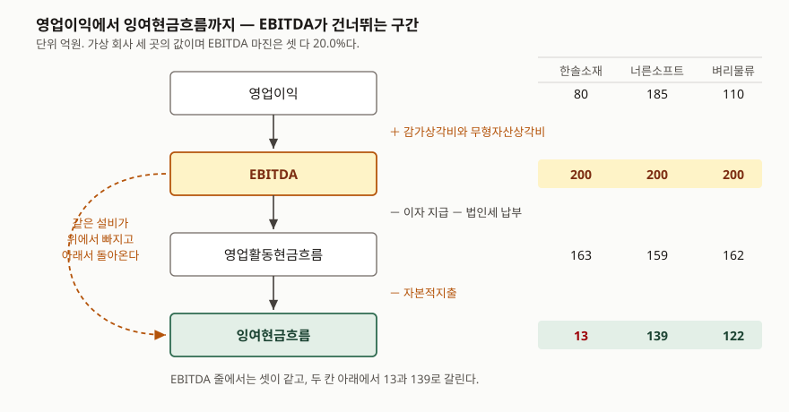

> 예제의 회사 `한솔소재`·`너른소프트`·`벼리물류`·`가나전자`와 모든 숫자는 계산 원리를 보이려고 만든 가상 값이다. 실제 기업과 관계가 없다. 이자·법인세 납부액과 리스 금액은 설명용 가정값이고, 운전자본 변동은 0으로 두었다.

## 들어가며

기업 소개 자료나 인수 협상 자료를 열면 수익성 칸에 영업이익률 대신 EBITDA 마진이 적혀 있는 경우가 많다. 설명도 붙어 있다 — 감가상각은 현금이 나가지 않는 비용이니 빼고 보면 본업이 버는 힘이 더 잘 보인다는 것이다. 틀린 말은 아니다. 그런데 그 말을 그대로 받아들이면, 매년 설비를 150억씩 다시 사야 하는 회사와 노트북만 사면 되는 회사가 같은 20.0%로 나란히 놓인다. 두 회사가 1년 뒤 통장에 남긴 돈은 13억과 139억으로 열 배 차이가 나는데도 그렇다. 감가상각비는 현금이 나가지 않는 비용이 맞지만, 그 비용을 만든 설비를 살 때는 현금이 나갔고 다음 설비를 살 때도 나간다.

## 개념

**EBITDA**는 영업이익에 감가상각비와 무형자산상각비를 더한 금액이고, 그것을 매출액으로 나눈 것이 **EBITDA 마진**이다.

```text
EBITDA       = 영업이익 + 감가상각비 + 무형자산상각비
EBITDA 마진  = EBITDA ÷ 매출액 × 100
```

먼저 알아 둘 것은 [순차입금배수를 다룰 때](../2026-10-25-net-debt-and-ebitda-multiple/index.md)와 같다. **이 두 줄은 회계기준서에 없다.** K-IFRS 어느 기준서에도 EBITDA의 정의가 적혀 있지 않다. 기준서가 정하는 것은 그 재료 쪽이다.

영업이익은 K-IFRS 제1001호의 한국 추가 문단이 정한다. 수익에서 매출원가와 판매비와관리비를 차감한 금액을 포괄손익계산서에 구분해 표시하게 하고, 매출원가를 구분하기 어렵거나 비용을 성격별로 분류하는 경우에는 영업수익에서 영업비용을 차감한 금액을 쓸 수 있게 한다(문단 한138.2). 감가상각비 쪽은 비용 분류 규정에 걸린다. 기능별로 분류한 회사는 감가상각비가 매출원가와 판관비에 흩어져 들어가므로, 기준서는 감가상각비·기타 상각비·종업원급여비용을 포함한 성격별 정보를 따로 공시하게 한다(문단 104). EBITDA를 손익계산서 본문에서 바로 읽을 수 없고 주석을 거쳐야 하는 이유가 여기 있다.

2027년 1월 1일 이후 시작하는 회계연도부터 시행되는 K-IFRS 제1118호는 다른 쪽에서 접근한다. 기준서가 규정하지 않은 수익·비용 소계를 경영진이 외부와 소통하는 데 쓰면 **경영진정의 성과지표**로 보고 산출 근거를 주석에 적게 한다. EBITDA가 그 전형이다. 산식을 정해 주는 것이 아니라 "당신이 쓰는 그 숫자를 어떻게 만들었는지 적으라"는 쪽이다.

## 구조



> **출처**: [K-IFRS 제1001호 재무제표 표시 — 문단 103 기능별 분류, 문단 104 성격별 추가 공시, 문단 한138.2 영업이익 구분 표시](https://accountingwiki.co.kr/standards/1001) (제3자 전재, 발행처는 [한국회계기준원](https://www.kasb.or.kr/front/board/ingAccountingList.do)) · [K-IFRS 제1007호 현금흐름표 — 문단 16(1) 유형자산·무형자산 및 기타 장기성 자산의 취득에 따른 현금유출](https://accountingwiki.co.kr/standards/1007) (제3자 전재)

도식의 점선이 이 글의 요지다. 위에서 영업이익에 더해 올린 감가상각비와, 아래에서 영업활동현금흐름에서 빼는 자본적지출은 **같은 설비를 가리킨다.** 위쪽은 이미 산 설비가 올해 닳은 몫이고 아래쪽은 올해 새로 산 설비의 대금이다. 시점이 다를 뿐 같은 종류의 지출이므로, 위에서 빼고 아래에서 다시 빼지 않으면 같은 금액을 두 번 좋게 센 셈이 된다.

K-IFRS 제1007호는 유형자산·무형자산 및 기타 장기성 자산의 취득에 따른 현금유출을 **투자활동**으로 분류한다(문단 16(1)). 자본화된 개발원가와 자가건설 유형자산 관련 지출도 여기 들어간다. 영업활동 쪽에는 잡히지 않으므로, 영업활동현금흐름만 보면 설비에 쓴 돈이 보이지 않는다.

## 동작 원리

마진을 비교할 때 무엇이 고정되고 무엇이 움직이는지를 정리하면 이렇다.

| 지표 | 분자에서 빠지는 비용 | 같은 값일 때 같은 것 |
|---|---|---|
| 매출총이익률 | 매출원가까지 | 사 온 값과 판 값의 차이 |
| 영업이익률 | 매출원가 + 판관비 | 설비 소모까지 친 본업의 이익 |
| EBITDA 마진 | 매출원가 + 판관비 − 감가상각비 | 설비 소모를 세지 않은 영업 현금 창출력 |
| 잉여현금흐름 마진 | 위 + 이자 + 법인세 + 자본적지출 | 실제로 남아 쓸 수 있게 된 돈 |

EBITDA 마진이 세 번째 줄에 있다는 것이 전부다. 설비 소모를 세지 않으므로 **설비가 큰 회사일수록 아래 두 줄과 멀어진다.** 세 마진이 단계별로 어떻게 갈리는지는 [세 가지 마진](../2026-10-14-three-margins-step-by-step/index.md)에서, 자본적지출을 뺀 잉여현금흐름의 계산은 [자본적지출을 뺀 잉여현금흐름](../2026-10-07-free-cash-flow-after-capex/index.md)에서 다뤘다.

## 실습 예제

매출액 1,000억과 EBITDA 200억을 똑같이 맞춰 EBITDA 마진을 20.0%로 고정한 가상 회사 세 곳을 둔다. 한솔소재는 설비가 큰 장치산업, 너른소프트는 자산이 가벼운 소프트웨어, 벼리물류는 설비의 상당 부분을 리스로 쓰는 물류 회사다.

```python
COMPANIES = [
    # 장치산업. 설비가 크고 매년 다시 사야 한다
    Company("한솔소재", 1000, 200, 120, 0, 25, 0, 0, 12, 150),
    # 소프트웨어. 자산이 가볍다
    Company("너른소프트", 1000, 200, 15, 0, 3, 0, 0, 38, 20),
    # 물류. 설비의 상당 부분을 리스로 쓴다
    Company("벼리물류", 1000, 200, 90, 60, 18, 10, 55, 20, 40),
]
```

전체 소스: [`code/`](code/) · 실행 기록: [`code/output.txt`](code/output.txt)

```text
[1] 손익 — EBITDA 마진은 셋이 같다 (단위: 억원)
--------------------------------------------------------------------------
                              한솔소재       너른소프트        벼리물류
매출액                          1,000       1,000       1,000
EBITDA                         200         200         200
EBITDA 마진(%)                  20.0        20.0        20.0
감가상각비                          120          15          90
영업이익                            80         185         110
영업이익률(%)                       8.0        18.5        11.0

[2] EBITDA에서 현금이 남는 자리까지 (단위: 억원)
--------------------------------------------------------------------------
                              한솔소재       너른소프트        벼리물류
EBITDA                         200         200         200
(−) 이자 지급                      -25          -3         -18
(−) 법인세 납부                     -12         -38         -20
= 영업활동현금흐름                     163         159         162
(−) 자본적지출                     -150         -20         -40
= 잉여현금흐름                        13         139         122
잉여현금흐름 마진(%)                   1.3        13.9        12.2
현금전환율(%)                       6.5        69.5        61.0
```

`[1]`에서 EBITDA 마진은 20.0%로 셋이 같은데 영업이익률은 8.0%·18.5%·11.0%로 갈린다. 감가상각비가 120억·15억·90억으로 다르기 때문이다. EBITDA 마진 하나만 적어 둔 자료는 이 10.5%p 차이를 지운다.

`[2]`에서 한 번 더 갈린다. 영업활동현금흐름까지는 163억·159억·162억으로 거의 같다가, 자본적지출을 빼는 순간 13억·139억·122억이 된다. 한솔소재의 현금전환율은 6.5%다. EBITDA 200억 중 187억이 이자·세금·설비로 나가고 끝난다.

여기서 벼리물류가 두 번째로 좋아 보이는데, 한 항목이 더 남아 있다.

```text
[3] 리스 원금까지 빼면 — 리스료는 자본적지출에 잡히지 않는다 (단위: 억원)
--------------------------------------------------------------------------
                              한솔소재       너른소프트        벼리물류
잉여현금흐름                          13         139         122
(−) 리스부채 원금                      0           0         -55
= 리스 반영 후                       13         139          67
현금전환율(%)                       6.5        69.5        33.5

[4] 자본적지출이 감가상각비를 덮는가 (배)
--------------------------------------------------------------------------
                              한솔소재       너른소프트        벼리물류
자본적지출                          150          20          40
감가상각비                          120          15          90
자본적지출÷감가상각                    1.25        1.33        0.44
리스 제외 감가상각                     120          15          30
리스 제외 기준 배수                   1.25        1.33        1.33
```

벼리물류가 설비를 쓰는 대가는 자본적지출 40억이 아니라 거기에 리스부채 원금 55억을 더한 금액이다. [리스부채와 사용권자산](../../statements/2026-10-10-lease-liability-right-of-use/index.md)에서 본 대로 리스부채 원금 상환은 재무활동으로 분류되므로, 투자활동에 있는 자본적지출만 빼면 55억이 남는다. 빼고 나면 현금전환율이 61.0%에서 33.5%로 내려간다.

`[4]`의 첫 배수가 그 신호다. 벼리물류만 0.44배로 1을 크게 밑돈다. 설비가 90억어치 닳는데 40억만 사고 있다는 뜻으로 읽히지만, 사용권자산 상각 60억을 제외하고 다시 계산하면 1.33배로 나머지 둘과 같아진다. 닳는 쪽과 사는 쪽을 같은 범위로 맞추지 않으면 이 배수는 뜻이 없다.

```text
[5] 벼리물류 — 같은 거래를 운용리스로 적었을 때 (단위: 억원)
--------------------------------------------------------------------------
                                  운용리스       사용권자산          차이
리스료 지급액                             65           0         -65
사용권자산 상각                             0          60          60
리스부채 이자                              0          10          10
영업이익                               105         110           5
EBITDA                             135         200          65
EBITDA 마진(%)                      13.5        20.0         6.5
```

`[5]`는 같은 거래를 어느 기준으로 적느냐만 바꾼 것이다. 운용리스로 처리하면 리스료 65억이 전액 영업비용이라 EBITDA에서 빠지고, 사용권자산으로 인식하면 상각 60억과 이자 10억으로 갈려 둘 다 EBITDA 아래로 내려간다. **같은 회사의 EBITDA 마진이 13.5%에서 20.0%로 6.5%p 오른다.** 영업이익은 105억에서 110억으로 5억만 움직였다. 사업에서 달라진 것은 없고 장부에 적는 자리만 바뀌었는데, 영업이익보다 EBITDA가 열세 배 크게 반응한다.

```text
[6] 자본적지출을 감가상각비만큼만 쓴다고 보면 (단위: 억원)
--------------------------------------------------------------------------
                              한솔소재       너른소프트        벼리물류
영업활동현금흐름                       163         159         162
(−) 유지 지출 대용치                 -120         -15         -90
= 성장 제외 현금                      43         144          72
매출액 대비(%)                      4.3        14.4         7.2
```

자본적지출에는 설비를 유지하는 몫과 사업을 키우는 몫이 섞여 있고, 공시만으로는 갈라지지 않는다. `[6]`은 감가상각비를 유지 지출의 대용치로 놓고 빼 본 것이다. 한솔소재는 실제 자본적지출 150억 대신 120억을 빼자 13억이 43억으로 올라간다. 성장 투자를 걷어내면 본업은 43억을 남긴다는 뜻이다. 다만 이 대용치는 취득원가 기준으로 계산된 과거 금액이라, 설비 가격이 오른 구간에서는 유지에 필요한 돈을 적게 잡는다.

```text
[7] 가나전자 — 설비를 덜 사며 버틴 5년 (단위: 억원)
--------------------------------------------------------------------------
연차             기초 장부       자본적지출        감가상각       기말 장부    EBITDA 마진(%)
1                500          50        -100         450            20.0
2                450          50        -100         400            20.0
3                400          50        -100         350            20.0
4                350          50        -100         300            20.0
5                300          50        -100         250            20.0

5년 누적 자본적지출 250, 누적 감가상각 500, 순장부금액 500 → 250
```

`[7]`이 마지막 함정이다. 가나전자는 5년 내내 EBITDA 마진 20.0%를 지켰고, 자본적지출을 감가상각비의 절반만 썼으니 잉여현금흐름은 해마다 좋게 찍혔다. 그 사이 설비 순장부금액은 500억에서 250억으로 반이 되었다. EBITDA 마진은 설비가 낡는 것을 세지 않으므로 이 5년 동안 아무 신호도 내지 않는다. 자본적지출÷감가상각비 배수가 0.50으로 계속 1을 밑돈 것이 유일한 흔적이다.

## 실무에서 주의할 점

- **EBITDA 마진 옆에 영업이익률을 같이 적는다.** 두 값의 차이가 곧 매출액 대비 감가상각비 비중이다. 예제에서 그 차이는 12.0%p·1.5%p·9.0%p였고, 이것만으로 설비가 얼마나 무거운 사업인지가 드러난다.
- **업종이 다른 두 회사의 EBITDA 마진을 나란히 놓지 않는다.** 이 지표는 설비 소모를 세지 않으므로 설비가 큰 쪽에 유리하게 기운다. 같은 업종 안에서 비교하거나, 비교해야 한다면 자본적지출을 뺀 뒤 비교한다.
- **리스를 많이 쓰는 회사는 리스부채 원금 상환을 같이 뺀다.** 사용권자산으로 인식한 뒤로 리스는 EBITDA를 올리고 자본적지출은 올리지 않는다. 예제에서 그 차이가 현금전환율 61.0%와 33.5%였다.
- **자본적지출÷감가상각비를 몇 해치 이어서 본다.** 한 해 1을 밑도는 것은 투자 주기 탓일 수 있지만 `[7]`처럼 5년이 이어지면 설비가 줄고 있는 것이다. 분자와 분모의 범위를 맞추는 것이 먼저다 — `[4]`에서 사용권자산 상각을 섞었더니 0.44배와 1.33배로 갈렸다.
- **적정 수준을 근거 없이 정하지 않는다.** 기준서에도 한국은행 기업경영분석에도 EBITDA 마진의 표준비율은 없다. 한국은행이 표준비율을 제시한 지표는 비유동비율과 비유동장기적합률뿐이고 둘 다 100% 이하를 든다. 기준선을 쓸 때는 그 기준이 어느 자료의 것인지 밝힌다.
- **산출 근거를 확인하고 읽는다.** 일회성 비용·주식보상비용·손상차손을 더 빼고 조정한 EBITDA가 같은 이름으로 적혀 있는 경우가 있다. K-IFRS 제1118호가 2027년부터 경영진정의 성과지표의 산출 근거를 주석에 적게 하므로, 그 전까지는 자료마다 범위를 직접 맞춰 봐야 한다.

## 정리

- EBITDA 마진은 영업이익에 감가상각비와 무형자산상각비를 더해 매출액으로 나눈 값이고, 산식과 정의 모두 회계기준서에 없다.
- 마진이 같아도 그 아래가 같지 않다. 예제에서 20.0%로 같은 세 회사의 영업이익률이 8.0%·18.5%·11.0%, 잉여현금흐름이 13억·139억·122억이었다.
- 위에서 더한 감가상각비와 아래에서 빼는 자본적지출은 같은 설비를 가리킨다. 위에서만 빼면 같은 금액을 두 번 좋게 센다.
- 리스부채 원금 상환은 재무활동이라 자본적지출에 잡히지 않는다. 빼고 보니 벼리물류의 현금전환율이 61.0%에서 33.5%로 내려갔다.
- 같은 리스 거래를 운용리스로 적으면 EBITDA 마진이 13.5%, 사용권자산으로 인식하면 20.0%다. 영업이익은 5억만 움직인다.
- 자본적지출이 감가상각비를 몇 해째 밑돌면 설비가 줄고 있는 것인데, EBITDA 마진은 그 5년 동안 20.0%로 아무 신호도 내지 않았다.

## 참고 자료

- [한국회계기준원 — 시행 중인 K-IFRS 기준서 목록](https://www.kasb.or.kr/front/board/ingAccountingList.do) — 기업회계기준서 제1001호·제1007호·제1116호·제1118호 원문(PDF·HWP) 발행처. 아래 전재 사이트는 문단을 바로 열기 위한 편의 링크다
- [K-IFRS 제1001호 재무제표 표시 — 문단 99 분류방법 선택, 문단 103 기능별 분류와 매출원가 구분 공시, 문단 104 감가상각비·상각비·종업원급여비용의 성격별 추가 공시, 문단 한138.2 영업이익 구분 표시](https://accountingwiki.co.kr/standards/1001) (제3자 전재)
- [K-IFRS 제1007호 현금흐름표 — 문단 6 영업활동·투자활동·재무활동의 정의, 문단 16(1) 유형자산·무형자산 및 기타 장기성 자산의 취득에 따른 현금유출](https://accountingwiki.co.kr/standards/1007) (제3자 전재)
- [K-IFRS 제1116호 리스](https://accountingwiki.co.kr/standards/1116) (제3자 전재) — 사용권자산과 리스부채의 인식, 리스료가 감가상각비와 이자비용으로 갈리는 구조
- [IFRS Foundation — IFRS 18 Presentation and Disclosure in Financial Statements](https://www.ifrs.org/issued-standards/list-of-standards/ifrs-18-presentation-and-disclosure-in-financial-statements/) — 국제회계기준 원문 발행처. 2027년 1월 1일 이후 시작하는 연차 보고기간부터 적용하며 조기적용을 허용한다는 것, 경영진정의 성과지표의 정의와 주석 공시 요구
- [한국은행, 『기업경영분석』 통계정보보고서(2019.12) — 분석지표 해설 611 매출액영업이익률, 612 매출원가 대 매출액, 705 비유동비율, 706 비유동장기적합률](https://mods.go.kr/boardDownload.es?bid=12030&list_no=379918&seq=1) — 통계청 정기통계품질진단 자료. 표준비율을 둔 지표와 두지 않은 지표
