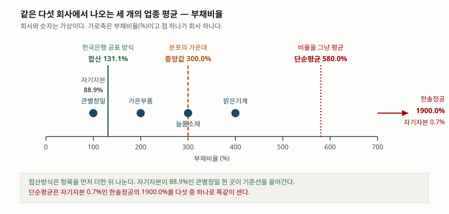

> 예제의 업종과 다섯 회사(`큰별정밀`·`가온부품`·`늘품소재`·`밝은기계`·`한솔정공`), 그리고 모든 금액은 계산 원리를 보이려고 만든 가상 값이다. 실제 기업·업종과 관계가 없다.

## 들어가며

재무비율을 하나 계산해 놓고 나면 곧바로 다음 질문이 온다. 이 숫자가 높은 건가 낮은 건가. 부채비율 200%를 손에 쥐고도 그것이 무엇을 뜻하는지는 모르는 상태다. 그래서 검색창에 "업종 평균 부채비율"을 치고, 나온 숫자와 내 숫자를 나란히 놓는다. 여기까지는 맞는 방향이다.

문제는 그다음이다. 검색 결과에는 같은 업종·같은 해인데 서로 다른 숫자가 여럿 나온다. 어떤 자료는 131%, 어떤 자료는 580%, 어떤 자료는 300%를 적어 놓았다. 보통은 그중 내 판단에 맞는 것을 고르거나, 가장 많이 나오는 것을 쓴다. 그런데 셋 다 같은 회사들의 같은 재무제표에서 나온 값일 수 있다. 숫자가 갈린 이유는 자료가 틀려서가 아니라 **평균을 만드는 방법이 셋이기 때문**이다.

## 개념

업종 평균은 하나의 정의를 가진 값이 아니다. 같은 모집단에서 적어도 세 가지가 나온다.

```text
합산방식  = (Σ 각 사 부채총계) ÷ (Σ 각 사 자기자본) × 100
단순평균  = (Σ 각 사 부채비율) ÷ 회사 수
중앙값    = 각 사 부채비율을 정렬했을 때 가운데 값
```

첫 줄이 한국은행 『기업경영분석』이 쓰는 방식이다. 통계정보보고서는 통계작성방법을 이렇게 적는다. 조사대상 각 법인의 재무제표를 업종별·규모별로 분류하여 **합산 재무제표**를 작성하고 이를 기초로 업종별·규모별 재무비율을 산출한다. 개별 회사의 비율을 구한 뒤 평균내는 것이 아니라, 항목을 먼저 더해서 업종 전체를 한 덩어리의 가상 회사로 만든 다음 그 회사의 비율을 뽑는다.

이 통계가 어떤 근거로 만들어지는지도 적혀 있다. 한국은행법의 통계자료 수집·작성 조항과 통계법의 통계작성 승인 조항을 근거로 하며, 1966년 7월에 승인번호 제301001호를 받은 일반·가공통계다. 연간 통계는 국세청 법인세 신고자료를 받아 작성하므로 표본조사가 아니라 신고기업 전체를 대상으로 한다. 공표는 작성기준 연도의 다음 해 11월 초다.

비율이 재무상태표와 손익계산서 어디서 오는지는 [안정성 비율 — 부채비율과 유동비율](../2026-10-01-leverage-and-current-ratio/index.md)과 [세 가지 마진](../2026-10-14-three-margins-step-by-step/index.md)에, 업종과 회계정책이 비율을 어떻게 흔드는지는 [비율 분석이 틀리는 세 가지 경우](../2026-10-14-ratio-distortions-industry-policy-timing/index.md)에 정리해 두었다.

## 구조



> **출처**: [한국은행, 『기업경영분석』 통계정보보고서(2019.12) — 통계개요 3. 통계작성방법(합산 재무제표에 의한 비율 산출), 통계 설계 2. 수집자료의 포괄성, 분석지표 해설 707 부채비율](https://mods.go.kr/boardDownload.es?bid=12030&list_no=379918&seq=1)

점 하나가 회사 하나이고 가로축은 부채비율이다. 네 회사는 축 안에 있고 한솔정공은 1900.0%라 축 밖으로 나간다. 세 세로선이 같은 자료에서 나온 세 개의 업종 평균이다. 초록 선(합산 131.1%)은 다섯 점 중 가장 왼쪽 점 바로 옆에 붙어 있고, 붉은 선(단순평균 580.0%)은 네 점 모두의 오른쪽에 있다. 어느 선도 점들의 한가운데에 있지 않다.

## 동작 원리

### 합산방식은 평균이 아니라 가중평균이다

합산방식의 식을 다시 쓰면 이렇게 된다.

```text
Σ부채        Σ(자기자본ᵢ × 부채비율ᵢ)              자기자본ᵢ
───── ×100 = ──────────────────────  =  Σ ( ───────── × 부채비율ᵢ )
Σ자기자본            Σ자기자본                      Σ자기자본
```

분자의 부채를 `자기자본 × 부채비율`로 바꿔 쓰면 식이 그대로 가중평균 모양이 된다. 가중치는 자기자본 비중이다. 예제 `[3]`에서 큰별정밀의 자기자본 비중은 88.9%이고, 합산 부채비율 131.1% 중 88.9%p가 이 회사 한 곳에서 나온다. 나머지 네 회사가 전부 합쳐 42.2%p를 보탠다.

여기서 바로 따라오는 것이 있다. **가중치로 쓰이는 금액은 지표마다 다르다.** 부채비율의 분모는 자기자본이므로 자기자본이 큰 회사가 끌어간다. 매출액영업이익률의 분모는 매출액이므로 매출이 큰 회사가 끌어간다. 예제 `[3]`에서 큰별정밀의 두 가중치는 88.9%와 79.4%로 다르다. 같은 업종 평균표의 두 줄이 서로 다른 가중치로 계산된 값이라는 뜻이다. 한 회사가 두 지표에서 업종 평균에 미치는 영향이 다르다.

### 단순평균은 작은 회사의 극단값에 끌려간다

단순평균은 반대 방향으로 치우친다. 회사 크기와 무관하게 한 회사가 한 표를 가지므로, 자기자본이 30억밖에 안 되는 한솔정공의 1900.0%가 자기자본 4000억인 큰별정밀의 100.0%와 같은 무게로 들어간다. 예제 `[2]`에서 단순평균이 580.0%로 뛰는 이유가 이것이다.

이 치우침은 분모가 작을수록 커진다. 부채비율의 분모는 자기자본이고, 자본잠식에 가까운 회사일수록 자기자본이 0에 가까워져 비율이 수백·수천 퍼센트로 튄다. 값의 범위가 위쪽으로 열려 있는 지표에서 단순평균을 쓰면 그 꼬리가 그대로 평균에 들어온다.

### 세 숫자 중 어느 것도 "가운데"가 아니다

예제 `[5]`가 분포 안에서 합산 평균이 어디에 놓이는지 보인다. 다섯 회사의 부채비율을 정렬하면 1사분위 150.0%, 중앙값 300.0%, 3사분위 1150.0%다. 합산 평균 131.1%는 1사분위보다도 아래에 있고, **다섯 회사 중 합산 평균보다 낮은 곳은 한 곳뿐이다.**

한국은행이 합산 지표만으로 부족하다고 보고 분위수 통계를 따로 만든 이유가 여기 있다. 분위수 통계는 2015년부터 작성하기 시작해 2013년 기준 통계까지 소급했고, 2023년에는 편제 업종을 제조업에서 비제조업까지 넓히고 기업규모별 통계를 새로 만들었다. 합산 재무제표 하나로는 업종 안의 분포가 보이지 않는다는 판단이 반영된 것이다.

### 판정이 기준에 따라 뒤집힌다

예제 `[4]`가 이 글에서 실제로 손해를 보는 지점이다. 가온부품의 부채비율은 200.0%이고 매출액영업이익률은 5.0%다. 이 회사를 세 기준에 각각 견주면 이렇게 된다.

- 합산 기준(131.1%, 7.76%)으로는 두 지표 모두 업종 평균보다 미흡하다
- 단순평균 기준(580.0%, 4.00%)으로는 두 지표 모두 업종 평균보다 양호하다
- 중앙값 기준(300.0%, 3.00%)으로도 두 지표 모두 양호하다

같은 회사, 같은 재무제표, 같은 업종, 같은 연도인데 결론이 반대로 나온다. 그래서 "업종 평균 대비"라는 문장은 **어느 방식의 평균인지를 밝히지 않으면 아무 정보도 전달하지 않는다.**

### 회사가 그대로여도 평균은 움직인다

업종 평균의 시계열을 비교할 때 더 까다로운 문제가 있다. 매년 집계 대상 기업의 집합이 달라진다는 점이다. 통계정보보고서도 이 한계를 적어 둔다. 결산월 변경, 상장폐지, 관리대상기업 편입 같은 이유로 매년 분석대상 기업이 달라질 수 있어 전년도 책자의 통계와 시계열상 단층이 생긴다.

연간 기업경영분석에는 1~5월 결산 법인이 작성대상에서 빠진다. 예제 `[6]`은 한솔정공이 결산월을 바꿔 다음 해 작성대상에서 제외된 경우를 계산한다. 남은 네 회사의 자기자본과 부채는 한 숫자도 바뀌지 않았는데 합산 부채비율은 131.1%에서 119.2%로, 단순평균은 580.0%에서 250.0%로 내려간다. 자료만 보면 "업종 재무구조가 크게 개선됐다"로 읽히지만 **개선된 회사는 한 곳도 없다.**

### 업종 경계는 매출 비중으로 그어진다

업종 분류는 통계청의 제10차 한국표준산업분류를 기준으로 한다. 2017년 1월 13일 고시해 2017년 7월 1일부터 시행된 분류다. 여러 사업을 하는 기업은 매출액에서 차지하는 비중이 가장 큰 사업부문의 업종으로 분류된다. 부문별로 쪼개 각 업종에 나눠 넣는 것이 아니라 **회사 전체가 한 업종으로 들어간다.**

예제 `[7]`이 그 결과를 금액으로 보인다. 큰별정밀의 매출 10,000억 중 4,500억이 유통부문이고 제조부문이 5,500억이면, 제조 쪽 비중이 더 크므로 회사 전체가 제조업으로 분류된다. 그러면 이 업종의 매출액영업이익률을 계산하는 분모 12,600억 중 4,500억, 곧 35.7%가 다른 업종의 매출이다. 대기업이 많은 업종일수록 이 섞임이 커진다.

## 실습 예제

가상 업종 하나에 다섯 회사를 두고, 큰 회사 한 곳과 작은 회사 네 곳이라는 구성을 만들었다. 금액 단위는 억원이다.

전체 소스: [`code/`](code/) · 수행 기록: [`code/output.txt`](code/output.txt)

```text
[1] 업종에 속한 다섯 회사 — 전부 가상 (억원)
                자기자본      부채총계       매출액      영업이익      부채비율       영업이익률
큰별정밀            4000      4000     10000       900     100.0         9.0
가온부품             200       400       800        40     200.0         5.0
늘품소재             150       450       700        21     300.0         3.0
밝은기계             120       480       600        12     400.0         2.0
한솔정공              30       570       500         5    1900.0         1.0

[2] 같은 다섯 회사에서 나오는 세 개의 '업종 평균' (%)
                        합산방식        단순평균         중앙값
부채비율                   131.1       580.0       300.0
매출액영업이익률                7.76        4.00        3.00

[3] 합산방식의 정체 — 지표마다 가중치로 쓰이는 금액이 다르다 (%)
                  자기자본비중      부채비율       기여분       매출액비중       영업이익률       기여분
큰별정밀                88.9     100.0      88.9        79.4         9.0      7.14
가온부품                 4.4     200.0       8.9         6.3         5.0      0.32
늘품소재                 3.3     300.0      10.0         5.6         3.0      0.17
밝은기계                 2.7     400.0      10.7         4.8         2.0      0.10
한솔정공                 0.7    1900.0      12.7         4.0         1.0      0.04

[4] 가온부품(부채비율 200.0%, 영업이익률 5.0%)을 세 기준에 견주면
                       기준값      내 회사            판정
부채비율·합산             131.11    200.00    업종 평균보다 미흡
부채비율·단순평균           580.00    200.00    업종 평균보다 양호
부채비율·중앙값            300.00    200.00    업종 평균보다 양호
이익률·합산                7.76      5.00    업종 평균보다 미흡
이익률·단순평균              4.00      5.00    업종 평균보다 양호
이익률·중앙값               3.00      5.00    업종 평균보다 양호

[6] 한솔정공이 결산월을 바꿔 작성대상에서 빠지면 (부채비율, %)
                        전년        당해        변동
합산방식                 131.1     119.2     -11.9
단순평균                 580.0     250.0    -330.0
중앙값                  300.0     250.0     -50.0
남은 네 회사의 자기자본·부채는 한 숫자도 바뀌지 않았다.
```

`[2]`가 이 글의 요지다. 같은 다섯 줄의 재무제표에서 부채비율의 업종 평균이 131.1%·580.0%·300.0%로, 매출액영업이익률의 업종 평균이 7.76%·4.00%·3.00%로 나온다. 세 숫자 모두 계산이 맞고 어느 것도 틀리지 않았다.

`[3]`에서 두 지표의 기여분 열을 세로로 더해 보면 각각 131.1과 7.76이 된다. 합산방식이 가중평균이라는 것을 숫자로 확인하는 자리다. 왼쪽 가중치는 자기자본 비중, 오른쪽 가중치는 매출액 비중이고 두 열의 값이 서로 다르다. 한솔정공은 자기자본 비중이 0.7%뿐이라 부채비율 1900.0%를 가지고도 기여분이 12.7%p에 그친다. 단순평균에서라면 같은 숫자가 380.0%p를 밀어 올린다.

`[4]`의 판정이 세 줄씩 갈리는 것이 실무에서 가장 자주 부딪히는 모습이다. 둘 다 합산 기준으로는 미흡, 나머지 두 기준으로는 양호다.

`[5]`는 [`code/output.txt`](code/output.txt)에 있다. 1사분위 150.0%, 중앙값 300.0%, 3사분위 1150.0%로 나오는데, 사분위는 중앙값을 뺀 하위 절반·상위 절반의 중앙값으로 구했다. 보간 방식에 따라 사분위 값은 달라지므로 자료마다 사분위 수치가 조금씩 다른 것도 이 때문이다.

`[6]`은 회사 다섯 곳의 숫자를 그대로 두고 한 곳을 명단에서 뺐을 뿐이다. 세 방식 모두 값이 내려가지만 내려간 폭은 -11.9%p·-330.0%p·-50.0%p로 전혀 다르다. 단순평균은 극단값 하나가 빠지는 것만으로 반 이하로 떨어진다.

`[7]`도 기록 파일에 있다. 업종 전체 매출 12,600억 중 4,500억(35.7%)이 다른 업종의 사업에서 나온 매출이다.

## 실무에서 주의할 점

- **어느 방식의 평균인지를 먼저 확인한다.** 한국은행 기업경영분석의 업종 지표는 합산재무제표 기준이므로 큰 회사가 끌고 가는 값이다. 중소기업이 자기 회사를 여기에 견주면 구조적으로 불리하게 나온다. 같은 자료의 기업규모별 표나 분위수 통계를 같이 보는 편이 낫다.
- **지표마다 가중치가 다르다는 것을 염두에 둔다.** 한 표 안의 부채비율과 매출액영업이익률은 각각 자기자본과 매출액으로 가중된 값이다. "우리 회사는 부채비율은 평균보다 낮은데 이익률은 평균보다 낮다"가 동시에 성립할 때, 그 두 평균이 서로 다른 가중치로 만들어졌다는 점이 설명의 일부가 된다.
- **시계열 비교는 집계 대상이 같은지부터 본다.** 예제 `[6]`에서 아무 회사도 변하지 않았는데 평균이 -11.9%p에서 -330.0%p까지 움직였다. 통계정보보고서 스스로 전년도 책자와 시계열상 단층이 있다고 밝히므로, 연도 간 차이를 "업종이 개선됐다"로 읽기 전에 대상 기업 수의 변화를 확인한다.
- **적정 수준이라는 기준선을 함부로 만들지 않는다.** 한국은행 분석지표 해설이 표준비율을 제시하는 지표는 비유동비율과 비유동장기적합률 둘뿐이고 양쪽 다 100% 이하를 든다. 부채비율·유동비율에는 표준비율이 없다. 기준선을 쓴다면 그 기준이 어느 자료에서 온 것인지 적는다.
- **내 업종의 통계가 있는지부터 본다.** 연간 기업경영분석은 금융 및 보험업, 임업, 수도사업, 연구개발업, 공정거래위원회 지정 지주회사, 공공행정, 보건 및 사회복지서비스업, 협회 및 단체 등을 작성대상에서 뺀다. 여기 해당하면 비교할 업종 평균 자체가 없다.
- **공표 시차를 계산에 넣는다.** 연간 통계는 작성기준 연도의 다음 해 11월 초에 나온다. 올해 상반기에 내 회사의 작년 숫자를 업종 평균과 견주려 하면, 가장 최근 공표치는 재작년 기준이다.
- **겸업 기업이 섞여 있다는 것을 감안한다.** 업종 분류는 매출 비중이 가장 큰 부문으로 회사 전체를 넣는다. 예제 `[7]`처럼 업종 매출의 35.7%가 다른 사업에서 나온 것일 수 있다.
- **분기 통계와 연간 통계를 한 시계열로 잇지 않는다.** 연간은 국세청 법인세 신고자료 기반이고 분기는 외감기업 모집단에서 층화계통추출로 뽑은 표본 기반이다(상장법인은 전수). 자료가 다르고 분기결산을 하지 않는 법인도 많아 두 지표를 이어 붙이기 어렵다는 점을 통계정보보고서가 한계로 적어 둔다.

## 정리

- 업종 평균은 하나가 아니다. 같은 회사들의 같은 재무제표에서 합산방식·단순평균·중앙값 세 값이 나오고, 예제에서는 131.1%·580.0%·300.0%였다.
- 한국은행 기업경영분석은 합산재무제표에서 비율을 뽑는다. 식을 풀어 쓰면 금액 가중평균이고, 가중치로 쓰이는 금액은 지표마다 다르다(부채비율은 자기자본, 매출액영업이익률은 매출액).
- 합산 평균은 분포의 가운데가 아니다. 예제에서 합산 131.1%는 1사분위 150.0%보다도 낮았고, 다섯 중 한 곳만 그보다 낮았다. 한국은행이 2015년부터 분위수 통계를 따로 작성하는 배경이다.
- 기준을 바꾸면 판정이 뒤집힌다. 부채비율 200.0%인 회사가 합산 기준으로는 미흡, 단순평균·중앙값 기준으로는 양호였다.
- 집계 대상이 바뀌면 회사가 그대로여도 평균이 움직인다. 한 곳이 결산월 변경으로 빠지자 단순평균이 330.0%p 내려갔다.
- 업종 경계는 매출 비중이 가장 큰 부문으로 그어지고 회사 전체가 그 업종에 들어간다. 분모에 다른 사업의 숫자가 섞인다.

## 참고 자료

- [한국은행 — 기업경영분석 공표 자료](https://www.bok.or.kr/portal/bbs/P0000599/list.do?menuNo=200455) — 연간·분기 기업경영분석 결과(해설 및 통계편) 발행처. 상세 통계는 한국은행 경제통계시스템(ECOS)에서 제공
- [한국은행, 『기업경영분석』 통계정보보고서(2019.12)](https://mods.go.kr/boardDownload.es?bid=12030&list_no=379918&seq=1) — 통계청 정기통계품질진단 과정에서 작성기관이 만든 이용자용 보고서. 통계개요 3. 통계작성방법(합산 재무제표), Ⅲ. 통계 설계 1~2(작성대상·제외 업종·분기 표본설계), 4. 적용 분류체계(한국표준산업분류·중소기업기본법), 2. 수집자료의 문제점 및 한계점(시계열 단층), 분석지표 해설 705 비유동비율·706 비유동장기적합률·707 부채비율
- [한국은행, 「기업경영분석 분위수 통계의 특징 및 평가」(2024.4.2)](https://eiec.kdi.re.kr/policy/domesticView.do?ac=0000183242) — KDI 경제정보센터 게재본. 분위수 통계를 2015년부터 작성해 2013년 기준까지 소급했고 2023년에 비제조업·기업규모별로 확대했다는 것
- 통계청, 「한국표준산업분류」 제10차 개정 — 통계청 고시 제2017-13호(2017년 1월 13일 고시, 2017년 7월 1일 시행). 기업경영분석의 업종 분류 기준이며, 고시 번호와 시행일은 위 통계정보보고서의 적용 분류체계 항목에서 확인했다. 분류표 원문은 통계청 통계분류포털에서 받을 수 있다
