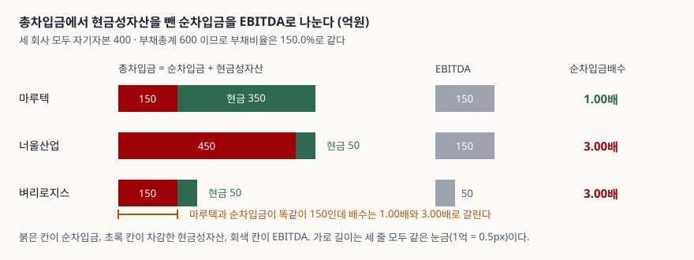

> 예제의 회사 `마루텍`·`너울산업`·`벼리로지스`와 모든 숫자는 계산 원리를 보이려고 만든 가상 값이다. 실제 기업과 관계가 없다. 차입금평균이자율 5.0%와 리스 금액, 법인세 납부액은 설명용 가정값이다.

## 들어가며

재무상태표에 차입금 500억이 적혀 있다고 하자. 같은 쪽 자산 항목에는 현금성자산 350억이 있다. 이 회사가 진 빚은 500억인가 150억인가. 부채비율은 둘을 구분하지 않으므로 500억으로 센다. 그런데 채권자와 신용평가사가 보는 자료에는 150억 쪽이 적혀 있고, 그 숫자를 다시 한 해 벌어들이는 현금으로 나눈 값이 조건으로 붙어 있다. 부채비율이 같은 두 회사가 이 숫자에서는 세 배로 갈리는 일이 흔하다. 어느 쪽이 맞는 숫자인가가 아니라, 두 숫자가 서로 다른 질문에 답한다는 것이 요점이다.

## 개념

**순차입금(net debt)** 은 총차입금에서 현금성자산을 뺀 금액이다. **순차입금배수(Net Debt/EBITDA)** 는 그 순차입금을 EBITDA로 나눈 값이고, 단위는 배다.

```text
순차입금   = 장단기차입금 + 회사채 − 현금및현금성자산
순차입금배수 = 순차입금 ÷ EBITDA
EBITDA     = 영업이익 + 감가상각비 + 무형자산상각비
```

여기서 먼저 알아 둘 것이 하나 있다. **이 세 줄은 회계기준서에 없다.** K-IFRS 어디에도 순차입금의 정의나 EBITDA의 산식이 적혀 있지 않다. 재무상태표가 "현금및현금성자산"과 "차입금"을 어떻게 측정하는지는 기준서가 정하지만, 그 둘을 빼는 일은 작성자가 자기 기준으로 한다.

기준서가 손을 댄 것은 표시와 공시 쪽이다. K-IFRS 제1007호는 2017년 1월 1일 이후 시작하는 회계연도부터 **재무활동에서 생기는 부채의 변동**을 공시하게 한다. 기초 잔액과 기말 잔액 사이를 재무활동 현금흐름·지배력 획득과 상실·환율변동효과·공정가치변동·그 밖의 변동으로 갈라 적는 조정표가 그 방법 중 하나다(문단 44D). 투자자가 요구한 것은 순부채 조정표였지만 기준서는 순부채를 정의하지 않고 부채 쪽 조정만 요구하는 선에서 멈췄다.

2027년 1월 1일 이후 시작하는 회계연도부터 시행되는 K-IFRS 제1118호는 다른 방향에서 접근한다. 기준서가 규정하지 않은 수익·비용 소계를 경영진이 외부와 소통하는 데 쓰면 **경영진정의 성과지표**로 보고 주석에 공시하게 한다. EBITDA가 그런 소계의 전형이다. 산식을 정해 주는 것이 아니라 "당신이 쓰는 그 숫자를 어떻게 만들었는지 적으라"는 쪽이다.

그래서 순차입금배수를 읽을 때 첫 질문은 "몇 배인가"가 아니라 **"분자와 분모를 어떻게 만들었는가"** 다.

안정성을 재무상태표 안에서만 보는 지표는 [자기자본비율과 차입금의존도](../2026-10-14-equity-ratio-and-borrowing-dependency/index.md)에, 현금성자산의 경계가 어디인지는 [현금성자산과 단기금융상품](../../statements/2026-10-13-cash-equivalents-and-short-term-deposits/index.md)에 정리해 두었다.

## 구조



> **출처**: [한국은행, 『기업경영분석』 통계정보보고서(2019.12) — 분석지표 해설 707 부채비율, 710 차입금의존도, 624 금융비용 대 부채](https://mods.go.kr/boardDownload.es?bid=12030&list_no=379918&seq=1) · [K-IFRS 제1007호 현금흐름표 — 문단 6·7 현금및현금성자산의 정의, 문단 44A~44E 재무활동에서 생기는 부채의 변동 공시](https://accountingwiki.co.kr/standards/1007) (제3자 전재)

붉은 칸이 순차입금, 초록 칸이 차감한 현금성자산이고 둘을 합치면 총차입금이다. 회색 칸은 EBITDA이며 세 줄 모두 눈금이 같다. 위 두 회사는 붉은 칸과 초록 칸을 합친 길이가 같은데 붉은 칸만 놓고 보면 75px와 225px로 세 배 벌어진다. 아래 두 회사는 반대로 붉은 칸이 같고 회색 칸이 세 배 차이다. 배수는 붉은 칸을 회색 칸으로 나눈 값이므로 두 경우 모두 갈린다.

## 동작 원리

### 현금을 빼면 부채비율이 못 보던 것이 보인다

부채비율은 재무상태표의 오른쪽만 본다. 왼쪽에 현금이 얼마나 쌓여 있든 부채총계와 자기자본의 비는 변하지 않는다. 그런데 차입금 500억을 지고 현금 350억을 들고 있는 회사와, 같은 500억을 지고 현금 50억만 있는 회사는 다음 달에 할 수 있는 일이 다르다. 앞 회사는 마음만 먹으면 차입금의 70%를 당장 갚을 수 있다.

순차입금은 이 점을 잡으려고 좌우를 교차해 계산한다. **자산 쪽 한 항목을 부채 쪽에서 빼는 것**이라 재무상태표 안에서만 계산되는 부채비율·차입금의존도와는 다른 정보를 담는다. 예제 `[2]`에서 마루텍과 너울산업은 부채비율 150.0%, 차입금의존도 50.0%로 두 지표가 모두 같은데 순차입금이 150억과 450억으로 갈린다.

### 분모를 EBITDA로 두는 이유와 그 대가

순차입금을 자기자본으로 나누면 또 하나의 재무상태표 비율이 된다. EBITDA로 나누면 **잔액을 유량으로 재는** 지표가 된다. 빚을 자기 돈과 견주는 대신 그 빚을 갚을 돈이 한 해에 얼마나 들어오는지와 견주는 것이다.

EBITDA가 분모로 쓰이는 이유는 셋이다. 감가상각비를 되돌리므로 설비 취득 시점과 상각 방법이 다른 회사를 나란히 놓기 쉽고, 이자비용 전이라 자본구조가 다른 회사끼리 비교해도 분모가 흔들리지 않으며, 법인세 전이라 세율이 다른 나라의 회사와도 견줄 수 있다. [EV/EBITDA](../../valuation/2026-10-03-ev-ebitda-debt-included/index.md)가 같은 분모를 쓰는 것도 같은 이유다.

대가는 분명하다. 되돌린 감가상각비만큼의 설비는 실제로 닳고 있고, 빼지 않은 이자와 법인세는 실제로 나간다. **EBITDA는 빚을 갚는 데 쓸 수 있는 현금이 아니다.** 예제 `[3]`이 그 차이를 금액으로 보인다. 너울산업의 EBITDA는 150억인데 이자 25.0억·법인세 18억·자본적지출 70억을 빼고 나면 남는 것은 37.0억이다.

### 배수 3.00배는 3년이 아니다

순차입금배수를 "번 돈으로 빚을 갚는 데 걸리는 햇수"로 읽는 설명을 자주 보는데, 위 문단의 이유로 성립하지 않는다. 예제 `[4]`가 이것을 숫자로 적는다. 너울산업은 배수 3.00배지만 이자·법인세·설비투자를 치르고 남는 37.0억으로 순차입금 450억을 갚으면 12.2년이 걸린다. 마루텍은 1.00배이고 4.1년이다.

배수와 실제 연수의 비는 회사마다 다르다. 설비투자가 큰 회사일수록 둘이 멀어지고, EBITDA에서 이자가 차지하는 비중이 클수록 더 멀어진다. **배수는 서로 다른 회사를 같은 자로 재기 위한 눈금이지, 기간이 아니다.**

### 같은 배수가 같은 상황을 뜻하지 않는다

예제 `[2]`의 너울산업과 벼리로지스는 배수가 둘 다 3.00배다. 그런데 너울산업은 순차입금 450억에 EBITDA 150억이고, 벼리로지스는 순차입금 150억에 EBITDA 50억이다. 빚의 절대 규모가 세 배 차이다.

둘의 사정이 갈리는 지점은 **EBITDA가 흔들릴 때**다. 영업이 나빠져 EBITDA가 20% 줄면 배수는 양쪽 모두 3.75배로 똑같이 오르지만, 갚아야 할 원금은 여전히 450억과 150억이다. 차환이 막히는 상황에서 450억을 새로 구해야 하는 쪽과 150억을 구해야 하는 쪽은 다른 문제를 푼다. 배수 옆에 순차입금 금액을 같이 적어야 하는 이유다.

### EBITDA와 순차입금은 같은 거래에 함께 반응한다

분자와 분모가 독립이 아니라는 점이 이 지표의 까다로운 부분이다. K-IFRS 제1116호에 따라 운용리스를 사용권자산과 리스부채로 인식하면 두 가지가 동시에 일어난다. 손익계산서에서는 리스료가 사라지고 감가상각비와 이자비용이 생겨 **EBITDA가 올라가고**, 재무상태표에서는 리스부채가 생겨 **순차입금이 올라간다.**

예제 `[6]`이 너울산업의 경우를 계산한다. 리스부채 150억을 인식하면 EBITDA는 150억에서 186억으로 오르고, 리스부채를 차입금에 넣으면 순차입금은 450억에서 600억으로 올라 배수는 3.00배에서 3.23배가 된다. 문제는 세 번째 줄이다. **EBITDA는 올라간 값을 쓰면서 리스부채는 차입금에서 빼면 배수가 2.42배로 내려간다.** 거래는 하나도 달라지지 않았는데 숫자만 좋아진다. 분자와 분모의 범위를 맞추지 않으면 이런 일이 생긴다.

### 기준서가 요구하는 것은 조정표다

순차입금의 정의는 없지만, 차입금이 기초에서 기말로 어떻게 이동했는지는 공시 대상이다. 예제 `[7]`이 너울산업의 차입금 조정표를 K-IFRS 제1007호 문단 44B의 변동 유형으로 적는다. 기초 470억에서 차입 120억과 상환 100억이 재무활동 현금흐름으로 오갔고, 환율변동효과 10억은 현금이 오가지 않았는데 잔액을 늘렸다.

순차입금이 380억에서 450억으로 70억 늘었다고만 적으면 그중 10억이 환율 때문이라는 것이 보이지 않는다. 조정표를 읽는 이유가 여기 있다. 같은 기준서의 공시 방법 항목(문단 44D)이 조정표를 "재무상태표 및 현금흐름표와 연계할 수 있을 만큼" 적으라고 하는 것도 이 때문이다.

## 실습 예제

세 회사의 자기자본 400억과 부채총계 600억을 같게 맞춰 부채비율을 150.0%로 고정하고, 차입금 구성과 보유 현금, 이익 규모만 다르게 뒀다. 금액 단위는 억원이다.

전체 소스: [`code/`](code/) · 수행 기록: [`code/output.txt`](code/output.txt)

```text
[1] 재무상태표 — 자기자본 400 과 부채총계 600 은 세 회사가 같다 (억원)
             단기차입금 장기차입금  회사채 차입금 계 기타부채 부채총계 현금성자산 자기자본
마루텍              150        250     100       500      100      600        350      400
너울산업            150        250     100       500      100      600         50      400
벼리로지스           60        140       0       200      400      600         50      400

[2] 순차입금과 순차입금배수 — 부채비율이 같아도 갈린다 (억원, %, 배)
             부채비율 차입금의존도 총차입금 현금성자산 순차입금   EBITDA 순차입금배수
마루텍          150.0         50.0      500        350      150      150         1.00
너울산업        150.0         50.0      500         50      450      150         3.00
벼리로지스      150.0         20.0      200         50      150       50         3.00

[3] EBITDA 로 가는 사다리 — 영업이익에 상각비를 되돌린다 (억원)
             영업이익 감가상각비   EBITDA 이자비용 법인세 납부 자본적지출 남는 현금
마루텍            110         40      150     25.0          18         70      37.0
너울산업          110         40      150     25.0          18         70      37.0
벼리로지스         30         20       50     10.0           4         25      11.0

[4] 배수는 상환 연수가 아니다 — 남는 현금으로 순차입금을 갚으면 (배, 년)
             순차입금 순차입금배수 남는 현금 실제 상환 연수
마루텍            150         1.00      37.0            4.1
너울산업          450         3.00      37.0           12.2
벼리로지스        150         3.00      11.0           13.6

[5] 마루텍의 현금 350 중 꺼낼 수 없는 돈이 있다면 (억원, 배)
                   차감한 현금 순차입금 순차입금배수
현금 전액 차감             350      150         1.00
질권 120 제외              230      270         1.80
해외 80 도 제외            150      350         2.33

[6] 너울산업이 창고 운용리스를 사용권자산으로 인식하면 (억원, 배)
                 영업이익 상각비 계   EBITDA 순차입금 순차입금배수
리스 인식 전          110        40      150      450         3.00
리스부채 포함         116        70      186      600         3.23
리스부채 제외         116        70      186      450         2.42
```

`[2]`가 이 글의 요지다. 세 회사의 부채비율은 150.0%로 같은데 순차입금배수는 1.00배·3.00배·3.00배로 갈린다. 마루텍과 너울산업은 차입금 구성까지 똑같고 현금만 350억과 50억으로 다른데, 부채비율도 차입금의존도도 그 차이를 담지 못한다. 반대로 마루텍과 벼리로지스는 순차입금이 똑같이 150억인데 EBITDA가 150억과 50억이라 배수가 갈린다.

`[1]`에서 벼리로지스의 사정이 보인다. 부채 600억 중 400억이 매입채무 등 이자를 부담하지 않는 부채이고 차입금은 200억뿐이라 차입금의존도는 20.0%로 셋 중 가장 낮다. 그런데 배수는 너울산업과 같은 3.00배다. 빚이 적은 대신 그 빚을 갚을 이익도 적기 때문이다.

`[5]`가 분자를 만드는 일의 어려움을 보인다. 마루텍의 현금 350억 중 120억이 담보로 질권이 설정돼 있고 80억이 송금 제약이 있는 해외 종속기업에 있다면, 실제로 차입금 상환에 쓸 수 있는 돈은 150억이다. 세 경우의 배수는 1.00배·1.80배·2.33배다. **같은 재무상태표에서 세 숫자가 모두 나온다.** 어느 것을 썼는지 밝히지 않으면 비교가 성립하지 않는다.

`[3]`과 `[4]`는 분모 쪽 이야기다. 마루텍과 너울산업은 영업이익 110억·감가상각비 40억으로 EBITDA가 똑같이 150억이고, 이자·법인세·설비투자를 빼고 남는 현금도 37.0억으로 같다. 그 37.0억으로 각자의 순차입금을 갚으면 4.1년과 12.2년이다. 배수 1.00배와 3.00배의 세 배 차이가 연수로는 세 배가 되지 않는다. 분모에서 뺀 것들이 두 회사에 같은 금액으로 붙기 때문이다.

`[7]`의 차입금 조정표는 [`code/output.txt`](code/output.txt)에 있다. 기초 총차입금 470억에서 기말 500억으로 가는 사이 차입 120억·상환 100억·환율변동 10억이 끼어 있고, 늘어난 순차입금 70억 중 10억은 현금이 오가지 않은 변동이다.

## 실무에서 주의할 점

- **분자의 범위를 먼저 확인한다.** 리스부채·전환사채·파생상품부채를 차입금에 넣는지가 자료마다 다르다. 예제 `[6]`에서 같은 거래의 배수가 3.23배와 2.42배로 갈린 것이 그 차이다. 두 회사를 나란히 놓기 전에 양쪽이 같은 범위를 썼는지 본다.
- **EBITDA를 올리는 조정은 순차입금도 올린다.** 리스 인식처럼 분자와 분모가 함께 움직이는 거래에서는 한쪽만 반영한 숫자가 가장 좋아 보인다. 분자를 늘리지 않으면서 분모만 늘리는 조정이 있다면 근거를 따로 확인한다.
- **차감하는 현금에 꺼낼 수 없는 돈이 섞이지 않게 한다.** 질권이 설정된 예금, 송금에 제약이 있는 해외 자회사의 현금, 결제를 위해 상시 들고 있어야 하는 최소 운전자금은 상환에 쓸 수 없다. K-IFRS 제1007호는 사용이 제한된 현금의 금액을 공시하게 하므로(문단 48) 주석에서 확인할 수 있다.
- **배수를 상환 기간으로 바꿔 읽지 않는다.** 예제 `[4]`에서 3.00배가 12.2년이었다. 기간이 궁금하면 EBITDA에서 이자·법인세·자본적지출을 뺀 금액으로 직접 나눈다.
- **배수 옆에 순차입금 금액을 같이 적는다.** 같은 3.00배라도 450억과 150억은 차환이 막혔을 때 전혀 다른 문제가 된다.
- **적정 수준을 근거 없이 정하지 않는다.** 기준서에도 한국은행 기업경영분석에도 순차입금배수의 표준비율은 없다. 한국은행이 표준비율을 제시한 지표는 비유동비율과 비유동장기적합률뿐이고 둘 다 100% 이하를 든다. 업종과 사업 주기에 따라 적정선이 다르므로, 기준선을 쓸 때는 그 기준이 어느 자료의 것인지 밝힌다.
- **EBITDA는 한 해치 유량이라 기준 기간을 맞춘다.** 순차입금은 기말 잔액이고 EBITDA는 기간 합계다. 반기 실적에 연환산한 EBITDA를 쓸 때와 최근 12개월 합계를 쓸 때 배수가 달라진다.

## 정리

- 순차입금은 총차입금에서 현금성자산을 뺀 금액이고, 순차입금배수는 그것을 EBITDA로 나눈 값이다. 셋 다 회계기준서에 정의가 없다.
- 자산 쪽 항목을 부채 쪽에서 빼므로 재무상태표 안에서만 계산되는 부채비율·차입금의존도가 못 보는 것을 담는다. 예제에서 두 지표가 똑같은 두 회사의 배수가 1.00배와 3.00배로 갈렸다.
- 배수는 햇수가 아니다. 3.00배인 회사가 이자·법인세·자본적지출을 치르고 남는 돈으로 갚으면 12.2년이 걸렸다.
- 같은 배수가 같은 상황을 뜻하지 않는다. 3.00배인 두 회사의 순차입금이 450억과 150억이었다.
- 분자와 분모는 독립이 아니다. 운용리스를 사용권자산으로 인식하면 EBITDA와 순차입금이 함께 오르고, 한쪽만 반영하면 배수가 조용히 내려간다.
- K-IFRS 제1007호는 순부채를 정의하는 대신 재무활동에서 생기는 부채의 기초·기말 조정표를 공시하게 한다(2017.1.1 시행). K-IFRS 제1118호는 EBITDA 같은 소계를 경영진정의 성과지표로 보고 산출 근거를 주석에 적게 한다(2027.1.1 시행).

## 참고 자료

- [한국회계기준원 — 시행 중인 K-IFRS 기준서 목록](https://www.kasb.or.kr/front/board/ingAccountingList.do) — 기업회계기준서 제1007호·제1116호·제1118호 원문(PDF·HWP) 발행처. 아래 전재 사이트는 문단을 바로 열기 위한 편의 링크다
- [IFRS Foundation — IFRS 18 Presentation and Disclosure in Financial Statements](https://www.ifrs.org/issued-standards/list-of-standards/ifrs-18-presentation-and-disclosure-in-financial-statements/) — 국제회계기준 원문 발행처. 2027년 1월 1일 이후 시작하는 연차 보고기간부터 적용하며 조기적용을 허용한다는 것, 경영진정의 성과지표를 "IFRS 회계기준이 규정하지 않은 수익·비용 소계로서 경영진이 공개 커뮤니케이션에서 재무성과의 한 측면을 설명하는 데 쓰는 것"으로 정의한다는 것
- [IFRS Foundation — IAS 7 Statement of Cash Flows](https://www.ifrs.org/issued-standards/list-of-standards/ias-7-statement-of-cash-flows/) — 재무활동에서 생기는 부채의 변동 공시를 추가한 2016년 1월 공시 개선 개정의 발행처. 2017년 1월 1일 이후 시작하는 회계연도부터 적용
- [K-IFRS 제1007호 현금흐름표 — 문단 6·7 현금및현금성자산, 문단 44A~44E 재무활동에서 생기는 부채의 변동 공시, 문단 48 사용이 제한된 현금](https://accountingwiki.co.kr/standards/1007) (제3자 전재)
- [K-IFRS 제1116호 리스](https://accountingwiki.co.kr/standards/1116) (제3자 전재) — 사용권자산과 리스부채의 인식, 리스료가 감가상각비와 이자비용으로 갈리는 구조
- [한국은행, 『기업경영분석』 통계정보보고서(2019.12) — 분석지표 해설 624 금융비용 대 부채, 625 차입금평균이자율, 705 비유동비율, 706 비유동장기적합률, 707 부채비율, 710 차입금의존도](https://mods.go.kr/boardDownload.es?bid=12030&list_no=379918&seq=1) — 통계청 정기통계품질진단 자료. 이자부부채와 비이자부부채의 구분, 표준비율을 둔 지표와 두지 않은 지표
