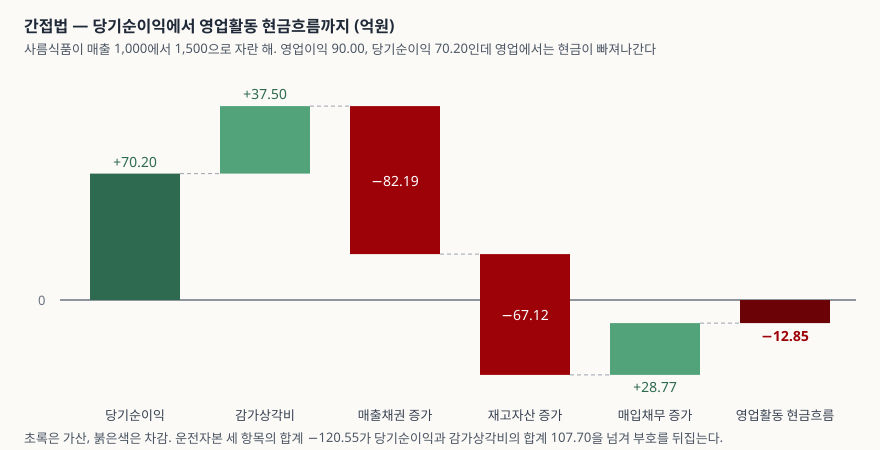

> 예제의 회사 `사름식품`과 모든 숫자는 계산 원리를 보이려고 만든 가상 값이다. 실제 기업과 관계가 없다. 회전일수와 법인세율 22%, 감가상각비율은 설명용 가정값이다.

## 들어가며

손익계산서에 영업이익 90억이 찍힌 회사가 있다. 매출은 전년 1,000억에서 1,500억으로 늘었고 영업이익률도 전년과 같은 6%다. 그런데 같은 해 현금흐름표의 영업활동 현금흐름은 −12.85억이다. 번 것은 분명한데 영업에서 현금이 나갔다. 회계를 조작한 것도, 일회성 손실이 난 것도 아니다. 손익계산서를 아무리 들여다봐도 이유가 보이지 않는데, 재무상태표에서 매출채권과 재고자산이 각각 82억과 67억 늘어 있다. 간접법 현금흐름표에서 이익과 현금을 가장 크게 벌리는 것은 대개 감가상각비가 아니라 이 줄이다.

## 개념

**영업 운전자본**은 영업 활동 때문에 자산과 부채에 묶여 있는 돈이다. 매출채권과 재고자산은 돈을 묶고, 매입채무는 거래처의 돈을 당분간 쓰는 것이라 묶인 돈을 덜어 준다.

```text
영업 운전자본 = 매출채권 + 재고자산 − 매입채무
```

한국은행 기업경영분석은 유동자산에서 유동부채를 뺀 금액을 순운전자본으로 두고 총자본 대비 비율(713 순운전자본 대 총자본)을 지표로 쓴다. 여기서는 영업에서 생기는 세 항목만 추렸다.

K-IFRS 제1007호는 간접법을 "당기순손익에 다음 항목들의 영향을 조정하여" 영업활동 순현금흐름을 결정하는 방법으로 적고, 조정 대상 첫 번째로 **회계기간 동안 발생한 재고자산과 영업활동 관련 채권·채무의 변동**을 든다(문단 20). 감가상각비 같은 비현금항목과, 투자·재무활동으로 분류되는 항목이 그 뒤를 잇는다. 세 종류 중 금액이 가장 크게 흔들리는 쪽이 첫 번째다.

두 방법이 어떻게 갈리는지는 [현금흐름표 직접법과 간접법](../../statements/2026-10-23-cash-flow-direct-vs-indirect/index.md)에, 묶인 돈이 풀리기까지 걸리는 날수는 [현금전환주기](../2026-10-13-cash-conversion-cycle-negative/index.md)에 정리해 두었다.

## 구조



> **출처**: [K-IFRS 제1007호 현금흐름표 — 문단 18 직접법과 간접법, 문단 20 간접법의 조정 항목](https://accountingwiki.co.kr/standards/1007) (제3자 전재) · [한국은행, 『기업경영분석』 통계정보보고서(2019.12) — 분석지표 해설 713 순운전자본 대 총자본, 807 재고자산회전율, 809 매출채권회전율, 810 매입채무회전율](https://mods.go.kr/boardDownload.es?bid=12030&list_no=379918&seq=1)

왼쪽 두 칸이 당기순이익 70.20과 감가상각비 37.50이고 합이 107.70이다. 가운데 두 칸이 매출채권 증가 82.19와 재고자산 증가 67.12, 오른쪽 초록 칸이 매입채무 증가 28.77이다. 운전자본 세 항목의 합계가 −120.55라 앞의 107.70을 넘겨 막대가 0 아래로 내려간다. **감가상각비 한 칸이 가산 쪽 전체의 3분의 1인데, 차감 쪽은 그 두 배가 넘는다.**

## 동작 원리

### 부호는 두 줄로 정리된다

조정의 방향은 외울 것이 아니라 뜻을 보면 나온다.

| 변동 | 조정 | 왜 |
|---|---|---|
| 매출채권 증가 | 차감 | 매출로 인식해 이익에는 들어갔는데 아직 받지 못한 돈이다 |
| 매출채권 감소 | 가산 | 전기에 이미 이익으로 잡힌 매출을 올해 현금으로 받았다 |
| 재고자산 증가 | 차감 | 돈을 주고 사 놨지만 아직 팔리지 않아 매출원가에 들어가지 않았다 |
| 재고자산 감소 | 가산 | 매출원가로 비용 처리된 금액 중 현금은 전기에 이미 나갔다 |
| 매입채무 증가 | 가산 | 매출원가로 비용 처리했지만 아직 치르지 않은 돈이다 |
| 매입채무 감소 | 차감 | 전기에 이미 비용으로 잡힌 매입 대금을 올해 치렀다 |

규칙으로 줄이면 **영업 자산이 늘면 빼고 영업 부채가 늘면 더한다.** 이익은 발생주의로 적히고 현금은 실제로 오간 것만 세므로, 둘 사이의 어긋남이 그대로 재무상태표의 운전자본 잔액에 쌓인다. 간접법은 그 쌓인 차이의 증감분을 되돌려 현금으로 환산한다.

### 매출이 늘면 운전자본도 비례해 늘어난다

여기서 성장 기업의 문제가 생긴다. 회전일수가 그대로라면 운전자본 잔액은 매출 규모에 비례한다. 매출채권은 매출액에, 재고자산과 매입채무는 매출원가에 걸려 있기 때문이다. 예제의 가정에서 순운전자본은 매출액의 약 24.1%다.

그러면 매출이 `g`만큼 늘 때 운전자본은 전기 매출액의 24.1% × `g`만큼 늘고, 그 금액이 통째로 영업활동 현금흐름에서 빠진다. 반면 들어오는 쪽인 당기순이익과 감가상각비는 매출액의 7.18%뿐이다. **묶이는 비율이 버는 비율보다 세 배 이상 크다.** 매출이 빠르게 늘수록 차감이 가산을 앞지른다.

예제 `[5]`가 그 결과를 한 줄로 보인다. 영업활동 현금흐름을 영업이익으로 나눈 값이 역성장 2.20배, 정체 1.20배, 성장 0.53배, 급성장 −0.14배로 단조롭게 내려간다. 네 경우의 영업이익률은 모두 6.00%다.

### 현금흐름이 0이 되는 성장률이 있다

묶이는 쪽과 버는 쪽이 둘 다 매출에 비례하므로, 두 힘이 같아지는 성장률을 풀 수 있다. 예제 `[6]`이 이분법으로 찾은 값은 **42.41%** 다. 이보다 느리게 자라면 영업에서 현금이 남고, 빠르게 자라면 이익이 나는 해에도 현금이 빠져나간다.

이 숫자는 예제의 가정에서만 성립한다. 영업이익률이 두 배면 임계점이 올라가고, 회전일수가 길면 내려간다. 중요한 것은 값이 아니라 **그런 지점이 존재한다**는 사실이다. 흑자 성장 기업이 자금을 조달해야 하는 이유가 설비투자 때문만은 아니다.

### 회전일수를 줄이면 한 번은 되돌릴 수 있다

예제 `[7]`에서 매출채권 회수를 60일에서 45일로, 재고를 70일에서 55일로 줄이면 같은 급성장 해의 영업활동 현금흐름이 −12.85에서 91.95로 뒤집힌다. 운전자본 증가가 120.55에서 15.75로 줄기 때문이다.

다만 이 효과는 **그 해 한 번뿐이다.** 45일과 55일로 자리를 잡고 나면 그다음 해부터는 다시 새 회전일수에 비례해 운전자본이 늘어난다. 회수 기간 단축은 묶인 돈을 한 번 풀어 주는 것이지 성장에 따르는 자금 소요 자체를 없애지 않는다. 한 해에 현금흐름이 크게 좋아졌다면 이런 일회성이 섞였는지 먼저 본다.

### 재무상태표의 차액과 조정액은 같지 않다

운전자본 변동을 재무상태표의 기말 잔액에서 기초 잔액을 빼 구하는 방식은 편하지만 틀릴 수 있다. 잔액을 움직이는 것 중에 영업활동 현금흐름이 아닌 것이 있기 때문이다.

- **사업결합으로 승계한 채권·재고** — 자산은 늘었지만 영업에서 현금이 나간 것이 아니다. 지급한 대가는 투자활동이다
- **외화 매출채권의 환율변동** — 잔액은 움직였는데 현금은 오가지 않았다
- **매출채권 손상차손과 제각** — 비현금항목이라 따로 조정된다
- **매각예정으로 분류한 자산** — 잔액이 다른 줄로 옮겨 간다

예제 `[8]`이 급성장 해의 매출채권 증가 82.19 중 40.00이 사업결합 승계분이고 15.00이 환율변동이라면, 영업활동에서 조정할 금액은 27.19라는 것을 보인다. 둘을 같다고 보면 영업활동 현금흐름을 55.00만큼 적게 적는다. 주석의 운전자본 변동 내역을 보는 이유가 여기 있다.

## 실습 예제

가상 회사 `사름식품`의 매출액만 바꿔 네 경우를 만들었다. 매출원가율 70%·판관비율 24%·회전일수는 네 경우가 모두 같으므로 영업이익률은 6.00%로 고정된다. 금액 단위는 억원이다.

전체 소스: [`code/`](code/) · 수행 기록: [`code/output.txt`](code/output.txt)

```text
[1] 전기 재무상태표의 영업 운전자본 — 매출액 1,000 기준 (억원)
  매출채권 (매출액 × 60/365)          164.38
  재고자산 (매출원가 × 70/365)         134.25
  매입채무 (매출원가 × 30/365)         -57.53
  순운전자본                            241.10

[2] 손익 — 네 경우의 영업이익률은 6.00% 로 같다 (억원, %)
                  매출액  매출원가    판관비  영업이익 영업이익률 당기순이익
역성장 −20%          800     560.0     192.0     48.00       6.00      37.44
정체 0%            1,000     700.0     240.0     60.00       6.00      46.80
성장 +20%          1,200     840.0     288.0     72.00       6.00      56.16
급성장 +50%        1,500   1,050.0     360.0     90.00       6.00      70.20

[3] 기말 운전자본 잔액과 전기 대비 증감 (억원)
                매출채권  재고자산  매입채무 순운전자본 전기 대비 증감
역성장 −20%       131.51    107.40     46.03     192.88         -48.22
정체 0%           164.38    134.25     57.53     241.10           0.00
성장 +20%         197.26    161.10     69.04     289.32          48.22
급성장 +50%       246.58    201.37     86.30     361.64         120.55

[4] 간접법 — 당기순이익에서 영업활동 현금흐름까지 (억원)
               당기순이익 +감가상각비 -매출채권증가  -재고증가 +매입채무증가 영업활동현금흐름
역성장 −20%         37.44       20.00         32.88      26.85        -11.51           105.66
정체 0%             46.80       25.00         -0.00      -0.00          0.00            71.80
성장 +20%           56.16       30.00        -32.88     -26.85         11.51            37.94
급성장 +50%         70.20       37.50        -82.19     -67.12         28.77           -12.85

[5] 이익과 현금의 간격 — 같은 이익률에서 얼마나 벌어지는가 (억원, 배)
                영업이익 영업활동현금흐름       차이 현금흐름÷영업이익
역성장 −20%        48.00           105.66      57.66              2.20
정체 0%            60.00            71.80      11.80              1.20
성장 +20%          72.00            37.94     -34.06              0.53
급성장 +50%        90.00           -12.85    -102.85             -0.14

[6] 영업활동 현금흐름이 0 이 되는 성장률 — 이분법으로 찾는다
  매출 성장률 42.41% 에서 영업활동 현금흐름 0.0000

[7] 급성장 +50% 에서 회전일수만 줄이면 (억원)
                매출채권  재고자산 순운전자본 전기 대비 증감 영업활동현금흐름
60일 · 70일       246.58    201.37     361.64         120.55           -12.85
45일 · 55일       184.93    158.22     256.85          15.75            91.95

[8] 재무상태표의 차액과 현금흐름표의 변동액은 같지 않다 (억원)
  재무상태표 매출채권 증가 (기말 − 기초)             82.19
  (-) 사업결합으로 승계한 매출채권                -40.00
  (-) 외화 매출채권의 환율변동효과                -15.00
  영업활동에서 조정할 매출채권 증가                 27.19
```

`[2]`와 `[4]`를 나란히 보는 것이 이 글의 요지다. 손익계산서만 보면 네 경우가 똑같이 건강하다. 영업이익률 6.00%에 당기순이익은 매출에 비례해 37.44·46.80·56.16·70.20으로 커진다. 같은 네 경우의 영업활동 현금흐름은 105.66·71.80·37.94·−12.85로 **정확히 반대 방향**이다.

`[3]`이 그 이유를 보인다. 매출이 50% 늘면 매출채권은 164.38에서 246.58로, 재고자산은 134.25에서 201.37로 늘어난다. 매입채무도 28.77 늘어 일부를 메우지만 순운전자본은 120.55 늘었다. 그 120.55가 `[4]`에서 그대로 차감된다.

`[4]`의 역성장 줄은 부호가 거꾸로다. 매출이 20% 줄면 매출채권과 재고가 풀려 32.88과 26.85가 가산되고, 매입채무도 줄어 11.51이 차감된다. 합치면 48.22가 들어와 영업활동 현금흐름이 105.66으로 영업이익 48.00의 두 배가 넘는다. **매출이 줄어드는 해에 현금이 가장 잘 도는 것은 드문 일이 아니다.** 묶여 있던 돈이 풀리기 때문이고, 다음 해에도 계속 풀릴 수는 없다.

`[7]`의 두 줄 차이는 104.80이다. 매출도 이익도 그대로인데 회수와 재고 관리만 바꿔 얻은 금액이다. 다만 앞서 적은 대로 그다음 해부터는 새 회전일수를 기준으로 다시 비례해 늘어난다.

## 실무에서 주의할 점

- **영업활동 현금흐름이 늘었다고 영업이 좋아진 것은 아니다.** 예제 `[4]`의 역성장 줄이 네 경우 중 현금흐름이 가장 좋다. 매출이 줄어 운전자본이 풀린 것이므로, 현금흐름 증가의 출처가 이익인지 운전자본인지를 먼저 가른다.
- **한 해 좋아진 현금흐름에 일회성이 섞였는지 본다.** 회전일수 단축은 그 해 한 번만 돈을 풀어 준다. 예제 `[7]`에서 104.80이 들어왔지만 그다음 해부터는 없다.
- **매입채무를 늘려 만든 현금흐름은 되돌아온다.** 결제를 미루면 그해 영업활동 현금흐름은 좋아지지만 다음 해에 그만큼 차감된다. 매입채무회전율(810)의 추이를 같이 본다.
- **재무상태표의 차액을 그대로 조정액으로 쓰지 않는다.** 사업결합·환율변동·손상·계정 재분류가 섞인다. 예제 `[8]`에서 82.19와 27.19의 차이가 55.00이었다.
- **운전자본 변동 줄에 영업이 아닌 것이 섞이지 않았는지 본다.** 설비 취득 대금을 미지급금으로 두고 그 증가를 운전자본 변동에 넣으면 영업활동 현금흐름이 부풀고 투자활동 유출은 줄어든다.
- **비교는 같은 업종 안에서 한다.** 회전일수의 적정선은 업종마다 다르다. 한국은행 기업경영분석의 회전율 지표에는 표준비율이 없으므로, 기준선을 쓰려면 그 기준이 어느 자료의 것인지 밝힌다.
- **성장과 현금을 같이 계획한다.** 이익이 나는데도 현금이 마르는 구간이 있다는 것을 알면, 성장률을 정할 때 필요한 운전자본 조달까지 같이 셈할 수 있다. [설비투자를 뺀 잉여현금흐름](../2026-10-07-free-cash-flow-after-capex/index.md)과 함께 보면 남는 돈의 범위가 분명해진다.

## 정리

- 간접법은 영업 자산이 늘면 빼고 영업 부채가 늘면 더한다. 이익은 발생주의로, 현금은 실제로 오간 것만 세기 때문이다(K-IFRS 제1007호 문단 20).
- 회전일수가 그대로면 운전자본은 매출에 비례해 늘어난다. 예제의 가정에서 묶이는 비율은 매출의 24.1%이고 버는 비율은 7.18%다.
- 그래서 영업이익률이 6.00%로 같은 네 경우의 영업활동 현금흐름이 105.66·71.80·37.94·−12.85로 갈렸다.
- 두 힘이 같아지는 성장률이 있다. 예제의 가정에서는 42.41%이고, 이보다 빠르게 자라면 흑자인 해에도 영업에서 현금이 나간다.
- 회전일수 단축은 묶인 돈을 한 번 풀어 준다. 예제에서 −12.85가 91.95로 뒤집혔지만 그다음 해에는 반복되지 않는다.
- 재무상태표의 기말·기초 차액을 그대로 조정액으로 쓰면 틀린다. 사업결합·환율변동·손상이 섞인다.

## 참고 자료

- [한국회계기준원 — 시행 중인 K-IFRS 기준서 목록](https://www.kasb.or.kr/front/board/ingAccountingList.do) — 기업회계기준서 제1007호 원문(PDF·HWP) 발행처. 아래 전재 사이트는 문단을 바로 열기 위한 편의 링크다
- [IFRS Foundation — IAS 7 Statement of Cash Flows](https://www.ifrs.org/issued-standards/list-of-standards/ias-7-statement-of-cash-flows/) — 국제회계기준 원문 발행처
- [K-IFRS 제1007호 현금흐름표 — 문단 18 직접법과 간접법, 문단 20 간접법의 조정 항목, 문단 43·44 비현금거래](https://accountingwiki.co.kr/standards/1007) (제3자 전재) — 문단 20이 조정 대상 첫 번째로 "회계기간 동안 발생한 재고자산과 영업활동 관련 채권·채무의 변동"을 든다
- [한국은행, 『기업경영분석』 통계정보보고서(2019.12) — 분석지표 해설 713 순운전자본 대 총자본, 807 재고자산회전율, 809 매출채권회전율, 810 매입채무회전율](https://mods.go.kr/boardDownload.es?bid=12030&list_no=379918&seq=1) — 통계청 정기통계품질진단 자료. 순운전자본의 정의와 회전율 산식, 표준비율을 둔 지표와 두지 않은 지표
