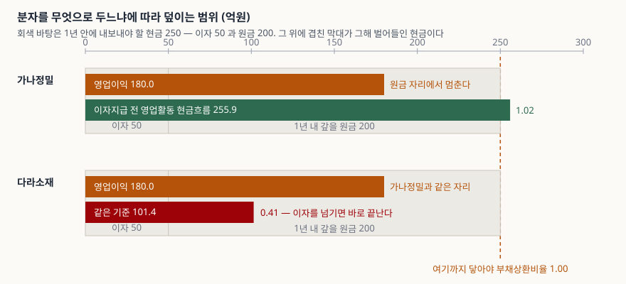
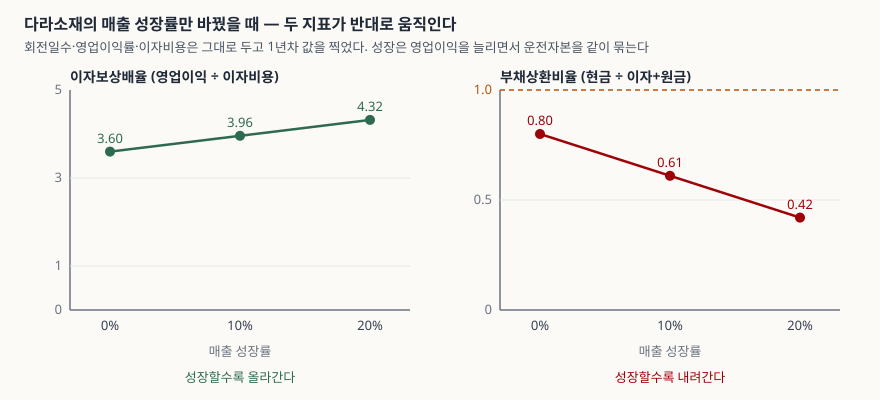

> 예제의 회사 `가나정밀`·`다라소재`와 그 숫자는 계산 원리를 보이려고 만든 가상 값이다. 실제 기업과 관계가 없다.

## 들어가며

종목 정보 화면의 재무 요약에는 이자보상배율이 한 줄로 붙어 있다. 3.60배라고 적혀 있으면 영업이익이 이자의 세 배를 넘으니 당장 급한 곳은 없어 보인다. 그런데 같은 화면 아래로 내려가 현금흐름표를 펴 보면, 영업활동으로 들어온 현금이 영업이익의 4분의 1밖에 안 되는 회사가 있다. 이익은 장부에 잡혔는데 현금은 매출채권과 재고에 묶여 있는 것이다.

여기서 걸리는 것이 하나 더 있다. 이자보상배율의 분모는 이자뿐이다. 1년 안에 갚기로 한 원금은 애초에 들어 있지 않다. 아래 예제의 두 회사는 영업이익·이자비용·차입금이 모두 같아 이자보상배율이 정확히 같은 3.60배로 나오는데, 분자를 영업활동 현금흐름으로 바꾸고 분모에 1년 내 상환 원금을 넣으면 1.02와 0.41로 갈린다. 한 화면에 한 줄로 찍히는 숫자가 가리지 않고 남기는 공백이 여기다.

## 개념

상환 능력을 재는 지표는 **분자에 무엇을 넣는가**와 **분모에 무엇까지 넣는가**로 갈린다.

| 지표 | 산식 | 분자의 성격 | 분모가 덮는 범위 |
|---|---|---|---|
| 이자보상배율 | 영업이익 ÷ 이자비용 | 발생주의 이익 | 이자만 |
| 현금흐름이자보상배율 | (영업활동 현금흐름 + 이자지급) ÷ 이자비용 | 실제 들어온 현금 | 이자만 |
| 부채상환비율 | (영업활동 현금흐름 + 이자지급) ÷ (이자비용 + 1년 내 상환 원금) | 실제 들어온 현금 | 이자 + 원금 |

한국은행 기업경영분석은 이자보상비율을 "이자지급에 필요한 수익의 창출능력"을 재는 지표로 설명한다. 이 설명에서 "수익"은 손익계산서의 영업이익이고, 영업이익은 현금이 실제로 들어왔는지를 묻지 않는다. 외상으로 팔아도 매출로 잡히고, 창고에 쌓인 재고도 아직 비용이 아니다.

분자를 현금으로 바꿀 근거는 현금흐름표 기준서 쪽에 있다. K-IFRS 제1007호는 영업활동 현금흐름을 **외부 재무자원에 의존하지 않고 영업만으로 차입금 상환·영업능력 유지·배당 지급·신규 투자에 필요한 현금을 창출하는 정도를 보여 주는 지표**로 설명한다. "차입금 상환"이 이 문장 안에 들어 있다는 것이 핵심이다. 상환 능력을 재겠다면 기준서가 가리키는 숫자는 영업이익이 아니라 영업활동 현금흐름이다.

이익과 현금이 왜 갈리는지, 그 차이를 가장 크게 벌리는 항목이 무엇인지는 [운전자본 증감](../2026-10-25-working-capital-change-and-operating-cash-flow/index.md)에서 다뤘다. 이 글은 그 다음 질문을 본다. **갈린 현금으로 빚을 갚을 수 있는가.**

## 구조



> **출처**: [K-IFRS 제1007호 현금흐름표 — 문단 13 영업활동 현금흐름의 의의, 문단 20 간접법](https://accountingwiki.co.kr/standards/1007) (제3자 전재) · 원문 발행처 [한국회계기준원](https://www.kasb.or.kr/front/board/ingAccountingList.do) · [한국은행, 『기업경영분석』 통계정보보고서(2019.12) — 분석지표 해설 629 이자보상비율](https://mods.go.kr/boardDownload.es?bid=12030&list_no=379918&seq=1). 막대 길이는 이 글의 [`code/output.txt`](code/output.txt) `[2]`·`[3]`에서 옮겼다.

회색 바탕이 1년 안에 반드시 내보내야 할 현금 250이다. 왼쪽 칸 50이 이자, 오른쪽 칸 200이 그해 만기가 돌아오는 원금이다. 그 위에 겹친 막대가 그해 영업에서 벌어들인 현금이다.

주황색 막대는 두 회사가 똑같다. 영업이익 180이 둘 다 같으니 이자보상배율도 같은 3.60배로 나온다. 갈리는 것은 그 아래 막대다. 가나정밀은 255.9로 회색 바탕을 간신히 넘고, 다라소재는 101.4에서 멈춘다. 이자 칸은 둘 다 넘지만, 원금 칸에 들어서면 다라소재는 4분의 1 지점에서 끝난다.

## 동작 원리

### 분자를 바꾸면 분자에서 이자를 되돌려야 한다

여기서 한 번 틀리기 쉽다. K-IFRS 제1007호는 이자와 배당금의 수취·지급을 각각 따로 공시하고 매 기간 일관된 활동으로 분류하도록 한다. 금융업이 아닌 회사가 이자지급을 영업활동으로 분류했다면, 현금흐름표에 찍힌 영업활동 현금흐름은 **이미 이자를 내고 남은 금액**이다.

그 숫자를 그대로 이자비용으로 나누면 분모의 이자가 분자에서 한 번 빠진 뒤 다시 나눠지는 꼴이 된다. 다라소재로 확인하면 영업활동 현금흐름 51.4를 이자비용 50으로 나눌 때 1.03배가 나오는데, 이자지급을 되돌린 101.4로 계산하면 2.03배다. 두 배 차이다. 분자에 이자지급액을 더해 되돌리는 이유가 이것이다.

| | 가나정밀 | 다라소재 |
|---|---|---|
| 영업활동 현금흐름 | 205.9 | 51.4 |
| 이자지급 전 영업활동 현금흐름 | 255.9 | 101.4 |
| 현금흐름이자보상배율 | 5.12 | 2.03 |

> 값은 [`code/output.txt`](code/output.txt) `[2]`·`[3]`에서 옮겼다.

이자지급을 재무활동으로 분류한 회사라면 영업활동 현금흐름에 이자가 애초에 빠져 있지 않으므로 되돌릴 것이 없다. 분류 방침은 회사마다 다르고 기준서가 둘 다 허용하므로, 지표를 만들기 전에 **그 회사가 이자지급을 어디에 넣었는지**를 현금흐름표에서 먼저 확인해야 한다.

### 원금을 분모에 넣으면 1.00을 넘기가 어려워진다

이자는 매년 비슷하게 나가지만 원금 만기는 해마다 몰리고 흩어진다. 예제의 두 회사는 총차입금 1,000 중 200이 1년 안에 만기다. 분모가 50에서 250으로 다섯 배가 되니, 분자가 그대로여도 지표는 5분의 1이 된다.

```text
[4] 부채상환비율이 1.00 이 되려면 현금이 얼마나 더 있어야 하는가
  가나정밀: 필요 250.0 / 현재 255.9 / 여유 5.9 (현재의 0.98배가 있어야 1.00)
  다라소재: 필요 250.0 / 현재 101.4 / 부족 148.6 (현재의 2.47배가 있어야 1.00)
```

이자보상배율 3.60배짜리 회사가 부채상환비율 1.02에 걸린다는 것이 이 지표의 성격을 보여 준다. 대부분의 회사는 만기가 돌아온 원금을 그해 영업현금으로 갚지 않고 다시 빌려 넘긴다. 그래서 **부채상환비율이 1 미만이라는 사실 자체는 곧바로 위험 신호가 아니다.** 읽어야 할 것은 1에서 얼마나 멀리 떨어져 있는가, 그리고 그 거리를 무엇으로 메우고 있는가다. 가나정밀은 영업현금만으로 한 해를 넘길 수 있고, 다라소재는 148.6을 어디선가 가져와야 한다. 가져올 곳은 차환, 보유 현금, 자산 매각, 증자뿐이다.

### 성장이 지표를 끌어내린다

운전자본은 매출에 비례해 묶인다. 회전일수가 그대로라도 매출이 늘면 매출채권과 재고 잔액이 같이 늘고, 늘어난 만큼이 그해 현금에서 빠진다. 그래서 성장은 영업이익을 올리면서 영업활동 현금흐름을 동시에 누른다.



> **출처**: [K-IFRS 제1007호 현금흐름표 — 문단 20 간접법에서 운전자본 변동을 조정하는 방식](https://accountingwiki.co.kr/standards/1007) (제3자 전재) · 원문 발행처 [한국회계기준원](https://www.kasb.or.kr/front/board/ingAccountingList.do). 두 선의 값은 이 글의 [`code/output.txt`](code/output.txt) `[5]` 1년차에서 옮겼다.

다라소재의 회전일수·영업이익률·이자비용·차입금을 그대로 두고 매출 성장률만 0%·10%·20%로 바꿨다. 영업이익은 180 → 198 → 216으로 늘어 이자보상배율이 3.60 → 3.96 → 4.32로 올라간다. 같은 세 경우에서 부채상환비율은 0.80 → 0.61 → 0.42로 내려간다. 두 지표가 같은 회사의 같은 해를 두고 반대 방향을 가리킨다.

이것을 "성장이 나쁘다"로 읽으면 안 된다. 운전자본에 묶인 현금은 사라진 것이 아니라 회수가 미뤄진 것이고, 성장이 멈추면 돌아온다. 같은 출력의 성장률 0% 줄에서 영업현금흐름이 150으로 올라가는 것이 그 자리다. 읽어야 할 것은 **회수가 미뤄진 기간을 버틸 현금이 있는가**이고, 그 답은 이 지표가 아니라 보유 현금과 미사용 차입한도에 있다.

## 실습 예제

두 회사는 매출 2,000·영업이익률 9%·이자비용 50·총차입금 1,000·1년 내 상환 원금 200이 모두 같다. 다른 것은 감가상각비와 순운전자본 회전일수, 그리고 직전 해 매출 셋뿐이다.

```python
GANA = Company(
    name="가나정밀",
    revenue=2000.0, prev_revenue=1950.0, operating_margin=0.09,
    depreciation=120.0,
    receivable_days=45.0, inventory_days=20.0, payable_days=35.0,
    income_tax_paid=40.0, interest_expense=50.0,
    gross_debt=1000.0, debt_due_within_year=200.0,
)

DARA = Company(
    name="다라소재",
    revenue=2000.0, prev_revenue=1700.0, operating_margin=0.09,
    depreciation=60.0,
    receivable_days=95.0, inventory_days=55.0, payable_days=30.0,
    income_tax_paid=40.0, interest_expense=50.0,
    gross_debt=1000.0, debt_due_within_year=200.0,
)
```

운전자본은 잔액을 직접 넣지 않고 회전일수로 뒀다. 매출이 바뀔 때 잔액과 증감이 함께 움직여야 성장률만 바꾼 경로를 같은 가정으로 뽑을 수 있기 때문이다. 가나정밀의 순운전자본 회전일수는 30일, 다라소재는 120일이다.

간접법으로 영업이익에서 영업활동 현금흐름까지 내려오면 이렇게 갈린다.

```text
[2] 간접법 현금흐름표 — 영업이익에서 영업활동 현금흐름까지
  가나정밀  (순운전자본 회전일수 30일)
    영업이익               180.0   누계     180.0
    감가상각비 가산           120.0   누계     300.0
    매출채권 증가             -6.2   누계     293.8
    재고자산 증가             -2.7   누계     291.1
    매입채무 증가              4.8   누계     295.9
    법인세 납부             -40.0   누계     255.9
    이자 지급              -50.0   누계     205.9
    영업활동 현금흐름                         205.9
  다라소재  (순운전자본 회전일수 120일)
    영업이익               180.0   누계     180.0
    감가상각비 가산            60.0   누계     240.0
    매출채권 증가            -78.1   누계     161.9
    재고자산 증가            -45.2   누계     116.7
    매입채무 증가             24.7   누계     141.4
    법인세 납부             -40.0   누계     101.4
    이자 지급              -50.0   누계      51.4
    영업활동 현금흐름                          51.4
```

같은 영업이익 180에서 출발해 205.9와 51.4로 끝난다. 벌어진 폭 154.5 중 60은 감가상각비 차이고, 나머지 94.5가 운전자본 차이다. 감가상각비는 현금이 나가지 않는 비용이라 더해 주는 것이고, 운전자본은 현금이 실제로 묶인 것이라 빼는 것이다. 성격이 다른 두 항목이 같은 방향으로 겹쳐 차이를 키웠다.

분자와 분모를 바꿔 가며 재면 이렇게 나온다.

```text
[3] 상환능력 지표 — 분자와 분모를 바꿔 가며
  지표                      산식                                        가나정밀        다라소재
  ----------------------------------------------------------------------------------
  이자보상배율                  영업이익 ÷ 이자비용                               3.60        3.60
  현금흐름이자보상배율              (OCF+이자지급) ÷ 이자비용                         5.12        2.03
  부채상환비율                  (OCF+이자지급) ÷ (이자+원금)                      1.02        0.41
  원금상환배율                  OCF ÷ 1년내 상환 원금                           1.03        0.26
  차입금 대비 OCF              OCF ÷ 총차입금 (%)                           20.59        5.14
  상환 소요 연수                총차입금 ÷ OCF (년)                            4.86       19.47
```

첫 줄에서 두 회사는 구분되지 않는다. 두 번째 줄부터 갈라지고, 세 번째 줄에서 한쪽은 1을 넘고 한쪽은 넘지 못한다. 맨 아래 줄이 같은 이야기를 기간으로 바꿔 말한다. 지금 속도로 영업현금만 모아 차입금 1,000을 갚으려면 가나정밀은 4.86년, 다라소재는 19.47년이 걸린다.

전체 소스: [`code/`](code/)

## 실무에서 주의할 점

- **이자지급을 어디에 분류했는지부터 본다.** K-IFRS 제1007호는 비금융회사가 이자지급을 영업활동으로도 재무활동으로도 분류할 수 있게 둔다. 영업활동으로 넣은 회사의 영업활동 현금흐름은 이자를 내고 남은 금액이므로, 되돌리지 않고 이자비용으로 나누면 배율이 절반 가까이 낮게 나온다. 분류가 다른 두 회사를 나란히 놓고 비교할 때 특히 어긋난다.
- **1년 내 상환 원금은 재무상태표 한 줄이 아니다.** 유동성장기부채만 보면 모자란다. 단기차입금, 1년 내 만기 회사채, 리스부채의 유동 부분까지 합쳐야 그해 실제로 나갈 원금이 된다. 주석의 차입금 명세와 만기 구조를 봐야 모인다.
- **부채상환비율 1 미만을 곧바로 위험으로 읽지 않는다.** 만기 원금은 대부분 차환된다. 중요한 것은 1에서 떨어진 거리와, 그 거리를 메우는 수단이 차환인지 자산 매각인지다. 차환에 기대고 있다면 금리와 신용등급이 바뀔 때 같이 흔들린다.
- **성장기 회사의 지표는 성장률과 함께 읽는다.** 운전자본이 묶여 생긴 하락과, 회수가 막혀 생긴 하락은 숫자가 같아도 성격이 다르다. 전자는 성장이 멈추면 돌아오고 후자는 돌아오지 않는다. 가르는 단서는 회전일수다. 회전일수가 그대로인데 잔액만 늘었다면 전자고, 회전일수 자체가 길어졌다면 후자를 의심한다.
- **한 해 숫자로 끊지 않는다.** 영업활동 현금흐름은 대금 입금 시점 하나로 분기가 통째로 밀린다. 한국은행 기업경영분석도 지표를 연간 집계로 공표한다. 최소 3년을 이어 보고, 그 사이 회전일수가 어떻게 움직였는지를 같이 본다.
- **적정 수준을 근거 없이 정하지 않는다.** 한국은행 기업경영분석이 표준비율을 제시한 지표는 비유동비율과 비유동장기적합률뿐이고, 현금흐름 기준 상환능력 지표에는 표준비율이 없다. 프로젝트 금융 약정처럼 계약에 기준선이 들어가는 경우는 있으나 그것은 그 계약의 조건이지 업종 공통의 기준이 아니다. 기준선을 쓸 때는 그 기준이 어느 자료의 것인지 밝힌다.

## 정리

- 이자보상배율은 **발생주의 이익**을 **이자만**으로 나눈 값이다. 두 축 모두 상환에 필요한 것을 전부 담지 않는다.
- 분자를 영업활동 현금흐름으로 바꾸면 이익과 현금이 갈린 회사가 드러난다. 이때 이자지급을 영업활동으로 분류한 회사는 분자에 이자지급액을 되돌려 더해야 한다.
- 분모에 1년 내 상환 원금을 넣으면 분모가 몇 배로 커지고, 이자보상배율이 높은 회사도 1 아래로 내려간다. 1 미만 자체보다 1에서 떨어진 거리와 그것을 메우는 수단이 중요하다.
- 성장은 영업이익을 올리면서 운전자본을 묶어 현금을 누른다. 이자보상배율과 부채상환비율이 반대로 움직이는 구간이 생기므로 성장률과 회전일수를 같이 봐야 한다.
- 예제의 두 회사는 이자보상배율이 같은 3.60배지만 부채상환비율은 1.02와 0.41이고, 영업현금만으로 차입금을 갚는 데 걸리는 기간은 4.86년과 19.47년이다.

## 참고 자료

- [K-IFRS 제1007호 현금흐름표](https://accountingwiki.co.kr/standards/1007) (제3자 전재) — 문단 6 용어의 정의, 문단 13 영업활동 현금흐름의 의의, 문단 18~20 직접법과 간접법, 문단 31·33 이자와 배당금의 분류, 문단 50 미사용 차입한도 등 추가 공시 권장
- [한국회계기준원](https://www.kasb.or.kr/front/board/ingAccountingList.do) — K-IFRS 기준서 원문 발행처
- [한국은행, 『기업경영분석』 통계정보보고서(2019.12) — 분석지표 해설 624 금융비용 대 부채, 625 차입금평균이자율, 629 이자보상비율](https://mods.go.kr/boardDownload.es?bid=12030&list_no=379918&seq=1) — 통계청 정기통계품질진단 자료. 이자보상비율의 산식과 해석, 표준비율을 둔 지표와 두지 않은 지표
- [이자보상배율 — 빚을 감당하는가](../2026-10-02-interest-coverage-ratio/index.md) — 발생주의 기준 이자보상배율과 한계기업 판정
- [운전자본 증감 — 이익과 현금흐름을 가장 크게 벌리는 항목](../2026-10-25-working-capital-change-and-operating-cash-flow/index.md) — 회전일수가 영업활동 현금흐름을 끌어내리는 경로
- [순차입금과 EBITDA 배수](../2026-10-25-net-debt-and-ebitda-multiple/index.md) — 차입금 규모를 이익 창출력으로 나눠 보는 쪽의 지표
