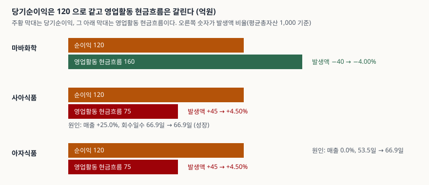

> 예제의 회사 `마바화학`·`사아식품`·`아자식품`과 그 숫자는 계산 원리를 보이려고 만든 가상 값이다. 실제 기업과 관계가 없다.

## 들어가며

실적 발표 날 손익계산서의 당기순이익이 120으로 나란히 찍힌 두 회사가 있다. 이익만 놓고 보면 구분할 방법이 없다. 그런데 현금흐름표로 넘어가면 한쪽은 영업으로 160이 들어왔고 다른 쪽은 75밖에 들어오지 않았다. 이익은 장부에 잡혔지만 그 일부가 매출채권과 재고에 묶여 있는 것이다.

이익과 현금의 이런 차이를 한 숫자로 줄이면 비교하기 쉬워진다. 순이익에서 영업활동 현금흐름을 뺀 값이 발생액이고, 이것을 자산 규모로 나눈 것이 발생액 비율이다. 이 글은 가상 회사 셋으로 그 값을 계산해 보고, 같은 값이 서로 다른 원인에서 나올 수 있다는 점까지 확인한다.

## 개념

**발생액(accruals)** 은 발생주의 이익 가운데 현금이 따라오지 않은 부분이다. 이 글은 현금흐름표로 구하는 방식을 쓴다.

| 항목 | 산식 | 이 글의 예제 |
|---|---|---|
| 발생액 | 당기순이익 − 영업활동 현금흐름 | 마바화학 −40.0 / 사아식품 +45.0 |
| 발생액 비율 | 발생액 ÷ 평균총자산 | −4.00% / +4.50% |

평균총자산으로 나누는 이유는 회사 크기를 지우기 위해서다. 발생액 45는 자산 1,000짜리에게는 크고 자산 100,000짜리에게는 작다.

발생액이 이익의 질을 가늠하는 단서로 쓰이는 근거는 Richard Sloan의 1996년 논문이다. 이 논문은 이익을 현금 부분과 발생액 부분으로 나누고, 두 부분이 다음 해 이익으로 이어지는 정도가 다르다고 보고했다. 다만 발생액을 재무상태표 증감으로 구하는지 현금흐름표로 구하는지, 무엇으로 나누는지에 따라 값이 달라지므로 **다른 출처의 발생액 비율은 산식부터 맞춰야 비교된다.**

## 구조



> **출처**: [K-IFRS 제1007호 현금흐름표 — 문단 18 영업활동 현금흐름의 보고, 문단 20 간접법](https://accountingwiki.co.kr/standards/1007) (제3자 전재) · 원문 발행처 [한국회계기준원](https://www.kasb.or.kr/front/board/ingAccountingList.do). 막대 길이는 이 글의 [`code/output.txt`](code/output.txt) `[2]`·`[3]`·`[5]`에서 옮겼다.

주황색 막대 셋은 길이가 같다. 순이익이 같다는 뜻이다. 그 아래 막대가 영업활동 현금흐름이고, 마바화학만 순이익보다 길다. 마바화학은 이익보다 현금이 더 들어왔고 나머지 둘은 이익보다 현금이 덜 들어왔다.

## 동작 원리

### 간접법이 곧 발생액의 명세서다

K-IFRS 제1007호의 간접법은 순이익에서 출발해 비현금 비용을 더하고 운전자본 증감을 조정해 영업활동 현금흐름에 닿는다. 그 조정 항목의 합이 바로 발생액이다. 사아식품으로 보면 다음과 같다.

```text
사아식품
  당기순이익                  120.0   누계    120.0
  감가상각비 가산              40.0   누계    160.0
  매출채권 증가              -55.0   누계    105.0
  재고자산 증가              -40.0   누계     65.0
  매입채무 증가               10.0   누계     75.0
  영업활동 현금흐름                         75.0
```

> 값은 [`code/output.txt`](code/output.txt) `[2]`에서 옮겼다.

순이익 120에서 현금흐름 75로 내려오는 길에 감가상각비가 +40을 더하고, 매출채권과 재고가 합쳐 −95를 빼고, 매입채무가 +10을 더한다. 순이익에서 영업활동 현금흐름을 뺀 발생액 45는 이 조정 항목의 부호를 뒤집은 합이다.

```text
  항목                  마바화학      사아식품      아자식품
  감가상각비            -40.0     -40.0     -40.0
  매출채권 증가            5.0      55.0      55.0
  재고자산 증가            3.0      40.0      40.0
  매입채무 증가           -8.0     -10.0     -10.0
  합계               -40.0      45.0      45.0
```

> 값은 [`code/output.txt`](code/output.txt) `[4]`에서 옮겼다.

감가상각비는 현금이 나가지 않는 비용이라 모든 회사에서 발생액을 음수 쪽으로 끌어내린다. 설비가 많은 회사는 이 항목이 커서 발생액 비율이 구조적으로 낮게 나온다. 운전자본 항목은 매출이 늘면 같이 늘어 발생액을 양수 쪽으로 민다. 그래서 **발생액 비율의 부호와 크기는 업종과 성장 단계의 영향을 함께 받는다.**

### 같은 비율이 서로 다른 원인에서 나온다

사아식품과 아자식품은 순이익·영업활동 현금흐름·발생액·비율이 모두 같다. 그런데 원인은 다르다. 매출채권 회수일수를 보면 갈린다.

```text
  마바화학  매출 증가율 +1.4%  회수일수 60.4일 -> 60.8일  (매출채권 증가 +5.0)
  사아식품  매출 증가율 +25.0%  회수일수 66.9일 -> 66.9일  (매출채권 증가 +55.0)
  아자식품  매출 증가율 +0.0%  회수일수 53.5일 -> 66.9일  (매출채권 증가 +55.0)
```

> 값은 [`code/output.txt`](code/output.txt) `[5]`에서 옮겼다.

사아식품은 매출이 25% 늘었고 회수일수는 그대로다. 외상 잔액이 늘어난 것은 매출이 커졌기 때문이다. 아자식품은 매출이 그대로인데 회수일수가 53.5일에서 66.9일로 길어졌다. 같은 잔액 증가가 대금 회수가 늦어진 결과다. 발생액 비율 4.50%는 둘을 구분하지 못한다.

이 차이가 중요한 이유는 뒤따르는 일이 다르기 때문이다. 성장으로 묶인 운전자본은 성장이 멈추면 돌아오지만, 회수가 늦어진 잔액은 회수가 정상으로 돌아와야 풀린다. 어느 쪽인지는 이 지표가 알려 주지 않고 회수일수·재고일수 같은 회전 지표와 주석의 연령별 채권 분석으로 확인한다.

## 실습 예제

세 회사의 입력은 순이익·감가상각비·평균총자산이 같고 매출과 운전자본 증감만 다르다.

```python
SAA = Company(
    name="사아식품", net_income=120.0, depreciation=40.0,
    revenue=1500.0, prev_revenue=1200.0,
    receivable=275.0, prev_receivable=220.0,
    inventory_change=40.0, payable_change=10.0, average_total_assets=1000.0,
)
```

계산 결과는 다음과 같다.

```text
                     순이익    영업CF     발생액       비율
  마바화학           120.0   160.0   -40.0   -4.00%
  사아식품           120.0    75.0    45.0    4.50%
  아자식품           120.0    75.0    45.0    4.50%
```

> 값은 [`code/output.txt`](code/output.txt) `[3]`에서 옮겼다.

전체 소스: [`code/`](code/)

## 실무에서 주의할 점

- **산식을 먼저 확인한다.** 발생액을 현금흐름표(순이익 − 영업활동 현금흐름)로 구하는지 재무상태표 증감으로 구하는지, 분모를 기말 자산으로 쓰는지 평균 자산으로 쓰는지에 따라 같은 회사의 값이 달라진다. 출처가 다른 수치를 한 표에 섞지 않는다.
- **이자와 법인세의 분류가 값을 바꾼다.** 이자지급을 영업활동으로 넣은 회사와 재무활동으로 넣은 회사는 영업활동 현금흐름의 정의가 달라 발생액이 달리 나온다. 현금흐름표에서 분류 방침을 먼저 본다.
- **높은 발생액을 곧바로 이익 부풀리기로 읽지 않는다.** 사아식품의 4.50%는 회수일수가 그대로인 성장에서 나왔다. 발생액은 이익과 현금이 갈렸다는 사실을 알려 줄 뿐 이유는 알려 주지 않는다.
- **낮은 발생액도 확인 없이 안심하지 않는다.** 감가상각비가 큰 회사는 운전자본이 묶여도 발생액이 음수로 남을 수 있다. 감가상각비 항목을 따로 떼어 보면 운전자본 부분만의 부호가 보인다.
- **한 해 값으로 끊지 않는다.** 대금 입금 시점이 해를 넘나들면 한 해 발생액이 크게 흔들린다. 최소 3년을 이어서 보고 회수일수와 재고일수를 같이 본다.
- **기준선은 이 글에 없다.** 발생액 비율의 높고 낮음을 가르는 수치는 업종과 산식에 따라 달라서 공통 기준을 두지 않았다. 기준을 쓸 때는 그 기준의 출처와 산식을 밝혀야 한다.

## 정리

- 발생액은 **당기순이익 − 영업활동 현금흐름**이고, 발생액 비율은 이것을 **평균총자산**으로 나눈 값이다. 예제는 −4.00%와 +4.50%가 나왔다.
- 간접법의 조정 항목이 곧 발생액의 구성이다. **감가상각비는 음수 쪽**, **매출채권·재고자산 증가는 양수 쪽**, **매입채무 증가는 음수 쪽**으로 작용한다.
- 같은 +4.50%가 성장(회수일수 66.9일 유지)에서도 회수 지연(53.5일 → 66.9일)에서도 나온다. 원인은 회전 지표로 가른다.
- 값은 산식과 업종·성장 단계에 따라 달라지므로 같은 산식끼리, 여러 해를 이어서 비교한다.

## 참고 자료

- [K-IFRS 제1007호 현금흐름표](https://accountingwiki.co.kr/standards/1007) (제3자 전재) — 문단 18 영업활동 현금흐름의 보고, 문단 20 간접법
- [K-IFRS 제1001호 재무제표 표시](https://accountingwiki.co.kr/standards/1001) (제3자 전재) — 발생기준 회계(문단 27)
- [한국회계기준원](https://www.kasb.or.kr/front/board/ingAccountingList.do) — K-IFRS 기준서 원문 발행처
- [Sloan, R. G. (1996), "Do Stock Prices Fully Reflect Information in Accruals and Cash Flows about Future Earnings?", The Accounting Review 71(3), 289–315](https://www.cuhk.edu.hk/acy2/workshop/June2009Wasley/1996TAR%29.pdf) — 이익을 발생액과 현금 부분으로 나눈 논문(저자 공개본 아님, 제3자 호스팅)
- [운전자본 증감 — 이익과 현금흐름을 가장 크게 벌리는 항목](../2026-10-25-working-capital-change-and-operating-cash-flow/index.md) — 회전일수가 영업활동 현금흐름에 미치는 경로
- [영업현금흐름으로 보는 상환 능력](../2026-11-02-operating-cash-flow-debt-service-coverage/index.md) — 같은 영업이익에서 현금이 갈리는 경우
