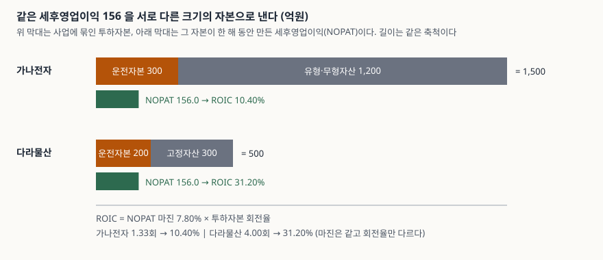
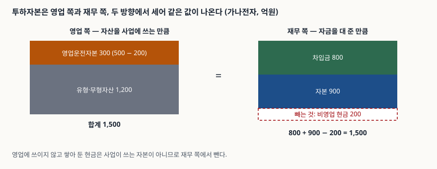

> 예제의 회사 `가나전자`·`다라물산`과 그 숫자는 계산 원리를 보이려고 만든 가상 값이다. 실제 기업과 관계가 없다. 세율 22%, 차입금 이자율 5%, 자본비용 8%는 계산을 위한 가정이다.

## 들어가며

두 회사의 손익계산서를 나란히 놓으면 매출 2,000에 영업이익 200으로 똑같다. 영업이익률도 10%로 같으니 장사 솜씨가 비슷해 보인다. 그런데 재무상태표를 펴면 한쪽은 공장과 설비로 1,200이 묶여 있고, 다른 쪽은 300밖에 없다. 같은 200을 벌려고 한쪽은 네 배의 자본을 깔아 둔 셈이다.

이익률만 보면 이 차이가 보이지 않는다. ROE는 자본을 쓰기는 하지만, 그 자본이 빌린 돈인지 주주가 낸 돈인지에 따라 숫자가 움직여서 사업 자체의 효율을 재기에는 변수가 하나 더 낀다. 사업에 묶인 자본 전체를 분모에 두고 영업 쪽 이익만 분자에 두면 이 두 문제가 한 번에 정리된다. 그 지표가 ROIC(Return on Invested Capital, 투하자본이익률)다.

## 개념

ROIC는 한 해 동안 사업이 낸 세후영업이익을 사업에 묶인 자본으로 나눈 값이다.

| 항목 | 정의 | 이 글의 예제 |
|---|---|---|
| NOPAT(세후영업이익) | 영업이익 × (1 − 세율) | 200 × (1 − 0.22) = 156.0 |
| 투하자본 | 영업운전자본 + 유형·무형자산 | 가나전자 1,500 / 다라물산 500 |
| ROIC | NOPAT ÷ 투하자본 | 10.40% / 31.20% |

NOPAT는 이자비용을 빼기 전의 이익에 세금만 적용한 값이다. 이자는 사업이 낸 이익이 아니라 자금을 댄 쪽에 나눠 주는 몫이므로, 사업의 수익성을 재는 분자에서는 뺀 채로 둔다.

K-IFRS는 ROIC를 정의하지 않는다. 기준서가 정하는 것은 재무상태표에 어떤 항목을 어떻게 표시하는지(제1001호 문단 54)이고, ROIC는 그 항목을 모아 만드는 분석 지표다. 그래서 회사나 분석자마다 투하자본의 범위가 다르다. 리스를 쓰는 회사는 사용권자산과 리스부채(제1116호)를 투하자본에 넣을지 정해야 하고, 법인세율 대신 실제 부담한 세율을 쓰는 경우도 있다. **ROIC 숫자를 비교할 때는 산식의 범위를 먼저 맞춰야 한다.**

## 구조



> **출처**: [K-IFRS 제1001호 재무제표 표시 — 문단 54 재무상태표에 표시하는 항목](https://accountingwiki.co.kr/standards/1001) (제3자 전재) · 원문 발행처 [한국회계기준원](https://www.kasb.or.kr/front/board/ingAccountingList.do). 금액은 이 글의 [`code/output.txt`](code/output.txt) `[2]`·`[3]`에서 옮겼다.

위 막대가 투하자본이고 아래 막대가 NOPAT다. 두 회사의 NOPAT 막대는 길이가 같다. 위 막대만 가나전자가 세 배 길다. 같은 이익을 더 큰 자본 위에서 냈으니 ROIC는 낮게 나온다.

이 관계는 식 하나로 나뉜다. ROIC는 NOPAT 마진(NOPAT ÷ 매출)과 투하자본 회전율(매출 ÷ 투하자본)의 곱이다. 두 회사의 마진은 7.80%로 같고 회전율은 1.33회와 4.00회다. 마진이 같으니 ROIC의 차이는 전부 회전율에서 나온다.

## 동작 원리

### 투하자본은 두 방향에서 세어 맞춘다

투하자본을 세는 방법은 둘이다. 영업 쪽에서는 영업운전자본(매출채권·재고자산 같은 영업유동자산에서 매입채무 같은 영업유동부채를 뺀 것)에 유형·무형자산을 더한다. 재무 쪽에서는 차입금과 자본을 더하고 영업에 쓰이지 않는 현금을 뺀다.



> **출처**: [K-IFRS 제1001호 재무제표 표시 — 문단 54 재무상태표에 표시하는 항목](https://accountingwiki.co.kr/standards/1001) (제3자 전재) · 원문 발행처 [한국회계기준원](https://www.kasb.or.kr/front/board/ingAccountingList.do). 값은 [`code/output.txt`](code/output.txt) `[2]`에서 옮겼다.

```text
가나전자
  영업 쪽  영업운전자본 300.0 + 고정자산 1200.0 = 1500.0
  재무 쪽  차입금 800.0 + 자본 900.0 - 현금 200.0 = 1500.0
  일치 여부  True
```

두 값이 같아야 하는 이유는 재무상태표의 양변이 같기 때문이다. 자산 총액에서 영업과 무관한 현금을 빼고 영업부채를 뺀 것이 영업 쪽 투하자본이고, 그만큼을 댄 자금이 차입금과 자본이다. 한쪽에서만 세고 끝내면 현금이나 영업부채를 빠뜨려도 알아차리기 어렵다. 두 방향의 값이 어긋나면 어느 항목을 분류에서 놓쳤다는 신호다.

여기서 **영업에 쓰이지 않는 현금을 가르는 일이 가장 판단이 필요한 부분**이다. 현금과 단기금융상품은 한 계정에 섞여 있지만 일부는 매입대금을 치르려고 두는 운영 현금이고 일부는 남아서 쌓인 현금이다. 이 글의 예제는 단순하게 200과 250 전액을 비영업 현금으로 뒀다.

### 같은 사업에서 차입금 비중만 바꾸면 ROE만 움직인다

ROIC는 분자와 분모가 모두 영업 쪽이라 자금을 어떻게 조달했는지와 무관하다. ROE는 이자 지급 후의 순이익을 자본으로 나누므로 조달 구조에 따라 달라진다. 가나전자의 사업을 그대로 두고 차입금과 자본의 비율만 바꿔 보면 다음과 같다.

```text
       차입금      자본      순이익      ROE     ROIC
       0.0  1700.0    156.0    9.18%   10.40%
     400.0  1300.0    140.4   10.80%   10.40%
     800.0   900.0    124.8   13.87%   10.40%
    1200.0   500.0    109.2   21.84%   10.40%
```

> 값은 [`code/output.txt`](code/output.txt) `[4]`에서 옮겼다.

차입금이 늘수록 ROE가 9.18%에서 21.84%로 올라가는 동안 ROIC는 10.40%에서 움직이지 않는다. 사업이 바뀐 것이 없으니 당연하다. 첫 줄에서 ROE가 ROIC보다 낮은 것은 이 예제가 비영업 현금 200이 이자를 벌지 않는다고 가정했기 때문이다. 자본 1,700 중 200이 수익 없이 놓여 있다.

ROE만 보면 차입금을 늘린 회사가 사업을 더 잘하는 것처럼 보이지만, 늘어난 ROE는 같은 사업이 더 얇은 자본 위에서 같은 이익을 나눈 결과다. 어느 정도까지 빌린 구조가 감당 가능한지는 이자보상배율 같은 별도 지표로 본다.

### 자본비용과 나란히 놓으면 구조가 보인다

ROIC는 그 자체로 높고 낮음을 말하지 않는다. 투하자본을 대 준 쪽이 요구하는 수익률, 곧 자본비용과 비교해야 뜻이 생긴다. 예제는 자본비용을 8%로 가정했고, 그 값은 예시일 뿐이다.

```text
가나전자  ROIC 10.40% - 자본비용 8.00% = +2.40%p, 투하자본에 곱하면 +36.0
다라물산  ROIC 31.20% - 자본비용 8.00% = +23.20%p, 투하자본에 곱하면 +116.0
```

차이에 투하자본을 곱한 값은 그해 사업이 자본비용을 치르고 남긴 이익의 크기다. 자본비용을 어떻게 구하는지는 [WACC 글](../../valuation/2026-10-15-wacc-capital-structure/index.md)에서 다뤘다. 이 글은 ROIC가 그 값과 나란히 놓일 때 읽힌다는 구조까지만 본다.

## 실습 예제

두 회사의 입력은 영업이익·매출·세율이 같고 재무상태표만 다르다.

```python
GANA = Company(
    name="가나전자", revenue=2000.0, operating_income=200.0,
    operating_current_assets=500.0, operating_current_liabilities=200.0,
    fixed_assets=1200.0, debt=800.0, equity=900.0, cash=200.0,
    prev_invested_capital=1400.0,
)
```

ROIC와 분해는 이렇게 나온다.

```text
가나전자
  NOPAT 200.0 x (1 - 0.22) = 156.0
  ROIC = 156.0 / 1500.0 = 10.40%
  분해  NOPAT 마진 7.80% x 투하자본 회전율 1.33회 = 10.40%
  평균 투하자본 1450.0 기준 ROIC = 10.76%
다라물산
  NOPAT 200.0 x (1 - 0.22) = 156.0
  ROIC = 156.0 / 500.0 = 31.20%
  분해  NOPAT 마진 7.80% x 투하자본 회전율 4.00회 = 31.20%
  평균 투하자본 490.0 기준 ROIC = 31.84%
```

기말 투하자본 대신 기초와 기말의 평균을 쓰면 값이 조금 달라진다. 한 해 동안 투하자본이 늘었다면 평균이 기말보다 작아 ROIC가 올라간다. 어느 쪽을 쓰든 두 회사의 순서와 격차는 바뀌지 않는다. 전체 소스: [`code/`](code/)

## 실무에서 주의할 점

- **산식의 범위부터 맞춘다.** 리스부채를 투하자본에 넣는지, 세율을 법정세율로 두는지 실효세율로 두는지에 따라 같은 회사의 ROIC가 달라진다. 서로 다른 출처의 ROIC를 한 표에 놓으면 범위 차이가 업종 차이처럼 보일 수 있다.
- **비영업 현금과 영업 현금을 가르는 기준을 일관되게 쓴다.** 해마다 기준이 바뀌면 투하자본 추이가 사업이 아니라 분류 방침을 반영한다.
- **영업이익에 일회성 항목이 섞였는지 본다.** 손상차손이나 처분이익이 영업이익에 들어 있으면 분자가 그해만 흔들린다. 세 해 이상 이어서 본다.
- **투하자본이 적은 쪽이 항상 좋은 사업이라고 읽지 않는다.** 다라물산의 ROIC가 높은 것은 사실이지만, 낮은 투하자본이 임대·외주처럼 남에게 기대는 구조에서 나왔다면 그 의존이 다른 위험이다. 지표가 말해 주는 것은 수익성이고 지속 가능성이 아니다.
- **적정 수준을 정하는 기준선은 이 글에 없다.** 업종마다 자본 구조가 달라 공통 기준이 없고, 자본비용과 비교한 차이도 가정한 자본비용에 따라 바뀐다. 기준을 들 때는 그 기준의 출처를 밝혀야 한다.

## 정리

- ROIC는 **NOPAT ÷ 투하자본**이다. 분자는 이자를 빼기 전 영업이익에 세금만 적용하고, 분모는 사업에 묶인 자본이다.
- 투하자본은 **영업 쪽(영업운전자본 + 유형·무형자산)** 과 **재무 쪽(차입금 + 자본 − 비영업 현금)** 두 방향에서 세어 맞춘다. 예제는 두 회사 모두 같은 값이 나온다.
- ROIC는 **NOPAT 마진 × 투하자본 회전율**로 나뉜다. 마진이 7.80%로 같은 두 회사의 ROIC가 10.40%와 31.20%로 갈린 것은 회전율(1.33회와 4.00회) 때문이다.
- 차입금 비중을 바꾸면 ROE는 9.18%에서 21.84%까지 움직이지만 ROIC는 10.40%로 그대로다.
- ROIC는 자본비용과 나란히 놓을 때 읽히고, K-IFRS가 정의하지 않으므로 산식의 범위를 먼저 확인한다.

## 참고 자료

- [K-IFRS 제1001호 재무제표 표시](https://accountingwiki.co.kr/standards/1001) (제3자 전재) — 문단 54 재무상태표에 표시하는 항목
- [K-IFRS 제1116호 리스](https://accountingwiki.co.kr/standards/1116) (제3자 전재) — 사용권자산과 리스부채
- [한국회계기준원](https://www.kasb.or.kr/front/board/ingAccountingList.do) — K-IFRS 기준서 원문 발행처
- [ROE vs ROA — 자기자본이익률과 총자산이익률](../2026-10-01-roe-vs-roa/index.md) — 자본 구조가 ROE에 미치는 영향
- [듀퐁 분해 — ROE의 세 요인](../2026-10-02-dupont-roe-three-factors/index.md) — 마진·회전율·레버리지로 나누는 방식
- [WACC와 자본 구조](../../valuation/2026-10-15-wacc-capital-structure/index.md) — 자본비용을 구하는 방법
