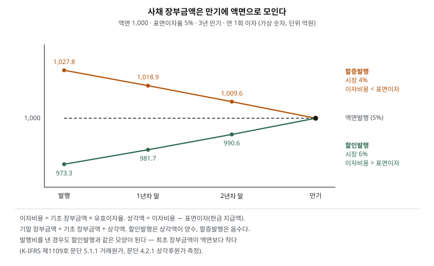

> 예제의 회사와 숫자, 시장이자율은 계산을 보이려고 만든 가상 자료다. 금액은 억원이다.

## 들어가며

회사가 회사채를 발행했다는 공시를 보면 보통 "표면이자율 5%, 3년 만기" 같은 조건이 함께 나온다. 그래서 그 회사의 손익계산서에 이자비용이 해마다 액면의 5%씩 잡힐 것이라고 짐작하기 쉽다. 그런데 막상 손익계산서와 주석을 맞춰 보면 이자비용이 표면이자보다 크거나 작고, 그 금액도 해마다 조금씩 다르다. 재무상태표의 사채 금액도 액면과 맞지 않는다. 발행가액이 액면과 달랐거나 발행에 비용이 들었기 때문이다. 이 차이를 계산하는 규칙이 유효이자율법이고, 이것을 알면 회사가 실제로 부담하는 금리를 재무제표에서 읽을 수 있다.

## 개념

### 차입금과 사채

회사가 빚으로 돈을 마련하는 대표적인 방법은 둘이다. **차입금**은 은행 같은 금융회사와 대출 계약을 맺어 빌리는 돈이고, **사채(회사채)**는 회사가 채권을 발행해 여러 투자자에게서 받는 돈이다. 차입금은 보통 약정 금리 그대로 이자를 내지만, 사채는 발행 조건(표면이자율)을 먼저 정하고 시장에서 팔기 때문에 투자자가 낸 돈이 액면과 다를 수 있다.

K-IFRS 제1109호는 둘을 구분하지 않고 금융부채로 본다. 금융부채는 당기손익-공정가치로 지정한 것 같은 예외를 빼면 **상각후원가**로 측정한다(문단 4.2.1).

### 세 가지 이자율

| 용어 | 뜻 | 예제 값 |
|---|---|---|
| 표면이자율 | 채권에 적힌 이자율. 현금으로 내는 이자 = 액면 × 표면이자율 | 5% |
| 시장이자율 | 발행 시점에 투자자가 같은 위험의 채권에서 요구하는 수익률 | 4% / 5% / 6% |
| 유효이자율 | 앞으로 낼 현금흐름의 현재가치를 최초 장부금액과 같게 만드는 할인율 | 발행비가 없으면 시장이자율과 같다 |

발행가액은 앞으로 낼 이자와 원금을 시장이자율로 할인한 값이다. 표면이자율이 시장이자율보다 낮으면 투자자는 그만큼 덜 받으므로 액면보다 싸게 사고(**할인발행**), 높으면 더 비싸게 산다(**할증발행**).

## 구조



> **출처**: [K-IFRS 제1109호 금융상품 — 문단 4.2.1 금융부채 분류, 5.1.1 최초 측정과 거래원가, 5.7.2 상각후원가 금융부채 손익](https://accountingwiki.co.kr/standards/1109) (제3자 전재), [OpenStax Principles of Financial Accounting §13.2 Effective-Interest Method](https://openstax.org/books/principles-financial-accounting/pages/13-2-compute-amortization-of-long-term-liabilities-using-the-effective-interest-method). 숫자는 이 글의 [`code/output.txt`](code/output.txt) `[1]`·`[2]`에 있다.

세 선 모두 만기에 액면 1,000으로 모인다. 만기에 갚는 돈이 액면이기 때문이다. 발행할 때 생긴 액면과의 차이는 사라지는 것이 아니라 만기까지 이자비용에 나뉘어 들어간다.

## 동작 원리

### 이자비용은 장부금액에 유효이자율을 곱한다

유효이자율법에서는 해마다 다음을 계산한다.

1. 이자비용 = 기초 장부금액 × 유효이자율
2. 상각액 = 이자비용 − 표면이자(현금 지급액)
3. 기말 장부금액 = 기초 장부금액 + 상각액

할인발행이면 장부금액이 액면보다 작으므로 이자비용이 표면이자보다 크다. 그 차이는 현금으로 나가지 않고 부채에 더해져 장부금액을 액면 쪽으로 올린다. 할증발행은 반대다. 기준서는 상각후원가로 측정하는 금융부채의 손익을 이 상각 과정과 제거할 때 당기손익으로 인식하게 한다(문단 5.7.2).

정액법으로 할인액을 3년에 똑같이 나누면 해마다의 이자비용이 같아지지만, 장부금액 대비 이자율은 해마다 달라진다. 유효이자율법은 반대로 **이자율을 일정하게 두고 금액을 바꾼다.** 장부금액이 커질수록 이자비용도 커지는 것은 이 때문이다.

### 발행비는 장부금액을 줄이고 이자율을 올린다

당기손익-공정가치로 측정하지 않는 금융부채는 발행과 직접 관련된 거래원가를 최초 측정 금액에서 뺀다(문단 5.1.1). 상각후원가로 측정하는 금융부채를 발행할 때 내는 수수료는 유효이자율을 이루는 요소로 본다(적용지침 B5.4.2). 그래서 액면에 발행해도 발행비가 있으면 최초 장부금액이 액면보다 작아지고, 할인발행과 같은 방식으로 만기까지 이자비용에 나뉘어 들어간다. 이 금액은 기대존속기간에 걸쳐 상각한다(적용지침 B5.4.4).

### 만기가 다가오면 유동부채로 옮긴다

보고기간 후 12개월 안에 결제하기로 되어 있는 부채는 유동부채로 분류한다(K-IFRS 제1001호 문단 69). 원래 만기가 12개월보다 길었던 금융부채도 남은 만기가 12개월 안으로 들어오면 유동부채다(문단 72). 재무상태표에서 같은 사채가 어느 해에 갑자기 유동부채 줄로 옮겨 가는 것은 이 규칙 때문이다.

## 실습 예제

전체 소스: [`code/`](code/) · 수행 기록: [`code/output.txt`](code/output.txt)

가나전자가 액면 1,000, 표면이자율 5%, 3년 만기, 연 1회 이자 조건으로 사채를 발행한다. 발행 시점의 시장이자율이 4%, 5%, 6%인 세 경우를 계산했다.

```text
[1] 같은 사채, 다른 시장이자율 — 액면 1,000, 표면이자율 5%, 3년 만기, 연 1회 이자
    현금흐름: 50, 50, 1,050
    구분         시장이자율        발행가액      액면과 차이
    할증발행           4%      1,027.8        +27.8
    액면발행           5%      1,000.0         +0.0
    할인발행           6%        973.3        -26.7
```

현금흐름은 세 경우가 똑같고, 할인하는 이자율만 다르다. 시장이 6%를 요구할 때 5% 이자를 주는 채권은 26.7만큼 싸게 팔린다.

```text
[2] 유효이자율법 상각표 — 이자비용 = 기초 장부금액 x 유효이자율
    할인발행: 최초 장부금액 973.3, 유효이자율 6.0000%
    연도        기초 장부      이자비용      표면이자       상각액      기말 장부
    1년차      973.3      58.4      50.0      +8.4      981.7
    2년차      981.7      58.9      50.0      +8.9      990.6
    3년차      990.6      59.4      50.0      +9.4    1,000.0
    이자비용 합계 176.7 = 표면이자 150.0 + (액면 1,000 - 최초 장부금액 973.3)

    할증발행: 최초 장부금액 1,027.8, 유효이자율 4.0000%
    연도        기초 장부      이자비용      표면이자       상각액      기말 장부
    1년차    1,027.8      41.1      50.0      -8.9    1,018.9
    2년차    1,018.9      40.8      50.0      -9.2    1,009.6
    3년차    1,009.6      40.4      50.0      -9.6    1,000.0
    이자비용 합계 122.2 = 표면이자 150.0 + (액면 1,000 - 최초 장부금액 1,027.8)
```

세 경우 모두 해마다 현금으로 나가는 이자는 50이다. 그러나 손익계산서의 이자비용은 할인발행이 58.4~59.4, 할증발행이 41.1~40.4다. 3년 합계는 표면이자 150에 발행 때 생긴 액면과의 차이를 더하거나 뺀 값과 정확히 같다. 할인발행 회사는 처음에 973.3만 받고 나중에 1,000을 갚으므로 그 차이 26.7이 추가 이자 부담이 된다. 할인발행의 이자비용이 해마다 늘어나는 것은 장부금액이 커지는데 이자율은 6%로 그대로이기 때문이다.

```text
[3] 사채발행비 — 거래원가는 최초 장부금액에서 뺀다 (문단 5.1.1)
    액면발행 1,000, 발행비 20 → 실제로 들어온 돈 980
    발행비 차감 후: 최초 장부금액 980.0, 유효이자율 5.7447%
    연도        기초 장부      이자비용      표면이자       상각액      기말 장부
    1년차      980.0      56.3      50.0      +6.3      986.3
    2년차      986.3      56.7      50.0      +6.7      993.0
    3년차      993.0      57.0      50.0      +7.0    1,000.0
    이자비용 합계 170.0 = 표면이자 150.0 + (액면 1,000 - 최초 장부금액 980.0)
    표면이자율 5%짜리 사채지만 회사가 부담하는 이자율은 5.74%

[4] 같은 1,000을 빌리는 두 방법의 유효이자율
    은행 차입금: 금리 5.5%, 부대비용 0      → 유효이자율 5.50%
    회사채     : 표면 5.0%, 발행비 20        → 유효이자율 5.74%
    표면 금리만 보면 회사채가 싸 보이지만, 발행비를 넣으면 순서가 바뀐다
```

시장이자율 5%에 액면으로 발행했어도 인수 수수료 같은 발행비 20을 냈다면 회사 손에 들어온 돈은 980이다. 이 980을 기준으로 50, 50, 1,050을 할인하는 이자율을 찾으면 5.74%가 된다. 은행에서 5.5%에 빌리는 경우와 표면 금리만 비교하면 회사채가 0.5%포인트 싸 보이지만, 실제 부담은 회사채 쪽이 크다.

```text
[5] 만기가 12개월 안으로 들어오면 유동부채로 옮긴다 (K-IFRS 제1001호 문단 69·72)
    1년차 말: 남은 만기 2년, 장부금액 981.7 → 비유동부채
    2년차 말: 남은 만기 1년, 장부금액 990.6 → 유동부채
```

할인발행 사채는 2년차 말에 남은 만기가 1년이 되어 유동부채로 옮겨 간다. 이 해에는 회사가 새로 돈을 빌리지 않았는데도 유동부채가 990.6 늘어난다.

## 실무에서 주의할 점

- **이자보상배율의 분모는 표면이자가 아니라 이자비용이다.** [이자보상배율 글](../../ratios/2026-10-02-interest-coverage-ratio/index.md)에서 쓴 이자비용은 손익계산서 금액이고, 할인발행이나 발행비가 있으면 [2]·[3]처럼 표면이자보다 크다. 공시된 발행 조건으로 이자 부담을 짐작하면 실제보다 작게 잡는다. 반대로 현금흐름표의 이자 지급액은 표면이자이므로, 두 숫자가 다른 것은 오류가 아니다.
- **장부금액은 시가가 아니다.** 상각후원가는 발행 당시 유효이자율로 계산한 값이라, 그 뒤 시장금리가 바뀌어도 재무상태표의 사채 금액은 [2]의 상각표를 따라 움직인다. 지금 같은 사채를 다시 사들이는 데 드는 돈은 공정가치 공시 주석에서 확인한다. 같은 구조를 자산 쪽에서 본 것이 [금융자산 세 분류 글](../2026-10-12-financial-assets-three-classes/index.md)의 상각후원가 자산이다.
- **유동부채가 갑자기 늘면 만기 구조부터 본다.** [5]처럼 장기 사채가 유동으로 옮겨 오면 [유동비율](../../ratios/2026-10-01-leverage-and-current-ratio/index.md)이 한 해에 크게 떨어질 수 있다. 영업이 나빠진 것이 아니라 상환 시점이 다가온 것일 수 있으므로, 차입금·사채 주석의 만기 분석표에서 언제 얼마를 갚아야 하는지와 차환 계획을 함께 확인한다.
- **조달 수단을 비교할 때는 유효이자율로 비교한다.** [4]처럼 표면 금리와 실제 부담의 순서가 바뀔 수 있다. 회사가 공시한 차입 조건을 비교할 때는 주석에 적힌 유효이자율이나, 이자비용을 평균 장부금액으로 나눈 값을 쓴다.
- **전환사채는 이 계산이 한 번 더 갈린다.** 전환권이 붙은 사채는 부채와 자본 요소로 나뉘고 부채 요소에 유효이자율법을 적용하므로, 이자비용이 표면이자보다 훨씬 커지는 경우가 많다. 주당이익에 주는 영향은 [희석 EPS 글](../../valuation/2026-10-08-diluted-eps-convertible-bonds/index.md)에서 다뤘다.

## 정리

- 차입금과 사채는 모두 금융부채이며 상각후원가로 측정한다.
- 사채는 표면이자율이 시장이자율보다 낮으면 할인, 높으면 할증으로 발행되고, 발행가액은 현금흐름을 시장이자율로 할인한 값이다.
- 이자비용은 기초 장부금액 × 유효이자율이고, 표면이자와의 차이는 장부금액을 액면 쪽으로 옮기며 만기에 액면과 같아진다.
- 발행비는 최초 장부금액에서 빠져 유효이자율을 올리므로, 조달 비용은 표면 금리가 아니라 유효이자율로 비교한다.
- 남은 만기가 12개월 안으로 들어오면 같은 사채가 유동부채로 옮겨 간다.

## 참고 자료

- [한국회계기준원 — 시행 중인 K-IFRS 기준서 목록](https://www.kasb.or.kr/front/board/ingAccountingList.do) — 기업회계기준서 제1109호·제1001호 원문 발행처. 아래 전재 사이트는 문단을 바로 열기 위한 편의 링크다
- [IFRS Foundation — IFRS 9 Financial Instruments](https://www.ifrs.org/issued-standards/list-of-standards/ifrs-9-financial-instruments/) — 국제회계기준 원문 발행처
- [K-IFRS 제1109호 — 문단 4.2.1 금융부채 분류, 5.1.1 최초 측정, 5.7.2 상각후원가 금융부채 손익](https://accountingwiki.co.kr/standards/1109) (제3자 전재)
- [K-IFRS 제1109호 적용지침 — B5.4.2 유효이자율의 구성요소인 수수료, B5.4.4 상각 기간, B5.4.8 거래원가](https://accountingwiki.co.kr/standards/1109/b) (제3자 전재)
- [K-IFRS 제1001호 재무제표 표시 — 문단 69·72 유동부채](https://accountingwiki.co.kr/standards/1001) (제3자 전재)
- [OpenStax, Principles of Financial Accounting — 13.2 Compute Amortization of Long-Term Liabilities Using the Effective-Interest Method](https://openstax.org/books/principles-financial-accounting/pages/13-2-compute-amortization-of-long-term-liabilities-using-the-effective-interest-method)
