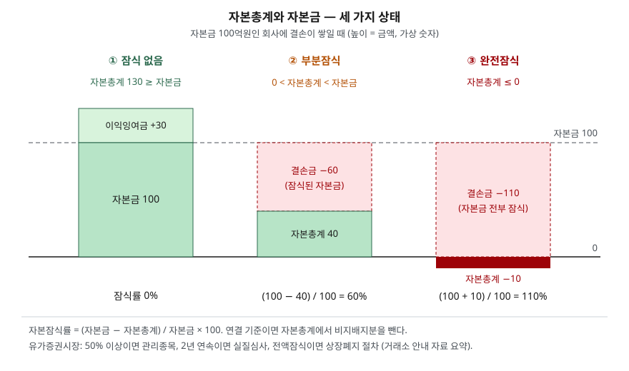

> 예제의 회사와 숫자는 계산을 보이려고 만든 가상 자료다. 금액은 억원이다.
> 거래소 기준은 2026년 2월 한국거래소가 낸 유가증권시장 12월 결산법인 안내 자료를 따랐다. 규정은 바뀔 수 있으므로 쓸 때는 현행 상장규정을 다시 확인한다.

## 들어가며

연초 감사보고서 시즌에 공시를 보다 보면 "자본잠식률 50% 이상 사실 발생" 같은 제목이 줄지어 올라온다. 기사는 이것을 "회사가 망해 간다는 신호"로 요약하고, 읽는 사람도 대개 "적자가 크다" 정도로 받아들이고 넘어간다. 그런데 적자 규모가 비슷한 두 회사 중 한쪽만 잠식 공시를 내기도 하고, 몇 달 뒤 주식 수를 10분의 1로 줄이는 감자를 하자 잠식이 사라지기도 한다. 적자 금액만 보고는 이 차이를 설명할 수 없다. 잠식률이 **손실을 무엇과 비교한 비율인지**를 알아야 공시 한 줄이 무엇을 말하는지 읽힌다.

## 개념

### 자본금과 자본총계

재무상태표의 자본에는 여러 줄이 있다. [자본변동표 글](../2026-10-07-equity-changes-statement/index.md)에서 본 것처럼 크게 자본금, 자본잉여금(주식발행초과금 등), 이익잉여금(또는 결손금), 기타포괄손익누계액 등으로 나뉜다. 이 중 **자본금**은 상법이 정한 금액으로, 액면주식을 발행한 회사의 자본금은 발행주식의 액면총액이다(상법 제451조 제1항). 주식을 액면보다 비싸게 팔아 들어온 나머지는 주식발행초과금이 된다.

**자본총계**는 이 줄들을 모두 더한 값이고, 자산에서 부채를 뺀 금액과 같다. 이익이 쌓이면 이익잉여금이 늘어 자본총계가 자본금보다 커지고, 손실이 쌓이면 결손금이 커져 자본총계가 줄어든다.

### 잠식

**자본잠식**은 자본총계가 자본금보다 작아진 상태다. 주주가 넣은 돈 가운데 자본금으로 계상한 몫까지 손실로 줄어들었다는 뜻이다. 자본잠식은 K-IFRS 기준서의 용어가 아니고 상장규정과 공시에서 쓰는 말이며, 한국거래소는 비율을 다음과 같이 계산한다.

| 구분 | 식 또는 조건 |
|---|---|
| 자본잠식률 | (자본금 − 자본총계) / 자본금 × 100 |
| 부분잠식 | 0 < 자본총계 < 자본금 |
| 완전잠식(자본전액잠식) | 자본총계 ≤ 0, 잠식률이 100% 이상 |
| 연결재무제표 기준 | 자본총계에서 비지배지분을 뺀 값을 쓴다 |

## 구조



> **출처**: [한국거래소 — 유가증권시장 12월 결산법인 정기결산 관련 유의사항 (2026-02-02, 자본잠식 여부 확인)](https://kind.krx.co.kr/external/notice/dst/20260202/kospi_1.pdf), [상법 제451조 자본금](https://casenote.kr/%EB%B2%95%EB%A0%B9/%EC%83%81%EB%B2%95/%EC%A0%9C451%EC%A1%B0) (제3자 전재). 숫자는 이 글의 [`code/output.txt`](code/output.txt) `[1]`·`[2]`에 있다.

점선이 자본금 수준이다. 자본총계 막대 꼭대기가 이 선 위에 있으면 잠식이 아니고, 선 아래로 내려가면 부분잠식, 0 아래로 내려가면 완전잠식이다. 잠식률은 점선과 막대 꼭대기 사이 거리를 자본금 높이로 나눈 값이다.

## 동작 원리

### 결손금이 자본금 외의 자본보다 커져야 잠식이 시작된다

손실은 자본총계를 줄이지만, 그 손실이 곧바로 잠식이 되지는 않는다. 자본총계에는 자본금 말고도 주식발행초과금과 이전에 쌓은 이익잉여금이 들어 있기 때문이다. 결손금이 이것들을 합한 금액보다 커진 뒤부터 자본총계가 자본금 아래로 내려간다.

그래서 **같은 돈을 받고 같은 손실을 낸 회사라도 액면을 얼마로 정했느냐에 따라 잠식률이 다르다.** 액면이 높으면 납입액 대부분이 자본금이 되어 작은 손실에도 잠식이 시작되고, 액면이 낮으면 납입액 대부분이 주식발행초과금이 되어 같은 손실을 더 오래 견딘다.

### 거래소가 보는 지점

유가증권시장에서 자본잠식은 사업연도말 감사받은 재무제표로 판단한다. 거래소 안내 자료가 정리한 순서는 다음과 같다.

1. 최근 사업연도말 잠식률이 50% 이상이면 감사보고서 제출일 다음 날 관리종목으로 지정한다.
2. 관리종목인 상태에서 다음 사업연도말에도 50% 이상이면 상장적격성 실질심사를 진행한다.
3. 최근 사업연도말 현재 자본전액잠식이면 사업보고서를 낼 때 상장폐지 절차를 진행한다. 다만 사업보고서 제출기한까지 잠식 해소를 보이는 재무상태표와 감사보고서를 내면 실질심사로 넘어간다.

종속회사가 있으면 연결재무제표 기준이고 이때 자본총계는 비지배지분을 뺀 값이다. 내부결산에서 잠식률 50% 이상이 확인되면 그 사실을 공시해야 하고, 공시 시각에 따라 30분 또는 다음 날 개장까지 매매거래가 정지된다.

### 잠식을 없애는 두 가지 방법

**무상감자**는 주주에게 돈을 돌려주지 않고 자본금을 줄이는 것이다. 주식 10주를 1주로 합치면 자본금이 10분의 1이 되고, 줄어든 자본금만큼 결손금을 메운다. 상법은 자본금을 줄일 때 원칙적으로 주주총회 특별결의를 요구하지만, 결손 보전을 위한 감자는 보통결의로 할 수 있다(상법 제438조 제2항). 회사 밖으로 나가는 재산이 없기 때문이다. 결손을 메우는 데는 이익준비금과 자본준비금도 쓸 수 있고, 법정준비금은 결손 보전 외에는 처분하지 못한다(상법 제460조).

**유상증자**는 새 주식을 팔아 돈을 들이는 것이다. 자본총계가 실제로 늘어나지만, 새 주식의 액면만큼 자본금도 함께 늘어난다.

## 실습 예제

전체 소스: [`code/`](code/) · 수행 기록: [`code/output.txt`](code/output.txt)

가나전자와 다라물산은 모두 200만 주를 발행해 100억원을 받았다. 가나전자는 액면을 5,000원으로 정해 전액이 자본금이고, 다라물산은 액면이 1,000원이라 자본금 20억원에 주식발행초과금이 80억원이다. 두 회사가 4년 동안 똑같이 30, 30, 30, 20억원의 순손실을 냈다.

```text
[2] 납입액이 같고 액면만 다른 두 회사에 같은 손실을 쌓는다
    가나전자: 발행주식 2,000,000주 x 액면 5,000원 = 자본금 100억원, 주식발행초과금 0억원
    다라물산: 발행주식 2,000,000주 x 액면 1,000원 = 자본금 20억원, 주식발행초과금 80억원

    가나전자    연도   순손실   결손금   자본총계   잠식률   상태
              1년차     -30      -30         70      30%   부분잠식 (지정 사유 아님)
              2년차     -30      -60         40      60%   50% 이상 → 관리종목
              3년차     -30      -90         10      90%   2년 연속 50% 이상 → 실질심사
              4년차     -20     -110        -10     110%   자본전액잠식 → 상장폐지 절차

    다라물산    연도   순손실   결손금   자본총계   잠식률   상태
              1년차     -30      -30         70       0%   -
              2년차     -30      -60         40       0%   -
              3년차     -30      -90         10      50%   50% 이상 → 관리종목
              4년차     -20     -110        -10     150%   자본전액잠식 → 상장폐지 절차
```

두 회사의 자본총계는 해마다 똑같다. 그런데 가나전자는 1년차부터 잠식이고 2년차에 관리종목 기준에 걸린다. 다라물산은 결손금이 주식발행초과금 80억원을 넘는 3년차에야 잠식이 시작된다. 잠식률은 회사가 가진 순자산의 크기가 아니라 **순자산과 자본금의 관계**를 재는 숫자다. 4년차에 자본총계가 음수가 되면 두 회사 모두 완전잠식이 되고, 이때는 잠식률 숫자보다 자본총계가 0 아래라는 사실이 기준이 된다.

이번에는 가나전자의 3년차 말 상태에서 잠식을 푸는 방법을 비교한다.

```text
[3] 가나전자 3년차 말 잠식을 푸는 세 가지 방법
    출발점: 자본금 100, 결손금 -90, 자본총계 10억원, 주식 2,000,000주, 잠식률 90%
    방법                                주식 수     자본금     결손금     자본총계     잠식률      주당 순자산
    그대로                          2,000,000     100     -90       10     90%         500원
    무상감자 10:1 (결손 보전)              200,000      10       0       10      0%       5,000원
    유상증자 50억 (액면 발행)             3,000,000     150     -90       60     60%       2,000원
    감자 10:1 후 유상증자 50억           1,200,000      60       0       60      0%       5,000원
```

무상감자를 하면 자본금 100억원이 10억원이 되고, 줄어든 90억원으로 결손금 90억원을 메운다. 자본총계는 10억원 그대로다. 회사의 순자산은 하나도 늘지 않았지만 잠식률은 90%에서 0%가 된다. 주당 순자산이 500원에서 5,000원으로 오른 것도 주식 수가 10분의 1이 되었기 때문이고, 10주를 가졌던 주주는 1주를 갖게 되어 손에 쥔 순자산 몫은 5,000원으로 같다.

반대로 액면가로 50억원을 증자하면 순자산은 실제로 50억원 늘지만 자본금도 50억원 늘어 잠식률은 60%에 머문다. 관리종목 기준선 50%를 넘는 그대로다. 그래서 잠식이 깊은 회사는 감자로 자본금을 먼저 줄인 뒤 증자하는 경우가 많다. 마지막 줄처럼 감자 후 같은 증자를 하면 자본금 60억원, 자본총계 60억원으로 잠식이 없어진다.

```text
[4] 연결재무제표 기준 — 비지배지분을 뺀 자본총계로 계산한다
    마바화학 연결: 자본금 100, 지배기업 소유주지분 45, 비지배지분 15, 자본총계 60억원
    자본총계 전체로 계산      : 잠식률 40%
    비지배지분을 빼고 계산    : 잠식률 55%  ← 거래소가 쓰는 값
```

연결 재무상태표의 자본총계에는 자회사의 다른 주주 몫인 비지배지분이 들어 있다. 이 몫은 상장회사 주주의 것이 아니므로 거래소는 빼고 계산한다. 마바화학은 자본총계 전체로 보면 40%지만 거래소 기준으로는 55%라 관리종목 기준에 걸린다.

## 실무에서 주의할 점

- **잠식률만으로 회사 크기를 비교하지 않는다.** [2]처럼 자본총계가 같아도 액면에 따라 잠식률이 30%와 0%로 갈린다. 회사 간 재무 상태를 비교할 때는 [부채비율 글](../../ratios/2026-10-01-leverage-and-current-ratio/index.md)의 자본총계 기준 지표나 순자산 금액을 함께 본다.
- **무상감자 뒤의 잠식률 0%는 순자산이 회복됐다는 뜻이 아니다.** [3]의 무상감자는 자본총계를 바꾸지 않는다. 감자 공시 전후의 자본총계와 결손금 줄을 나란히 놓고, 실제로 들어온 돈이 있는지를 확인한다. 감자로 주식 수가 줄면 주당 지표도 크게 바뀌므로, 감자 전후의 주가·주당순자산을 단순 비교하지 않는다. 주식 수가 바뀌는 다른 경우는 [액면분할·무상증자 글](../../market/2026-10-04-stock-split-and-bonus-issue/index.md)에서 다뤘다.
- **증자 효과는 발행가와 액면의 차이에 달렸다.** [3]의 증자는 액면 발행이라 들어온 돈이 전부 자본금이 됐다. 액면보다 비싸게 발행하면 일부가 주식발행초과금이 되어 잠식률이 더 많이 내려간다. 증자로 기존 주주 지분이 줄어드는 효과는 [유상증자 글](../../market/2026-10-06-rights-issue-dilution/index.md)에서 다뤘다.
- **연결과 별도의 기준이 다르다.** 종속회사가 있는 회사는 연결재무제표의 지배기업 소유주지분으로 판단하므로 [4]처럼 비지배지분이 큰 회사는 연결 자본총계만 보고 판단하면 기준을 잘못 읽는다. 공시의 재무제표 구분을 확인한다.
- **시장마다 기준이 다르고 규정은 바뀐다.** 이 글은 유가증권시장의 사업연도말 기준이다. 코스닥시장은 별도의 상장규정을 따르며, 상장폐지 요건은 개정이 잦으므로 판단할 때는 해당 시장의 현행 규정을 다시 확인한다.

## 정리

- 자본잠식률은 (자본금 − 자본총계) / 자본금이며, 자본총계가 0 이하이면 완전잠식이다.
- 결손금이 주식발행초과금 등 자본금 외의 자본보다 커진 뒤부터 잠식이 시작되므로, 같은 손실이라도 액면이 높은 회사가 먼저 잠식된다.
- 유가증권시장은 50% 이상이면 관리종목, 2년 연속이면 실질심사, 전액잠식이면 상장폐지 절차로 이어지며, 연결 기준에서는 비지배지분을 뺀다.
- 무상감자는 자본총계를 바꾸지 않고 자본금만 낮춰 잠식률을 0으로 만들고, 액면 증자는 자본금도 함께 늘려 잠식률을 생각보다 적게 낮춘다.

## 참고 자료

- [한국거래소 — 유가증권시장 12월 결산법인 정기결산 관련 유의사항 (2026-02-02)](https://kind.krx.co.kr/external/notice/dst/20260202/kospi_1.pdf) — 자본잠식률 식, 관리종목·실질심사·상장폐지 절차, 연결 기준 비지배지분 제외, 매매거래정지
- [국가법령정보센터 — 상법](https://www.law.go.kr/%EB%B2%95%EB%A0%B9/%EC%83%81%EB%B2%95) — 조문 원문 발행처. 아래 전재 링크는 조문을 바로 열기 위한 편의 링크다
- [상법 제438조 자본금 감소의 결의 (2014-05-20 시행)](https://casenote.kr/%EB%B2%95%EB%A0%B9/%EC%83%81%EB%B2%95/%EC%A0%9C438%EC%A1%B0) (제3자 전재)
- [상법 제451조 자본금 (2012-04-15 시행)](https://casenote.kr/%EB%B2%95%EB%A0%B9/%EC%83%81%EB%B2%95/%EC%A0%9C451%EC%A1%B0) (제3자 전재)
- [상법 제460조 법정준비금의 사용 (2012-04-15 시행)](https://casenote.kr/%EB%B2%95%EB%A0%B9/%EC%83%81%EB%B2%95/%EC%A0%9C460%EC%A1%B0) (제3자 전재)
