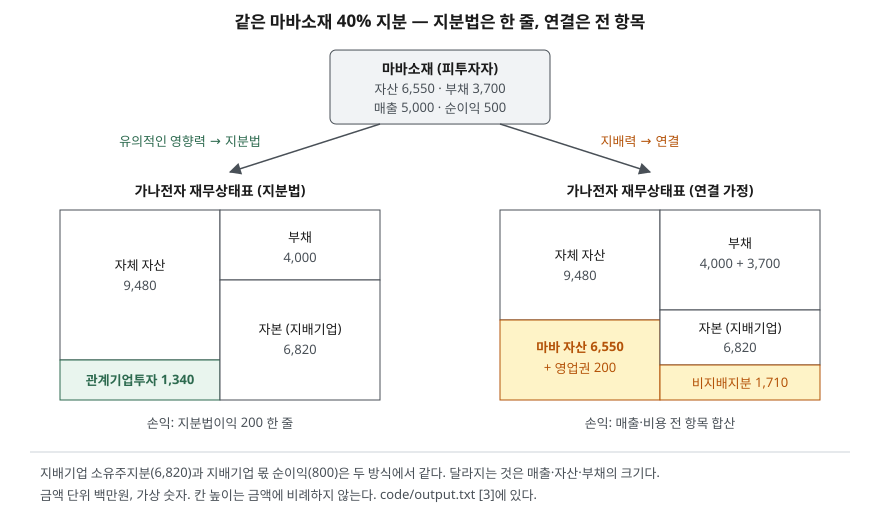

> 예제의 `가나전자`·`마바소재`와 그 숫자는 계산을 보이려고 만든 가상 자료다. 금액은 백만원이다.

## 들어가며

어떤 회사가 다른 회사 지분을 30~40% 사들였다는 공시를 보고 다음 분기 재무제표를 열면, 그 회사의 매출과 자산은 그대로이고 재무상태표에 관계기업투자 한 줄, 손익계산서에 지분법이익 한 줄이 늘어 있다. 피투자회사의 매출이 수천억이어도 투자회사 매출에는 한 푼도 더해지지 않는다. 이때 흔히 지분법이익을 배당으로 받은 돈이라고 읽거나, 피투자회사가 커질수록 투자회사의 매출도 늘어날 것이라고 기대한다. 둘 다 틀린 읽기이고, 같은 지분을 50% 넘게 샀다면 재무제표 모양이 완전히 달라졌을 것이다. 지분율과 영향력에 따라 다른 회사를 장부에 담는 방식이 세 갈래로 갈리는 규칙을 알면, 한 줄짜리 숫자 뒤에 무엇이 있는지 읽을 수 있다.

## 개념

### 유의적인 영향력과 관계기업

K-IFRS 제1028호는 **유의적인 영향력**을 피투자자의 재무정책과 영업정책 결정에 참여할 수 있는 능력으로 정의하고, 그 정책을 지배하거나 공동으로 지배하는 것과 구별한다(문단 3). 투자자가 유의적인 영향력을 가진 기업이 **관계기업**이다.

영향력은 지분율로 추정한다. 직접 또는 간접으로 의결권의 20% 이상을 보유하면 유의적인 영향력이 있는 것으로 보고, 20% 미만이면 없는 것으로 본다. 다만 반대 증거를 명백하게 제시할 수 있으면 이 추정은 뒤집힌다(문단 5). 지분율이 낮아도 이사회 참여, 배당 결정을 포함한 정책결정 과정 참여, 중요한 거래, 경영진 상호 교류, 필수 기술정보 제공 중 하나 이상이 있으면 일반적으로 유의적인 영향력이 있다는 증거가 된다(문단 6).

### 지분법

**지분법**은 투자자산을 처음에 원가로 인식하고, 취득 후 피투자자 순자산 변동액 중 투자자의 몫을 장부금액에 더하거나 빼는 방법이다(문단 3). 연결이 피투자자의 자산·부채·수익·비용을 항목마다 합치는 데 비해, 지분법은 그 결과 중 내 몫만 투자자산 한 줄에 반영한다. 그래서 지분법을 "한 줄 연결"이라고도 부른다.

## 구조



> **출처**: [K-IFRS 제1028호 관계기업과 공동기업에 대한 투자 — 문단 3 정의, 5·6 유의적인 영향력, 10 지분법 적용](https://accountingwiki.co.kr/standards/1028) (제3자 전재), [K-IFRS 제1110호 연결재무제표](https://accountingwiki.co.kr/standards/1110) (제3자 전재). 숫자는 이 글의 [`code/output.txt`](code/output.txt) `[3]`에 있다.

왼쪽과 오른쪽 모두 지배기업 소유주에게 귀속되는 자본은 6,820이다. 지분법은 마바소재 순자산의 40%와 영업권만 한 줄로 담고, 연결은 마바소재 전체를 담은 뒤 남의 몫 60%를 비지배지분으로 따로 표시한다. 같은 결과를 얼마나 펼쳐 보이는가의 차이다.

## 동작 원리

### 취득 — 원가로 인식하고, 차액은 영업권으로 안에 둔다

관계기업 투자는 원가로 처음 인식한다(문단 10). 취득원가가 피투자자 식별가능 순자산 공정가치 중 내 몫보다 크면 그 차액은 영업권이며, 따로 떼지 않고 투자자산 장부금액에 포함한다. 반대로 작으면 그 차액은 취득한 기간의 지분법 손익에 수익으로 넣는다(문단 32).

### 이후 — 순이익, 배당, 기타포괄손익

지분법은 세 가지 움직임으로 장부금액을 바꾼다(문단 10).

| 피투자자에서 일어난 일 | 투자자 장부금액 | 투자자 재무제표에서 |
|---|---|---|
| 당기순이익 | 내 몫만큼 증가 | 당기손익 (지분법이익) |
| 배당 지급 | 받은 만큼 감소 | 손익 아님, 현금과 맞바뀜 |
| 기타포괄손익 | 내 몫만큼 증가 | 기타포괄손익 |

배당이 장부금액을 줄이는 이유는 이익을 이미 지분법이익으로 인식했기 때문이다. 배당은 이미 내 몫으로 잡아 둔 순자산 일부가 현금으로 넘어온 것이므로, 받을 때 다시 이익으로 잡으면 같은 이익을 두 번 세게 된다.

### 손실이 커지면 — 0에서 멈춘다

관계기업 손실 중 내 몫이 투자지분과 같거나 커지면 손실 인식을 멈춘다. 투자지분은 투자자산 장부금액에 실질적으로 순투자의 일부인 장기 대여금 같은 지분을 더한 금액이다(문단 38). 법적의무나 의제의무가 있거나 대신 지급한 경우에만 그만큼 부채를 추가로 잡는다. 이후 관계기업이 이익을 내면, 인식하지 못했던 손실을 먼저 메운 뒤에야 이익을 인식한다(문단 39).

### 지분율에 따른 세 갈래

```text
[1] 지분율에 따른 처리 방식 (제1028호 문단 5, 추정은 반증 가능)
     10%  영향력 없음 추정    금융자산 (제1109호)
     19%  영향력 없음 추정    금융자산 (제1109호)
     20%  유의적인 영향력 추정  지분법 (제1028호)
     40%  유의적인 영향력 추정  지분법 (제1028호)
     51%  지배력 추정       연결 (제1110호)
    20% 미만이라도 이사회 참여 등이 있으면 유의적인 영향력이 있을 수 있다 (문단 6)
```

20%와 50%는 추정의 출발점이다. 실제 분류는 영향력과 지배력이 있는지로 정해지므로, 같은 지분율이라도 회사마다 다르게 분류될 수 있다.

## 실습 예제

전체 소스: [`code/`](code/) · 수행 기록: [`code/output.txt`](code/output.txt)

가나전자가 순자산 2,500인 마바소재 지분 40%를 1,200에 샀다. 1년 동안 마바소재는 순이익 500을 내고 배당 200을 지급했으며 기타포괄손익 50이 생겼다.

```text
[2] 지분법 장부금액 움직임 — 1년차 (문단 10·32)
    마바소재 취득일 순자산 2,500 × 40% = 1,000
    취득원가 1,200 - 순자산 몫 1,000 = 영업권 200 (장부금액에 포함)
    항목                 마바소재 전체     40% 몫      장부금액
    취득                                       1,200
    당기순이익 → 지분법이익       500      +200     1,400
    배당 수령 → 장부 감소       200       -80     1,320
    기타포괄손익                  50       +20     1,340
    검산: 기말 순자산 2,850 × 40% = 1,140 + 영업권 200 = 1,340
```

가나전자가 실제로 받은 현금은 배당 80뿐이지만 손익계산서에는 지분법이익 200이 잡힌다. 차이 120은 마바소재가 쌓아 둔 이익 중 가나전자 몫이고, 투자자산 장부금액이 그만큼 늘었다. 마지막 줄 검산처럼 기말 장부금액은 언제나 "피투자자 순자산 × 지분율 + 영업권"으로 맞아떨어진다.

이제 지분율은 40%로 그대로 두고, 이 지분으로 지배력이 있다고 가정해 연결했을 때와 나란히 놓는다. 실제로는 지배력이 있는지에 따라 둘 중 하나만 쓰므로, 처리 방식의 차이만 보려는 계산상 비교다.

```text
[3] 같은 40% 지분, 처리 방식만 바꾼 가나전자 1년차 재무제표
    항목                       지분법      연결(가정)
    매출                     8,000      13,000
    당기순이익                    800       1,100
      지배기업 소유주 몫             800         800
      비지배지분 몫                  0         300
    자산총계                  10,820      16,230
      관계기업투자               1,340           0
    부채총계                   4,000       7,700
    자본총계                   6,820       8,530
      지배기업 소유주지분           6,820       6,820
      비지배지분                    0       1,710
    부채비율(%)                 58.7        90.3
    지배기업 ROE(%)             11.7        11.7
    지배기업 몫 순이익과 자본은 같고, 매출·자산·부채만 달라진다
```

지배기업 몫 순이익 800과 지배기업 소유주지분 6,820, 그리고 둘로 계산한 ROE 11.7%는 두 열이 같다. 연결 열에서 마바소재 순이익 500 중 300은 비지배지분 몫으로 빠지고 가나전자 몫 200이 남는데, 이것이 지분법이익 200과 같은 금액이다. 반면 매출은 5,000, 부채는 3,700이 더해져 부채비율이 58.7%에서 90.3%로 바뀐다. 같은 회사에 같은 돈을 넣었는데 레버리지 지표가 이만큼 달라지는 것이다. 연결 열의 비지배지분은 식별가능 순자산의 비례 몫으로 측정했다고 두었다(K-IFRS 제1103호 문단 19).

마지막으로 마바소재가 2년 연속 크게 손실을 낸 뒤 회복하는 경우다.

```text
[4] 관계기업 손실이 장부금액을 넘으면 — 0 에서 멈춘다 (문단 38·39)
    연도        마바 순손익    40% 몫      인식액     미인식 누계     장부금액
    1년차 말                                       0    1,340
    2년차        -2,000     -800     -800          0      540
    3년차        -2,000     -800     -540        260        0
    4년차         1,000     +400     +140          0      140
    법적·의제의무가 없으면 0 아래로 부채를 잡지 않는다
```

3년차에 내 몫 손실은 800이지만 장부금액 540만큼만 인식하고 260은 장부 밖에 기록해 둔다. 4년차 이익 몫 400은 그 260을 먼저 메우고 남은 140만 지분법이익이 된다. 가나전자의 손실은 투자한 금액까지로 제한되고, 회복할 때는 앞서 빠진 손실을 다 갚은 뒤에야 이익이 보인다.

## 실무에서 주의할 점

- **지분법이익은 현금이 아니다.** [2]에서 지분법이익 200 중 현금으로 들어온 것은 배당 80이다. [현금흐름표 글](../2026-09-30-cash-flow-profit-without-cash/index.md)에서 본 것처럼 영업활동현금흐름을 구할 때 지분법이익은 차감 조정되고, 받은 배당만 현금으로 남는다. 순이익에서 지분법이익 비중이 크면 이익과 현금의 차이가 그만큼 벌어진다.
- **지분법손익이 어느 이익 단계에 있는지 확인한다.** K-IFRS 제1001호는 재무상태표에 지분법 투자자산을, 손익계산서에 관계기업 당기순손익 지분을 따로 표시하라고 정하지만(문단 54·82), 영업이익 위에 둘지 아래에 둘지는 정하지 않는다. 관계기업이 핵심 사업을 맡고 있는데 그 손익이 영업이익 아래에 있으면 영업이익만으로는 그 실적이 보이지 않는다. [손익계산서 글](../2026-09-29-income-statement-five-steps/index.md)의 단계별 이익과 함께, K-IFRS 제1112호가 중요한 관계기업마다 공시하게 한 요약 재무정보(문단 21·B12)를 주석에서 본다.
- **같은 지분율이라도 지표가 크게 달라진다.** [3]처럼 지분법과 연결은 부채비율과 매출 규모를 다르게 보이게 한다. 두 회사를 비교할 때 한쪽은 핵심 계열사를 연결하고 다른 쪽은 지분법으로 들고 있다면 부채비율이나 매출 성장률을 그대로 비교할 수 없다. [연결과 별도 글](../../disclosure/2026-10-07-consolidated-vs-separate/index.md)의 연결 범위를 함께 확인한다.
- **내부거래 이익은 지분만큼 지운다.** 가나전자가 마바소재에 물건을 팔고 그 물건이 아직 마바소재 창고에 있으면, 그 거래에서 생긴 이익 중 마바소재에 대한 가나전자 지분 몫은 아직 실현되지 않은 것으로 보아 제거한다. 관계기업이 투자자에게 파는 상향거래도 같다(문단 28). 관계기업과 거래가 많은 회사는 이 제거 금액이 지분법손익을 움직인다.
- **장부금액이 0인 관계기업은 손실이 안 보인다.** [4]의 3년차 이후처럼 장부금액이 0이 되면 관계기업이 손실을 더 내도 투자자 손익에는 나타나지 않는다. 주석에 미인식 손실 누계가 공시되므로(K-IFRS 제1112호 문단 22), 관계기업투자 장부금액이 0에 가까운 줄이 있으면 그 주석을 찾아본다.

## 정리

- 지분율 20% 이상이면 유의적인 영향력이 있는 것으로 추정하고 지분법을 쓰며, 이 추정은 반대 증거로 뒤집힌다.
- 지분법은 원가로 인식한 뒤 피투자자 순이익 몫은 이익으로, 배당은 장부금액 감소로, 기타포괄손익 몫은 기타포괄손익으로 반영한다.
- 같은 지분을 지분법과 연결로 처리하면 지배기업 몫 이익과 자본은 같고 매출·자산·부채의 크기만 달라진다.
- 관계기업 손실은 투자지분이 0이 될 때까지만 인식하고, 이후 이익은 미인식 손실을 먼저 메운 뒤 인식한다.

## 참고 자료

- [한국회계기준원 — 시행 중인 K-IFRS 기준서 목록](https://www.kasb.or.kr/front/board/ingAccountingList.do) — 기업회계기준서 제1028호·제1110호·제1112호·제1103호 원문 발행처. 아래 전재 사이트는 문단을 바로 열기 위한 편의 링크다
- [IFRS Foundation — IAS 28 Investments in Associates and Joint Ventures](https://www.ifrs.org/issued-standards/list-of-standards/ias-28-investments-in-associates-and-joint-ventures/) — 국제회계기준 원문 발행처
- [K-IFRS 제1028호 — 문단 3 정의, 5·6 유의적인 영향력, 10 지분법 적용, 28 미실현손익 제거, 32 취득 시 차액, 38·39 손실 인식 중지](https://accountingwiki.co.kr/standards/1028) (제3자 전재)
- [K-IFRS 제1110호 연결재무제표](https://accountingwiki.co.kr/standards/1110) (제3자 전재)
- [K-IFRS 제1001호 재무제표 표시 — 문단 54 재무상태표 표시 항목, 82 당기손익 표시 항목](https://accountingwiki.co.kr/standards/1001) (제3자 전재)
- [K-IFRS 제1112호 타 기업에 대한 지분의 공시 — 문단 21·22·B12 관계기업 공시](https://accountingwiki.co.kr/standards/1112) (제3자 전재)
- [K-IFRS 제1103호 사업결합 — 문단 19 비지배지분 측정](https://accountingwiki.co.kr/standards/1103) (제3자 전재)
