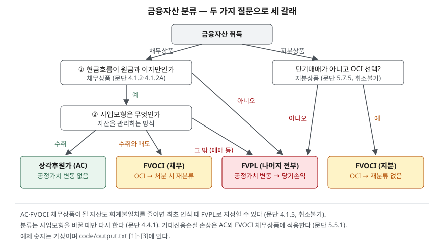

> 예제의 숫자와 시장수익률, 주가는 계산을 보이려고 만든 가상 자료다. 금액은 백만원이다.

## 들어가며

금리가 크게 오른 해의 금융회사나 현금이 많은 제조업체 실적을 보면, 같은 국고채를 들고 있었을 텐데 어떤 회사는 당기순이익이 크게 줄고 어떤 회사는 순이익은 멀쩡한데 자본만 줄어 있다. 주식을 팔아 손실을 본 해에도 순이익에는 아무 흔적이 없는 회사도 있다. 이때 흔히 한쪽은 운용을 못했고 다른 쪽은 잘했다고 읽는다. 하지만 들고 있는 자산이 같아도 그 자산을 어느 분류에 넣었느냐에 따라 같은 시가 변동이 당기손익으로 가기도 하고, 자본에 머물기도 하고, 아예 장부에 반영되지 않기도 한다. 분류 규칙을 알면 금리와 주가가 움직인 해에 순이익과 자본이 따로 움직이는 이유를 읽을 수 있다.

## 개념

### 두 가지 질문

K-IFRS 제1109호는 금융자산을 관리하는 **사업모형**과 **계약상 현금흐름 특성**, 이 두 가지를 근거로 세 범주 중 하나로 분류한다(문단 4.1.1).

- **계약상 현금흐름 특성**: 정해진 날에 원금과 그 원금에 대한 이자만 받는가. 원금과 이자만이면 이 조건을 충족한다. 주식은 원금도 이자도 없으므로 충족하지 않고, 전환사채처럼 주가에 따라 받는 것이 바뀌는 채권도 충족하지 않는다.
- **사업모형**: 회사가 그 자산 묶음으로 현금흐름을 어떻게 만드는가. 계약상 현금흐름을 받는 것이 목적인지, 받으면서 팔기도 하는지, 사고팔아 차익을 내는지다. 자산 하나하나의 의도가 아니라 회사가 실제로 자산을 관리하는 방식으로 판단한다.

### 세 범주

| 범주 | 조건 | 재무상태표 금액 | 공정가치 변동 |
|---|---|---|---|
| 상각후원가(AC) | 원금·이자만 + 수취 목적 사업모형 (문단 4.1.2) | 상각후원가 | 반영하지 않음 |
| 기타포괄손익-공정가치(FVOCI) | 원금·이자만 + 수취와 매도 사업모형 (문단 4.1.2A) | 공정가치 | 기타포괄손익, 처분 때 당기손익으로 재분류 |
| 당기손익-공정가치(FVPL) | 위 둘에 해당하지 않는 나머지 전부 (문단 4.1.4) | 공정가치 | 당기손익 |

여기에 두 가지 선택권이 붙는다. 단기매매 목적이 아닌 주식은 최초 인식 때 공정가치 변동을 기타포괄손익으로 표시하겠다고 선택할 수 있고, 이 선택은 취소할 수 없다(문단 4.1.4·5.7.5). 반대로 AC나 FVOCI가 될 자산도 회계불일치를 없애거나 크게 줄이면 최초 인식 때 FVPL로 지정할 수 있다(문단 4.1.5).

## 구조



> **출처**: [K-IFRS 제1109호 금융상품 — 문단 4.1.1~4.1.5 금융자산 분류, 4.4.1 재분류, 5.5.1 손상 적용 범위, 5.7.5 지분상품 OCI 선택](https://accountingwiki.co.kr/standards/1109) (제3자 전재). 숫자는 이 글의 [`code/output.txt`](code/output.txt) `[1]`에 있다.

FVOCI라는 이름이 두 칸에 있지만 채무상품과 지분상품은 처분할 때 갈린다. 채무상품은 쌓아 둔 기타포괄손익이 처분 때 당기손익으로 넘어오고, 지분상품은 넘어오지 않는다. 같은 이름이라 함께 묶어 읽기 쉬운 곳이다.

## 동작 원리

### 분류 판단은 위에서 아래로

```text
[1] 분류 판단 — 계약상 현금흐름 특성과 사업모형 (문단 4.1.1~4.1.4, 5.7.5)
    보유 자산           원금·이자만  사업모형     분류
    국고채, 만기까지 보유    예         수취        AC
    국고채, 유동성 관리용    예         수취와 매도    FVOCI (처분 시 재분류)
    국고채, 트레이딩 데스크   예         매매        FVPL
    전환사채            아니오       수취        FVPL
    전략적 보유 비상장 주식   -         -         FVOCI (재분류 없음)
    단기 시세차익용 상장 주식  -         -         FVPL
```

같은 국고채라도 회사가 그 채권을 어떻게 관리하는지에 따라 세 범주로 모두 갈 수 있다. 분류를 정하는 것은 상품의 이름이 아니라 현금흐름의 모양과 관리 방식이다.

### 평가손익이 가는 곳

공정가치로 측정하는 금융자산의 손익은 원칙적으로 당기손익이다(문단 5.7.1). FVOCI 채무상품은 손상차손과 외환손익을 뺀 공정가치 변동을 기타포괄손익으로 인식하고, 자산을 제거하면 그동안 쌓인 누계액을 당기손익으로 재분류한다(문단 5.7.10). 이렇게 하면 FVOCI 채무상품에서 당기손익으로 인식하는 금액은 상각후원가로 측정했을 때와 같아진다(문단 5.7.11). 이자는 어느 범주에서든 받을 권리가 생기면 손익에 들어간다.

FVOCI를 선택한 주식은 배당만 당기손익으로 인식하고(문단 5.7.6), 공정가치 변동은 기타포괄손익에 남는다. 처분해도 이 누계액은 당기손익으로 옮기지 않으며, 자본 안에서 이익잉여금으로 옮길 수만 있다(적용지침 B5.7.1).

### 분류는 쉽게 바뀌지 않는다

금융자산은 관리하는 사업모형을 바꾼 경우에만 재분류한다(문단 4.4.1). 시장이 움직였다고, 손익이 나빠 보인다고 바꿀 수 있는 것이 아니다. 주식의 FVOCI 선택과 FVPL 지정은 처음부터 취소할 수 없게 되어 있다.

## 실습 예제

전체 소스: [`code/`](code/) · 수행 기록: [`code/output.txt`](code/output.txt)

액면 1,000, 표면이자 5%, 3년 만기 채권을 세 회사가 액면에 사서 각각 AC, FVOCI, FVPL로 분류했다. 1년차 말에 시장수익률이 7%로 오르고, 2년차 말에 4%로 내렸다.

```text
[2] 같은 채권 1,000 을 세 회사가 다르게 분류 (문단 4.1.2·4.1.2A·5.7.1·5.7.10·5.7.11)
    액면 1,000, 표면이자 5%, 3년 만기, 액면 취득
    연도      시장수익률     공정가치      변동 |   AC 손익 |  FVOCI 손익    OCI |  FVPL 손익
    1년차       7%     963.8    -36.2 |     50.0 |       50.0   -36.2 |      13.8
    2년차       4%   1,009.6    +45.8 |     50.0 |       50.0   +45.8 |      95.8
    3년차       만기   1,000.0     -9.6 |     50.0 |       50.0    -9.6 |      40.4
    합계                      |    150.0 |      150.0    +0.0 |     150.0
    1년차 말 재무상태표 장부금액: AC 1,000.0 / FVOCI 963.8 / FVPL 963.8
    FVOCI 의 당기손익은 AC 와 같고, 공정가치 변동은 OCI 에 쌓였다가 만기에 0 으로 돌아온다
```

공정가치는 남은 이자와 원금을 그해 말 시장수익률로 할인한 값이다. 금리가 오르면 이미 정해진 5% 이자의 값어치가 떨어져 공정가치가 963.8로 내려간다. AC 회사는 이 변동을 장부에 반영하지 않아 해마다 이자 50만 손익으로 잡는다. FVOCI 회사도 당기손익은 50으로 같고, 공정가치 변동은 기타포괄손익으로 자본에만 반영된다. FVPL 회사는 이자와 공정가치 변동이 함께 손익에 들어가 13.8, 95.8, 40.4로 흔들린다.

세 회사 모두 3년 합계는 150이다. 만기까지 들고 있으면 액면을 돌려받으므로 공정가치 변동은 합계에서 사라진다. 다른 것은 해마다의 순이익과 자본이다. 1년차 말 자본은 FVOCI와 FVPL 회사가 AC 회사보다 36.2 적다.

이번에는 같은 주식을 500에 사서 한 회사는 FVPL로, 다른 회사는 FVOCI로 선택해 들고 있다가 2년차 말에 450에 팔았다. 해마다 배당 20을 받았다.

```text
[3] 같은 주식 500 — FVPL 과 FVOCI 선택 (문단 5.7.1·5.7.5·5.7.6, B5.7.1)
    연도        공정가치      변동 |   FVPL 손익 |  FVOCI 손익     OCI
    1년차         600    +100 |       +120 |        +20    +100
    2년차 처분      450    -150 |       -130 |        +20    -150
    합계                   |        -10 |        +40     -50
    처분 후 FVOCI 의 OCI 누계 -50 은 당기손익으로 재분류되지 않는다 (자본 안에서 이익잉여금으로만 옮길 수 있다)
    두 방식의 총포괄손익은 -10 으로 같고, 당기손익 합계만 -10 대 +40 로 갈린다
```

두 회사는 같은 주식에서 똑같이 50을 잃었다. FVPL 회사는 그 손실이 순이익에 그대로 나타나 2년 순이익 합계가 −10이다. FVOCI 회사는 배당 40만 순이익에 남고, 손실 50은 기타포괄손익에 들어간 뒤 처분해도 순이익으로 오지 않는다. 채권과 달리 이 차이는 시간이 지나도 맞춰지지 않는다.

## 실무에서 주의할 점

- **순이익만 보면 금리 효과가 안 보일 수 있다.** [2]의 AC·FVOCI 회사는 금리가 올라도 순이익이 그대로다. FVOCI 채무상품의 평가손실은 [자본변동표 글](../2026-10-07-equity-changes-statement/index.md)에서 본 기타포괄손익누계액에 쌓이므로, 금리가 크게 움직인 해에는 포괄손익계산서 아래쪽과 자본변동표를 함께 본다. AC 자산은 공정가치가 재무상태표에 없으므로 K-IFRS 제1107호가 요구하는 금융상품 범주별 공정가치 주석을 봐야 시가와의 차이가 보인다.
- **FVOCI 주식의 처분손익은 순이익에 없다.** [3]처럼 주식을 손해 보고 팔아도, 반대로 크게 이익을 보고 팔아도 순이익에는 배당만 남는다. 투자 주식이 많은 회사는 순이익만으로 투자 성과를 판단할 수 없으므로 총포괄손익을 같이 본다. [ROE 글](../../ratios/2026-10-01-roe-vs-roa/index.md)의 ROE를 계산할 때도 분자는 순이익인데 분모인 자본에는 기타포괄손익이 들어 있다는 점을 기억한다.
- **FVPL은 순이익 변동성을 키운다.** 같은 자산이라도 FVPL로 들고 있으면 [2]의 13.8, 95.8처럼 시장 변동이 순이익에 그대로 실린다. 영업이 안정적인데 순이익이 해마다 크게 출렁이는 회사라면 금융자산 평가손익 줄을 먼저 확인한다.
- **손상은 AC와 FVOCI 채무상품에만 붙는다.** 기대신용손실 손상 규정은 AC 자산과 FVOCI 채무상품에 적용된다(문단 5.5.1). FVOCI 채무상품의 손실충당금은 장부금액을 줄이지 않고 기타포괄손익에서 인식한다(문단 5.5.2). FVPL 자산과 주식은 신용 악화가 이미 공정가치에 반영되므로 따로 손상을 계산하지 않는다.
- **분류는 회사가 고른 것이다.** 주식의 FVOCI 선택과 FVPL 지정은 회사의 선택이고, 사업모형도 회사가 판단한다. 두 회사의 순이익을 비교할 때 금융자산 분류 구성이 크게 다르면 순이익 차이 중 일부는 영업이 아니라 분류에서 나온 것이다. 회계정책 주석에서 각 범주의 금액을 확인한다.

## 정리

- 금융자산은 현금흐름이 원금과 이자만인지, 사업모형이 무엇인지 두 질문으로 AC·FVOCI·FVPL 중 하나로 분류한다.
- AC는 공정가치 변동을 반영하지 않고, FVOCI 채무상품은 변동을 기타포괄손익에 쌓았다가 처분 때 당기손익으로 옮기며, FVPL은 변동을 바로 당기손익에 넣는다.
- 단기매매가 아닌 주식은 FVOCI를 취소불가로 선택할 수 있고, 이때 평가손익은 처분해도 당기손익으로 오지 않는다.
- 만기까지 든 채권은 분류와 무관하게 총손익이 같고 해마다의 순이익과 자본만 다르지만, FVOCI 주식의 손익 차이는 끝내 맞춰지지 않는다.

## 참고 자료

- [한국회계기준원 — 시행 중인 K-IFRS 기준서 목록](https://www.kasb.or.kr/front/board/ingAccountingList.do) — 기업회계기준서 제1109호·제1107호 원문 발행처. 아래 전재 사이트는 문단을 바로 열기 위한 편의 링크다
- [IFRS Foundation — IFRS 9 Financial Instruments](https://www.ifrs.org/issued-standards/list-of-standards/ifrs-9-financial-instruments/) — 국제회계기준 원문 발행처. 지분상품 OCI 누계액을 당기손익으로 옮기지 않는다는 적용지침 B5.7.1 포함
- [K-IFRS 제1109호 — 문단 4.1.1~4.1.5 분류, 4.4.1 재분류, 5.5.1·5.5.2 손상, 5.7.1 손익 인식, 5.7.5·5.7.6 지분상품 OCI 선택과 배당, 5.7.10·5.7.11 FVOCI 채무상품](https://accountingwiki.co.kr/standards/1109) (제3자 전재)
- [K-IFRS 제1107호 금융상품: 공시](https://accountingwiki.co.kr/standards/1107) (제3자 전재)
