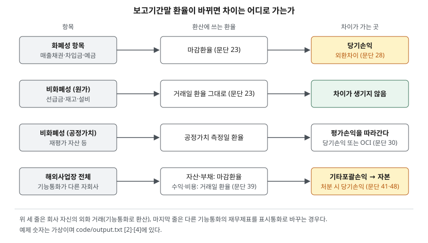

> 예제의 `가나전자`·`다라물산`과 그 숫자, 환율은 계산을 보이려고 만든 가상 자료다. 외화는 천 달러, 원화는 백만원이다.

## 들어가며

환율이 크게 움직인 분기의 실적 발표를 보면 영업이익은 비슷한데 당기순이익만 크게 늘거나 줄어든 회사가 눈에 띈다. 이유를 찾아 손익계산서를 내려가면 금융손익 줄에 외환차익이나 외환차손이 큰 금액으로 적혀 있다. 이때 흔히 수출 회사는 원화가 약해지면 무조건 이익이 늘어난다고 읽고 넘어간다. 그런데 같은 수출 회사라도 외화 차입금을 얼마나 지고 있는지, 어떤 항목이 외화로 남아 있는지에 따라 같은 환율 변동이 이익을 키우기도 하고 아무 영향도 주지 않기도 한다. 환율 변동이 재무제표 어느 줄로 가는지를 정한 규칙을 알면, 순이익이 움직인 이유를 영업과 환율로 갈라 읽을 수 있다.

## 개념

### 기능통화와 표시통화

K-IFRS 제1021호는 두 통화를 구분한다(문단 8). **기능통화**는 회사가 영업하는 주된 경제 환경의 통화로, 판매가격과 원가를 정하는 통화, 자금을 조달하고 영업현금을 보유하는 통화를 보고 정한다(문단 9~11). **표시통화**는 재무제표를 표시하는 통화다. 국내 회사는 보통 둘 다 원화지만, 미국에서 달러로 사고파는 해외 자회사는 기능통화가 달러이고 모회사 연결재무제표에서는 원화로 표시된다.

### 화폐성 항목과 비화폐성 항목

환율 변동이 장부에 반영되는지는 이 구분으로 정해진다. 화폐성 항목은 확정되었거나 결정 가능한 화폐단위 수량으로 받을 권리나 줄 의무가 있는 항목이다(문단 8·16). 그런 권리나 의무가 없으면 비화폐성이다. 기준서는 재화나 용역에 대한 선급금, 영업권, 재고자산, 유형자산을 비화폐성의 예로 든다(문단 16).

판별은 "나중에 받거나 줄 달러 수량이 지금 정해져 있는가"다. 달러 매출채권은 받을 달러 수량이 정해져 있다. 달러로 설비 대금을 미리 낸 선급금은 받을 것이 달러가 아니라 설비이므로 비화폐성이다.

## 구조



> **출처**: [K-IFRS 제1021호 환율변동효과 — 문단 23 보고기간말 환산, 28 화폐성항목 외환차이, 30 비화폐성항목 손익, 39·41 표시통화로의 환산, 48 처분 시 재분류](https://accountingwiki.co.kr/standards/1021) (제3자 전재). 숫자는 이 글의 [`code/output.txt`](code/output.txt) `[2]`·`[4]`에 있다.

위 세 줄은 회사 자신의 외화 거래를 기능통화로 기록하는 규칙이고, 마지막 줄은 기능통화가 다른 해외사업장의 재무제표를 표시통화로 바꾸는 규칙이다. 두 단계는 목적이 다르고, 그래서 차이가 가는 곳도 다르다.

## 동작 원리

### 거래일 — 그날의 환율로 기록한다

외화 거래는 거래일의 현물환율을 외화금액에 적용해 기능통화로 기록한다(문단 21). 환율이 크게 흔들리지 않았다면 기간 평균환율처럼 거래일 환율에 가까운 환율을 쓸 수 있다(문단 22).

### 보고기간말 — 항목마다 다른 환율

보고기간말에는 세 갈래로 환산한다(문단 23). 화폐성 항목은 마감환율로, 역사적원가로 측정하는 비화폐성 항목은 거래일 환율로, 공정가치로 측정하는 비화폐성 항목은 공정가치를 측정한 날의 환율로 환산한다. 화폐성 항목은 결국 그 달러 수량만큼 주고받아야 하므로 지금 환율로 다시 잴 이유가 있고, 원가로 잡은 설비는 이미 치른 값이므로 다시 잴 이유가 없다.

### 외환차이 — 당기손익으로

화폐성 항목을 결제하거나 다시 환산할 때 생기는 차이는 그 기간의 당기손익이다(문단 28). 비화폐성 항목의 평가손익을 기타포괄손익으로 인식하면 그 안의 환율 효과도 기타포괄손익으로, 당기손익으로 인식하면 당기손익으로 간다(문단 30).

### 해외사업장 환산 — 기타포괄손익으로

기능통화가 다른 해외사업장의 재무제표는 자산·부채를 보고기간말 마감환율로, 수익·비용을 거래일 환율로 환산하고, 그 차이를 기타포괄손익으로 인식한다(문단 39). 실무에서는 수익·비용에 기간 평균환율을 자주 쓰지만, 환율이 크게 움직인 기간에는 적절하지 않다(문단 40). 이 차이를 당기손익에 넣지 않는 이유는 환율 변동이 해외사업장의 영업현금흐름에 직접 주는 영향이 거의 없기 때문이며, 해외사업장을 처분할 때까지 자본의 별도 항목에 쌓아 둔다(문단 41). 처분하면 그 누계액을 당기손익으로 재분류한다(문단 48).

## 실습 예제

전체 소스: [`code/`](code/) · 수행 기록: [`code/output.txt`](code/output.txt)

```text
[1] 화폐성과 비화폐성 (문단 8·16)
    외화 매출채권    화폐성   받을 달러 수량이 정해져 있다
    외화 차입금     화폐성   갚을 달러 수량이 정해져 있다
    외화 예금      화폐성   달러 그 자체다
    외화 선급금     비화폐성  받을 것이 돈이 아니라 재화다
    수입 재고자산    비화폐성  팔아서 받을 돈이 정해져 있지 않다
    해외 구입 설비   비화폐성  쓰거나 팔아서 받을 돈이 정해져 있지 않다
    보고기간말 환산: 화폐성은 마감환율, 역사적원가 비화폐성은 거래일 환율 (문단 23)
```

```text
[2] 같은 날 같은 1,000 천 달러 — 하나는 매출채권, 하나는 선급금 (문단 21·23·28)
    거래일 환율 1,300 → 보고기간말 환율 1,400
    회사      항목          최초 인식   기말 장부금액   당기손익 외환차이
    가나전자  외화 매출채권         1,300         1,400            +100
    다라물산  외화 선급금          1,300         1,300              +0
    같은 달러, 같은 환율 변동인데 선급금은 다시 환산하지 않는다
```

두 회사 모두 달러 1,000천을 장부에 갖고 있고 환율도 똑같이 올랐다. 가나전자는 받을 달러가 원화로 100만큼 더 값어치 있어졌으므로 이익이 생긴다. 다라물산은 받을 것이 설비이므로 환율이 올라도 장부금액이 그대로다.

```text
[3] 환율이 오르내린 3년 — 매출채권만 가진 회사와 같은 금액의 차입금도 가진 회사
    가나전자: 매출채권 1,000 + 차입금 1,000 (천 달러)  /  다라물산: 매출채권 1,000 만
    연도     기말 환율   가나 채권 차이  가나 차입금 차이  가나 순손익   다라 순손익
    1년차      1,400           +100            -100          +0        +100
    2년차      1,250           -150            +150          +0        -150
    3년차      1,350           +100            -100          +0        +100
    3년 합계 외환손익: 가나전자 +0 / 다라물산 +50
    다라물산의 외환손익이 해마다 영업과 무관하게 당기순이익을 움직인다
```

이번에는 다라물산도 매출채권을 가진 경우다. 가나전자는 받을 달러와 갚을 달러가 같아 채권의 이익과 차입금의 손실이 해마다 상쇄된다. 다라물산은 +100, −150, +100으로 순이익이 흔들린다. 3년 합계 +50은 처음 환율 1,300과 마지막 환율 1,350의 차이에서 나온 것이고, 중간의 흔들림은 합계에서 사라지지만 해마다의 순이익에는 그대로 남는다.

```text
[4] 해외 자회사(기능통화 달러)를 원화로 표시 — 차이는 기타포괄손익으로 (문단 39·41)
    시작 순자산 2,000 천 달러, 환율 1,300
    연도    순이익($)  거래일 환율  순이익(원화)  기말 순자산($)  기말 환율  환산 순자산  기초+순이익  환산차이(OCI)
    1년차       200       1,350          270          2,200      1,400       3,080       2,870          +210
    2년차       200       1,300          260          2,400      1,250       3,000       3,340          -340
    자본에 쌓인 해외사업환산차이 누계 -130
    순이익은 해마다 원화로 260~270 이고, 환율 효과는 순이익에 들어가지 않는다
    자회사를 처분하면 이 누계액이 당기손익으로 재분류된다 (문단 48)
```

예제는 자회사의 수익·비용이 그해 한 환율로 발생했다고 가정했다. 1년차 순자산을 마감환율로 환산한 3,080과, 기초 순자산에 원화 순이익을 더한 2,870의 차이 210이 기타포괄손익이다. 2년차에는 환율이 내려 −340이 생겼다. 자회사가 달러로 번 이익은 두 해 모두 200으로 같지만, 원화로 본 자본은 환율에 따라 크게 움직인다. 그 움직임은 순이익이 아니라 자본에 쌓인다.

## 실무에서 주의할 점

- **외환차이는 영업이익 아래에 있을 수 있다.** 기준서는 외환차이를 당기손익으로 인식하라고 정할 뿐 어느 줄에 둘지는 정하지 않으므로, 회사마다 영업손익이나 금융손익 중 다른 곳에 둔다. [손익계산서 글](../2026-09-29-income-statement-five-steps/index.md)의 단계별 이익을 비교할 때 두 회사가 외환차이를 같은 줄에 두었는지 회계정책 주석에서 확인한다.
- **순노출을 본다.** [3]처럼 외화 자산이 커도 같은 통화의 부채가 비슷하면 환율 효과가 상쇄된다. K-IFRS 제1107호는 환위험을 포함한 시장위험 유형별 민감도 분석을 공시하게 하므로(문단 40), 외화 자산만 보고 환율 영향을 짐작하지 말고 그 주석에서 환율 변동이 손익에 주는 영향을 확인한다.
- **기타포괄손익도 자본이다.** [4]의 해외사업환산차이는 순이익에 안 보이지만 자본을 움직이므로 PBR과 ROE의 분모가 달라진다. [자본변동표 글](../2026-10-07-equity-changes-statement/index.md)의 기타포괄손익누계액 변동에서 이 금액을 찾는다. 기준서는 당기손익으로 인식한 외환차이와 자본에 쌓인 순외환차이의 기초·기말·변동을 공시하게 한다(문단 52).
- **자회사 처분 해에 순이익이 튄다.** 쌓여 있던 누계액이 처분 시 당기손익으로 재분류되므로(문단 48), 해외 자회사를 판 해에는 영업과 무관한 큰 손익이 한 번 생긴다. [연결과 별도 글](../../disclosure/2026-10-07-consolidated-vs-separate/index.md)에서 본 연결 범위가 바뀐 해라면 이 줄을 같이 본다.
- **비화폐성이라고 환율과 무관한 것은 아니다.** 수입 재고는 환산 차이가 생기지 않지만, 환율이 오르면 다음에 사는 재고의 원화 원가가 오른다. 이 효과는 외환차이가 아니라 매출원가로 나타나므로 외환손익 줄만 보면 환율 영향 전체를 놓친다.

## 정리

- 외화 거래는 거래일 환율로 기록하고, 보고기간말에는 화폐성 항목만 마감환율로 다시 환산한다.
- 화폐성 항목의 외환차이는 당기손익이 되고, 원가로 잡은 비화폐성 항목은 다시 환산하지 않아 차이가 없다.
- 같은 통화의 외화 자산과 부채를 함께 가지면 외환차이가 상쇄되므로 환율 영향은 순노출로 본다.
- 해외사업장을 표시통화로 환산한 차이는 기타포괄손익으로 자본에 쌓이고, 처분할 때 당기손익으로 재분류된다.

## 참고 자료

- [한국회계기준원 — 시행 중인 K-IFRS 기준서 목록](https://www.kasb.or.kr/front/board/ingAccountingList.do) — 기업회계기준서 제1021호 환율변동효과 원문 발행처. 아래 전재 사이트는 문단을 바로 열기 위한 편의 링크다
- [IFRS Foundation — IAS 21 The Effects of Changes in Foreign Exchange Rates](https://www.ifrs.org/issued-standards/list-of-standards/ias-21-the-effects-of-changes-in-foreign-exchange-rates/) — 국제회계기준 원문 발행처
- [K-IFRS 제1021호 — 문단 8 정의, 9~11 기능통화 결정, 16 화폐성항목, 21·22 최초 인식, 23 보고기간말 환산, 28 화폐성항목 외환차이, 30 비화폐성항목 손익, 39·40·41 표시통화로의 환산, 48 처분 시 재분류, 52 공시](https://accountingwiki.co.kr/standards/1021) (제3자 전재)
- [K-IFRS 제1107호 금융상품: 공시 — 문단 40 시장위험 유형별 민감도 분석](https://accountingwiki.co.kr/standards/1107) (제3자 전재)
