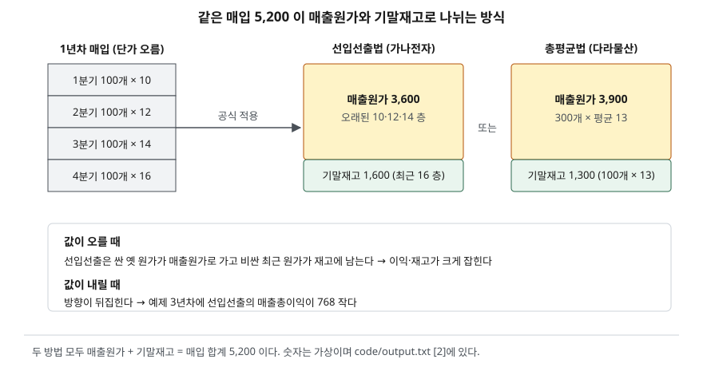

> 예제의 `가나전자`·`다라물산`과 그 숫자는 계산을 보이려고 만든 가상 자료다. 단위는 백만원이다.

## 들어가며

같은 업종의 두 회사를 나란히 놓고 매출총이익률을 비교하다 보면, 매출 규모와 판매 단가가 비슷한데도 이익률이 몇 퍼센트포인트씩 벌어지는 경우가 있다. 이때 흔히 한쪽의 원가 관리가 낫다고 결론짓고 넘어간다. 그런데 주석의 회계정책을 열어 보면 두 회사가 재고 원가를 계산하는 공식부터 다른 경우가 있다. 똑같이 사서 똑같이 팔아도 공식 하나 때문에 한 해 매출총이익이 수백씩 달라질 수 있으므로, 그 공식을 확인하지 않은 비교는 영업 성과와 회계 선택을 섞어 읽게 된다.

## 개념

### 재고자산과 원가 공식

재고자산은 정상적인 영업과정에서 판매를 위해 보유하거나, 판매할 제품을 생산 중이거나, 생산에 쓸 원재료·소모품인 자산이다(K-IFRS 제1002호 문단 6). 문제는 같은 물건을 여러 번 다른 값에 샀을 때 팔린 것이 어느 값의 물건인지다. 기준서는 이것을 원가 공식이라 부르고 세 가지를 둔다.

- **개별법** — 서로 바꿔 쓸 수 없는 항목이나 특정 프로젝트용 항목에 쓴다(문단 23). 바꿔 쓸 수 있는 대량 품목에 쓰면 어느 물건을 재고로 남길지 골라 이익을 조정할 수 있으므로 쓰지 않는다(문단 24)
- **선입선출법** — 먼저 사거나 만든 것이 먼저 팔린다고 보고, 기말에 남은 것은 가장 최근에 산 것으로 본다(문단 27)
- **가중평균법** — 기초재고와 기간 중 매입의 원가를 가중평균해 단가를 정한다. 기간 단위로 한 번 낼 수도 있고(총평균법), 매입할 때마다 다시 낼 수도 있다(이동평균법, 문단 27)

개별법 대상이 아닌 재고는 선입선출법이나 가중평균법 중에서 고른다(문단 25). 성격과 용도가 비슷한 재고에는 같은 공식을 써야 하고, 지역이나 세법이 다르다는 이유만으로 공식을 달리할 수 없다(문단 25·26).

### 후입선출법은 왜 없는가

최근 산 것이 먼저 팔린다고 보는 후입선출법은 국제회계기준에서 2003년 개정 때 삭제됐다. 실제 물건 흐름을 충실하게 나타내지 못하고, 재고가 최근 원가와 동떨어진 금액으로 남으며, 오래된 층이 팔리는 해에는 이익이 왜곡된다는 것이 결론도출근거의 설명이다(IAS 2 BC9·BC13). 세금 혜택은 회계방법을 고를 근거가 될 수 없다고도 적었다(BC20). 해외 기업의 재무제표를 읽을 때 후입선출법이 보이면 국제회계기준이 아닌 다른 기준으로 작성된 것이다.

## 구조



> **출처**: [K-IFRS 제1002호 재고자산 — 문단 23~27 원가 공식](https://accountingwiki.co.kr/standards/1002) (제3자 전재). 숫자는 이 글의 [`code/output.txt`](code/output.txt) `[2]`에 있다.

원가 공식은 새 돈을 만들지 않는다. 그 기간에 쓸 수 있었던 원가(기초재고 + 당기 매입)를 매출원가와 기말재고 두 칸에 나누는 규칙일 뿐이다. 한 칸이 커지면 다른 칸이 같은 만큼 작아진다. 매출원가는 손익계산서로, 기말재고는 재무상태표로 가므로 이 나눗셈이 두 표를 동시에 움직인다.

## 동작 원리

### 단가가 오를 때

선입선출법은 오래되어 싼 원가를 먼저 매출원가로 보낸다. 그래서 단가가 오르는 동안에는 매출원가가 작고 이익이 크며, 재고에는 최근의 비싼 원가가 남는다. 가중평균법은 옛 원가와 새 원가를 섞으므로 두 값이 그 사이에 놓인다.

### 단가가 내릴 때

방향이 그대로 뒤집힌다. 선입선출법은 앞서 비싸게 산 재고를 먼저 비용으로 보내므로 매출원가가 커진다. 어느 공식이 이익을 크게 잡는지는 공식 자체가 아니라 그 기간의 단가 흐름이 정한다.

### 차이는 다음 해로 넘어간다

올해 기말재고는 내년 기초재고다. 올해 재고를 크게 잡은 공식은 그만큼을 내년 매출원가로 넘긴다. 그래서 여러 해를 합치면 두 공식의 이익 차이는 마지막 해의 기말재고 차이만큼으로 줄어든다.

### 저가법 — 원가보다 낮게 받을 것 같으면

재고자산은 원가와 순실현가능가치 중 낮은 금액으로 측정한다(문단 9). 순실현가능가치는 예상 판매가에서 완성과 판매에 드는 비용을 뺀 금액이다(문단 6). 손상·진부화·판매가 하락이 생기면 원가를 회수하지 못할 수 있으므로 장부금액을 낮추고(문단 28), 그 평가손실은 발생한 기간의 비용이 된다(문단 34). 원가가 공식마다 다르므로 같은 하락을 겪어도 평가손실 크기가 공식마다 달라진다.

## 실습 예제

전체 소스: [`code/`](code/) · 수행 기록: [`code/output.txt`](code/output.txt)

두 회사는 같은 날 같은 값에 사서 같은 날 같은 값에 판다. 다른 것은 원가 공식뿐이다.

```text
[1] 두 회사가 똑같이 겪은 매입·판매 내역
    연도      분기별 매입 (수량×단가)                 판매 수량  판매 단가
    1년차   100×10, 100×12, 100×14, 100×16              300       25
    2년차   100×18, 100×20, 100×22, 100×24              400       30
    3년차   100×22, 100×20, 100×18, 100×16              400       30
    1·2년차는 매입 단가가 오르고, 3년차는 내린다
```

```text
[2] 1년차를 풀어 본다 — 400개 사서 300개 팔았다 (문단 25·27)
    매입 합계 5,200  /  매출 7,500
    선입선출 (가나전자): 팔린 300개 = 10·12·14 짜리 100개씩 → 매출원가 3,600
                         남은 100개 = 16 짜리             → 기말재고 1,600
    총평균   (다라물산): 단가 5,200 ÷ 400 = 13.00
                         팔린 300개 × 13.00          → 매출원가 3,900
                         남은 100개 × 13.00          → 기말재고 1,300
    매출원가 + 기말재고 = 매입 합계: 가나 5,200 / 다라 5,200
```

매입 5,200이 어느 쪽으로 더 많이 가느냐만 다르다. 가나전자는 1년차 매출총이익이 300 크고, 그 300은 재무상태표의 재고에 그대로 들어 있다.

```text
[3] 3년 동안 — 매출총이익과 기말재고
    연도        매출   선입 매출원가  평균 매출원가  선입 매출총이익  평균 매출총이익     차이  선입 기말재고  평균 기말재고
    1년차     7,500         3,600         3,900           3,900           3,600     +300         1,600         1,300
    2년차    12,000         7,600         7,760           4,400           4,240     +160         2,400         1,940
    3년차    12,000         8,400         7,632           3,600           4,368     -768         1,600         1,908
    3년 합계 매출총이익: 가나전자 11,900 / 다라물산 12,208  (차이 -308)
    차이 = 기말재고 차이 — 3년 동안 같은 매입액 21,200 이 두 칸에 다르게 나뉜 결과다
    두 회사가 낸 현금(매입)과 받은 현금(매출)은 3년 내내 같다
```

1·2년차에는 가나전자의 이익이 크다가, 단가가 내린 3년차에는 다라물산이 768 크다. 2년차 말 가나전자의 재고에는 24짜리 100개가 남아 있었고, 이것이 3년차 매출원가로 먼저 나간 탓이다. 3년 합계 차이 308은 3년차 말 기말재고 차이(1,600과 1,908)와 같다.

```text
[4] 3년차 말 판매가가 떨어졌다 — 저가법 (문단 9·28·34)
    순실현가능가치 = 예상 판매가 17 − 판매비용 2 = 개당 15, 100개면 1,500
    회사        장부 원가     순실현가능가치   평가손실   평가 후 장부금액
    가나전자       1,600           1,500        100           1,500
    다라물산       1,908           1,500        408           1,500
    같은 100개, 같은 순실현가능가치인데 원가 공식에 따라 평가손실이 다르다
    평가손실을 매출원가에 더한 3년 합계 매출총이익:
      가나전자  11,900 − 100 = 11,800
      다라물산  12,208 − 408 = 11,800
```

평가손실이 어느 줄에 들어가는지는 기준서가 정하지 않는다. 비용으로 인식하라고만 하므로(문단 34) 예제는 매출원가에 넣었다. 평가 후 두 회사의 재고가 1,500으로 같아지자 3년 합계 이익도 같아졌다. 원가 공식이 만든 차이가 평가손실로 한 번에 정리된 것이다.

## 실무에서 주의할 점

- **이익률을 비교하기 전에 원가 공식을 확인한다.** 기준서는 채택한 원가 공식을 포함한 회계정책을 주석에 공시하게 한다(문단 36). [2]·[3]처럼 공식만 달라도 한 해 매출총이익이 수백씩 갈리므로, 단가가 크게 움직인 해에는 특히 공식이 같은지부터 본다.
- **재고 회전율도 같이 움직인다.** [재고자산회전율 글](../2026-10-01-receivables-inventory-turnover/index.md)의 계산식은 매출원가를 평균재고로 나눈다. 단가가 오를 때 선입선출법은 분자가 작고 분모가 커서 회전율이 낮게 나온다. 회전율의 차이가 실제 재고 관리의 차이인지 공식의 차이인지 갈라 봐야 한다.
- **평가손실과 환입을 따로 본다.** 평가손실과 그 환입액은 주석에 공시한다(문단 36). 순실현가능가치가 다시 오르면 처음 장부금액을 한도로 환입하고 그해 비용을 줄인다(문단 33·34). [4]처럼 평가손실이 큰 해 다음 해에 환입이 생기면 그해 이익률이 영업과 무관하게 오른다.
- **현금은 공식과 무관하다.** [3]의 마지막 줄처럼 두 회사의 매입·매출 현금은 같다. 이익이 커진 해에 법인세가 늘어나는 경우를 빼면, 공식 차이는 [현금흐름표 글](../2026-09-30-cash-flow-profit-without-cash/index.md)의 영업활동현금흐름을 바꾸지 않는다. 이익이 공식 때문에 커졌는지 볼 때 현금흐름과 대조하는 이유다.
- **공식을 바꾸면 비교 연도도 고쳐진다.** 원가 공식 변경은 회계정책 변경이므로, 바꾼 해의 재무제표에서는 앞선 연도의 숫자도 새 공식으로 다시 작성된다(K-IFRS 제1008호 문단 22 소급적용). 예전 사업보고서의 숫자와 최신 보고서의 비교 연도 숫자가 다르면 이 때문일 수 있다.

## 정리

- 원가 공식은 기초재고와 당기 매입의 원가를 매출원가와 기말재고로 나누는 규칙이고, K-IFRS는 개별법·선입선출법·가중평균법을 허용하며 후입선출법은 허용하지 않는다.
- 단가가 오를 때는 선입선출법의 이익과 재고가 크고, 내릴 때는 반대가 된다.
- 한 해의 차이는 기말재고를 거쳐 다음 해로 넘어가므로, 여러 해를 합치면 이익 차이는 마지막 기말재고 차이만큼 남는다.
- 저가법 평가손실의 크기도 원가에 따라 달라지므로, 이익률을 비교할 때는 주석의 원가 공식과 평가손실·환입을 함께 본다.

## 참고 자료

- [한국회계기준원 — 시행 중인 K-IFRS 기준서 목록](https://www.kasb.or.kr/front/board/ingAccountingList.do) — 기업회계기준서 제1002호 재고자산 원문 발행처. 아래 전재 사이트는 문단을 바로 열기 위한 편의 링크다
- [IFRS Foundation — IAS 2 Inventories](https://www.ifrs.org/issued-standards/list-of-standards/ias-2-inventories/) — 국제회계기준 원문 발행처
- [K-IFRS 제1002호 — 문단 6 정의, 9 저가 측정, 23·24 개별법, 25·26·27 선입선출법과 가중평균법, 28 평가 사유, 33 재검토와 환입, 34 비용 인식, 36 공시](https://accountingwiki.co.kr/standards/1002) (제3자 전재)
- [K-IFRS 제1002호 결론도출근거 — BC9 후입선출법 삭제 결정, BC13 재무상태표·손익 왜곡, BC20 세무상 동기](https://accountingwiki.co.kr/standards/1002/bc) (제3자 전재)
- [K-IFRS 제1008호 회계정책, 회계추정치 변경과 오류 — 문단 22 소급적용](https://accountingwiki.co.kr/standards/1008) (제3자 전재)
