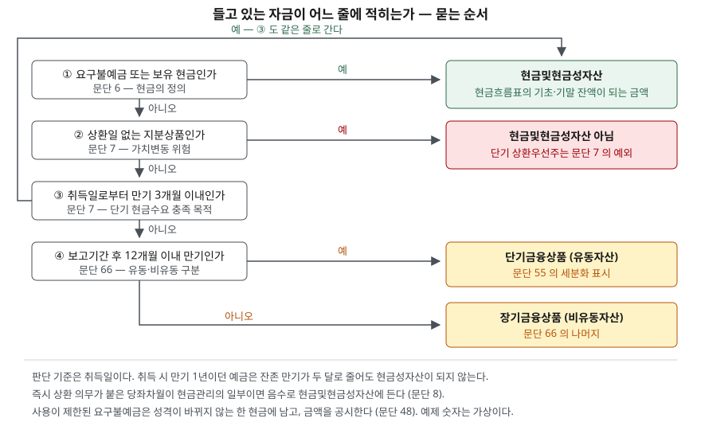

> 예제의 회사와 금액은 계산을 보이려고 만든 가상 자료다. 금액 단위는 백만원이다.

## 들어가며

두 회사의 재무상태표를 나란히 놓고 "현금이 얼마나 있나"를 보려고 할 때가 있다. 맨 윗줄 현금및현금성자산을 찾아 적어 두면 한쪽은 450, 다른 쪽은 200이다. 여기서 보통은 앞 회사가 현금을 두 배 넘게 쥐고 있다고 읽고 넘어간다. 그런데 바로 아래 줄에 단기금융상품 250이 적혀 있다면, 두 회사가 들고 있는 돈은 똑같이 450이다. 달라진 것은 돈의 양이 아니라 만기 몇 달짜리 예금에 넣어 두었느냐다. 같은 일이 현금흐름표에서도 벌어진다. 영업으로 벌어들인 현금이 같아도 한 회사의 기말 현금은 180이 줄어 있다. 현금을 세는 규칙을 알아야 이 숫자들이 무엇을 말하는지 구분된다.

## 개념

### 현금과 현금성자산은 다른 말이다

K-IFRS 제1007호 '현금흐름표'는 둘을 따로 정의한다(문단 6). **현금**은 보유 현금과 요구불예금이다. **현금성자산**은 유동성이 매우 높은 단기 투자자산으로서, 확정된 금액의 현금으로 전환이 쉽고 가치변동 위험이 경미한 자산이다. 재무상태표에 적히는 `현금및현금성자산`은 이 둘을 합친 금액이고, 현금흐름표가 기초·기말 잔액으로 쓰는 것도 같은 금액이다.

현금성자산은 "굴려서 수익을 내려고" 들고 있는 것이 아니다. 문단 7은 그 보유 목적을 단기 현금수요를 충족하기 위한 것으로 못 박는다. 투자 목적이면 금액이 아무리 작고 만기가 짧아도 현금성자산이 아니다.

### 3개월은 규칙이 아니라 예시다

흔히 "만기 3개월 이내면 현금성자산"으로 외우지만, 문단 7의 문장은 그렇게 단정하지 않는다. 가치변동 위험이 경미하려면 만기가 짧아야 한다고 말한 뒤 "예를 들어, 취득일로부터 만기일이 3개월 이내인 경우"를 든다. 즉 3개월은 요건을 충족하는 전형적인 경우를 보인 것이고, 판단해야 할 것은 여전히 **확정된 금액의 현금으로 쉽게 전환되는가**와 **가치변동 위험이 경미한가**다. 실무에서는 이 예시를 기준선으로 삼는다.

중요한 것은 **취득일 기준**이라는 점이다. 취득 당시 만기가 1년이던 정기예금은 결산일에 잔존 만기가 두 달로 줄어도 현금성자산이 되지 않는다. 기준선이 결산일이 아니라 취득일이어서, 남은 기간이 같아도 분류가 갈린다.

### 지분상품은 빠지고, 상환우선주는 예외다

문단 7은 지분상품을 현금성자산에서 제외한다. 주식은 상환일이 없고 가치변동 위험이 경미하지 않으므로 만기 요건을 볼 것도 없이 걸린다. 다만 상환일이 정해져 있고 취득일부터 상환일까지 기간이 짧은 우선주처럼 실질이 현금성자산에 해당하면 예외로 본다.

### 당좌차월은 빼는 쪽으로 들어온다

은행차입은 보통 재무활동이다. 그런데 금융회사의 요구에 따라 즉시 상환해야 하는 당좌차월은 기업의 현금관리 수단이고, 이때 당좌차월은 현금및현금성자산의 구성요소에 포함된다(문단 8). 부호가 음수로 들어간다는 뜻이다. 재무상태표에서는 부채로 적히는 금액이 현금흐름표의 기말 현금에서는 차감된다.

## 구조



> **출처**: [K-IFRS 제1007호 현금흐름표 — 문단 6 용어의 정의, 7 현금성자산의 요건, 8 당좌차월, 48 사용제한 금액 공시](https://accountingwiki.co.kr/standards/1007) (제3자 전재) 및 [K-IFRS 제1001호 재무제표 표시 — 문단 55 항목의 세분화, 66 유동자산 분류](https://accountingwiki.co.kr/standards/1001) (제3자 전재). 원문 발행처는 [한국회계기준원](https://www.kasb.or.kr/front/board/ingAccountingList.do)이다. 예제 숫자는 이 글의 [`code/output.txt`](code/output.txt)에 있다.

판단은 위에서 아래로 내려간다. 세 번째 질문에서 걸러진 것도 결국 첫 번째와 같은 줄로 들어가고, 거기서 떨어진 것부터 금융상품 줄로 간다. 만기가 길어질수록 아래로 내려가는 구조이므로 `현금및현금성자산` → `단기금융상품` → `장기금융상품` 세 줄은 같은 성격의 자금을 만기로 나눈 것이라고 읽으면 된다.

## 동작 원리

### 요건을 순서대로 물으면 분류가 갈리는 자리가 보인다

전체 소스: [`code/`](code/) · 수행 기록: [`code/output.txt`](code/output.txt)

```text
[1] 분류가 갈리는 자리 — 문단 6~7 의 요건을 순서대로 묻는다
    보통예금                              현금및현금성자산        요구불예금은 현금의 정의에 바로 든다 (문단 6)
    상장주식 — 단기 운용 목적                   현금및현금성자산 아님     상환일이 없는 지분상품은 제외 (문단 7)
    취득 시 상환일이 두 달 남았던 상환우선주           현금및현금성자산        상환일까지 기간이 단기인 우선주 — 문단 7 의 예외
    정기예금 — 취득 시 만기 2개월                현금및현금성자산        취득일로부터 만기 3개월 이내 (문단 7 예시)
    정기예금 — 취득 시 만기 12개월, 잔존 2개월       단기금융상품          취득일 기준 만기 3개월 초과 (문단 7·55)
    정기예금 — 취득 시 만기 18개월               장기금융상품          보고기간 후 12개월 이후 만기 (문단 66)
    잔존 만기가 2개월로 같아도 취득 시 만기가 다르면 분류가 갈린다.
```

아래 두 줄이 이 트랙에서 가장 자주 틀리는 자리다. 결산일 기준으로 남은 기간만 보면 둘 다 두 달이지만, 취득 시 만기가 12개월이던 예금은 단기금융상품에 남는다.

### 현금및현금성자산 안에서 옮긴 돈은 현금흐름이 아니다

현금및현금성자산을 구성하는 항목 사이의 이동은 영업·투자·재무활동 어디에도 들지 않는다. 현금관리의 일부이기 때문이다(문단 9). 보통예금에서 만기 2개월 예금으로 옮겼다면 현금흐름표에는 아무것도 나타나지 않는다.

반대로 그 경계를 넘어가면 현금흐름이 생긴다. 만기 6개월 예금에 넣는 순간 그 돈은 현금및현금성자산 밖으로 나간 것이므로 투자활동 현금유출로 잡힌다. 돈이 회사 밖으로 나간 것이 아닌데도 기말 현금은 그만큼 줄어든다.

### 사용이 제한돼도 현금에서 빼지 않는다

제삼자와의 계약으로 지정된 목적에만 쓸 수 있게 묶어 둔 요구불예금은 어떻게 할까. IFRS 해석위원회는 2022년 4월 이 질의를 검토하고, 사용제한이 예금의 성격을 바꾸어 현금의 정의를 더는 충족하지 못하게 만드는 것이 아니라면 그 예금은 여전히 현금이라고 결론 내렸다. 기업이 그 금액을 인출할 수 있기 때문이다. 따라서 현금흐름표와 재무상태표 모두에서 현금및현금성자산 구성요소에 포함한다.

대신 두 가지가 붙는다. 연결실체가 사용할 수 없는 유의적인 현금및현금성자산이 있으면 그 금액과 경영진의 설명을 공시하고(제1007호 문단 48), 교환이나 부채 상환 목적의 사용 제한 기간이 보고기간 후 12개월 이상이면 유동자산이 아니다(제1001호 문단 66(d)). 즉 숫자를 본문에서 빼는 대신 주석에서 알린다.

## 실습 예제

여유자금 450을 들고 있는 두 회사가 그 돈을 다르게 두었다. 가나전자는 보통예금 200, 수시입출금 MMF 150, 취득 시 만기 2개월 정기예금 100으로 나눴고, 다라물산은 보통예금 200과 취득 시 만기 6개월 정기예금 250으로 나눴다. 유동부채 500과 매출채권 등 나머지 당좌자산 300은 두 회사가 같다.

```text
[3] 재무상태표 표시와 현금비율 — 총액은 같고 자리만 다르다
                    현금및현금성자산      단기금융상품     자금 합계     유동부채     현금비율     당좌비율
    가나전자                 450           0       450      500    90.0%   150.0%
    다라물산                 200         250       450      500    40.0%   150.0%
    두 회사가 쥔 돈은 450 으로 같지만 현금비율은 갈린다.
    매출채권까지 넣는 당좌비율에서는 단기금융상품도 분자에 들어가 차이가 사라진다.
```

현금비율은 90%와 40%로 두 배 넘게 벌어지지만, 당좌비율은 150%로 같다. 분자에 단기금융상품을 넣느냐 마느냐가 전부다. 현금비율만 보고 다라물산의 유동성이 나쁘다고 읽으면, 실제로는 만기 6개월 예금에 넣어 둔 돈을 세지 않은 것이다. [유동비율과 부채비율 글](../../ratios/2026-10-01-leverage-and-current-ratio/index.md)에서 본 분자 정의를 확인해야 하는 자리가 여기다.

가나전자의 450 가운데 80은 제삼자와의 계약에 따라 지정된 목적에만 쓰기로 한 요구불예금이다.

```text
[4] 사용이 제한된 요구불예금 — 현금에서 빼지 않고 공시한다 (문단 48)
    가나전자 현금및현금성자산             450
      그중 지정 목적에만 쓸 수 있는 요구불예금      80
      제약 없이 쓸 수 있는 금액                370
    현금비율  표시된 금액 기준 90.0%  →  제약을 뺀 금액 기준 74.0%
    인출이 막힌 것이 아니므로 현금의 정의는 그대로 충족한다.
    표시 금액은 450 이고, 줄어드는 것은 본문이 아니라 읽는 사람의 해석이다.
```

표시 금액은 450 그대로다. 바뀌는 것은 그 숫자를 읽는 사람이 얼마를 쓸 수 있는 돈으로 보느냐이고, 90%와 74%의 차이는 재무상태표 본문이 아니라 주석에서만 확인된다.

이번에는 같은 영업성과를 낸 한 해를 두고 기말 현금을 비교한다. 두 회사 모두 기초 현금및현금성자산이 380이고 영업활동 현금흐름이 +70이다. 다라물산은 기중에 250을 만기 6개월 예금으로 옮겼다.

```text
[5] 같은 영업성과, 다른 기말 현금 — 현금성자산 밖으로 옮기면 투자활동이다
    두 회사 모두 기초 현금및현금성자산 380, 영업활동 현금흐름 +70
                    기초      영업활동      투자활동      기말      증감
    가나전자           380       +70         0     450     +70
    다라물산           380       +70      -250     200    -180
    다라물산의 현금은 180 줄었지만 벌어들인 현금은 가나전자와 같다.
    현금및현금성자산 안에서 옮긴 가나전자의 MMF·2개월 예금은 현금흐름이 아니다 (문단 9).
```

다라물산의 기말 현금은 180 줄었다. 그런데 영업활동 현금흐름은 가나전자와 똑같은 +70이고, 돈이 회사 밖으로 나간 것도 아니다. 줄어든 180은 예금 만기를 6개월로 잡은 결과일 뿐이다. 기말 현금의 증감만으로 그해 장사를 판단할 수 없는 이유가 여기 있고, [현금흐름 세 갈래 글](../2026-09-30-cash-flow-three-activities/index.md)이 활동별로 나누어 보라고 한 까닭도 같다.

마지막으로 당좌차월이 끼면 재무상태표의 한 줄과 현금흐름표의 기말 현금이 어긋난다.

```text
[6] 현금흐름표 기말 현금과 재무상태표의 조정 (문단 45)
    다라물산이 즉시 상환 의무가 붙은 당좌차월 30 을 현금관리에 쓴다고 하면
      재무상태표 현금및현금성자산 (자산)           200
      재무상태표 단기차입금 중 당좌차월 (부채)      -30
      현금흐름표 기말 현금및현금성자산             170
      (단기금융상품 250 은 어느 쪽에도 들지 않는다)
    자산 한 줄만 보고 현금흐름표 기말 현금과 맞춰 보면 30 이 어긋난다.
    그 차이를 메우는 것이 문단 45 가 요구하는 조정 공시다.
```

재무상태표 자산 쪽은 200인데 현금흐름표 기말 현금은 170이다. 두 금액이 다른 것이 잘못이 아니라, 당좌차월을 현금관리에 쓰는 회사에서는 이렇게 되는 것이 맞다. 문단 45가 현금및현금성자산의 구성요소와 재무상태표 항목 간 조정내용을 공시하라고 요구하는 것은 이 차이를 설명하게 하려는 것이다.

## 실무에서 주의할 점

- **현금비율을 비교할 때는 바로 아랫줄을 같이 본다.** [3]처럼 같은 돈을 들고도 현금비율이 두 배 넘게 갈린다. 회사마다 자금 운용 만기가 다르므로, 현금및현금성자산만 뽑아 비교하면 예금 만기를 길게 가져가는 회사가 일방적으로 나빠 보인다. 단기금융상품을 더한 금액으로 한 번 더 계산해 두 숫자를 같이 보는 편이 낫다.
- **기말 현금 증감을 영업성과로 읽지 않는다.** [5]의 다라물산은 현금이 180 줄었지만 영업활동 현금흐름은 +70이다. 현금 증감은 세 활동의 합이고, 그중 투자활동에는 이렇게 자금을 옮긴 것만으로 생기는 금액이 섞인다. [영업이익과 순이익이 벌어지는 자리 글](../2026-09-30-operating-vs-net-income-gap/index.md)에서 본 것과 같은 종류의 함정이다.
- **사용제한 금액은 본문에 없다.** [4]의 80은 재무상태표 어디에도 따로 적히지 않고 주석에만 나온다. 현금이 많아 보이는 회사일수록 제1007호 문단 48 공시를 찾아 얼마가 묶여 있는지 확인한다. 담보로 제공한 예금, 계약상 지정 용도가 붙은 예금이 여기 걸린다.
- **당좌차월을 쓰는 회사는 두 숫자가 어긋난다.** [6]처럼 재무상태표 자산 줄과 현금흐름표 기말 현금이 다를 수 있다. 두 숫자가 안 맞는다고 오류로 보지 말고 문단 45의 조정 공시를 먼저 읽는다.
- **취득일 기준이라는 점을 확인한다.** [1]의 마지막 두 줄처럼, 결산일에 남은 기간이 같아도 분류가 갈린다. 회사가 어떤 기준으로 분류했는지는 회계정책 주석의 현금및현금성자산 항목에 적힌다. 분류 기준이 바뀌면 전기와 당기의 현금 줄이 같은 것을 세지 않게 되므로 그 사실도 함께 본다.

## 정리

- 현금은 보유 현금과 요구불예금이고, 현금성자산은 단기 현금수요를 채우려고 들고 있는 유동성 높은 단기 투자자산이다. 재무상태표의 현금및현금성자산은 둘의 합이다.
- 3개월은 문단 7이 드는 예시이고 판단 기준은 취득일이다. 취득 시 만기가 길었던 예금은 잔존 만기가 짧아져도 현금성자산이 되지 않는다.
- 현금및현금성자산 안에서 옮긴 돈은 현금흐름이 아니고, 그 경계를 넘으면 투자활동 현금흐름이 생긴다. 기말 현금 증감만으로 영업성과를 읽을 수 없다.
- 사용이 제한된 요구불예금은 성격이 바뀌지 않는 한 현금에 남고 금액을 공시한다. 당좌차월이 현금관리의 일부이면 음수로 들어가므로 재무상태표와 현금흐름표의 숫자가 달라진다.

## 참고 자료

- [한국회계기준원 — 시행 중인 K-IFRS 기준서 목록](https://www.kasb.or.kr/front/board/ingAccountingList.do) — 기업회계기준서 제1007호·제1001호 원문 발행처. 아래 전재 사이트는 문단을 바로 열기 위한 편의 링크다
- [IFRS Foundation — IAS 7 Statement of Cash Flows](https://www.ifrs.org/issued-standards/list-of-standards/ias-7-statement-of-cash-flows/) — 국제회계기준 원문 발행처
- [IFRS 해석위원회 논의 결과 — 제삼자와의 계약으로 인해 사용이 제한된 요구불예금 (2022년 4월)](https://ifrs.org/content/dam/ifrs/supporting-implementation/agenda-decisions/2022/ko-demand-deposits-with-restrictions-on-use-arising-from-a-contract-with-a-third-party-apr-2022.pdf) — 한국회계기준원 번역본. 관련 문단 6·31·45·48·54·55·66
- [K-IFRS 제1007호 현금흐름표 — 문단 6 정의, 7 현금성자산 요건, 8 당좌차월, 9 구성항목 간 이동, 45 구성요소 공시, 48 사용제한 금액 공시](https://accountingwiki.co.kr/standards/1007) (제3자 전재)
- [K-IFRS 제1001호 재무제표 표시 — 문단 54(i) 최소 표시 항목, 55 항목의 세분화, 66 유동자산 분류](https://accountingwiki.co.kr/standards/1001) (제3자 전재)
