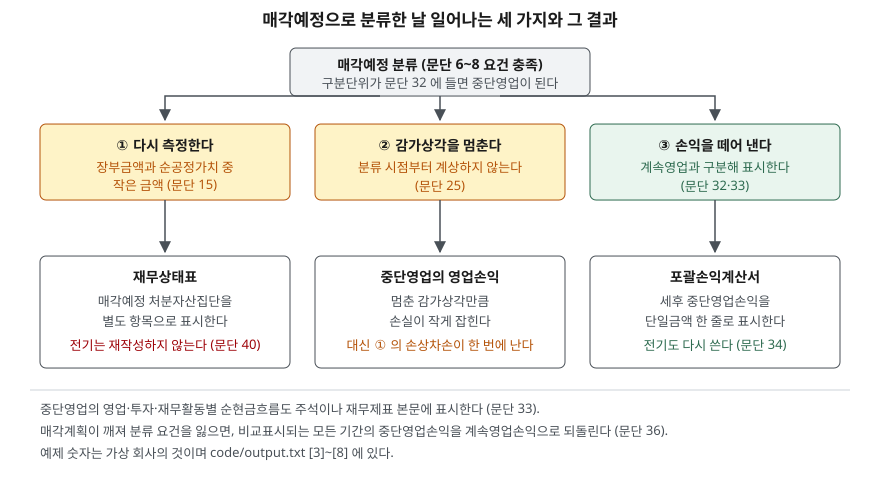

> 예제의 회사와 금액은 계산을 보이려고 만든 가상 자료다. 금액 단위는 백만원이고 세율은 22%로 뒀다.

## 들어가며

작년에 어떤 회사의 실적을 보면서 매출 1조라고 적어 뒀다고 하자. 올해 같은 회사의 사업보고서를 열면 비교표시된 전기 매출이 8천억으로 적혀 있다. 숫자를 잘못 적었나 싶어 작년 보고서를 다시 열어 보면 거기엔 분명 1조다. 둘 다 맞다. 그 사이 회사가 사업부 하나를 접기로 했고, 손익계산서에서 그 사업부의 매출이 떨어져 나가면서 전기 숫자까지 같은 기준으로 다시 쓰였기 때문이다. 이걸 모르면 올해 성장률을 계산할 때 어느 전기 숫자를 분모에 넣느냐에 따라 2%와 10% 사이를 오간다. 두 숫자 모두 회사가 공시한 값이라 어느 쪽도 틀리지 않았다는 점이 더 까다롭다.

## 개념

### 매각예정이 먼저고 중단영업이 다음이다

K-IFRS 제1105호 '매각예정비유동자산과 중단영업'은 두 단계로 읽어야 한다. 먼저 자산이나 처분자산집단이 **매각예정** 요건을 채우는지 보고, 그다음 그것이 **중단영업**에 해당하는지 본다.

매각예정은 장부금액을 계속 사용이 아니라 매각거래로 주로 회수할 예정일 때다(문단 6). 여기에 두 가지가 붙는다. 현재 상태에서 통상적이고 관습적인 거래조건만으로 즉시 매각할 수 있어야 하고, 매각될 가능성이 매우 높아야 한다(문단 7). 가능성이 매우 높다는 것은 문단 8이 다시 풀어 적는다. 경영진이 매각계획을 확약하고 매수자를 찾는 조치를 이미 시작했을 것, 현재 공정가치에 비추어 합리적인 가격으로 추진할 것, 분류 시점부터 1년 내 매각 완료가 예상될 것, 계획이 크게 바뀌거나 철회될 가능성이 낮을 것이다.

"팔 생각이 있다"로는 모자란다는 뜻이다. 이사회 결의와 매각 주관사 선정 같은 것이 이미 있어야 요건이 선다.

### 중단영업은 구분단위여야 한다

매각예정이 됐다고 전부 중단영업은 아니다. 문단 32는 이미 처분되었거나 매각예정으로 분류된 **기업의 구분단위**이면서 다음 셋 중 하나일 것을 요구한다. 별도의 주요 사업계열 또는 영업지역이거나, 그런 사업계열·영업지역을 처분하려는 **단일 계획의 일부**이거나, 매각만을 목적으로 취득한 종속기업이다. 세 가지다.

따라서 공장 건물 하나를 파는 것은 매각예정 자산일 수는 있어도 중단영업이 아니다. 손익계산서는 그대로 두고 재무상태표에서만 자산이 옮겨 간다.

## 구조



> **출처**: [K-IFRS 제1105호 매각예정비유동자산과 중단영업 — 문단 6~8 매각예정 분류, 15 측정, 25 감가상각 중단, 32 중단영업의 정의, 33 표시와 공시, 34 비교표시 재작성, 36 분류 취소, 40 과거 재무상태표](https://accountingwiki.co.kr/standards/1105) (제3자 전재). 원문 발행처는 [한국회계기준원](https://www.kasb.or.kr/front/board/ingAccountingList.do)이다. 예제 숫자는 이 글의 [`code/output.txt`](code/output.txt)에 있다.

아래 줄 세 칸이 서로 다른 시간 범위를 가진다는 점이 이 도식의 핵심이다. 포괄손익계산서는 전기까지 거슬러 다시 쓰이고, 재무상태표는 당기만 바뀐다. 같은 보고서 안에서 비교 가능한 범위가 표마다 다르다.

## 동작 원리

### 측정하고, 감가상각을 멈춘다

매각예정으로 분류한 비유동자산은 순공정가치, 즉 공정가치에서 처분부대원가를 뺀 금액과 장부금액 중 작은 금액으로 측정한다(문단 15). 그리고 감가상각이나 상각을 하지 않는다(문단 25). 팔려고 내놓은 자산이므로 장부금액을 회수하는 경로가 사용에서 매각으로 바뀌었고, 그 매각 금액이 이미 측정에 반영됐기 때문이다. 다만 처분자산집단에 딸린 부채의 이자와 기타 비용은 계속 인식한다.

이 둘은 반대 방향으로 작용한다. 감가상각을 멈추면 그 기간의 비용이 줄어 손실이 작아 보이지만, 측정 단계에서 손상차손이 한꺼번에 난다.

### 손익은 한 줄로 나가고, 전기는 다시 쓴다

중단영업의 세후 손익과, 중단영업 자산을 순공정가치로 측정하거나 처분하면서 생긴 세후 손익을 합쳐 **단일금액**으로 포괄손익계산서에 표시한다(문단 33). 본문에 나가는 것은 이 한 줄이고, 그 안의 수익·비용·세전손익·법인세·측정손익은 주석이나 본문에서 나누어 공시한다. 영업·투자·재무활동별 순현금흐름도 같이 공시하고, 지배기업 소유주에게 귀속되는 계속영업손익과 중단영업손익 금액도 밝힌다.

그다음이 성장률을 흔드는 조항이다. 문단 34는 재무제표에 표시되는 **과거 기간**도 중단영업 기준으로 같은 공시를 다시 하도록 요구한다. 즉 비교표시된 전기 손익계산서가 재작성된다.

반면 재무상태표는 다르다. 문단 40에 따라 매각예정으로 분류된 자산과 부채는 **과거 재무상태표를 재분류하거나 재작성하지 않는다.** 손익과 현금흐름만 다시 쓰고 재무상태표는 그대로 둔다.

### 계획이 깨지면 되돌린다

구분단위가 더 이상 매각예정으로 분류될 수 없게 되면, 이전에 중단영업으로 표시했던 영업성과를 비교표시되는 모든 기간에 걸쳐 계속영업손익으로 다시 분류하고, 과거 기간이 재분류되었다는 사실을 주석에 적는다(문단 36). 매각이 무산된 해에는 전기와 전전기 숫자가 또 한 번 바뀐다는 뜻이다.

## 실습 예제

전체 소스: [`code/`](code/) · 수행 기록: [`code/output.txt`](code/output.txt)

마바중공업은 기계사업부와 설비사업부를 가지고 있고, 20X2년 7월 1일에 설비사업부를 매각예정으로 분류했다. 분류 직전 설비사업부 처분자산집단의 장부금액은 1,200, 순공정가치는 950이다. 연간 감가상각비는 80이다.

```text
[3] 감가상각 중단 — 분류 시점부터 계상하지 않는다 (문단 25)
    설비사업부 연간 감가상각비                    80
    20X2년 7월 1일 분류 — 계상하지 않은 하반기분       40
    분류하지 않았다면 20X2년 영업손익           -240
    실제 20X2년 영업손익                    -200
    감가상각을 멈춘 만큼 중단영업의 손실이 작아 보인다.
    대신 그 자산은 아래 [4] 에서 순공정가치로 한 번에 떨어진다.

[4] 처분자산집단 측정 — 장부금액과 순공정가치 중 작은 금액 (문단 15)
    분류 직전 장부금액                       1,200
    공정가치에서 처분부대원가를 뺀 금액               950
    측정에 따른 손상차손                       250
    재무상태표 매각예정 처분자산집단 금액             950
```

감가상각 40을 아꼈지만 손상차손 250이 났다. 둘을 합치면 분류하지 않았을 때보다 210만큼 손실이 크다. 매각예정 분류가 손실을 미루는 장치가 아니라 앞당기는 장치에 가깝다는 것이 여기서 보인다.

```text
[5] 포괄손익계산서에 나가는 중단영업손익 — 단일금액으로 표시 (문단 33)
    구분                                      세전       법인세효과        세후
    중단영업의 영업손익                            -200         +44      -156
    순공정가치 측정에 따른 손익                       -250         +55      -195
    중단영업손익 (단일금액)                                               -351
    본문에는 이 한 줄만 나가고, 위 두 갈래는 주석이나 본문에서 나누어 공시한다.
```

손익계산서 본문에 적히는 것은 −351 한 줄이다. 영업에서 난 손실인지 자산을 깎은 손실인지는 본문만 봐서 알 수 없고, 주석을 열어야 −156과 −195로 갈린다.

이제 두 해를 나란히 놓는다.

```text
[6] 비교표시를 다시 쓴다 — 전기 숫자가 달라진다 (문단 34)
                 전체 매출      전체 영업익       계속영업 매출        계속영업 영업익
    20X1        10,000         450         8,000             600
    20X2        10,200         560         8,800             760

                                 재작성 전          재작성 후 (계속영업)
    매출 성장률                        2.0%                 10.0%
    영업이익률 (전기)                    4.5%                  7.5%
    영업이익률 (당기)                    5.5%                  8.6%
    같은 회사의 같은 두 해인데 성장률이 2.0% 와 10.0% 로 갈린다.
    숫자가 좋아진 것이 아니라 세는 범위가 바뀐 것이다.
    손익과 현금흐름만 다시 쓰고, 전기 재무상태표는 재분류·재작성하지 않는다 (문단 40).
```

20X1년 보고서에 적혔던 매출 10,000은 20X2년 보고서에서 8,000이 된다. 성장률은 2.0%에서 10.0%로, 전기 영업이익률은 4.5%에서 7.5%로 뛴다. 회사가 나아진 것이 아니라 적자 사업부를 세는 범위 밖으로 옮긴 결과다. 반대로 접는 사업이 흑자였다면 계속영업 기준 지표가 재작성 전보다 나빠진다.

```text
[7] 주당이익도 둘로 나뉜다 (문단 33)
    계속영업 세후손익                      +593
    중단영업손익                          -351
    당기순손익                            +242
    계속영업 기본주당이익           59원
    기본주당이익                  24원
    두 해를 비교할 때는 같은 쪽끼리 본다. 계속영업 EPS 와 전체 EPS 를 섞지 않는다.
```

계속영업 기준 59원과 전체 기준 24원은 두 배 넘게 차이 난다. [PER 글](../../valuation/2026-10-02-per-trailing-vs-forward/index.md)에서 본 것처럼 PER의 분모는 주당이익이므로, 어느 쪽을 썼는지에 따라 같은 주가에서 배수가 두 배 넘게 갈린다.

```text
[8] 매각계획이 철회되면 전부 되돌린다 (문단 36)
    20X1  계속영업 매출 8,000 → 10,000 · 계속영업 영업익 600 → 450
    20X2  계속영업 매출 8,800 → 10,200 · 계속영업 영업익 760 → 560
    과거 기간이 재분류되었다는 사실도 주석에 적는다.
    [6] 에서 10.0% 였던 성장률은 다시 2.0% 가 된다.
```

## 실무에서 주의할 점

- **성장률은 같은 보고서 안에서 계산한다.** 전기 숫자를 작년 보고서에서 가져오고 당기 숫자를 올해 보고서에서 가져오면 [6]의 두 열을 섞는 셈이다. 비교표시된 전기 숫자를 당기 보고서에서 함께 꺼내야 2.0%와 10.0%가 섞이지 않는다. 여러 해를 이어 붙인 표를 쓸 때 특히 걸린다.
- **재무상태표와 손익계산서의 비교 범위가 다르다.** 문단 40에 따라 전기 재무상태표는 그대로다. 손익계산서는 계속영업만 남았는데 전기 자산총계에는 접기로 한 사업의 자산이 들어 있으므로, [ROA](../../ratios/2026-10-01-roe-vs-roa/index.md)처럼 손익과 자산을 함께 쓰는 지표는 전기 값이 왜곡된다. 분자만 재작성되고 분모는 그대로인 상태다.
- **감가상각 중단은 비용을 없애는 것이 아니다.** [3]과 [4]를 함께 보면 감가상각 40을 멈춘 대신 손상차손 250이 났다. 중단영업의 영업손실만 보고 "생각보다 선방했다"고 읽으면 측정손익 줄을 빠뜨린 것이다. 문단 33이 두 갈래를 나누어 공시하게 한 이유가 여기 있다.
- **EPS는 계속영업 기준과 전체 기준을 구분해 쓴다.** [7]처럼 59원과 24원이 함께 공시된다. 전년과 비교할 때 한 해는 계속영업 기준, 다른 해는 전체 기준을 쓰면 아무 뜻도 없는 증감률이 나온다.
- **매각이 무산되면 또 바뀐다.** [8]처럼 문단 36에 따라 비교표시되는 모든 기간이 되돌아간다. 매각 협상이 진행 중인 회사의 과거 숫자는 확정된 값이 아니라는 뜻이므로, [주석과 감사의견 글](../2026-10-01-notes-and-audit-opinion/index.md)에서 본 것처럼 진행 상황을 주석에서 확인한다.

## 정리

- 중단영업은 두 단계를 거친다. 먼저 문단 6~8의 매각예정 요건을 채우고, 그다음 문단 32의 구분단위 세 가지 중 하나에 들어야 한다.
- 분류하면 장부금액과 순공정가치 중 작은 금액으로 다시 측정하고 감가상각을 멈춘다. 멈춘 감가상각보다 손상차손이 큰 것이 보통이다.
- 중단영업의 세후 손익과 측정·처분 손익을 합쳐 단일금액 한 줄로 표시하고, 비교표시되는 과거 기간의 손익도 같은 기준으로 다시 쓴다.
- 재무상태표는 과거 기간을 재작성하지 않으므로 같은 보고서 안에서도 표마다 비교 가능한 범위가 다르다. 매각계획이 깨지면 중단영업으로 표시했던 것을 모든 기간에 걸쳐 되돌린다.

## 참고 자료

- [한국회계기준원 — 시행 중인 K-IFRS 기준서 목록](https://www.kasb.or.kr/front/board/ingAccountingList.do) — 기업회계기준서 제1105호 원문 발행처. 아래 전재 사이트는 문단을 바로 열기 위한 편의 링크다
- [IFRS Foundation — IFRS 5 Non-current Assets Held for Sale and Discontinued Operations](https://www.ifrs.org/issued-standards/list-of-standards/ifrs-5-non-current-assets-held-for-sale-and-discontinued-operations/) — 국제회계기준 원문 발행처
- [K-IFRS 제1105호 — 문단 6~8 매각예정 분류 요건, 15 순공정가치 측정, 25 감가상각 중단, 32 중단영업의 정의, 33 단일금액 표시와 공시, 34 비교표시 재작성, 36 분류 취소, 40 과거 재무상태표](https://accountingwiki.co.kr/standards/1105) (제3자 전재)
- [K-IFRS 제1001호 재무제표 표시 — 문단 54 최소 표시 항목(매각예정 자산·부채 별도 표시 포함)](https://accountingwiki.co.kr/standards/1001) (제3자 전재)
