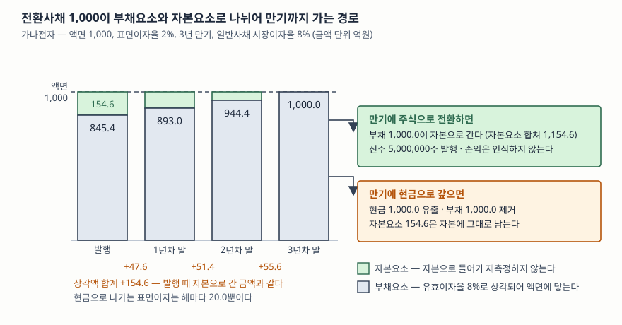

> 예제의 회사와 숫자, 이자율은 계산을 보이려고 만든 가상 자료다. 금액 단위는 억원이고, 전환가액과 주식 수는 원과 주다.

## 들어가며

공시 화면에서 전환사채 발행 결정을 보면 조건란에 "표면이자율 0%"나 "표면이자율 2%" 같은 숫자가 적혀 있다. 요즘 은행 금리를 생각하면 비정상적으로 싼 돈이고, 그래서 이 회사가 이자 부담 없이 자금을 마련했다고 읽기 쉽다. 그런데 몇 달 뒤 나온 반기보고서를 열어 보면 손익계산서에 이자비용이 꽤 큰 금액으로 잡혀 있고, 재무상태표의 전환사채 금액은 발행한 액면보다 작다. 숫자 두 개가 모두 공시한 조건과 맞지 않는다. 이 어긋남은 오류가 아니라 전환사채를 기록하는 방식 자체에서 나온다. 한 장의 증권이 재무제표에서는 두 조각으로 나뉘어 각각 다른 자리에 앉기 때문이다.

## 개념

### 한 장인데 성격이 둘이다

전환사채는 만기까지 가지고 있으면 원금과 이자를 받고, 원하면 정해진 가격에 주식으로 바꿀 수 있는 사채다. 투자자 입장에서 앞쪽은 채권이고 뒤쪽은 주식을 살 수 있는 권리다. 발행하는 회사 입장에서 보면 앞쪽은 갚아야 할 의무이므로 부채이고, 뒤쪽은 갚을 의무가 없으므로 부채가 아니다.

K-IFRS 제1032호는 이렇게 성격이 섞인 증권을 **복합금융상품**이라 부르고, 발행자가 조건을 평가해 부채요소와 자본요소를 모두 포함하는지 판단한 뒤 각각을 따로 분류하도록 한다(문단 28). 한 장의 증권이지만 재무상태표에서는 부채 줄과 자본 줄에 나뉘어 앉는다.

### 표면이자율이 싼 이유가 곧 자본요소다

투자자가 시장에서 8%를 요구하는 신용등급의 회사가 2%짜리 사채를 액면 그대로 팔 수 있는 이유는 전환권이 끼어 있기 때문이다. 투자자는 포기한 6%포인트를 전환권의 값으로 지불한 셈이다. 회계는 이 포기분을 그대로 자본요소의 금액으로 잡는다. 표면이자율이 시장이자율과 같아지면 투자자가 포기한 것이 없으므로 자본요소도 0이 되고, 그 증권은 일반사채와 다를 바가 없어진다.

### 신주인수권부사채는 어디가 다른가

신주인수권부사채는 사채와 신주인수권이 함께 붙어 있다. 복합금융상품으로 보아 부채요소와 자본요소로 나누는 회계는 전환사채와 같다. 갈리는 지점은 **권리를 행사한 뒤**다. 전환사채는 사채가 주식으로 바뀌므로 사채가 사라지지만, 신주인수권부사채는 신주를 사는 대금을 따로 내고 받는 구조라 **사채가 그대로 남는다.** 회사는 신주 대금을 현금으로 받고도 만기에 액면을 갚아야 한다.

## 구조



> **출처**: [한국회계기준원 — 기업회계기준서 제1032호 금융상품: 표시, 문단 28 복합금융상품의 분리, 문단 31 자본요소의 잔여 배분과 최초 인식 손익, 문단 32 전환사채의 측정 순서](https://www.kasb.or.kr/front/board/ingAccountingList.do), [같은 기준서 적용지침 AG32 만기 전환 시 손익 미인식과 자본 내 대체](https://accountingwiki.co.kr/standards/1032/b) (제3자 전재). 숫자는 이 글의 [`code/output.txt`](code/output.txt) `[1]`·`[2]`·`[4]`에 있다.

도식에서 눈여겨볼 것은 초록색 간격이 해마다 줄어드는 모양이다. 발행 시점에 부채요소와 액면 사이에 벌어져 있던 154.6이 자본요소의 금액이고, 그 간격이 3년에 걸쳐 쌓이는 상각액 47.6 + 51.4 + 55.6 = 154.6으로 정확히 메워진다. 발행할 때 자본으로 보낸 금액만큼이 만기까지 이자비용으로 돌아온다는 뜻이다.

## 동작 원리

### 잔여법 — 부채요소를 먼저 재고 나머지를 자본으로 본다

나누는 순서가 정해져 있다. 전환권이 없는 같은 조건의 사채라면 얼마에 팔렸을지를 먼저 계산해 그것을 부채요소로 잡고, 발행가액에서 그 금액을 뺀 나머지를 자본요소로 본다(문단 32). 자본요소를 직접 평가하지 않는 이유는 옵션의 공정가치를 재는 일이 부채의 현재가치를 재는 일보다 훨씬 불확실하기 때문이다. 덜 불확실한 쪽을 먼저 재고 나머지를 밀어 넣는다.

기준서는 두 요소에 배분한 금액의 합이 전체 공정가치와 같아야 한다고 못 박고, **구성요소를 분리해 인식하는 최초 인식 시점에는 어떠한 손익도 생기지 않는다**고 적는다(문단 31). 나누는 행위 자체는 이익도 손실도 만들지 않는다. 1,000을 받았으면 재무상태표에 올라가는 합계도 1,000이고, 그 1,000이 부채 줄과 자본 줄로 갈려 앉을 뿐이다.

### 부채요소는 시장이자율로 상각된다

부채요소로 잡힌 845.4는 전환권이 없는 사채와 똑같이 상각후원가로 측정한다. 이자비용은 기초 장부금액에 유효이자율 8%를 곱한 값이고, 현금으로 나가는 표면이자 20과의 차이가 부채 장부금액에 더해진다. 같은 계산을 일반사채에서 다룬 글이 [차입금과 사채 — 조달 수단이 재무제표에 남기는 자국](../2026-10-12-bonds-effective-interest/index.md)이다.

여기서 전환사채 특유의 모양이 나온다. 일반사채의 할인발행에서는 장부금액과 액면의 차이가 시장이자율과 표면이자율의 차이만큼이지만, 전환사채는 그 차이에 **전환권의 값까지 들어가 있어** 간격이 훨씬 크다. 그래서 현금으로 나가는 이자가 해마다 20인데 손익계산서의 이자비용은 67.6에서 75.6까지 올라간다. 공시된 표면이자율만 보고 이자 부담을 짐작하면 실제의 3분의 1도 안 되게 잡는다.

### 자본요소는 다시 재지 않는다

자본요소 154.6은 발행 시점에 정해지고 그 뒤로 재측정하지 않는다. 주가가 올라 전환권의 가치가 커져도, 반대로 주가가 폭락해 전환권이 휴지가 되어도 재무상태표의 그 금액은 그대로다. 자본으로 분류된 항목은 공정가치 변동을 손익으로 잡지 않기 때문이다.

만기에 전환되면 부채요소를 제거하고 같은 금액을 자본으로 보내는데, 적용지침은 이때 **인식할 손익이 없다**고 명시하고 최초의 자본요소를 자본의 다른 항목으로 대체할 수 있다고 한다(AG32). 전환되지 않고 만기를 맞아 현금으로 갚아도 마찬가지다. 자본요소 154.6은 자본에 남아 있고 손익으로 되돌아오지 않는다. **전환권이 결국 행사되지 않았다고 해서 회사가 이익을 보는 것이 아니다.**

## 실습 예제

전체 소스: [`code/`](code/) · 수행 기록: [`code/output.txt`](code/output.txt)

가나전자가 액면 1,000, 표면이자율 2%, 3년 만기 조건으로 전환사채를 액면 그대로 발행한다. 전환권이 없는 같은 조건 사채라면 시장이 8%를 요구한다.

```text
[1] 발행 — 부채요소를 먼저 재고 남은 금액을 자본요소로 본다 (잔여법)
    가나전자 전환사채: 액면 1,000, 표면이자율 2%, 3년 만기, 액면발행
    전환권 없는 같은 조건 일반사채의 시장이자율: 8%
    현금흐름: 20, 20, 1,020

    구분                      금액            계산
    발행가액               1,000.0            받은 돈
    부채요소                 845.4          현금흐름을 8%로 할인
    자본요소                 154.6           발행가액 - 부채요소
```

20, 20, 1,020을 8%로 할인하면 845.4가 나온다. 회사가 1,000을 받았으므로 차액 154.6이 자본요소다. 전체 조달액의 15%가 재무상태표의 자본 줄에 앉는다.

```text
[2] 부채요소의 상각표 — 표면이자는 2%인데 이자비용은 8%로 쌓인다
    최초 장부금액 845.4, 유효이자율 8.0000%
    연도             기초 장부        이자비용        표면이자         상각액       기말 장부
    1년차           845.4        67.6        20.0       +47.6       893.0
    2년차           893.0        71.4        20.0       +51.4       944.4
    3년차           944.4        75.6        20.0       +55.6     1,000.0
    이자비용 합계 214.6 = 표면이자 합계 60.0 + 액면과 부채요소의 차이 154.6
```

3년간 손익계산서에 잡히는 이자비용은 214.6인데 실제로 현금으로 나간 이자는 60뿐이다. 차이 154.6은 발행 때 자본으로 보낸 금액과 정확히 같다. 전환사채를 발행한 회사의 영업이익과 당기순이익 사이가 크게 벌어진다면, 이 비현금 이자비용이 원인인 경우가 많다.

```text
[3] 같은 1,000을 조달하는 세 가지 — 부채비율과 3년 이자비용
    발행 직전: 부채 800, 자본 1,200, 부채비율 66.7%

    조달 방법                        부채 증가       자본 증가        부채비율       3년 이자비용
    일반사채 (표면 8%)               1,000.0         0.0      150.0%         240.0
    전환사채 (표면 2%)                 845.4       154.6      121.5%         214.6
    유상증자                           0.0     1,000.0       36.4%           0.0
    전환사채를 나누지 않고 전액 부채로 보면 부채비율 150.0% — 28.5%포인트 차이
```

같은 1,000을 조달해도 수단에 따라 부채비율이 36.4%에서 150%까지 흩어진다. 전환사채는 둘 사이에 놓이는데, 이는 분리 회계 덕분이다. 전액을 부채로 기록했다면 일반사채와 같은 150%가 됐을 것이므로, 분리 여부 하나가 부채비율을 28.5%포인트 움직인다. [자기자본비율과 차입금 의존도 글](../../ratios/2026-10-14-equity-ratio-and-borrowing-dependency/index.md)에서 본 지표를 전환사채 발행 회사에 적용할 때 이 조각내기를 모르면 숫자가 왜 그런지 설명되지 않는다.

```text
[4] 만기 시점에 갈린다 — 주식으로 줄 때와 현금으로 갚을 때
    3년차 말 부채요소 장부금액 1,000.0 (상각이 끝나 액면과 같아졌다), 자본요소 154.6
    3년차 표면이자 20.0은 어느 쪽이든 현금으로 나간다 — 갈리는 것은 액면 1,000의 처리다

    전환 — 전환가액 20,000원, 액면총액 1,000억원 → 신주 5,000,000주
      부채 1,000.0 제거 → 같은 금액이 자본으로 간다
      발행 때 들어간 자본요소 154.6과 합치면 자본에 1,154.6이 남는다
      액면만큼의 현금은 오가지 않고, 전환으로 인식할 손익도 없다

    상환 — 전환하지 않고 만기를 맞으면
      현금 1,000.0 유출, 부채 1,000.0 제거
      자본요소 154.6은 자본에 그대로 남는다 — 손익으로 돌리지 않는다
```

전환되면 회사는 현금을 내놓지 않고 주식을 찍어 준다. 부채가 사라지고 자본이 그만큼 늘지만 기존 주주의 지분은 희석된다. 전환되지 않으면 현금 1,000이 나간다. **어느 쪽이든 손익계산서에는 아무 일도 일어나지 않는다.** 3년 동안의 이자비용 214.6이 이미 손익을 지나갔고, 만기에 벌어지는 일은 재무상태표 안에서의 이동이거나 현금 유출일 뿐이다.

```text
[5] 전환사채(CB)와 신주인수권부사채(BW) — 권리를 쓴 뒤에 사채가 남는가
    두 사채의 발행 조건은 같다. 2년차 말에 전량 권리 행사, 신주 5,000,000주 발행
    행사 직전: 부채 800 + 사채 944.4, 자본 1,200 + 자본요소 154.6

                     현금 유입       사채 부채       자본 증가        부채        자본       부채비율
    CB                 0.0          소멸       944.4     800.0   2,299.1      34.8%
    BW(분리형)        1,000.0       944.4     1,000.0   1,744.4   2,354.6      74.1%
```

두 회사가 같은 조건으로 발행하고 같은 날 전량 권리를 행사했는데 부채비율이 34.8%와 74.1%로 갈린다. 전환사채는 사채를 주식으로 바꾼 것이라 부채가 사라지고, 신주인수권부사채는 신주 대금 1,000이 새로 들어오는 대신 **사채 944.4가 그대로 남는다.** 신주인수권부사채를 발행한 회사는 권리 행사로 현금을 받고도 만기에 액면 1,000을 갚아야 하고, 3년차 이자비용 75.6도 피하지 못한다. 자산 쪽에서 보면 현금이 1,000 늘어난 것이 전환사채와의 차이다.

## 실무에서 주의할 점

- **표면이자율로 이자 부담을 짐작하지 않는다.** 표면이자율 0%짜리 전환사채도 부채요소에 시장이자율이 붙으므로 이자비용은 0이 아니다. [2]처럼 현금 60이 나갈 때 손익계산서에는 214.6이 잡힌다. 이 차이는 영업이익 대비 이자비용으로 재는 [이자보상배율](../../ratios/2026-10-02-interest-coverage-ratio/index.md)을 눈에 띄게 끌어내린다. 반대로 현금흐름표의 이자 지급액은 표면이자인 60이므로 두 숫자가 다른 것은 정상이다.
- **전환가액 조정 조항이 붙으면 분리 회계가 성립하지 않을 수 있다.** 전환권이 자본으로 분류되려면 확정된 수량의 주식을 확정된 금액과 교환하는 조건이어야 한다. 주가에 따라 전환가액이 내려가는 리픽싱 조항이 있으면 교환될 주식 수가 고정되지 않으므로 전환권을 자본이 아니라 파생상품부채로 분류하게 되는 경우가 있다. 이때는 매 결산마다 공정가치로 다시 재서 평가손익이 손익계산서에 들어오므로, 주가가 오를수록 회계상 손실이 커지는 모양이 나온다. 주석의 전환사채 항목에 파생상품부채가 함께 적혀 있는지 확인한다.
- **전환가액 조정에는 규제상 하한이 있다.** 금융위원회는 2024년 11월 13일 「증권의 발행 및 공시 등에 관한 규정」을 개정해 2024년 12월 1일부터 시행했다. 시가 변동에 따른 전환가액 하향 조정의 최저한도를 최초 전환가액의 70%로 두고, 그보다 낮게 조정하려면 발행할 때마다 주주총회 특별결의를 거치도록 했다. 콜옵션 행사자를 지정하거나 제3자에게 양도하는 경우, 만기 전에 사채를 취득하는 경우도 주요사항보고서로 공시해야 한다. 오래된 글이나 2024년 이전 사례를 볼 때는 이 기준이 달랐다는 점을 감안한다.
- **희석 가능 주식 수를 세어 두지 않으면 주당이익이 갑자기 바뀐다.** [4]에서 전환으로 발행되는 5,000,000주는 전환 전에도 희석 효과로 계산에 들어간다. 계산 방법은 [희석 주당이익 글](../../valuation/2026-10-08-diluted-eps-convertible-bonds/index.md)에서 다뤘다. 전환사채 잔액이 큰 회사는 기본 주당이익과 희석 주당이익의 차이부터 확인하는 편이 빠르다.
- **조건을 바꿔 조기전환을 유도하면 그때는 손익이 생긴다.** 만기 전환에는 손익이 없지만, 발행자가 전환비율을 더 유리하게 바꿔 전환을 앞당기면 보유자가 추가로 받게 되는 대가의 공정가치 차이를 손실로 보아 당기손익으로 인식한다(AG35). 만기 전에 현금으로 조기상환하거나 재매입하는 경우에도 지급한 대가를 발행 때와 같은 방법으로 두 요소에 배분한다(AG33). "전환사채는 전환돼도 손익이 없다"는 말은 원래 조건대로 만기에 전환될 때의 이야기다.

## 정리

- 전환사채와 신주인수권부사채는 복합금융상품이라 한 장의 증권이 부채요소와 자본요소로 나뉘어 기록된다.
- 나누는 순서는 전환권 없는 같은 조건 사채의 공정가치를 부채요소로 먼저 잡고, 발행가액에서 뺀 나머지를 자본요소로 보는 것이다. 나누는 행위에서 손익은 생기지 않는다.
- 부채요소에는 시장이자율이 붙으므로, 표면이자율이 싼 전환사채일수록 현금으로 나가는 이자와 손익계산서의 이자비용이 크게 벌어진다.
- 만기에 전환되든 현금으로 갚든 손익은 인식하지 않는다. 자본요소는 끝까지 자본에 남는다.
- 신주인수권부사채는 권리를 행사해도 사채가 남아 만기에 갚아야 한다. 이것이 전환사채와 갈리는 지점이다.

## 참고 자료

- [한국회계기준원 — 시행 중인 K-IFRS 기준서 목록](https://www.kasb.or.kr/front/board/ingAccountingList.do) — 기업회계기준서 제1032호·제1109호 원문 발행처. 아래 전재 사이트는 문단을 바로 열기 위한 편의 링크다
- [IFRS Foundation — IAS 32 Financial Instruments: Presentation](https://www.ifrs.org/issued-standards/list-of-standards/ias-32-financial-instruments-presentation/) — 국제회계기준 원문 발행처
- [K-IFRS 제1032호 금융상품: 표시 — 문단 28 복합금융상품의 분리, 문단 31 잔여 배분과 최초 인식 손익, 문단 32 전환사채의 측정 순서](https://accountingwiki.co.kr/standards/1032) (제3자 전재)
- [K-IFRS 제1032호 적용지침 — AG31 복합금융상품의 구조, AG32 만기 전환, AG33 만기 전 소멸, AG35 조기전환 유도](https://accountingwiki.co.kr/standards/1032/b) (제3자 전재)
- [K-IFRS 제1109호 금융상품 — 문단 4.2.1 금융부채 분류, 5.1.1 최초 측정과 거래원가](https://accountingwiki.co.kr/standards/1109) (제3자 전재)
- [금융위원회 — 「증권의 발행 및 공시 등에 관한 규정」 개정안 의결 (2024년 11월 13일 의결, 2024년 12월 1일 시행)](https://www.fsc.go.kr/no010101/83400) — 전환가액 조정 한도, 콜옵션·만기 전 취득 공시
