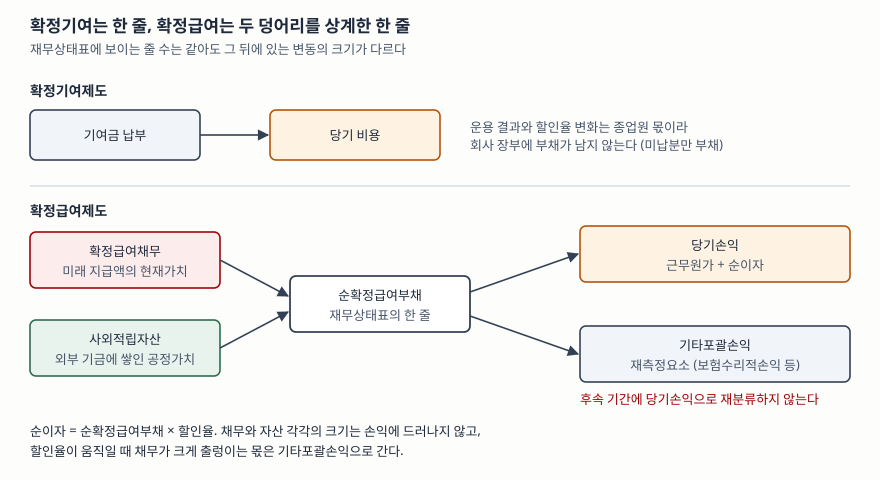

> 예제의 회사와 숫자는 계산을 보이려고 만든 가상 자료다. 금액 단위는 억원이고, 법인세 효과는 넣지 않았다. 확정급여채무는 보험수리적 평가 대신 듀레이션 12년짜리 미래 지급액의 현재가치로 단순화했다.

## 들어가며

두 회사의 재무상태표를 비교하다 보면 순확정급여부채가 둘 다 200 정도로 비슷하게 찍혀 있는 경우가 있다. 크기가 같으니 퇴직급여 부담도 비슷하다고 읽고 넘어가기 쉽다. 그런데 다음 해 재무제표에서 한 회사는 기타포괄손익에 −140이 찍히고 다른 회사는 −50에 그친다. 두 회사가 퇴직금을 다르게 준 것이 아니라, 재무상태표의 그 한 줄 뒤에 숨어 있던 채무와 자산의 **원래 크기**가 달랐기 때문이다. 주석을 열지 않으면 이 차이는 한 해가 지나서야 드러난다.

## 개념

### 두 제도를 가르는 기준은 위험을 누가 지는가다

K-IFRS 제1019호는 퇴직급여제도를 둘로 나눈다(문단 8).

- **확정기여제도**: 기업이 별개의 실체(기금)에 고정 기여금을 내고, 기금이 급여를 지급할 만큼 자산을 갖지 못하더라도 **추가로 낼 의무가 없는** 제도다.
- **확정급여제도**: 확정기여제도가 아닌 퇴직급여제도 전부다.

정의가 비대칭이다. 확정기여제도를 좁게 정하고 나머지를 전부 확정급여제도로 묶었다. 기여금을 낸 뒤에도 회사가 무언가를 더 책임져야 할 여지가 조금이라도 있으면 확정급여 쪽으로 분류된다는 뜻이다. 기금의 운용 성과가 나빠도, 종업원이 예상보다 오래 근무해도, 할인율이 내려가도 그 차이를 회사가 메워야 한다면 위험은 회사에 있다.

### 확정기여제도는 낸 돈이 곧 비용이다

확정기여제도에서는 종업원이 근무용역을 제공한 기간에 그 대가로 내야 할 기여금을 비용으로 인식한다. 아직 내지 않은 금액이 있으면 부채로, 미리 더 낸 금액이 있으면 자산으로 인식한다(문단 51). 추정도 할인도 없다. 기여금을 낸 순간 회사의 의무가 끝나기 때문이다.

### 확정급여제도는 세 단계를 거친다

확정급여제도의 회계처리는 기준서가 순서를 정해 둔다(문단 57).

1. 확정급여채무의 현재가치와 사외적립자산의 공정가치를 측정해 적자나 적립초과를 정한다
2. 그 금액으로 순확정급여부채(자산)를 결정한다
3. 당기손익으로 인식할 금액과 기타포괄손익으로 인식할 금액을 나눈다

재무상태표에는 순확정급여부채(자산) **한 줄**만 올린다(문단 63). 적립초과로 순자산이 생기면 그 금액과 자산인식상한 중 작은 금액으로 측정한다(문단 64).

## 구조



> **출처**: [한국회계기준원 — 기업회계기준서 제1019호 종업원급여, 문단 8 정의, 문단 51 확정기여제도, 문단 57 확정급여제도 회계처리 절차, 문단 63 순확정급여부채, 문단 120·122 확정급여원가의 인식과 재분류 금지, 문단 123 순이자](https://www.kasb.or.kr/front/board/ingAccountingList.do)

확정급여원가는 세 가지로 나뉜다(문단 120). **근무원가**와 **순확정급여부채의 순이자**는 당기손익으로, **재측정요소**는 기타포괄손익으로 인식한다. 기타포괄손익으로 들어간 재측정요소는 후속 기간에 당기손익으로 재분류하지 않는다(문단 122).

## 동작 원리

### 순이자는 순액에만 이자를 붙인다

순이자는 순확정급여부채에 할인율을 곱해 구한다(문단 123). 할인율은 보고기간말 우량회사채의 시장수익률로 정하고, 그런 회사채의 시장이 충분하지 않으면 국공채 수익률을 쓴다(문단 83). 순액에 이자를 붙이므로 채무에서 생기는 이자원가와 사외적립자산에서 생기는 이자수익이 서로 상계된 결과만 손익에 남는다. 그래서 채무 1,000·자산 800인 회사와 채무 300·자산 100인 회사는 할인율이 같으면 **순이자가 똑같다.** 손익계산서만 보아서는 두 회사의 규모 차이가 드러나지 않는다.

### 출렁이는 몫은 재측정요소로 간다

재측정요소는 세 가지로 구성된다(문단 127). 보험수리적손익, 순이자에 포함된 금액을 뺀 사외적립자산의 수익, 자산인식상한 효과의 변동이다. 이 가운데 가장 크게 움직이는 것은 보통 할인율 변화에서 오는 보험수리적손익이다. 미래 지급액은 그대로인데 할인율이 내려가면 현재가치가 커지고, 그 증가분이 보험수리적손실이 된다.

기준서가 이 몫을 당기손익에서 떼어 낸 이유는 이 변동이 영업 성과와 상관없이 금리 환경에 따라 생기기 때문이다. 대신 그 크기는 **채무 총액**에 비례한다. 순액은 같아도 총액이 큰 회사일수록 같은 할인율 변화에 크게 흔들린다.

## 실습 예제

전체 소스: [`code/`](code/) · 수행 기록: [`code/output.txt`](code/output.txt)

```text
[2] 확정급여제도 — 기초에는 순부채가 같은 두 회사
    회사              확정급여채무      사외적립자산       순확정급여부채
    다라물산           1,000.0       800.0         200.0
    마바화학             300.0       100.0         200.0
    재무상태표에는 오른쪽 한 줄만 보인다
```

세 회사 모두 한 해 근무원가가 100이고 해마다 기금에 100을 낸다. 확정기여제도인 가나전자는 그 100이 비용의 전부이고 재무상태표에 퇴직급여부채가 남지 않는다. 확정급여제도인 두 회사는 기초 순부채가 200으로 같지만 그 안의 채무와 자산 크기가 세 배 넘게 차이 난다.

```text
[3] 한 해 뒤 — 할인율이 5% 에서 4% 로 내려갔다
                                  다라물산        마바화학
    근무원가 (손익)                    100.0       100.0
    순이자 (손익)                      10.0        10.0
      채무 이자원가                     50.0        15.0
      자산 이자수익                    -40.0        -5.0
    당기손익 합계                      110.0       110.0
    보험수리적손실 (OCI)               -132.6       -48.1
    자산 재측정요소 (OCI)               -10.0        -1.2
    기타포괄손익 합계                   -142.6       -49.3
    가나전자(확정기여)의 당기손익은 100.0, 기타포괄손익은 0.0
```

당기손익은 두 회사 모두 110으로 같다. 이자원가와 이자수익은 50 대 15, 40 대 5로 크게 다르지만 상계한 순이자가 10으로 같아지기 때문이다. 차이는 기타포괄손익에서 터진다. 할인율이 1%p 내려가자 다라물산의 채무는 132.6, 마바화학은 48.1 늘었다. 사외적립자산의 실제 수익이 순이자에 넣은 기대 몫(5%)에 못 미친 차이도 재측정요소로 함께 들어간다.

```text
[4] 기말 재무상태표 — 같은 출발점에서 순부채가 갈렸다
    회사              확정급여채무      사외적립자산       순확정급여부채     기초 대비
    다라물산           1,222.6       870.0         352.6    +152.6
    마바화학             443.1       183.8         259.3     +59.3
```

같은 순부채 200에서 출발해 같은 금액을 내고 같은 비용을 인식했는데, 한 해 뒤 순부채가 352.6과 259.3으로 갈렸다. 이 차이는 손익계산서 어디에도 나타나지 않았다.

```text
[5] 민감도 — 기말 할인율이 다시 움직이면 순부채는 얼마나 흔들리나
    회사              기말 순부채     -1.0%p     -0.5%p     +0.5%p     +1.0%p
    다라물산             352.6     +150.3      +72.8      -68.4     -132.6
    마바화학             259.3      +54.5      +26.4      -24.8      -48.1
    표의 값은 순부채의 변화량이다. 사외적립자산은 고정하고 채무만 다시 할인했다
```

할인율이 다시 1%p 내려가면 다라물산의 순부채는 150.3 더 늘어 지금의 1.4배가 된다. 마바화학은 54.5 늘어난다. 같은 폭이라도 내려갈 때 늘어나는 양이 올라갈 때 줄어드는 양보다 크다는 것도 보인다. 현재가치는 할인율에 대해 직선이 아니기 때문이다.

## 실무에서 주의할 점

- **순확정급여부채만 보지 말고 주석의 총액을 본다.** 재무상태표의 한 줄은 상계된 결과다. 주석에서 확정급여채무와 사외적립자산을 각각 확인하고, 채무 총액이 자본에 비해 얼마나 큰지를 본다. [4]처럼 순액이 같아도 총액이 큰 회사는 금리 변화 한 번에 자본이 크게 움직인다.
- **주석의 민감도 분석을 읽는다.** 기준서는 유의적인 보험수리적 가정마다 민감도 분석을 공시하게 한다(문단 145). 할인율 1%p나 0.5%p 변화에 채무가 얼마나 움직이는지가 적혀 있으므로, [5]와 같은 계산을 회사가 직접 해 둔 셈이다.
- **기타포괄손익의 재측정요소는 손익으로 돌아오지 않는다.** 재분류가 금지되어 있으므로(문단 122), 당기순이익 기준 지표만 보면 금리 하락기에 쌓인 퇴직급여 부담이 끝까지 드러나지 않는다. ROE를 계산할 때 분모인 자본은 이 손실로 줄어들지만 분자인 순이익은 영향을 받지 않는다는 점도 함께 기억한다.
- **확정기여제도로 바꾼 해의 숫자를 가른다.** 확정급여에서 확정기여로 제도를 바꾸면 기존 채무를 정산하면서 생긴 정산 손익이 정산이 일어난 해의 당기손익에 들어간다(문단 57, 110). 바꾼 해의 퇴직급여 비용이 평소와 크게 다르면 주석에서 제도 변경 여부를 먼저 확인한다.
- **사외적립자산 비율에 일반적인 적정선은 없다.** 채무 대비 적립 비율을 높게 유지할수록 순부채는 작아지지만 자산 운용 위험이 커진다. 기준서는 적립 수준의 기준선을 정하지 않으므로, 같은 회사의 비율 변화와 그 이유를 보는 편이 낫다.

## 정리

- 퇴직급여제도는 기여금을 낸 뒤 회사가 추가로 책임질 여지가 있는지로 갈린다. 없으면 확정기여, 조금이라도 있으면 확정급여다.
- 확정기여제도는 낸 기여금이 곧 비용이고 재무상태표에는 미납분만 남는다.
- 확정급여제도는 확정급여채무와 사외적립자산을 상계한 순확정급여부채 한 줄로 보인다. 근무원가와 순이자는 당기손익, 재측정요소는 기타포괄손익으로 가고 재분류하지 않는다.
- 순이자는 순액에 붙으므로 손익은 같아도, 할인율 변화에서 오는 재측정요소는 채무 총액에 비례한다. 순액이 같은 두 회사도 총액이 다르면 흔들리는 크기가 다르다.

## 참고 자료

- [한국회계기준원 — 시행 중인 K-IFRS 기준서 목록](https://www.kasb.or.kr/front/board/ingAccountingList.do) — 기업회계기준서 제1019호 원문 발행처. 아래 전재 사이트는 문단을 바로 열기 위한 편의 링크다
- [IFRS Foundation — IAS 19 Employee Benefits](https://www.ifrs.org/issued-standards/list-of-standards/ias-19-employee-benefits/) — 국제회계기준 원문 발행처
- [K-IFRS 제1019호 종업원급여 — 문단 8 정의, 문단 51 확정기여제도, 문단 57 확정급여제도 절차, 문단 63·64 순확정급여부채와 자산인식상한, 문단 83 할인율, 문단 110 정산 손익, 문단 120·122·123·127 확정급여원가, 문단 145 민감도 분석](https://accountingwiki.co.kr/standards/1019) (제3자 전재)
