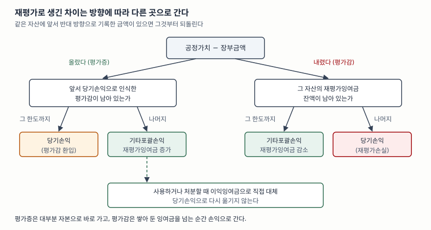

> 예제의 회사와 숫자는 계산을 보이려고 만든 가상 자료다. 금액 단위는 억원이고, 비교를 흐리지 않으려고 법인세와 이연법인세는 넣지 않았다.

## 들어가며

부채비율을 여러 해 늘어놓고 보다 보면, 차입금 잔액은 그대로인데 어느 한 해에 부채비율이 뚝 떨어진 회사를 만날 때가 있다. 그 해 순이익도 특별히 크지 않았다. 자본변동표를 열어 보면 이익잉여금이 아니라 **재평가잉여금**이라는 줄이 크게 늘어 있다. 회사가 들고 있던 토지나 건물의 장부가를 시세에 맞춰 다시 매겼고, 늘어난 금액이 손익계산서를 거치지 않고 곧바로 자본에 더해진 것이다. 이 숫자를 영업 성과로 착각하면 부채비율 개선을 잘못 해석하고, 반대로 몇 해 뒤 영업이익이 줄어든 이유도 놓치게 된다.

## 개념

### 측정모형은 둘 중 하나를 고른다

K-IFRS 제1016호는 유형자산을 처음 인식한 뒤의 측정 방법으로 **원가모형과 재평가모형 중 하나**를 회계정책으로 고르게 하고, 고른 정책을 같은 분류의 유형자산 전체에 적용하게 한다(문단 29).

- **원가모형**: 취득원가에서 감가상각누계액과 손상차손누계액을 뺀 금액으로 들고 간다. 시세가 올라도 장부가는 오르지 않는다.
- **재평가모형**: 공정가치를 신뢰성 있게 측정할 수 있을 때, 재평가일의 공정가치에서 그 뒤의 감가상각누계액과 손상차손누계액을 뺀 금액으로 들고 간다(문단 31).

### 재평가에는 붙는 조건이 있다

재평가모형을 고르면 마음에 드는 자산만 골라 다시 매길 수 없다. 한 자산을 재평가하면 **같은 분류의 유형자산 전체**를 재평가한다(문단 36). 토지 가운데 시세가 오른 필지만 올리고 나머지는 원가로 두는 식의 선택을 막는 장치다. 빈도도 정해져 있다. 보고기간말의 장부금액이 공정가치와 중요하게 다르지 않도록 주기적으로 해야 하고(문단 31), 공정가치 변동이 크면 해마다, 변동이 작으면 3년이나 5년마다로도 충분할 수 있다(문단 34).

## 구조



> **출처**: [한국회계기준원 — 기업회계기준서 제1016호 유형자산, 문단 39 장부금액 증가의 처리, 문단 40 장부금액 감소의 처리, 문단 41 재평가잉여금의 이익잉여금 대체](https://www.kasb.or.kr/front/board/ingAccountingList.do)

장부금액이 늘면 기타포괄손익으로 인식해 재평가잉여금으로 자본에 더한다. 다만 같은 자산에 대해 앞서 당기손익으로 인식한 재평가감소액이 있으면, 그만큼은 당기손익으로 되돌린다(문단 39). 장부금액이 줄면 반대다. 당기손익으로 인식하되, 그 자산의 재평가잉여금 잔액이 있으면 그 한도까지는 기타포괄손익에서 깎는다(문단 40).

## 동작 원리

### 평가증과 평가감은 대칭이 아니다

두 문단을 나란히 놓으면 규칙이 한쪽으로 기울어 있다는 것이 보인다. **처음 오른 금액은 자본으로 가고, 처음 내린 금액은 손익으로 간다.** 앞서 반대 방향으로 기록한 금액이 있을 때만 그것을 먼저 되돌린다. 오른 것은 아직 실현되지 않은 이익이므로 당기 성과에서 떼어 두고, 내린 것은 손실이 될 수 있으므로 성과에 바로 반영하는 보수적인 설계다. 그래서 같은 가격 경로라도 **어느 쪽으로 먼저 움직였느냐**에 따라 손익으로 가는 금액이 달라진다.

### 올린 장부가는 감가상각비로 돌아온다

건물처럼 감가상각하는 자산은 재평가 뒤에 늘어난 장부금액을 남은 내용연수에 걸쳐 상각한다. 재평가로 자본은 한 번에 늘었지만, 그 대가로 그 뒤의 모든 해에 감가상각비가 커져 영업이익이 줄어든다. 늘어난 상각비를 상쇄하는 장치가 재평가잉여금의 **이익잉여금 대체**다. 자산을 사용하는 동안 재평가금액 기준 감가상각비와 원가 기준 감가상각비의 차이만큼을 잉여금에서 이익잉여금으로 옮길 수 있고, 자산을 처분하면 남은 잉여금을 옮길 수 있다. 이 대체는 **당기손익을 거치지 않는다**(문단 41).

결국 재평가로 늘어난 금액은 손익계산서에서는 비용으로만 나타나고, 그에 맞서는 이익은 자본 안에서 조용히 이동한다. 이 비대칭 때문에 재평가한 회사의 이익률은 같은 자산을 원가로 든 회사보다 낮게 보인다.

## 실습 예제

전체 소스: [`code/`](code/) · 수행 기록: [`code/output.txt`](code/output.txt)

```text
[2] 2년차 말 재평가 — 늘어난 금액은 손익을 거치지 않는다
    재평가 직전 장부금액 800.0  ->  공정가치 1,200.0
    차이 400.0 을 기타포괄손익으로 인식해 재평가잉여금에 쌓는다
    그 해 당기순이익에 들어간 금액: 0.0

    회사                건물      자산총계        부채        자본      부채비율
    가나전자           800.0   2,800.0   1,500.0   1,300.0    115.4%
    다라물산         1,200.0   3,200.0   1,500.0   1,700.0     88.2%
    차입금은 한 푼도 갚지 않았는데 부채비율이 115.4% 에서 88.2% 로 내려간다
```

두 회사는 취득원가 1,000짜리 건물을 같은 날 사서 10년 정액으로 상각해 왔다. 다라물산만 2년차 말에 공정가치 1,200을 반영했다. 늘어난 400은 그 해 순이익에 한 푼도 들어가지 않았는데 자본이 400 늘었고, [부채비율](../../ratios/2026-10-01-leverage-and-current-ratio/index.md)은 115.4%에서 88.2%로 내려갔다. 차입금도, 현금도, 영업도 바뀐 것이 없다.

```text
[3] 3년차부터 — 올린 장부가는 감가상각비로 돌아온다
    연도            가나 상각비       가나 영업이익      다라 상각비       다라 영업이익      잉여금 대체
    3년차            100.0         200.0       150.0         150.0        50.0
    4년차            100.0         200.0       150.0         150.0        50.0
    5년차            100.0         200.0       150.0         150.0        50.0
    다라물산은 해마다 50.0 을 재평가잉여금에서 이익잉여금으로 직접 옮길 수 있다 (손익을 거치지 않음)
    8년 동안 영업이익 합계 차이: 400.0 = 재평가로 늘린 400.0
```

다라물산은 1,200을 남은 8년에 나눠 해마다 150씩 상각한다. 가나전자보다 50씩 많고, 영업이익은 그만큼 낮다. 8년을 더하면 차이가 정확히 400으로, 재평가로 늘린 금액과 같다. **재평가는 자본을 앞당겨 늘리고, 그 값을 그 뒤의 영업이익에서 나눠 갚는 구조**다.

```text
[4] 5년차 말에 1,050 에 팔면 — 처분이익이 갈린다
    회사                처분 직전 장부금액        처분이익(손익)         이익잉여금 직접 대체
    가나전자                   500.0           550.0                 0.0
    다라물산                   750.0           300.0               250.0
    1~5년차 영업이익+처분이익 합계: 가나전자 1,550.0 / 다라물산 1,150.0
    다라물산은 손익이 400.0 적지만, 잉여금 대체 400.0 이 손익을 거치지 않고 이익잉여금에 들어간다
    5년차 말 이익잉여금 증가액: 가나전자 1,550.0 / 다라물산 1,550.0
```

같은 건물을 같은 값에 팔았는데 처분이익이 550과 300으로 갈린다. 처분 직전 장부금액이 다르기 때문이다. 5년을 통틀어 보면 다라물산의 손익이 400 적지만, 같은 금액이 잉여금 대체로 이익잉여금에 들어가 두 회사의 이익잉여금 증가액은 1,550으로 같아진다. **경제적 결과는 같고, 손익계산서를 지나간 몫만 다르다.**

```text
[5] 비대칭 — 취득원가 500 인 토지를 두 번 재평가한다
    경로                   평가액      당기손익      기타포괄손익      잉여금 잔액
    올랐다가 내림              700      +0.0      +200.0       200.0
                         500      +0.0      -200.0         0.0
    내렸다가 오름              300    -200.0        +0.0         0.0
                         500    +200.0        +0.0         0.0
    내렸다가 더 오름            400    -100.0        +0.0         0.0
                         700    +100.0      +200.0       200.0
    올랐다가 더 내림            600      +0.0      +100.0       100.0
                         350    -150.0      -100.0         0.0
```

첫 두 경로는 둘 다 500에서 출발해 500으로 돌아온다. 그런데 먼저 오른 쪽은 손익에 아무것도 남기지 않고, 먼저 내린 쪽은 한 해에 −200, 다음 해에 +200을 손익에 찍는다. 마지막 경로는 잉여금 100을 다 쓰고 남은 150만 손익으로 간다. 토지는 감가상각하지 않으므로 이 차이가 상각으로 나뉘지도 않는다.

## 실무에서 주의할 점

- **재평가가 만든 부채비율 개선은 따로 떼어 본다.** 자본변동표에서 재평가잉여금 증가분을 확인하고, 그만큼을 뺀 자본으로 부채비율을 다시 계산해 보면 영업으로 번 몫과 장부가를 다시 매긴 몫이 갈린다. 실제 재무제표에서는 평가증에 대한 이연법인세부채가 함께 잡혀 자본 증가가 이 예제보다 작다.
- **같은 업종이라도 측정모형이 다르면 이익률을 그대로 비교하지 않는다.** [3]처럼 재평가한 회사는 감가상각비가 커서 영업이익률이 낮게 나온다. 유형자산 주석에서 회사가 어느 모형을 쓰는지, 재평가모형이면 원가모형으로 측정했을 때의 장부금액이 얼마인지부터 확인한다.
- **처분이익의 크기로 자산 매각의 성과를 판단하지 않는다.** [4]처럼 재평가한 회사는 오른 몫을 이미 자본에 반영했으므로 팔 때 손익에 남는 이익이 작다. 반대로 원가모형 회사의 큰 처분이익은 수십 년 동안 쌓인 가치 상승이 한 해에 몰려 나온 것일 수 있다.
- **재평가 시점과 빈도를 본다.** 같은 분류 전체를 재평가해야 하고(문단 36), 주기는 공정가치 변동에 맞춰 정한다(문단 34). 시세가 오른 해에만 재평가하거나, 처음으로 재평가모형으로 바꾼 해가 차입 약정 갱신 시점과 겹친다면 그 이유를 주석에서 찾아본다.
- **재평가 손실이 손익에 찍힌 해는 원인을 가른다.** [5]의 "내렸다가 오름" 경로처럼 손익으로 간 평가감은 다음 재평가에서 손익으로 환입될 수 있다. 한 해에 손익으로 찍힌 재평가손실만 보고 수익성이 나빠졌다고 결론 내리지 않는다.

## 정리

- 유형자산은 원가모형과 재평가모형 중 하나를 골라 같은 분류 전체에 적용한다. 재평가모형은 공정가치를 신뢰성 있게 측정할 수 있어야 하고 주기적으로 다시 해야 한다.
- 평가증은 기타포괄손익을 거쳐 재평가잉여금으로, 평가감은 당기손익으로 간다. 앞서 반대 방향으로 기록한 금액이 있으면 그것부터 되돌린다.
- 재평가는 자본을 한 번에 늘려 부채비율을 낮추지만, 그 뒤의 감가상각비를 늘려 영업이익을 깎는다.
- 재평가잉여금은 사용이나 처분에 따라 이익잉여금으로 직접 옮겨지고 손익을 거치지 않는다. 그래서 두 모형의 이익잉여금은 결국 같아지고, 손익계산서를 지나간 몫만 다르다.

## 참고 자료

- [한국회계기준원 — 시행 중인 K-IFRS 기준서 목록](https://www.kasb.or.kr/front/board/ingAccountingList.do) — 기업회계기준서 제1016호 원문 발행처. 아래 전재 사이트는 문단을 바로 열기 위한 편의 링크다
- [IFRS Foundation — IAS 16 Property, Plant and Equipment](https://www.ifrs.org/issued-standards/list-of-standards/ias-16-property-plant-and-equipment/) — 국제회계기준 원문 발행처
- [K-IFRS 제1016호 유형자산 — 문단 29 측정모형 선택, 문단 31 재평가모형, 문단 34 재평가 빈도, 문단 36 분류 전체 재평가, 문단 39·40 장부금액 증감의 처리, 문단 41 이익잉여금 대체](https://accountingwiki.co.kr/standards/1016) (제3자 전재)
