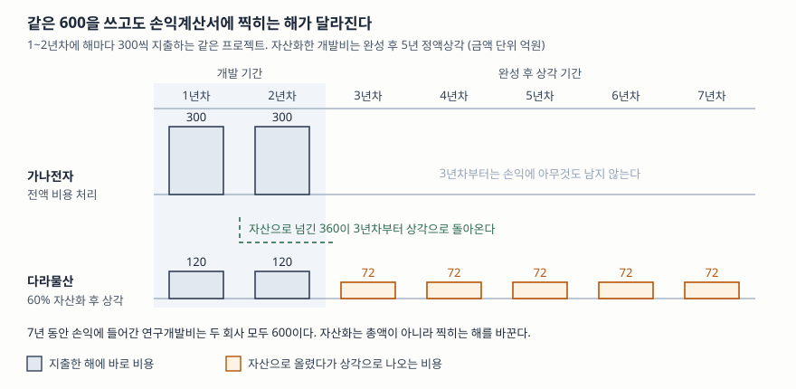

> 예제의 회사와 숫자는 계산을 보이려고 만든 가상 자료다. 금액 단위는 억원이고, 비교를 흐리지 않으려고 세금과 이자는 넣지 않았다.

## 들어가며

같은 업종의 두 회사를 나란히 놓고 영업이익률을 비교하다 보면, 연구개발에 돈을 많이 쓴다고 알려진 쪽이 오히려 이익률이 높게 나오는 경우가 있다. 사업보고서의 연구개발비 항목을 열어 보면 실제로 매출의 15%를 쓰고 있다고 적혀 있는데, 손익계산서의 판매비와관리비에서 그만한 금액이 보이지 않는다. 숫자를 잘못 읽은 것이 아니다. 그 회사는 연구개발 지출의 상당 부분을 비용이 아니라 **자산**으로 올려 두었고, 올라간 금액은 그 해의 이익을 깎지 않는다. 같은 돈을 쓰고도 손익계산서가 달라 보이는 이 구간이 재무제표에서 판단이 가장 많이 개입하는 자리 가운데 하나다.

## 개념

### 무형자산이 되려면 세 가지를 넘겨야 한다

K-IFRS 제1038호는 물리적 실체가 없는 비화폐성 자산을 무형자산으로 정의하고, 자산으로 올리려면 **식별가능성·통제·미래경제적효익**의 세 가지를 모두 갖출 것을 요구한다. 사서 가져온 무형자산은 거래 가격이 있으니 이 판단이 비교적 쉽다. 문제는 회사가 스스로 만든 것이다. 돈을 쓰기는 썼는데 그 돈이 자산을 만들었는지, 그냥 없어졌는지를 밖에서 확인할 방법이 마땅치 않다.

기준서가 이 문제를 다루는 방식은 **지출을 단계로 나누는 것**이다. 내부적으로 창출한 무형자산이 인식기준을 충족하는지 평가하기 위해 창출 과정을 연구단계와 개발단계로 나누라고 하고(문단 52), 단계마다 다른 규칙을 적용한다.

### 연구단계는 무조건 비용이다

연구단계에서 발생하는 무형자산은 인식하지 않는다(문단 54). 새로운 지식을 얻으려는 활동, 여러 대안을 탐색하고 평가하는 활동은 성과가 나올지 알 수 없으므로 자산으로 올리지 않고 그 해의 비용으로 턴다. 여기에는 선택지가 없다.

그리고 **단계를 가를 수 없으면 전부 연구단계로 본다**(문단 53). 연구와 개발이 섞여 구분이 안 되는 프로젝트는 자동으로 전액 비용 처리된다. 회계에서 판단이 서지 않을 때 보수적인 쪽으로 몰아 두는 전형적인 장치다.

### 개발단계는 6가지를 모두 제시해야 자산이 된다

개발활동에서 생긴 무형자산은 다음 여섯 가지를 **모두** 제시할 수 있는 경우에만 인식한다(문단 57). 하나라도 빠지면 비용이다.

| | 요건 |
|---|---|
| 1 | 완성해서 사용하거나 판매할 수 있는 기술적 실현가능성 |
| 2 | 완성해 사용하거나 판매하려는 기업의 의도 |
| 3 | 사용하거나 판매할 수 있는 기업의 능력 |
| 4 | 미래경제적효익이 창출되는 방식 — 거래시장이 있거나, 내부 사용이면 그 유용성 |
| 5 | 개발을 마치는 데 필요한 기술적·재정적 자원의 확보 가능성 |
| 6 | 개발 지출을 신뢰성 있게 측정할 수 있는 능력 |

개수를 세어 보면 알 수 있듯 이 요건들은 **"될 것 같다"를 넘어 "증명할 수 있다"를 요구한다.** 그런데 여섯 가지 가운데 어느 것도 기계적으로 판정되지 않는다. 특히 첫 번째 기술적 실현가능성을 언제 충족한 것으로 볼지가 회사마다 갈리고, 그 시점이 자산화 금액을 그대로 결정한다.

## 구조



> **출처**: [한국회계기준원 — 기업회계기준서 제1038호 무형자산, 문단 54 연구단계 지출의 비용 처리, 문단 57 개발단계 인식요건, 문단 97 상각 개시 시점과 정액법](https://www.kasb.or.kr/front/board/ingAccountingList.do). 숫자는 이 글의 [`code/output.txt`](code/output.txt) `[2]`에 있다.

두 줄의 막대를 각각 더하면 둘 다 600이다. 자산화는 비용의 총액을 바꾸지 않고 **찍히는 해를 뒤로 민다.** 상각은 자산을 경영자가 의도한 방식으로 운영할 수 있는 장소와 상태에 이른 때부터 시작하고, 효익이 소비되는 형태를 신뢰성 있게 정할 수 없으면 정액법을 쓴다(문단 97).

## 동작 원리

### 자산화는 이익을 앞으로 당겨 오는 일이다

개발비를 자산으로 올리면 그 해의 비용이 줄어 영업이익이 올라간다. 대신 완성 이후의 모든 해에 상각비가 붙는다. 프로젝트 수명 전체로 보면 손익에 들어가는 금액이 같으므로, 자산화가 만드는 것은 이익이 아니라 **이익의 시간 배치**다.

이 배치가 뜻을 가지는 경우가 분명히 있다. 개발한 결과가 앞으로 5년 동안 매출을 만들어 낸다면, 그 개발에 든 돈도 5년에 나누어 매출에 대응시키는 편이 한 해에 몰아 터는 것보다 사업의 실제 모양에 가깝다. 자산화를 허용하는 이유가 이것이다. 문제는 그 "앞으로 5년 동안 매출을 만들어 낸다"가 **지출 시점에는 가정**이라는 점이다. 여섯 가지 요건은 그 가정이 가정 이상임을 보이라는 요구다.

### 한 번 비용으로 턴 지출은 되돌릴 수 없다

기준서는 **최초에 비용으로 인식한 지출은 그 이후에 무형자산의 원가로 인식할 수 없다**고 못 박는다(문단 71). 1년차에 보수적으로 비용 처리한 회사가 2년차에 프로젝트가 잘되는 것을 보고 "역시 자산이었다"며 되돌릴 수는 없다. 이 비대칭이 중요하다. 자산화는 나중에 취소되어 손실로 돌아올 수 있지만, 비용 처리는 나중에 이익으로 돌아오지 않는다.

### 완성 전에도 해마다 손상검사를 한다

자산화한 개발비는 아직 사용할 수 없는 무형자산이므로 제1036호가 **연 1회 이상 손상검사**를 요구한다(문단 10). 손상 징후가 있을 때만 보는 것이 아니라 징후와 무관하게 해마다 본다. 그 회계연도에 처음 인식한 무형자산은 그 해가 끝나기 전에 검사해야 한다. 자산화를 허용하는 대신 해마다 그 자산이 아직 살아 있는지 확인하게 하는 장치다.

## 실습 예제

전체 소스: [`code/`](code/) · 수행 기록: [`code/output.txt`](code/output.txt)

```text
[1] 두 회사의 전제 — 쓰는 돈은 같고 판단만 다르다
    프로젝트: 1~2년차에 해마다 300 지출, 2년차 말 완성, 완성 후 5년 정액상각
    연구개발비를 빼기 전 영업이익: 해마다 400

    회사        판단                                       자산화       즉시 비용
    가나전자      개발단계 인식요건을 입증하지 못함                       0.0       600.0
    다라물산      1년차 중반부터 6가지 요건 모두 충족                  360.0       240.0
    현금으로 나가는 돈은 두 회사 모두 600으로 같다
```

두 회사가 하는 일, 쓰는 돈, 받는 매출이 모두 같다. 다른 것은 개발단계에 언제 들어섰다고 보는가 하나뿐이다.

```text
[2] 연도별 영업이익 — 같은 돈을 쓰는데 손익계산서가 갈린다
    연도           가나 비용     가나 상각       가나 영업이익     다라 비용     다라 상각       다라 영업이익        차이
    1년차         300.0       0.0         100.0     120.0       0.0         280.0    +180.0
    2년차         300.0       0.0         100.0     120.0       0.0         280.0    +180.0
    3년차           0.0       0.0         400.0       0.0      72.0         328.0     -72.0
    4년차           0.0       0.0         400.0       0.0      72.0         328.0     -72.0
    5년차           0.0       0.0         400.0       0.0      72.0         328.0     -72.0
```

1년차와 2년차에는 다라물산의 영업이익이 가나전자의 거의 세 배다. 두 회사의 사업이 다른 것이 아니라 한쪽이 지출의 60%를 자산으로 올렸기 때문이다. 3년차부터는 반대로 다라물산이 해마다 72씩 뒤진다. 영업이익률로 재든 [세 가지 이익률](../../ratios/2026-10-14-three-margins-step-by-step/index.md)로 재든 개발 기간과 상각 기간에 서로 다른 결론이 나오므로, 연구개발 집약 업종에서 한 해 숫자만 보고 비교하면 틀린다.

```text
[3] 7년 합계는 같다 — 갈리는 것은 시점이지 총액이 아니다
    회사                   손익에 반영한 연구개발비          7년 영업이익 합계
    가나전자                         600.0             2,200.0
    다라물산                         600.0             2,200.0
    자산화는 비용을 없애는 것이 아니라 뒤로 미루는 것이다
    다만 5년 상각이 끝나기 전에 잘라 보면 차이가 남는다 — 5년차까지만 더하면 1,400.0 대 1,544.0
```

상각이 끝나는 7년차까지 더하면 두 회사의 영업이익 합계가 2,200으로 같아진다. 그런데 5년차에서 잘라 보면 1,400 대 1,544로 144 차이가 난다. 아직 상각되지 않은 개발비 잔액이 그만큼 남아 있기 때문이다. **구간을 어디서 끊느냐에 따라 "누가 더 벌었나"의 답이 달라진다**는 뜻이고, 실제로 투자자가 보는 3년치나 5년치 실적은 거의 항상 상각이 끝나기 전 구간이다.

```text
[4] 2년차 말 재무상태표 — 현금은 같은데 자산총계가 다르다
                    개발비 자산        자산총계        부채        자본      부채비율      ROA
    가나전자               0.0     3,200.0   1,200.0   2,000.0     60.0%     3.1%
    다라물산             360.0     3,560.0   1,200.0   2,360.0     50.8%     7.9%
```

두 회사의 현금 잔액은 같고, 빌린 돈도 1,200으로 같다. 그런데 부채비율은 60.0%와 50.8%로 갈리고 ROA는 3.1%와 7.9%로 두 배 넘게 벌어진다. 자산화한 360이 자산총계와 자본에 동시에 더해졌기 때문이다. ROA는 분자인 영업이익과 분모인 자산총계가 함께 커지는데 분자 쪽의 변동이 더 크다. [ROE와 ROA를 가르는 글](../../ratios/2026-10-01-roe-vs-roa/index.md)에서 다룬 지표를 연구개발 집약 회사에 쓸 때는 개발비 자산 금액을 먼저 떼어 놓고 보는 편이 안전하다.

```text
[5] 3년차에 프로젝트를 접으면 — 자산화한 쪽이 한꺼번에 떨어낸다
    회사              3년차 비용        3년차 영업이익         남은 개발비 자산
    가나전자               0.0           400.0               0.0
    다라물산             360.0            40.0               0.0
    계획대로 갔다면 3년차 영업이익 328.0 — 실패하면 40.0로 떨어진다
```

개발이 실패해 자산을 회수할 수 없게 되면 남은 장부금액 360을 한 해에 손상차손으로 떨어낸다. 다라물산의 3년차 영업이익은 계획대로 갔을 때의 328에서 40으로 주저앉는다. 가나전자는 1~2년차에 이미 털어 두었으므로 추가로 잃을 것이 없다. 자산화는 이익을 앞으로 당겨 오는 대신 **실패했을 때의 충격을 한 해에 몰아 두는** 선택이기도 하다.

## 실무에서 주의할 점

- **사업보고서의 연구개발비 총액과 손익계산서를 맞춰 본다.** 기준서는 당기에 비용으로 인식한 연구와 개발 지출의 총액을 공시하도록 한다(문단 126). 사업보고서의 연구개발 활동 항목에 적힌 지출 총액과 이 공시 금액의 차이가 그 해에 자산으로 올라간 금액이다. 두 숫자를 나누면 자산화 비율이 나오고, 같은 회사의 연도별 추이를 보면 판단이 바뀐 해가 드러난다.
- **자산화 비율에 일반적인 적정선은 없다.** 업종과 프로젝트 성격에 따라 요건 충족 시점이 다르므로, 비율 자체로 옳고 그름을 가를 기준선은 기준서에도 감독 규정에도 없다. 볼 것은 수준이 아니라 **변화**다. 같은 회사의 비율이 어느 해에 급히 올라갔다면 그 해에 무엇이 달라졌는지를 주석에서 찾는다.
- **자산화는 영업현금흐름을 좋아 보이게 만든다.** 자본화한 개발원가의 현금 지출은 투자활동 현금흐름으로 분류된다(제1007호 문단 16). 같은 돈을 쓰고도 비용 처리한 회사는 영업활동에서, 자산화한 회사는 투자활동에서 빠져나간다. 영업현금흐름만 비교하면 자산화한 쪽이 유리해 보이므로, [잉여현금흐름](../../ratios/2026-10-07-free-cash-flow-after-capex/index.md)처럼 투자활동까지 묶어 보는 지표를 함께 쓴다.
- **내부에서 만든 브랜드와 고객목록은 자산이 되지 않는다.** 내부적으로 창출한 브랜드, 제호, 출판표제, 고객목록과 실질이 유사한 항목은 무형자산으로 인식하지 않는다(문단 63). 사업 전체를 개발하는 데 든 원가와 구별할 수 없기 때문이다(문단 64). 마케팅 지출을 "브랜드 가치에 투자했다"고 설명하는 회사가 있어도 재무제표에는 비용으로만 남는다.
- **개발비 자산이 큰 회사는 손상 주석을 먼저 읽는다.** 아직 사용할 수 없는 개발비는 해마다 손상검사 대상이다(제1036호 문단 10). 주석에 회수가능액을 어떤 가정으로 추정했는지가 적혀 있고, 매출 성장률이나 할인율 같은 가정이 한 해 사이에 바뀌었다면 [5]에 해당하는 일이 다음 해에 일어날 수 있다는 신호다.

## 정리

- 연구개발 지출은 연구단계와 개발단계로 나뉘고, 연구단계는 예외 없이 그 해의 비용이다. 단계를 가를 수 없으면 전부 연구단계로 본다.
- 개발단계 지출은 6가지 요건을 모두 제시할 수 있을 때만 자산이 된다. 하나라도 빠지면 비용이다.
- 자산화는 비용의 총액을 바꾸지 않고 찍히는 해를 뒤로 민다. 프로젝트 수명 전체로 보면 손익 합계가 같아지지만, 상각이 끝나기 전 구간에서는 차이가 남는다.
- 같은 현금을 쓰고도 자산화 여부에 따라 영업이익·자산총계·ROA·부채비율이 모두 달라지므로, 연구개발 집약 업종을 비교할 때는 자산화 비율을 먼저 확인한다.
- 한 번 비용으로 인식한 지출은 되돌릴 수 없고, 자산화한 개발비는 해마다 손상검사를 받아 실패하면 한 해에 떨어낸다.

## 참고 자료

- [한국회계기준원 — 시행 중인 K-IFRS 기준서 목록](https://www.kasb.or.kr/front/board/ingAccountingList.do) — 기업회계기준서 제1038호·제1036호·제1007호 원문 발행처. 아래 전재 사이트는 문단을 바로 열기 위한 편의 링크다
- [IFRS Foundation — IAS 38 Intangible Assets](https://www.ifrs.org/issued-standards/list-of-standards/ias-38-intangible-assets/) — 국제회계기준 원문 발행처
- [K-IFRS 제1038호 무형자산 — 문단 52·53 연구단계와 개발단계의 구분, 문단 54 연구단계 지출, 문단 57 개발단계 인식요건, 문단 63·64 내부창출 브랜드, 문단 71 비용 인식분의 환원 금지, 문단 97 상각, 문단 126 공시](https://accountingwiki.co.kr/standards/1038) (제3자 전재)
- [K-IFRS 제1036호 자산손상 — 문단 10 아직 사용할 수 없는 무형자산의 연 1회 손상검사](https://accountingwiki.co.kr/standards/1036) (제3자 전재)
- [K-IFRS 제1007호 현금흐름표 — 문단 16 투자활동 현금흐름과 자본화한 개발원가](https://accountingwiki.co.kr/standards/1007) (제3자 전재)
