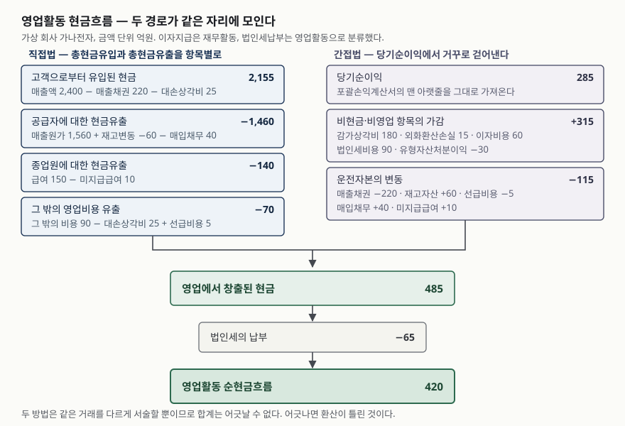

> 예제의 회사와 숫자는 계산을 보이려고 만든 가상 자료다. 금액 단위는 억원이고, 매출채권 제각은 없는 것으로 두었다.

## 들어가며

사업보고서를 열어 현금흐름표로 내려가면 맨 윗줄이 **당기순이익**이다. 현금 이야기를 보려고 들어왔는데 손익계산서의 맨 아랫줄이 다시 나온다. 그래서 대부분은 그 아래 스무 줄 남짓을 건너뛰고 '영업활동 순현금흐름'이라고 적힌 합계 한 줄만 확인하고 닫는다. 건너뛴 줄들이 사실은 **이익이 현금이 아니었던 이유**를 하나씩 적어 둔 목록인데도 그렇다. 반면 교과서에서 본 현금흐름표는 '고객으로부터 유입된 현금'으로 시작했다. 둘은 서로 다른 표가 아니라 같은 표를 쓰는 두 가지 방식이고, 끝에 적히는 숫자는 반드시 같다.

## 개념

### 현금흐름표는 세 갈래로 나눈 표다

현금흐름표는 한 회계기간의 현금흐름을 영업활동·투자활동·재무활동으로 분류해 보고한다(문단 10). 영업활동은 주요 수익창출활동에서 생기는 현금흐름으로, 대체로 당기순손익에 영향을 주는 거래의 결과다(문단 14). 세 갈래 가운데 영업활동만 두 가지 서술 방식이 허용된다.

### 두 방식은 영업활동 구간에만 있다

기준서는 영업활동 현금흐름을 다음 두 방법 중 하나로 보고하게 한다(문단 18).

- **직접법**: 총현금유입과 총현금유출을 주요 항목별로 구분해 표시한다.
- **간접법**: 당기순손익에 현금을 수반하지 않는 거래, 과거·미래 영업활동 현금흐름의 이연과 발생, 투자·재무활동 관련 손익의 영향을 조정해 표시한다.

투자활동과 재무활동은 선택지가 없다. 총액으로 각각 적는다.

### 기준서가 권장하는 쪽은 직접법이다

문단 19는 영업활동 현금흐름을 보고할 때 직접법을 쓸 것을 권장한다. 직접법이 간접법으로는 파악할 수 없는 정보를 주고, 미래현금흐름을 추정하는 데 더 유용하기 때문이라고 적는다. 그런데 실제 사업보고서에서 보게 되는 것은 거의 간접법이다. 권장과 실무가 갈리는 이유는 아래 환산 과정에서 드러난다.

## 구조



> **출처**: [한국회계기준원 — 기업회계기준서 제1007호 현금흐름표, 문단 10 활동별 분류, 문단 18 직접법과 간접법, 문단 19 직접법 권장, 문단 20 간접법의 조정 항목, 문단 35 법인세 현금흐름](https://www.kasb.or.kr/front/board/ingAccountingList.do)

## 동작 원리

### 두 방법은 같은 거래 집합을 다르게 읽는다

발생주의로 적힌 손익을 현금주의로 바꾸는 일은 한 가지다. 다만 어디서 출발하느냐가 다르다. 직접법은 손익계산서의 **각 줄**을 그에 대응하는 현금 항목으로 하나씩 환산한다. 매출액은 매출채권의 변동으로 조정해 회수액이 되고, 매출원가는 재고자산과 매입채무의 변동으로 조정해 지급액이 된다. 간접법은 손익계산서의 **마지막 줄**에서 출발해 현금이 오가지 않은 것과 영업이 아닌 것을 통째로 걷어낸다(문단 20). 같은 거래를 두 방향에서 집계하는 셈이므로 합계가 어긋날 수 없다. 어긋났다면 환산이 틀린 것이다.

### 걷어내는 것은 세 종류다

간접법이 당기순손익에 가감하는 항목은 성격이 셋으로 갈린다.

1. **현금이 오가지 않은 손익** — 감가상각비, 외화환산손익, 충당부채 전입, 이연법인세
2. **영업이 아닌 손익** — 유형자산처분손익처럼 관련 현금흐름이 투자활동으로 가는 항목
3. **시점이 어긋난 몫** — 재고자산과 영업 관련 채권·채무의 변동

1과 2는 손익에서 빼내고, 3은 손익에 적힌 금액과 실제로 오간 현금의 시차를 메운다.

### 직접법은 계정마다 비현금 성분을 솎아내야 한다

직접법의 항목별 금액은 회계기록에서 직접 뽑거나, 손익 항목을 재고자산·영업 관련 채권채무의 변동과 비현금항목에 대해 조정해 얻는다(문단 19). 뒤쪽 방법이 까다롭다. 예를 들어 대손상각비는 판매비와관리비 안에 들어 있지만 현금이 나간 비용이 아니다. 그래서 '그 밖의 영업비용 유출'에서 빼야 하고, 동시에 매출채권 순액의 변동이 이미 대손충당금 증가를 반영하고 있으므로 '고객으로부터 유입된 현금'에서도 한 번 더 빼야 한다. 계정이 하나 늘 때마다 이런 솎아내기가 따라붙는다. 간접법은 이미 만들어진 손익계산서와 재무상태표의 차이만으로 작성되므로 이 작업이 없다. 실무가 권장을 따르지 않는 이유가 여기 있다.

### 이자·배당금과 법인세는 분류를 고른다

이자와 배당금의 수취·지급은 각각 따로 공시하고, 영업·투자·재무 가운데 어디로 분류할지는 회사가 정하되 **기간마다 일관되게** 적용한다(문단 31). 금융회사가 아니면 이자지급을 재무활동으로, 이자·배당금 수입을 투자활동으로 분류하는 것도 허용된다(문단 33). 법인세로 인한 현금흐름은 별도 공시하고, 재무활동이나 투자활동에 명백히 관련되지 않는 한 영업활동으로 분류한다(문단 35).

## 실습 예제

가나전자 한 곳의 한 해를 두 방법으로 각각 적었다. 전체 소스: [`code/`](code/) · 수행 기록: [`code/output.txt`](code/output.txt)

```text
[1] 포괄손익계산서 — 한 해 동안 벌었다고 적힌 숫자
    매출액                                    2,400
    매출원가                                  -1,560
    판매비와관리비                                 -420
      감가상각비                                  180
      급여                                     150
      그 밖의 비용 (대손상각비 25 포함)                   90
    영업이익                                     420
    유형자산처분이익                                  30
    외화환산손실                                   -15
    이자비용                                     -60
    법인세비용                                    -90
    당기순이익                                    285
```

영업과 맞물린 재무상태표 계정은 매출채권이 순액 기준 220 늘었고, 재고자산은 60 줄었으며, 선급비용 5·매입채무 40·미지급급여 10이 각각 늘었다. 이연법인세부채가 20, 미지급법인세가 5 늘어 법인세비용 90 가운데 실제로 낸 금액은 65다.

```text
[3] 간접법 — 당기순이익에서 거꾸로 걷어낸다
    당기순이익                                    285
      감가상각비                                  180
      외화환산손실                                  15
      이자비용                                    60
      법인세비용                                   90
      유형자산처분이익                               -30
      매출채권의 증가                              -220
      재고자산의 감소                                60
      선급비용의 증가                                -5
      매입채무의 증가                                40
      미지급급여의 증가                               10
    영업에서 창출된 현금                              485
    법인세의 납부                                  -65
    영업활동 순현금흐름                               420
```

앞의 다섯 줄이 비현금·비영업 항목이고 뒤의 다섯 줄이 운전자본 변동이다. 이자비용과 법인세비용을 일단 전액 더한 뒤 실제 납부액을 아래에서 따로 빼는 구조라는 점도 보인다. 이자지급 60은 재무활동으로 분류했으므로 영업활동 구간에 다시 나타나지 않는다.

```text
[4] 직접법 — 들어온 현금과 나간 현금을 항목별로 적는다
    고객으로부터 유입된 현금                          2,155
    공급자에 대한 현금유출                          -1,460
    종업원에 대한 현금유출                            -140
    그 밖의 영업비용 현금유출                           -70
    영업에서 창출된 현금                              485
    법인세의 납부                                  -65
    영업활동 순현금흐름                               420

    두 방법의 영업에서 창출된 현금: 485 / 485  → 일치 True
    당기순이익 285 과 영업활동 순현금흐름 420 의 차이는 135 이다
```

고객 회수액 2,155는 매출액 2,400에서 매출채권 순액 증가 220과 대손상각비 25를 함께 뺀 값이다. 그 밖의 영업비용 유출 70도 비용 90에서 대손상각비 25를 솎아내고 선급비용 증가 5를 더한 값이다. 한 계정이 두 줄에 걸쳐 조정된다는 것이 직접법 환산의 전형적인 모습이다. 네 줄을 더하면 간접법과 같은 485가 된다.

```text
[5] 매입채무 증가 40 가운데 15 가 설비 취득 대금이었다면
    섞인 채로 둔 영업활동 순현금흐름                       420
    설비 몫을 걷어낸 간접법                            405
    설비 몫을 걷어낸 직접법                            405
    부풀려졌던 금액                                  15
```

매입채무 계정에 설비 대금 미지급분이 함께 들어 있는데 이를 그대로 운전자본 변동으로 썼다면 영업활동 현금흐름이 15만큼 커진다. 설비 대금은 투자활동이므로 영업활동에서 빠져야 하고, 두 방법 모두 405가 맞다. 이 오류는 방법을 바꿔도 사라지지 않는다.

## 실무에서 주의할 점

- **당기순이익과 영업활동 현금흐름의 차이를 한 줄씩 읽는다.** 이 예제에서 그 차이 135는 감가상각비 180이 밀어 올린 몫과 매출채권 220이 끌어내린 몫이 맞물린 결과다. 합계만 보면 둘이 섞여 보이지 않는다. 특히 매출이 늘면서 매출채권이 그보다 더 늘어나는 해가 이어지면, 이익은 늘어도 영업활동 현금흐름은 줄어든다.
- **운전자본 변동에 비영업 항목이 섞여 있는지 본다.** [5]처럼 매입채무에 설비 대금이 들어 있거나 미수금에 자산 매각 대금이 들어 있으면 영업활동이 과대 표시된다. 주석의 계정 구성을 확인하는 편이 빠르다.
- **이자와 법인세의 분류를 먼저 확인하고 회사를 비교한다.** 문단 31과 33이 선택을 허용하므로, 이자지급을 영업으로 분류한 회사와 재무로 분류한 회사는 영업활동 현금흐름의 출발선 자체가 다르다. 금액을 나란히 놓기 전에 분류를 맞춰야 한다.
- **현금이 오가지 않은 투자·재무거래는 이 표에 없다.** 리스로 설비를 취득하거나 채무를 지분으로 전환하면 현금흐름표에서 제외되고 다른 주석에 공시된다(문단 43, 44). 현금흐름표만 보면 설비 투자가 없었던 해처럼 보일 수 있다.
- **직접법으로 적은 회사를 만나면 항목별 금액을 그대로 쓴다.** 고객 회수액과 공급자 지급액은 간접법에서는 복원되지 않는 정보다. 문단 19가 직접법을 권장하는 근거가 이 두 줄이다.

## 정리

- 현금흐름표는 영업·투자·재무로 나뉘고, 두 가지 서술 방식은 영업활동 구간에만 있다.
- 직접법은 손익계산서의 각 줄을 현금 항목으로 환산하고, 간접법은 마지막 줄에서 비현금·비영업 항목과 운전자본 변동을 가감한다. 같은 거래를 두 방향에서 집계하므로 합계는 같다.
- 기준서는 직접법을 권장하지만, 계정마다 비현금 성분을 솎아내야 해서 실무는 이미 만든 두 재무제표의 차이만으로 작성되는 간접법을 쓴다.
- 영업활동 현금흐름을 읽을 때는 합계보다 당기순이익과의 차액이 어느 줄에서 생겼는지, 운전자본 변동에 투자·재무 항목이 섞이지 않았는지를 본다.

## 참고 자료

- [한국회계기준원 — 시행 중인 K-IFRS 기준서 목록](https://www.kasb.or.kr/front/board/ingAccountingList.do) — 기업회계기준서 제1007호 원문 발행처. 아래 전재 사이트는 문단을 바로 열기 위한 편의 링크다
- [IFRS Foundation — IAS 7 Statement of Cash Flows](https://www.ifrs.org/issued-standards/list-of-standards/ias-7-statement-of-cash-flows/) — 국제회계기준 원문 발행처
- [K-IFRS 제1007호 현금흐름표 — 문단 10 활동별 분류, 문단 14 영업활동의 예, 문단 18 직접법·간접법, 문단 19 직접법 권장, 문단 20 간접법의 조정, 문단 31·33 이자와 배당금, 문단 35 법인세, 문단 43·44 비현금거래](https://accountingwiki.co.kr/standards/1007) (제3자 전재)
