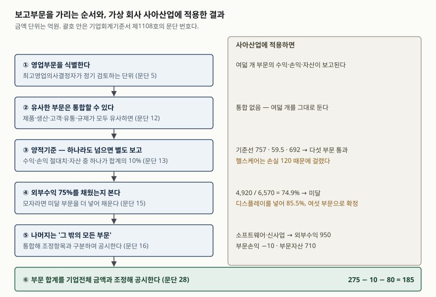

> 예제의 회사와 숫자는 계산을 보이려고 만든 가상 자료다. 금액 단위는 억원이다.

## 들어가며

어떤 회사의 손익계산서에서 영업이익률을 계산했더니 2.8%가 나왔다. 업종 평균보다 낮으니 경쟁력이 떨어지는 회사라고 적어 두고 넘어간다. 그런데 주석의 부문 정보를 열면 전혀 다른 그림이 나온다. 이익률 12.5%와 14.0%를 내는 주력 사업이 둘 있고, 그 옆에 −14.5%와 −23.1%를 기록 중인 사업이 둘 더 있다. 2.8%는 이 넷이 섞여 평평해진 값이다. 합계 한 줄은 평균을 보여주는 동시에 **그 평균을 만든 분포를 지운다.** 부문별 정보는 지워진 분포를 다시 꺼내는 자리다.

## 개념

### 영업부문은 회계가 아니라 경영진이 나눈다

기업회계기준서 제1108호는 영업부문을 세 조건을 모두 충족하는 구성단위로 정의한다(문단 5). 수익을 창출하고 비용이 발생하는 사업활동을 하고, 최고영업의사결정자가 성과를 **정기적으로 검토**하며, 구분된 재무정보를 이용할 수 있어야 한다. 아직 수익이 나지 않는 신규 사업도 영업부문이 될 수 있다.

핵심은 가운데 조건이다. 기준서가 업종 분류나 지역 같은 외부 잣대로 부문을 가르지 않고, **경영진이 실제로 들여다보는 단위를 그대로 공시하게 했다.** 그래서 부문 정보는 회사 안에서 쓰는 관리 보고서와 모양이 비슷하다. 외부 투자자가 경영진과 같은 눈높이로 회사를 보게 하려는 설계다.

### 전부를 따로 보고하지는 않는다

부문이 스무 개라고 해서 스무 개를 다 공시하면 읽을 수 없는 주석이 된다. 그래서 기준서는 비슷한 것을 묶고(문단 12), 일정 크기를 넘는 것만 별도로 보고하며(문단 13), 그래도 전체가 충분히 덮이지 않으면 더 넣고(문단 15), 남은 것은 한 덩어리로 묶게 한다(문단 16). 아래 순서가 그 과정이다.

## 구조



> **출처**: [한국회계기준원 — 기업회계기준서 제1108호 영업부문, 문단 5 영업부문의 정의, 문단 12 통합 기준, 문단 13 양적기준, 문단 15 외부수익 75% 기준, 문단 16 그 밖의 모든 부문, 문단 28 조정](https://www.kasb.or.kr/front/board/ingAccountingList.do)

## 동작 원리

### 통합은 다섯 가지가 모두 비슷할 때만 한다

경제적 특성이 유사한 둘 이상의 영업부문은 하나로 통합할 수 있는데, 조건은 다섯 항목이 모두 유사한 것이다(문단 12). 제품과 용역의 성격, 생산과정의 성격, 고객의 유형이나 계층, 제품 공급과 용역 제공 방법, 그리고 해당한다면 규제환경의 성격이다. 다섯을 모두 걸어 둔 이유는 통합이 정보를 지우는 방향이기 때문이다. 하나라도 다르면 묶지 않는다.

### 양적기준이 셋인 이유는 수익만으로는 모자라서다

별도 보고 대상은 세 기준 가운데 **하나라도** 넘으면 된다(문단 13).

| 기준 | 분모 |
|---|---|
| 부문수익 | 모든 영업부문 수익 합계 (내부거래 포함) |
| 부문당기손익의 절대치 | 이익 부문 합계와 손실 부문 합계의 절대치 중 **큰 금액** |
| 부문자산 | 모든 영업부문 자산 합계 |

손익 기준의 분모가 순액이 아니라 둘 중 큰 금액이라는 점이 중요하다. 이익과 손실을 상계한 순액을 분모로 쓰면 이익과 손실이 비슷한 회사에서 분모가 0에 가까워져 모든 부문이 기준을 넘게 된다. 큰 쪽을 쓰면 그 일이 생기지 않는다.

세 기준을 병렬로 둔 효과는 아래 예제에서 드러난다. 수익이 작아 수익 기준에도, 자산 기준에도 걸리지 않는 적자 사업이 **손실 크기 때문에** 별도 보고 대상이 된다. 수익 기준 하나만 있었다면 그 사업은 '그 밖의 모든 부문'에 묻혔을 것이다.

### 75% 기준이 전체 덮개를 맡는다

양적기준을 통과한 부문들의 **외부고객 수익 합계**가 기업전체 수익의 75%에 못 미치면, 기준에 미달한 부문이라도 75%에 이를 때까지 추가로 보고부문으로 식별한다(문단 15). 앞의 세 기준이 "큰 것을 빠뜨리지 않는" 역할이라면 이 기준은 "전체의 대부분이 설명되게 하는" 역할이다. 남은 부문은 '그 밖의 모든 부문'으로 통합해 다른 조정항목과 구분해 공시하고, 그 범주의 수익 원천이 무엇인지 설명한다(문단 16). 보고부문 개수에 상한은 정해져 있지 않지만, 10개를 넘으면 공시가 지나치게 상세해질 수 있으므로 실무적 한계에 이르렀는지 판단하라고 적는다(문단 19).

### 부문 금액은 회계기준 금액이 아니라 경영진이 보는 숫자다

부문별로 보고하는 금액은 자원 배분과 성과 평가를 위해 **최고영업의사결정자에게 보고되는 측정치**다(문단 25). 기업전체 재무제표를 만들 때 하는 수정이나 제거, 비용 배분은 최고영업의사결정자가 부문손익 측정에 실제로 쓰는 경우에만 부문손익에 들어간다. 그래서 부문손익을 전부 더해도 기업전체 손익과 같아지지 않고, 그 차이를 메우는 조정 공시가 따로 필요하다(문단 28).

## 실습 예제

가상 회사 사아산업은 여덟 개 사업을 운영한다. 전체 소스: [`code/`](code/) · 수행 기록: [`code/output.txt`](code/output.txt)

```text
[1] 최고영업의사결정자에게 보고되는 부문 자료
    부문                외부수익      내부거래      부문수익      부문손익      부문자산
    가전               2,000         0     2,000       250     1,800
    반도체장비            1,500         0     1,500       210     1,500
    소재                 700       400     1,100      -160     1,200
    물류                 200       600       800        50       450
    헬스케어               520         0       520      -120       640
    디스플레이              700         0       700        45       620
    소프트웨어              600         0       600        40       380
    신사업                350         0       350       -50       330

[2] 전사 숫자 하나로 볼 때
    기업전체 수익                              6,570
    부문손익 합계                                265
    배분하지 않은 본사 공통비                     -80
    법인세비용차감전순이익                        185
    기업전체 이익률                             2.8%
```

소재와 물류는 내부거래 비중이 큰 부문이다. 기업전체 수익 6,570은 내부거래 1,000을 제거한 뒤의 금액이고, 양적기준의 분모가 되는 부문수익 합계 7,570은 내부거래를 포함한 금액이라는 점에서 다르다.

```text
[3] 양적기준의 기준선 (문단 13)
    부문수익 합계 7,570 의 10%               757.0
    이익 합계 595 와 손실 합계 330 중 큰 금액의 10%     59.5
    부문자산 합계 6,920 의 10%               692.0

[4] 부문별 판정 — 하나라도 넘으면 별도 보고
    부문                수익      손익      자산   판정
    가전                넘음      넘음      넘음   보고부문
    반도체장비             넘음      넘음      넘음   보고부문
    소재                넘음      넘음      넘음   보고부문
    물류                넘음       -       -   보고부문
    헬스케어               -      넘음       -   보고부문
    디스플레이              -       -       -   미달
    소프트웨어              -       -       -   미달
    신사업                -       -       -   미달
```

헬스케어는 수익 520이 기준선 757에, 자산 640이 기준선 692에 못 미친다. 그런데 손실 120의 절대치가 기준선 59.5를 넘어 별도 보고 대상이 됐다. 반대로 디스플레이는 수익 700·자산 620으로 헬스케어보다 크지만 손익이 45라서 세 기준을 모두 비껴간다. **크기가 아니라 성과의 극단값이 부문을 드러낸다**는 것이 손익 기준의 효과다.

```text
[5] 외부수익 75% 검증 (문단 15)
    기업전체 외부수익                          6,570
    1차 보고부문의 외부수익                    4,920
    비율                                      74.9%   미달 — 부문을 더 식별한다
    + 디스플레이 추가 → 5,620 / 6,570 = 85.5%

[6] 최종 보고부문 6개 — 가전, 반도체장비, 소재, 물류, 헬스케어, 디스플레이
    '그 밖의 모든 부문' (문단 16): 소프트웨어, 신사업
      외부수익 950 · 부문손익 -10 · 부문자산 710
```

다섯 부문으로는 74.9%, 0.1%p 차이로 기준에 걸린다. 외부수익이 가장 큰 미달 부문인 디스플레이를 넣으면 85.5%가 되어 여섯 부문으로 확정된다. 남은 소프트웨어와 신사업은 한 덩어리가 되는데, 이익 40과 손실 −50이 상계되어 부문손익이 −10으로 보인다. 덩어리 안의 두 사업이 반대 방향이라는 사실은 여기서 보이지 않는다.

```text
[8] 부문별 영업이익률 — 합계 하나로는 안 보이던 것
    부문                부문수익      부문손익      이익률
    가전               2,000       250    12.5%
    반도체장비            1,500       210    14.0%
    소재               1,100      -160   -14.5%
    물류                 800        50     6.2%
    헬스케어               520      -120   -23.1%
    디스플레이              700        45     6.4%
    소프트웨어              600        40     6.7%
    신사업                350       -50   -14.3%
```

기업전체 이익률 2.8% 한 줄 안에 두 자릿수 이익률 둘과 두 자릿수 적자 셋이 들어 있다. 적자 셋의 손실 합계 330이 이익 595를 깎아 265가 되고, 거기서 본사 공통비 80을 더 빼 185가 된 것이 그 한 줄의 내역이다.

## 실무에서 주의할 점

- **부문 구분은 회사마다 달라서 회사 간 비교가 어렵다.** 경영진이 보는 단위를 그대로 공시하게 한 설계의 대가다. 같은 업종의 두 회사가 사업을 다르게 묶어 두면 부문 이익률을 나란히 놓을 수 없다. 비교하려면 부문의 구성 설명부터 읽어야 한다.
- **부문손익 합계가 기업전체 손익과 다른 것이 정상이다.** 측정치가 최고영업의사결정자 기준이고(문단 25) 공통비가 배분되지 않을 수 있으므로, 조정 공시(문단 28)에서 차이가 어디서 생겼는지 확인한다. 이 예제에서는 본사 공통비 80이 어느 부문에도 배분되지 않았다.
- **부문 구분이 바뀐 해를 조심한다.** 내부 조직 구조가 바뀌어 보고부문 구성이 달라지면 과거 기간의 부문정보를 재작성한다(문단 29). 재작성하지 않는다면 변경이 일어난 해의 부문정보를 옛 기준과 새 기준 양쪽으로 공시한다(문단 30). 전기 숫자가 작년 보고서와 다르면 먼저 이 공시를 찾아본다.
- **'그 밖의 모든 부문'이 클수록 가려지는 것이 많다.** 이 예제에서는 외부수익의 14%가 그 덩어리에 들어갔고, 그 안에서 이익과 손실이 상계됐다. 이 범주의 비중과 수익 원천 설명을 함께 읽는다.
- **주요 고객 공시를 빠뜨리지 않는다.** 단일 외부고객으로부터의 수익이 기업전체 수익의 10% 이상이면 그 사실과 금액, 해당 부문의 명칭을 공시한다(문단 34). 고객 이름까지 밝힐 의무는 없다. 부문 이익률이 좋아도 수익이 한 고객에 몰려 있으면 성격이 다른 숫자다.
- **보고부문 개수에 정해진 적정선은 없다.** 문단 19는 10개를 상한으로 정한 것이 아니라 실무적 한계를 판단할 지점으로 든다. "부문이 몇 개여야 한다"는 기준선을 세워 두고 회사를 평가할 근거는 기준서에 없다.

## 정리

- 영업부문은 최고영업의사결정자가 정기적으로 성과를 검토하는 단위이고, 기준서는 경영진이 보는 구분을 그대로 공시하게 한다(문단 5).
- 다섯 항목이 모두 유사하면 통합하고(문단 12), 수익·손익 절대치·자산 가운데 하나가 합계의 10%를 넘으면 별도 보고한다(문단 13).
- 보고부문의 외부수익이 기업전체의 75%에 못 미치면 채울 때까지 부문을 더 넣고(문단 15), 남은 것은 '그 밖의 모든 부문'으로 묶는다(문단 16).
- 손익 기준은 수익이 작아도 손실이 큰 부문을 끌어내는 장치다. 예제의 헬스케어가 그 경우다.
- 부문 금액은 경영진 기준 측정치이므로 합계가 기업전체 금액과 다르고, 그 차이는 조정 공시로 메운다(문단 25, 28).

## 참고 자료

- [한국회계기준원 — 시행 중인 K-IFRS 기준서 목록](https://www.kasb.or.kr/front/board/ingAccountingList.do) — 기업회계기준서 제1108호 원문 발행처. 아래 전재 사이트는 문단을 바로 열기 위한 편의 링크다
- [IFRS Foundation — IFRS 8 Operating Segments](https://www.ifrs.org/issued-standards/list-of-standards/ifrs-8-operating-segments/) — 국제회계기준 원문 발행처
- [K-IFRS 제1108호 영업부문 — 문단 5 영업부문의 정의, 문단 11·13 양적기준, 문단 12 통합 기준, 문단 15 외부수익 75%, 문단 16 그 밖의 모든 부문, 문단 19 보고부문 개수, 문단 23 공시 항목, 문단 25 측정, 문단 28 조정, 문단 29·30 구조 변경, 문단 34 주요 고객](https://accountingwiki.co.kr/standards/1108) (제3자 전재)
