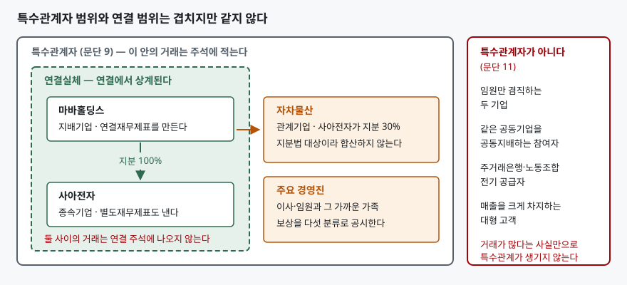
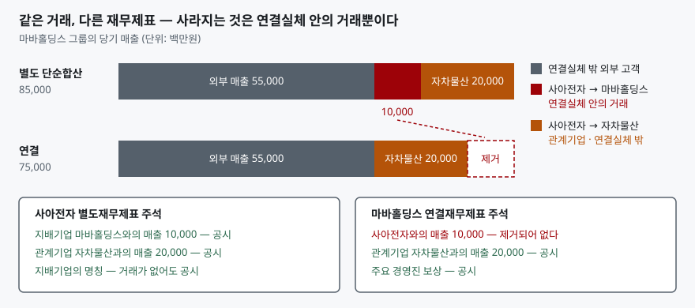

> 예제의 회사와 거래 금액은 계산을 보이려고 만든 가상 자료다. 실재하는 회사가 아니다. 금액 단위는 백만원이다.

## 들어가며

지주회사 체제인 그룹의 사업보고서를 열고 주석에서 "특수관계자와의 거래"를 찾는다. 계열사끼리 얼마나 밀어주는지 보려는 것인데, 막상 표를 열면 금액이 생각보다 작고 계열사 이름도 몇 개 안 보인다. 여기서 "이 그룹은 내부거래가 적구나"라고 결론 내리기 쉽다. 그런데 같은 그룹 종속회사의 감사보고서를 따로 열면 지배기업과의 매출이 수백억 단위로 적혀 있다. 두 숫자가 다른 이유는 한쪽이 숨긴 것이 아니라, 두 재무제표가 애초에 다른 범위를 그리고 있기 때문이다. 어느 쪽을 봐야 하는지 알려면 **거래가 사라지는 기준**부터 알아야 한다.

## 개념

### 왜 따로 적게 하는가

특수관계자와의 거래는 가격이 시장에서 정해지지 않을 수 있다. 지배기업이 종속기업에게 원가에 팔게 하거나, 반대로 비싸게 사 주거나, 아예 대가 없이 자산을 넘길 수도 있다. 그 결과로 나온 매출과 이익은 독립된 상대와 거래해서 나온 것과 성격이 다르다. K-IFRS 제1024호는 재무제표에 특수관계와 그 거래가 재무상태와 손익에 영향을 미쳤을 가능성에 **주의를 환기하는** 공시를 담도록 요구한다(문단 1). 거래가 공정했는지를 판단해 주는 것이 아니라, 판단할 재료를 내놓게 하는 기준서다.

범위는 생각보다 넓다. 기준서는 특수관계자를 보고기업과 특수관계에 있는 개인이나 기업으로 정의하고, 지배·공동지배·유의적 영향력을 가진 사람과 그 가까운 가족, 주요 경영진, 지배기업·종속기업·관계기업·공동기업을 모두 포함시킨다(문단 9). 특수관계자거래는 **대가의 부담 여부에 관계없이** 자원·용역·의무가 이전된 것을 말한다. 무상으로 넘겼어도 거래다.

### 거래가 많다고 특수관계가 생기지는 않는다

반대로 범위에서 분명히 빼 놓은 것들이 있다(문단 11). 임원을 함께 두고 있을 뿐인 두 기업, 같은 공동기업을 공동지배하는 두 참여자, 통상적 업무관계만 있는 자금제공자·노동조합·공익기업, 그리고 거래량이 많아 경제적으로 의존하게 된 고객이나 공급자다. 매출의 절반을 한 고객에게 올리는 회사라도 그 고객은 특수관계자가 아니다. 판단 기준은 거래의 크기가 아니라 **지배·영향력의 존재**다.

## 구조



> **출처**: [한국회계기준원 — 기업회계기준서 제1024호 특수관계자 공시, 문단 9 특수관계자의 정의, 문단 11 특수관계자가 아닌 경우, 문단 13 지배관계 공시](https://www.kasb.or.kr/front/board/ingAccountingList.do) · 문단 본문은 [K-IFRS 제1024호 전재본](https://accountingwiki.co.kr/standards/1024)에서 확인했다 (제3자 전재).

이 도식의 핵심은 두 상자의 크기 차이다. **특수관계자 범위가 연결 범위보다 넓다.** 연결 범위는 지배력을 기준으로 그어지지만 특수관계자 범위는 유의적 영향력과 개인까지 끌어안는다. 관계기업과 주요 경영진은 그 차이 구간에 들어가고, 바로 그 구간의 거래가 연결재무제표에서도 끝까지 살아남는다.

## 동작 원리

### 제거 기준은 "특수관계자인가"가 아니다

연결재무제표를 만들 때 사라지는 거래의 기준은 간단하다. 기준서는 투자기업과 공정가치로 측정하는 그 종속기업 사이를 제외하고, **연결실체 내 기업 간 특수관계자거래와 채권·채무 잔액은 연결재무제표를 작성할 때 제거된다**고 정한다(문단 4). 걸러내는 기준은 특수관계자 여부가 아니라 **연결실체 안인가**다.

그래서 지배기업과 종속기업 사이의 매출, 대여금, 이자, 지급보증은 연결 주석에서 통째로 사라진다. 같은 지갑 안에서 돈을 옮긴 것이므로 그룹 전체로 보면 아무 일도 없었다는 관점이다. 반면 관계기업은 지분법으로 한 줄에 담을 뿐 합산하지 않으므로, 관계기업과의 거래는 제거할 대상이 아니다. **연결 주석에 남은 특수관계자 거래는 대부분 관계기업·공동기업·경영진과의 거래다.**



> **출처**: [한국회계기준원 — 기업회계기준서 제1024호 특수관계자 공시, 문단 4 연결실체 내 거래의 제거, 문단 13 지배기업 명칭 공시, 문단 18 거래와 잔액의 공시](https://www.kasb.or.kr/front/board/ingAccountingList.do) · [IFRS Foundation — IAS 24 Related Party Disclosures](https://www.ifrs.org/issued-standards/list-of-standards/ias-24-related-party-disclosures/)가 국제회계기준 원문 발행처다. 숫자는 이 글의 [`code/output.txt`](code/output.txt) `[3]`·`[4]`·`[5]`에 있다.

### 거래가 없어도 적어야 하는 것이 있다

공시 요구는 두 갈래다. 하나는 거래가 있을 때의 공시다. 회계기간 중 특수관계자거래가 있으면 특수관계의 성격과 함께 거래금액, 약정을 포함한 채권·채무 잔액과 그 조건·담보·보증, 채권에 대한 대손충당금, 당기에 인식한 대손상각비를 적는다(문단 18). 그리고 이 내용을 지배기업·공동지배하거나 유의적 영향력을 행사하는 기업·종속기업·관계기업·공동기업·주요 경영진·그 밖의 특수관계자라는 **범주로 나누어** 적는다(문단 19).

다른 하나는 거래와 무관한 공시다. **지배기업과 그 종속기업 사이의 관계는 거래의 유무에 관계없이 공시한다**(문단 13). 지배기업의 명칭을 적고, 최상위 지배자가 다르면 그 명칭도 적는다. 올해 아무 거래가 없었더라도 "누가 이 회사를 쥐고 있는가"는 재무제표 이용자가 알아야 할 정보라는 뜻이다.

주요 경영진 보상은 별도의 조항으로 다룬다. 총액과 함께 단기종업원급여·퇴직급여·기타 장기급여·해고급여·주식기준보상의 다섯 분류 금액을 각각 공시한다(문단 17). 다섯 번째 항목의 계산 구조는 [주식기준보상 글](../2026-10-25-share-based-payment-vesting-expense/index.md)에서 다뤘다. 주요 경영인력용역을 다른 기업에서 제공받는 경우에는 그 기업이 자기 종업원이나 이사에게 지급한 보상까지 문단 17대로 쪼갤 필요는 없고(문단 17A), 대신 그 용역으로 발생한 금액을 따로 적는다(문단 18A). 이 두 문단은 2014년 1월 1일 이후 개시하는 회계연도부터 적용된다.

## 실습 예제

전체 소스: [`code/`](code/) · 수행 기록: [`code/output.txt`](code/output.txt)

마바홀딩스가 사아전자 지분 100%를 들고 있고, 사아전자가 자차물산 지분 30%를 들고 있다. 당기에 일곱 건의 특수관계자 거래가 있었다.

```text
[3] 당기 거래 — 연결재무제표를 만들 때 어느 것이 제거되는가 (문단 4)
    거래            당사자                    금액        연결 작성 시
    제품 매출       사아전자 → 마바홀딩스     10,000      제거된다
    매출채권 잔액   사아전자 → 마바홀딩스     2,500       제거된다
    자금 대여       마바홀딩스 → 사아전자     30,000      제거된다
    이자수익        마바홀딩스 → 사아전자     1,500       제거된다
    지급보증        마바홀딩스 → 사아전자     20,000      제거된다
    제품 매출       사아전자 → 자차물산       20,000      남는다
    매출채권 잔액   사아전자 → 자차물산       6,000       남는다
    일곱 건 중 5건이 연결재무제표에서 사라진다
```

일곱 건 모두 특수관계자 거래인데 연결재무제표에는 두 건만 남는다. 사라지는 다섯 건의 공통점은 상대가 지배기업이거나 종속기업이라는 것뿐이다. 거래 금액이 크거나 성격이 특이해서가 아니다.

```text
[4] 매출 — 별도 단순합산과 연결이 갈리는 폭
    재무제표        외부 매출       특수관계자 매출     별도 매출 합계
    마바홀딩스      15,000          0                   15,000
    사아전자        40,000          30,000              70,000
    두 회사 별도 매출 단순합산 85,000
    (-) 연결실체 내부 매출 10,000  ← 사아전자가 마바홀딩스에 판 몫
    = 연결 매출 75,000
```

사아전자의 특수관계자 매출 30,000 중 10,000만 제거된다. 나머지 20,000은 관계기업 자차물산에 판 것이라 연결실체 밖의 거래이고, 연결 매출 75,000 안에 그대로 들어 있다. 특수관계자 매출을 전부 "지워지는 매출"로 보면 연결 매출을 65,000으로 잘못 세게 된다.

```text
[5] 어느 주석에 적히는가 — 같은 거래가 재무제표마다 달리 보인다
    항목                                  사아전자 별도 주석    마바홀딩스 연결 주석
    사아전자 → 마바홀딩스 매출 10,000     공시                  제거되어 공시하지 않는다
    마바홀딩스 → 사아전자 이자수익 1,500  공시                  제거되어 공시하지 않는다
    마바홀딩스 → 사아전자 지급보증 20,000 공시                  제거되어 공시하지 않는다
    사아전자 → 자차물산 매출 20,000       공시                  공시한다
    주요 경영진 보상                      공시                  공시한다
    지배기업 마바홀딩스의 명칭            거래 없어도 공시      해당 없음
```

들어가며에서 본 두 숫자의 차이가 이 표다. 연결 주석을 아무리 들여다봐도 사아전자가 마바홀딩스에 판 10,000은 나오지 않는다. 그 거래를 보려면 사아전자의 별도재무제표를 따로 열어야 한다.

## 실무에서 주의할 점

- **연결 주석에 내부거래가 없다고 내부거래가 없는 것이 아니다.** 지배·종속 관계의 거래는 문단 4에 따라 통째로 제거된다. 계열사 간 일감이 얼마나 오가는지 보려면 종속회사 각각의 별도재무제표나 감사보고서를 열어야 한다. 연결만 보고 "내부거래 비중이 낮다"고 판단하는 것은 범위를 잘못 잡은 것이다.
- **연결 주석에 남아 있는 특수관계자 거래를 더 눈여겨본다.** 제거되지 않고 살아남았다는 것은 그 상대가 연결실체 밖이라는 뜻이다. 관계기업·공동기업·주요 경영진·최대주주의 다른 회사와의 거래가 여기 모인다. 그룹 바깥으로 값이 흘러 나가는 통로를 보려면 이쪽이 먼저다.
- **"정상거래 조건" 문구는 입증할 수 있을 때만 쓸 수 있다.** 기준서는 독립된 당사자 사이의 거래 조건으로 이루어졌음을 **입증할 수 있는 경우에 한하여** 그 사실을 공시하도록 한다(문단 23). 주석에 그 문장이 있으면 회사가 입증 자료를 갖고 있다고 선언한 것이다. 반대로 그 문장이 없다면 그것도 정보다.
- **회계상 특수관계자와 공정거래법상 특수관계인은 다른 개념이다.** 하나는 재무제표 주석의 범위이고 다른 하나는 대규모내부거래 공시·사익편취 규제의 범위다. 두 범위는 겹치지만 같지 않으므로, 한쪽 목록을 다른 쪽에 그대로 가져다 쓰면 어긋난다.
- **정부가 지배하는 기업은 공시가 면제될 수 있다.** 보고기업에 지배력·공동지배력·유의적 영향력을 행사하는 정부, 그리고 같은 정부가 지배하는 다른 기업과의 거래는 문단 18의 상세 공시가 면제된다(문단 25). 공기업이나 정부 지분이 큰 회사의 주석이 유난히 간단해 보인다면 이 면제 때문일 수 있고, 그 경우 문단 26에 따른 대체 공시가 들어간다.

## 정리

- 특수관계자 공시는 거래가 공정했는지를 알려주는 것이 아니라, 판단할 재료를 내놓게 하는 장치다. 대가가 없는 이전도 거래로 센다.
- 특수관계자 범위는 연결 범위보다 넓다. 관계기업과 주요 경영진이 그 차이 구간에 들어간다.
- 연결재무제표를 만들 때 사라지는 기준은 "특수관계자인가"가 아니라 "연결실체 안인가"다. 지배·종속 사이의 거래만 제거된다.
- 거래가 없어도 지배기업과 종속기업의 관계는 공시한다. 최상위 지배자가 다르면 그 명칭까지 적는다.
- 그룹 안의 일감을 보려면 연결이 아니라 별도재무제표를 연다. 연결 주석에 남은 특수관계자 거래는 그룹 밖과의 거래다.

## 참고 자료

- [한국회계기준원 — 시행 중인 K-IFRS 기준서 목록](https://www.kasb.or.kr/front/board/ingAccountingList.do) — 기업회계기준서 제1024호 원문 발행처. 아래 전재 사이트는 문단을 바로 열기 위한 편의 링크다
- [IFRS Foundation — IAS 24 Related Party Disclosures](https://www.ifrs.org/issued-standards/list-of-standards/ias-24-related-party-disclosures/) — 국제회계기준 원문 발행처
- [K-IFRS 제1024호 특수관계자 공시 — 문단 4 연결 제거, 문단 9 정의, 문단 11 특수관계자가 아닌 경우, 문단 13 지배관계, 문단 17·17A 주요 경영진 보상, 문단 18·18A·19 거래 공시, 문단 23 정상거래 조건, 문단 25 정부특수관계기업 면제](https://accountingwiki.co.kr/standards/1024) (제3자 전재)
- [IFRS Interpretations Committee, 2013년 1월 안건자료 15E — IAS 24 Key management personnel services](https://www.ifrs.org/content/dam/ifrs/meetings/2013/january/ifric/ap15e-aip-ias-24-key-managment-personnel.pdf) — 문단 11·17의 영문 본문과 문단 17A·18A를 넣은 경위, 2014년 1월 1일 적용 시점이 적혀 있다
