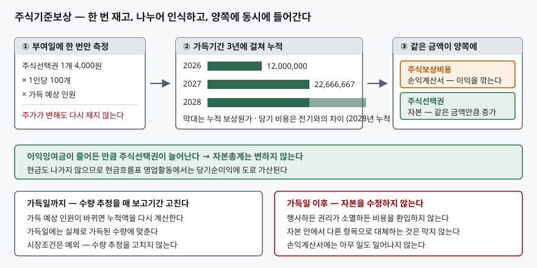
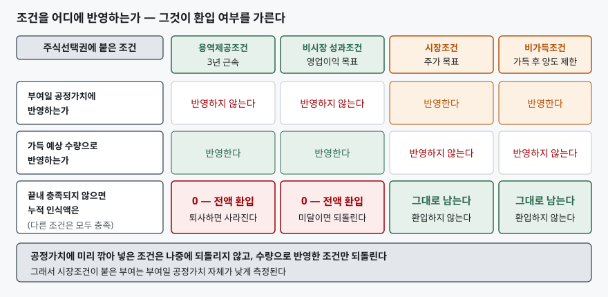

> 예제의 회사와 임직원 수, 공정가치, 이익은 계산을 보이려고 만든 가상 자료다. 실재하는 회사가 아니다. 금액 단위는 원이고, 비교를 흐리지 않으려고 법인세 효과는 뺐다.

## 들어가며

관심 있는 회사의 공시 목록을 훑다 보면 "주식매수선택권 부여에 관한 신고"나 양도제한조건부주식(RSU) 부여 공시가 올라온 것을 보게 된다. 회사가 현금을 쓴 것은 아니니 재무제표에는 별일이 없겠거니 하고 넘긴다. 그런데 몇 달 뒤 분기보고서를 열면 손익계산서 판매비와관리비 안에 "주식보상비용"이라는 줄이 꽤 큰 금액으로 들어와 있고, 영업이익이 그만큼 깎여 있다. 현금흐름표를 보면 영업활동 현금흐름은 멀쩡하다. 여기서 흔히 내리는 결론이 "현금이 안 나갔으니 이 비용은 무시하고 봐도 된다"다. 절반만 맞는 말이고, 나머지 절반을 모르면 세 가지를 잘못 읽는다. 비용이 얼마나 더 남았는지, 그 비용이 나중에 사라질 수 있는지, 그리고 기존 주주의 지분이 얼마나 줄어드는지다.

## 개념

### 주식을 받을 권리도 대가다

회사가 임직원에게 일을 시키고 돈 대신 자기 회사 주식을 받을 권리를 준다. 받는 쪽에서 보면 보수이고, 주는 쪽에서 보면 용역을 제공받은 것이다. K-IFRS 제1102호는 주식기준보상거래에서 제공받는 재화나 용역을 그 재화나 용역을 제공받는 날에 인식하도록 하고, 주식으로 결제하는 거래라면 자본의 증가를 함께 인식하도록 한다(문단 7). 현금이 오가지 않았다는 사실은 인식 여부와 아무 상관이 없다. 회사가 받은 것은 노동이고, 그 노동에 값을 치렀다.

값을 매기는 방법은 원칙적으로 제공받은 재화나 용역의 공정가치다(문단 10). 그런데 종업원이 3년 동안 제공할 노동의 공정가치를 직접 재는 일은 가능하지 않다. 그래서 기준서는 종업원과의 거래에서는 부여한 지분상품의 공정가치로 대신 재고, 그 측정 시점을 **부여일**로 못 박는다(문단 11). 부여일에 한 번 재고 그 뒤로는 다시 재지 않는다. 주가가 두 배가 되어도, 반대로 반토막이 나도 손익계산서에 잡히는 1개당 금액은 부여일의 그 값 그대로다.

### 가득기간이 왜 중요한가

부여한 권리가 곧바로 내 것이 되는 경우는 드물다. 보통 "3년을 더 다녀야" 같은 조건이 붙는다. 이 조건을 다 채워 권리가 확정되는 것을 **가득**이라 하고, 그때까지의 기간이 **가득기간**이다. 기준서는 부여하자마자 가득되는 거래라면 용역 전부를 부여일에 인식하라고 하고(문단 14), 특정 기간의 근무가 조건이라면 **그 가득기간에 걸쳐 용역을 제공받는 것으로 보아 나누어 인식**하도록 한다(문단 15).

이 배분이 회계의 재량이 아니라는 점이 중요하다. 3년을 다녀야 받는 권리라면 회사는 3년에 걸쳐 노동을 받는 것이고, 비용도 3년에 걸쳐 생긴다. 부여일에 전액을 털어 넣는 것도, 가득일에 몰아서 잡는 것도 노동이 들어온 시점과 맞지 않는다.

### 자본총계는 왜 줄지 않는가

보통의 비용은 자산이 줄거나 부채가 늘면서 생긴다. 급여를 주면 현금이 나가고, 미지급금이 쌓이면 부채가 는다. 주식기준보상은 둘 다 아니다. 비용을 잡는 반대쪽에 **자본**이 늘어난다(문단 7). 비용은 이익잉여금을 깎고, 같은 금액이 주식선택권이라는 자본 항목으로 들어온다. 자본 안에서 한쪽이 줄고 다른 쪽이 그만큼 느는 것이므로 자본총계는 움직이지 않는다.

주주 입장에서 손해가 없다는 뜻은 아니다. 손해는 재무제표의 숫자가 아니라 **지분율**에서 발생한다. 나중에 권리가 행사되어 신주가 발행되면 기존 주주의 몫이 그만큼 나뉜다. 재무제표에 잡히지 않는 이 희석이 주식기준보상의 진짜 비용이고, 그래서 주당이익을 계산할 때 따로 반영한다.

## 구조



> **출처**: [한국회계기준원 — 기업회계기준서 제1102호 주식기준보상, 문단 7 인식과 자본의 증가, 문단 11 부여일 측정, 문단 15 가득기간 배분, 문단 20 수량 추정의 수정, 문단 23 가득일 이후 자본 미수정](https://www.kasb.or.kr/front/board/ingAccountingList.do) · 문단 본문은 [K-IFRS 제1102호 전재본](https://accountingwiki.co.kr/standards/1102)에서 확인했다 (제3자 전재). 숫자는 이 글의 [`code/output.txt`](code/output.txt) `[2]`에 있다.

도식에서 볼 것은 왼쪽 상자와 오른쪽 상자의 관계다. 왼쪽에서 한 번 정해진 금액이 가운데에서 세 조각으로 나뉘고, 오른쪽에서 그 조각이 비용과 자본 양쪽에 **동시에** 찍힌다. 한 거래가 손익계산서와 재무상태표에 각각 자국을 남기는데 그 두 자국의 크기가 같다. 그래서 비용이 아무리 커도 자본총계는 꿈쩍하지 않는다.

## 동작 원리

### 누적액을 먼저 구하고 전기와의 차이를 당기 비용으로 본다

가장 많이 오해하는 지점이 계산 순서다. 매년 3분의 1씩 기계적으로 잡는 것이 아니다. 기준서는 가득기간 중에 인식할 금액을 **가득될 것으로 예상되는 수량에 대한 최선의 추정치**에 기초하도록 하고, 추정이 바뀌면 고치도록 한다(문단 20). 그래서 보고기간 말마다 다음을 다시 계산한다.

> 누적 보상원가 = 부여일 공정가치 × 가득 예상 수량 × 경과기간 ÷ 가득기간

당기 비용은 이렇게 구한 누적액에서 전기까지의 누적액을 뺀 값이다. 가득 예상 인원이 내려가면 누적액이 작아지므로 **당기 비용이 전기보다 줄어들 수도 있고, 추정이 크게 꺾이면 음수가 되어 환입으로 나타나기도 한다.** 한 해 전보다 주식보상비용이 줄었다고 해서 부여 규모가 줄었다고 읽으면 안 되는 이유가 여기 있다. 퇴사가 예상보다 많았을 뿐일 수 있다.

### 조건의 종류가 환입 여부를 가른다

조건을 어느 쪽에 반영하느냐가 이 기준서에서 가장 자주 틀리는 부분이다. 기준서는 **시장조건이 아닌 가득조건은 측정기준일의 공정가치를 추정할 때 고려하지 않는다**고 정한다(문단 19). 근속 조건이나 영업이익 목표는 1개당 공정가치를 깎는 데 쓰지 않고, 대신 **가득될 수량**을 조정해 반영한다. 충족되지 않으면 수량이 0이 되므로 누적 인식액도 0이 되고, 그간 쌓아 둔 비용은 전액 되돌아온다.

시장조건은 반대다. 주가 목표처럼 주식의 시장가격에 걸린 조건은 **공정가치 추정에 반영**하고, 그 조건이 충족되는지에 관계없이 다른 가득조건을 채운 거래상대방의 용역은 인식한다(문단 21). 공정가치를 잴 때 이미 "목표를 못 채울 가능성"만큼 깎아 두었으므로 나중에 또 깎으면 두 번 반영하는 셈이기 때문이다. 가득 후 양도 제한 같은 비가득조건도 같은 방식으로 다룬다(문단 21A).



> **출처**: [한국회계기준원 — 기업회계기준서 제1102호 주식기준보상, 문단 19 시장조건이 아닌 가득조건, 문단 20 수량 추정, 문단 21 시장조건, 문단 21A 비가득조건](https://www.kasb.or.kr/front/board/ingAccountingList.do) · [IFRS Foundation — IFRS 2 Share-based Payment](https://www.ifrs.org/issued-standards/list-of-standards/ifrs-2-share-based-payment/)의 같은 문단이 국제회계기준 원문이고, 문단 19~21의 영문 본문은 [IFRS Interpretations Committee 2010년 7월 안건자료 3D](https://www.ifrs.org/content/dam/ifrs/meetings/2010/july/ifric/1007obs3d-ifric-ifrs-2-vesting-and-non-vesting-conditions.pdf)에 전재되어 있다.

### 가득일이 지나면 손대지 않는다

가득일이 지난 뒤에는 자본을 수정하지 않는다(문단 23). 임직원이 권리를 행사하지 않고 그대로 소멸시켜도, 주가가 행사가격 아래로 내려가 권리가 휴지가 되어도 이미 인식한 비용은 돌아오지 않는다. 회사는 노동을 이미 받았고 그 대가를 치렀다는 것이 기준서의 입장이다. 다만 자본 안에서 주식선택권 계정을 다른 자본 항목으로 옮기는 것은 막지 않는다. **손익계산서로 되돌리는 것이 금지될 뿐 자본 내 이동은 자유롭다.**

## 실습 예제

전체 소스: [`code/`](code/) · 수행 기록: [`code/output.txt`](code/output.txt)

가나전자가 2026년 1월 1일에 임직원 100명에게 1인당 주식선택권 100개를 부여한다. 부여일 공정가치는 1개당 4,000원이고, 조건은 3년 근속 하나뿐이다.

```text
[2] 연도별 보상원가 — 누적액을 먼저 구하고 전기까지의 누적을 뺀다
    연도    가득 예상 인원  누적 보상원가     전기까지 누적     당기 비용
    2026    90명            12,000,000        0                 12,000,000
    2027    85명            22,666,667        12,000,000        10,666,667
    2028    88명            35,200,000        22,666,667        12,533,333
    3년 합계 35,200,000원 = 실제 가득 88명분의 부여일 공정가치
```

2027년 비용이 2026년보다 1,333,333원 작다. 한 해가 더 지나 경과기간이 3분의 1에서 3분의 2로 늘었는데도 그렇다. 가득 예상 인원이 90명에서 85명으로 내려가 누적액의 기준 자체가 작아졌기 때문이다. 2028년에는 실제 가득 인원 88명으로 맞추면서 누적액이 다시 올라가고 당기 비용이 커진다. 이 들쭉날쭉함은 오류가 아니라 문단 20이 시키는 대로 계산한 결과다.

```text
[3] 같은 12,000,000원을 비용으로 잡아도 — 주식보상과 현금상여가 갈린다
    보상 방식             당기 비용       현금 유출     자본 증가(주식선택권)   당기순이익        자본총계 증감
    주식선택권 부여       12,000,000      0             12,000,000              488,000,000       500,000,000
    같은 금액 현금상여    12,000,000      12,000,000    0                       488,000,000       488,000,000
```

두 회사의 손익계산서는 똑같다. 비용도 12,000,000원이고 당기순이익도 488,000,000원이다. 그런데 자본총계는 12,000,000원 차이가 난다. 현금상여를 준 회사는 자산이 줄어 그만큼 자본이 깎였고, 주식선택권을 준 회사는 깎인 이익잉여금을 주식선택권이 메웠다. **손익계산서만 보면 두 회사가 같아 보이지만 재무상태표에서 갈린다.**

```text
[4] 현금흐름표 영업활동 — 간접법에서 비용이 다시 가산된다
    구분                              주식선택권 부여     현금상여 지급
    당기순이익                        488,000,000         488,000,000
    (+) 주식보상비용 (현금 유출 없음) 12,000,000          0
    영업활동 현금흐름                 500,000,000         488,000,000
```

간접법은 당기순이익에서 출발해 현금이 오가지 않은 항목을 되돌리는 방식이라, 감가상각비와 마찬가지로 주식보상비용도 도로 더해진다. 당기순이익이 같은 두 회사의 영업활동 현금흐름이 갈리는 지점이고, [현금흐름표를 직접법과 간접법으로 읽는 글](../2026-10-23-cash-flow-direct-vs-indirect/index.md)에서 본 가산 항목 중 하나다.

```text
[5] 다라물산 — 같은 설계에 조건만 바꾼 두 갈래 (3년 뒤 목표 미달)
    설계 A — 3년 근속 + 영업이익 목표 (비시장조건), 부여일 공정가치 4,000원
    설계 B — 3년 근속 + 주가 목표 (시장조건), 부여일 공정가치 2,800원

    연도    A 비시장조건 누적     A 당기            B 시장조건 누적       B 당기
    2026    12,000,000            12,000,000        8,400,000             8,400,000
    2027    22,666,667            10,666,667        15,866,667            7,466,667
    2028    0                     -22,666,667       24,640,000            8,773,333
```

같은 회사가 같은 수량을 같은 사람들에게 주면서 조건만 바꿨고, 3년 뒤 결과도 똑같이 "근속자 88명, 목표 미달"이다. 그런데 3년을 합친 보상원가가 A는 0원이고 B는 24,640,000원이다. A는 비시장조건이 깨지면서 가득 수량이 0이 되어 2028년에 22,666,667원이 환입으로 뒤집혔고, B는 주가 목표를 못 채웠어도 1원도 되돌리지 않았다. B의 1개당 공정가치가 4,000원이 아니라 2,800원인 것이 그 대가다. **목표를 못 채울 가능성을 부여일에 미리 깎아 두었기 때문에 나중에 다시 깎지 않는다.**

## 실무에서 주의할 점

- **주식보상비용이 줄었다고 부여가 줄었다고 읽지 않는다.** [2]처럼 가득 예상 인원이 내려가기만 해도 당기 비용은 작아진다. 주석의 주식기준보상 항목에서 기초·부여·행사·소멸·기말 수량을 보면 실제로 부여가 줄었는지 추정만 바뀌었는지 가려진다. 수량 표를 건너뛰고 비용 금액만 추적하면 거꾸로 읽게 된다.
- **"비현금 비용이니 빼고 본다"는 조정에는 조건이 붙는다.** 주식보상비용을 더해 조정 영업이익을 계산하는 관행이 널리 쓰이지만, 이 비용의 대가는 미래의 신주 발행이다. 비용을 빼고 이익을 보려면 같은 자리에서 희석 주식 수의 증가도 함께 봐야 앞뒤가 맞는다. 비용만 지우고 분모를 그대로 두면 주당 가치가 과대평가된다. 계산 방식은 [희석 주당이익 글](../../valuation/2026-10-08-diluted-eps-convertible-bonds/index.md)과 같은 구조다.
- **시장조건이 붙은 부여는 애초에 비용이 작게 잡힌다.** [5]의 B처럼 1개당 공정가치가 낮게 측정되므로, 같은 수량을 부여해도 손익계산서에 찍히는 금액이 작다. 두 회사의 주식보상비용을 비교할 때 조건 설계를 보지 않으면 "A가 임직원에게 두 배를 썼다"는 식으로 잘못 읽는다. 주석에서 공정가치 측정에 쓴 모형과 가정(기대 변동성, 무위험이자율, 기대 행사기간)을 함께 본다.
- **환입은 한 번에 터진다.** [5]의 A에서 2028년에 들어온 -22,666,667원은 그 해의 이익을 그만큼 밀어 올린다. 성과조건 미달이 확정되는 해에 영업이익이 갑자기 좋아지는 모양이 나오는데, 영업이 좋아진 것이 아니라 과거에 쌓아 둔 비용이 되돌아온 것이다. 전년 대비 증감을 볼 때 주식보상비용 줄을 따로 떼어 본다.
- **주요 경영진 몫은 따로 공시된다.** K-IFRS 제1024호 문단 17은 주요 경영진에 대한 보상을 총액과 함께 단기종업원급여·퇴직급여·기타 장기급여·해고급여·**주식기준보상**의 다섯 분류로 나누어 공시하도록 한다. 전체 주식보상비용 중 경영진 몫이 얼마인지는 손익계산서가 아니라 이 주석에서 읽는다.

## 정리

- 주식기준보상은 현금이 오가지 않아도 비용이다. 회사가 받은 것은 노동이고, 그 대가로 주식을 받을 권리를 주었다.
- 종업원과의 거래는 부여일의 지분상품 공정가치로 재고, 그 뒤로 다시 재지 않는다. 주가가 변해도 1개당 금액은 그대로다.
- 비용은 가득기간에 걸쳐 나누되, 매 보고기간 가득 예상 수량으로 누적액을 다시 계산하고 전기와의 차이를 당기 비용으로 잡는다. 그래서 비용이 줄거나 음수가 되기도 한다.
- 근속·비시장 성과조건은 수량으로 반영하므로 미달하면 전액 환입되고, 시장조건·비가득조건은 공정가치에 반영하므로 미달해도 환입하지 않는다.
- 비용이 깎은 이익잉여금만큼 주식선택권이 자본을 채우므로 자본총계는 변하지 않는다. 주주가 치르는 값은 재무제표가 아니라 지분 희석으로 나타난다.

## 참고 자료

- [한국회계기준원 — 시행 중인 K-IFRS 기준서 목록](https://www.kasb.or.kr/front/board/ingAccountingList.do) — 기업회계기준서 제1102호·제1024호 원문 발행처. 아래 전재 사이트는 문단을 바로 열기 위한 편의 링크다
- [IFRS Foundation — IFRS 2 Share-based Payment](https://www.ifrs.org/issued-standards/list-of-standards/ifrs-2-share-based-payment/) — 국제회계기준 원문 발행처
- [K-IFRS 제1102호 주식기준보상 — 문단 7 인식, 문단 10·11 측정, 문단 14·15 가득기간 배분, 문단 19~21A 조건의 처리, 문단 23 가득일 이후](https://accountingwiki.co.kr/standards/1102) (제3자 전재)
- [K-IFRS 제1024호 특수관계자 공시 — 문단 17 주요 경영진 보상의 다섯 분류](https://accountingwiki.co.kr/standards/1024) (제3자 전재)
- [IFRS Interpretations Committee, 2010년 7월 안건자료 3D — IFRS 2 Vesting and Non-vesting Conditions](https://www.ifrs.org/content/dam/ifrs/meetings/2010/july/ifric/1007obs3d-ifric-ifrs-2-vesting-and-non-vesting-conditions.pdf) — 문단 15·19·20·21의 영문 본문이 그대로 실려 있다
