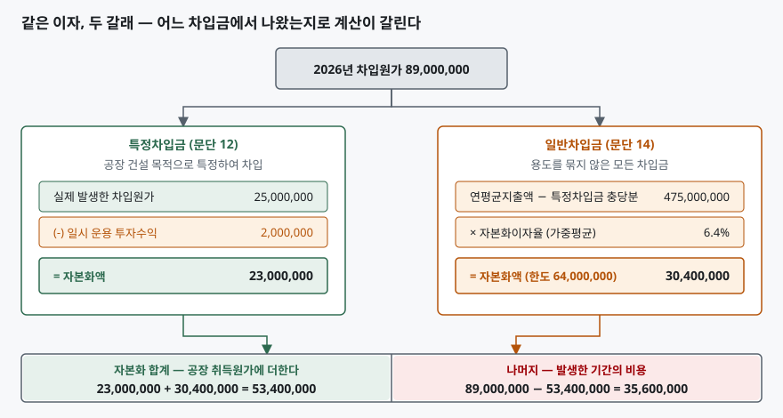
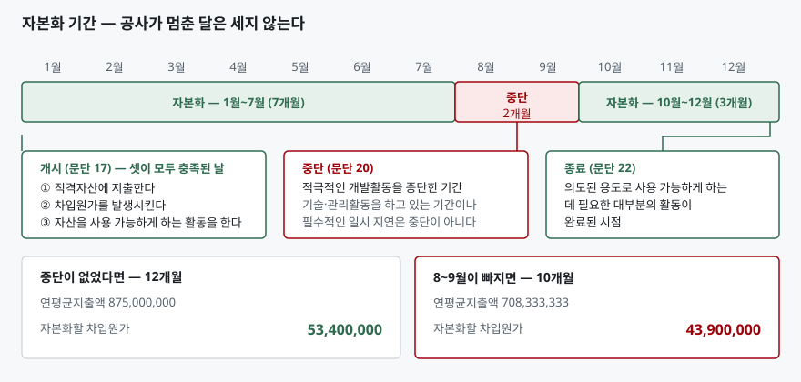

> 예제의 회사와 공사 지출, 차입 조건, 내용연수는 계산을 보이려고 만든 가상 자료다. 실재하는 회사가 아니다. 금액 단위는 원이고, 비교를 흐리지 않으려고 법인세 효과는 뺐다.

## 들어가며

제조업 회사의 분기보고서를 보다 보면 재무상태표에 "건설중인자산"이 크게 잡혀 있는 해가 있다. 공장을 짓거나 설비를 들이는 중이라는 뜻이다. 그런 해에는 차입금도 같이 늘어난다. 그러면 이자비용도 늘었겠거니 하고 손익계산서를 보는데, 금융원가 줄이 생각보다 작다. 차입금은 분명 1,700,000,000원이 늘었는데 이자비용은 그만큼 안 늘었다. 주석을 뒤지면 "자본화된 차입원가" 한 줄이 나온다. 이 금액은 손익계산서를 거치지 않고 건설중인자산 안으로 들어가 있다. 공사가 끝나면 그때부터 감가상각비로 조금씩 다시 나온다. 그래서 공사하는 해에는 이익이 좋아 보이고 공장을 돌리기 시작한 해부터는 비용이 더 크다. 이 효과를 모르면 설비투자를 크게 한 회사의 이익 추이를 거꾸로 읽는다.

## 개념

### 적격자산에 붙은 이자만 자산이 된다

K-IFRS 제1023호 문단 8은 **적격자산의 취득·건설·생산과 직접 관련된 차입원가는 해당 자산 원가의 일부로 자본화하고, 그 밖의 차입원가는 발생한 기간에 비용으로 인식**하도록 한다. "할 수 있다"가 아니라 "한다"다. 요건을 채우면 회사에 선택권이 없다.

적격자산은 문단 5가 정의한다. **의도된 용도로 사용하거나 판매할 수 있는 상태에 이르게 하는 데 상당한 기간을 필요로 하는 자산**이다. 문단 7은 재고자산, 제조설비자산, 전력생산설비, 무형자산, 투자부동산, 생산용식물을 예로 들고, 금융자산과 단기간에 반복해서 생산되는 재고자산은 적격자산이 아니라고 밝힌다. 사 와서 바로 쓰는 기계는 아무리 비싸도 적격자산이 아니다. 시간이 걸리는가가 기준이지 금액이 기준이 아니다.

예외도 있다. 문단 4는 공정가치로 측정하는 적격자산(제1041호의 생물자산 등)과 반복해서 대량으로 제조되는 재고자산에는 자본화를 요구하지 않는다.

### 왜 이자를 자산으로 보는가

원가는 그 자산을 지금 상태로 만드는 데 들어간 것을 모은 금액이다. 1년 걸려 짓는 공장이라면 그 1년 동안 묶인 자금의 값도 공장을 만드는 데 들어갔다. 똑같은 공장을 사 오면 판매자가 그 금융비용을 가격에 얹었을 것이다. 직접 지었다는 이유로 그 부분만 비용으로 떨어뜨리면 지은 회사와 사 온 회사의 자산 금액이 달라진다. 자본화는 그 차이를 없앤다.

## 구조



> **출처**: [한국회계기준원 — 기업회계기준서 제1023호 차입원가, 문단 8 자본화 요구, 문단 12 특정차입금과 일시 운용 투자수익, 문단 14 자본화이자율과 한도](https://www.kasb.or.kr/front/board/ingAccountingList.do) · 문단 본문은 [K-IFRS 제1023호 전재본](https://accountingwiki.co.kr/standards/1023)에서 확인했다 (제3자 전재). 숫자는 이 글의 [`code/output.txt`](code/output.txt) `[2]`·`[3]`에 있다.

왼쪽과 오른쪽의 계산 모양이 전혀 다르다는 점이 이 도식의 요지다. 왼쪽은 실제로 낸 이자에서 출발하고, 오른쪽은 실제 이자가 아니라 **지출액에 이자율을 곱해** 만든 금액이다. 같은 자산에 대한 같은 해의 계산인데 출발점이 다르다.

## 동작 원리

### 특정차입금 — 낸 이자에서 번 이자를 뺀다

공장을 짓겠다고 용도를 못 박아 빌린 돈이 특정차입금이다. 이쪽은 계산이 단순하다. 그 차입금에서 실제로 발생한 차입원가를 자본화한다. 다만 문단 12는 **일시적 운용에서 생긴 투자수익을 차감**하도록 한다.

차감하는 이유는 자금이 놀고 있던 기간에 있다. 기성금 지급 일정 때문에 빌린 돈을 한꺼번에 쓰지 못하고 예금에 넣어 두는 경우가 흔하다. 그 기간 동안 자금은 공장을 짓는 데 쓰이지 않았다. 그 몫의 이자까지 공장 원가에 넣으면 공장이 실제로 쓴 것보다 비싸게 기록된다.

### 일반차입금 — 실제 이자가 아니라 추정액이다

용도를 묶지 않은 차입금에서 나간 돈도 공장에 들어갔을 것이다. 다만 어느 차입금에서 나온 돈인지 특정할 수 없다. 문단 14는 그래서 **자본화이자율**을 쓴다. 회계기간의 모든 일반차입금에서 발생한 차입원가의 가중평균 이자율을 구하고, 그것을 적격자산에 대한 지출액에 곱한다.

여기에 한도가 붙는다. 같은 문단은 자본화한 차입원가가 **해당 기간에 실제로 발생한 차입원가를 초과할 수 없다**고 못 박는다. 지출액이 차입금보다 훨씬 크면 곱셈의 결과가 실제 이자보다 커질 수 있는데, 그런 금액을 자산으로 올리면 내지도 않은 이자를 자산으로 만드는 셈이다.

### 개시·중단·종료 — 기간을 세는 규칙

자본화는 공사 기간 전체에 걸리는 것이 아니다. 문단 17은 **셋이 모두 충족된 날**에 개시하도록 한다. 적격자산에 지출하고, 차입원가를 발생시키고, 자산을 의도된 용도로 사용 가능하게 하는 활동을 수행하는 것. 땅만 사 두고 아무것도 안 하는 동안에는 세 번째가 빠지므로 개시하지 않는다.

문단 20은 **적극적인 개발활동을 중단한 기간**에는 자본화를 중단하도록 한다. 다만 문단 21이 예외를 둔다. 상당한 기술 및 관리활동을 하고 있는 기간이나, 자산을 완성하는 데 필수적인 일시적 지연은 중단으로 보지 않는다. 설계 변경을 검토하느라 현장이 조용한 것과 분쟁으로 공사가 멈춘 것은 다르게 취급된다.

문단 22는 **의도된 용도로 사용 가능하게 하는 데 필요한 대부분의 활동이 완료된 시점**에 종료하도록 한다. 실제 가동일이 아니라 사용 가능한 상태가 된 날이다. 완공해 놓고 수주가 없어 몇 달 세워 두었다면 그 기간의 이자는 비용이다.



> **출처**: [한국회계기준원 — 기업회계기준서 제1023호 차입원가, 문단 17 자본화의 개시, 문단 20 자본화의 중단, 문단 21 중단으로 보지 않는 경우, 문단 22 자본화의 종료](https://www.kasb.or.kr/front/board/ingAccountingList.do) · 문단 본문은 [K-IFRS 제1023호 전재본](https://accountingwiki.co.kr/standards/1023)에서 확인했다 (제3자 전재). 숫자는 이 글의 [`code/output.txt`](code/output.txt) `[3]`·`[4]`에 있다.

## 실습 예제

전체 소스: [`code/`](code/) · 수행 기록: [`code/output.txt`](code/output.txt)

가나전자가 2026년 1월 1일에 제2공장 착공에 들어가 그해 말 완공한다. 지출은 1월 1일 600,000,000원, 7월 1일 400,000,000원, 10월 1일 300,000,000원이다. 공장 건설 목적으로 특정하여 500,000,000원을 연 5%에 빌렸고, 그중 200,000,000원은 기성 일정 때문에 6개월간 예치해 2,000,000원을 벌었다. 용도를 묶지 않은 차입금은 연 6%짜리 800,000,000원(연중)과 연 8%짜리 400,000,000원(7월 1일 차입) 둘이다.

```text
[2] 자본화이자율 — 일반차입금 전체의 가중평균 (문단 14)
    차입금               연평균 차입액          차입원가
    차입금 A               800,000,000        48,000,000
    차입금 B               200,000,000        16,000,000
    합계                 1,000,000,000        64,000,000

    자본화이자율 = 64,000,000 / 1,000,000,000 = 6.4%
```

차입금 B가 연 8%인데 가중평균이 6.4%에 그치는 것은 반년만 빌렸기 때문이다. 연평균 차입액이 400,000,000원이 아니라 200,000,000원으로 들어간다. 자본화이자율은 **명목 이자율의 평균이 아니라 금액과 기간으로 가중한 값**이다.

```text
[3] 중단 없이 1년 내내 공사한 경우
    연평균지출액
      1월 1일 착공 지출              600,000,000     × 12/12       600,000,000
      7월 1일 기성 지출              400,000,000      × 6/12       200,000,000
      10월 1일 기성 지출             300,000,000      × 3/12        75,000,000
      연평균지출액 합계                                           875,000,000

      (-) 특정차입금이 충당한 평균액                              400,000,000
      = 일반차입금 적용 대상                                      475,000,000

      특정차입금 차입원가                                          25,000,000
      (-) 일시 운용 투자수익 (문단 12)                              2,000,000
      = 특정차입금 자본화액                                        23,000,000

      일반차입금 적용 대상 × 자본화이자율 6.4%                     30,400,000
        (한도: 일반차입금 실제 차입원가)                           64,000,000

      자본화할 차입원가 합계                                       53,400,000
```

지출 1,300,000,000원이 연평균으로는 875,000,000원이다. 10월에 쓴 돈은 석 달치 이자만 붙는다는 뜻이고, 이것이 자본화 계산의 출발점이다. 특정차입금이 충당한 400,000,000원을 빼고 남은 475,000,000원에만 자본화이자율을 적용한다. 특정차입금 평균액이 500,000,000원이 아니라 400,000,000원인 것은 일시 운용한 200,000,000원이 반년 동안 공장에 쓰이지 않았기 때문이다.

```text
[4] 8~9월에 토지 소유권 분쟁으로 공사가 전면 중지된 경우 (문단 20)
      연평균지출액 합계                                           708,333,333
      = 특정차입금 자본화액                                        18,833,333
      일반차입금 적용 대상 × 자본화이자율 6.4%                     25,066,667
      자본화할 차입원가 합계                                       43,900,000

    중단 2개월 때문에 자본화액이 9,500,000원 줄고
    그만큼 2026년 비용이 늘어난다
```

차입금도 그대로고 이자율도 그대로인데 자본화액만 9,500,000원 줄었다. **실제로 낸 이자는 1원도 달라지지 않았다.** 달라진 것은 그 이자 중 얼마를 자산으로 볼 수 있는가뿐이다.

```text
[5] 2026년 — 자본화한 회사와 전액 비용 처리한 회사
    항목                                    가나전자(자본화)     다라물산(전액 비용)
    차입원가 총액                                 89,000,000              89,000,000
      그중 자본화                                 53,400,000                       0
      그중 당기 비용                              35,600,000              89,000,000
    일시 운용 투자수익 (손익)                              0               2,000,000
    세전이익 영향                                -35,600,000             -87,000,000
    공장 취득원가                              1,353,400,000           1,300,000,000
```

다라물산은 일반기업회계기준을 적용하는 회사다. 일반기업회계기준 제18장 문단 18.4는 차입원가를 기간비용으로 처리하는 것을 원칙으로 하고 적격자산 취득 자금에 대한 차입원가는 취득원가로 회계처리할 수 있다고만 하므로, **자본화가 선택이다.** 문단 18.5는 고른 방법을 모든 적격자산에 매기 계속 적용하도록 한다. K-IFRS를 적용하는 가나전자는 선택할 수 없다는 것이 두 회사가 갈리는 지점이다.

```text
[6] 2027~2036년 — 자본화한 이자는 감가상각으로 돌아온다
    내용연수 10년, 정액법, 잔존가치 0
    항목                                            가나전자                다라물산
    연 감가상각비                                135,340,000             130,000,000
    10년 누계                                  1,353,400,000           1,300,000,000

[7] 11년을 합치면 — 자본화는 이연일 뿐 총액을 바꾸지 않는다
    항목                                            가나전자                다라물산
    2026년 세전이익 영향                         -35,600,000             -87,000,000
    2027~2036년 감가상각 누계                 -1,353,400,000          -1,300,000,000
    11년 합계                                 -1,389,000,000          -1,387,000,000
```

2026년만 보면 가나전자의 세전이익이 51,400,000원 더 좋다. 그런데 11년을 합치면 두 회사의 차이가 2,000,000원으로 줄어든다. 그 2,000,000원이 일시 운용 투자수익이다. 다라물산은 그것을 영업외수익으로 올렸고, 가나전자는 문단 12에 따라 자본화액에서 뺐다. 그 한 항목을 빼면 **자본화는 비용의 총액을 바꾸지 않고 시점만 미룬다.** [개발비 자본화 글](../2026-10-22-rnd-capitalisation-vs-expense/index.md)에서 본 구조와 같다.

## 실무에서 주의할 점

- **설비투자를 크게 한 해의 영업이익률을 그대로 비교하지 않는다.** [5]처럼 자본화 금액만큼 그해 비용이 덜 잡힌다. 차입금은 늘었는데 금융원가가 안 늘었다면 주석의 자본화 금액과 자본화이자율을 찾아본다. 제1023호 문단 26은 자본화한 차입원가 금액과 자본화이자율을 공시하도록 한다.
- **자본화액이 줄었다고 투자가 줄었다고 읽지 않는다.** [4]가 그 경우다. 지출도 차입도 그대로인데 공사가 멈추면 자본화액이 줄고 비용이 는다. 영업이익이 나빠진 이유가 영업이 아니라 공사 일정일 수 있다.
- **현금흐름표에서 자리가 달라진다.** 자본화한 차입원가는 유형자산 취득의 일부이므로 투자활동 유출로 간다. 같은 돈을 비용으로 처리하면 제1007호 문단 33에 따라 영업활동이나 재무활동으로 분류된다. 영업활동 현금흐름을 두 회사끼리 비교할 때 이 차이가 끼어든다. [현금흐름 세 갈래 글](../2026-09-30-cash-flow-three-activities/index.md)에서 다룬 분류 문제가 여기서도 나온다.
- **자본화는 감가상각 기간 내내 따라온다.** [6]의 5,340,000원은 10년 동안 매년 반복된다. 완공 이후 해의 이익을 볼 때 이 금액이 깔려 있다는 것을 알고 봐야 한다. [감가상각 글](../2026-09-30-depreciation-non-cash-expense/index.md)의 계산 구조 그대로다.
- **적격자산인지는 금액이 아니라 기간으로 가른다.** 문단 5의 기준은 상당한 기간이고, 문단 7은 단기간에 반복 생산되는 재고자산을 제외한다. 큰돈을 들여 산 설비라도 바로 쓸 수 있으면 그 이자는 전액 비용이다.

## 정리

- K-IFRS에서 적격자산에 직접 관련된 차입원가의 자본화는 선택이 아니라 의무다. 일반기업회계기준에서는 선택이다.
- 적격자산은 사용 가능한 상태에 이르는 데 상당한 기간이 걸리는 자산이다. 금액이 아니라 기간이 기준이다.
- 특정차입금은 실제 차입원가에서 일시 운용 투자수익을 뺀 금액을, 일반차입금은 지출액에 자본화이자율을 곱한 금액을 자본화한다. 후자에는 실제 차입원가라는 한도가 붙는다.
- 자본화 기간은 세 요건이 모두 갖춰진 날 시작하고, 적극적인 개발활동이 멈춘 기간에는 중단하며, 사용 가능한 상태가 된 시점에 끝난다.
- 자본화는 비용의 총액을 줄이지 않는다. 공사하는 해의 비용을 완공 이후의 감가상각으로 미룰 뿐이다.

## 참고 자료

- [한국회계기준원 — 시행 중인 K-IFRS 기준서 목록](https://www.kasb.or.kr/front/board/ingAccountingList.do) — 기업회계기준서 제1023호·제1007호 원문 발행처. 아래 전재 사이트는 문단을 바로 열기 위한 편의 링크다
- [한국회계기준원 — 일반기업회계기준 목록](https://www.kasb.or.kr/front/board/List3003.do) — 제18장 차입원가자본화(2019년 개정 반영) 원문 발행처
- [IFRS Foundation — IAS 23 Borrowing Costs](https://www.ifrs.org/issued-standards/list-of-standards/ias-23-borrowing-costs/) — 국제회계기준 원문 발행처
- [K-IFRS 제1023호 차입원가 — 문단 4 적용 예외, 문단 5 적격자산의 정의, 문단 7 적격자산의 예, 문단 8 자본화 요구, 문단 12 특정차입금, 문단 14 자본화이자율, 문단 17·20·21·22 개시·중단·종료, 문단 26 공시](https://accountingwiki.co.kr/standards/1023) (제3자 전재)
- [일반기업회계기준 제18장 차입원가자본화 — 문단 18.4 기간비용 원칙과 자본화 허용, 문단 18.5 계속 적용](https://accountingwiki.co.kr/kgaap/standards/18) (제3자 전재)
- [K-IFRS 제1007호 현금흐름표 — 문단 33 이자 지급의 분류](https://accountingwiki.co.kr/standards/1007) (제3자 전재)
