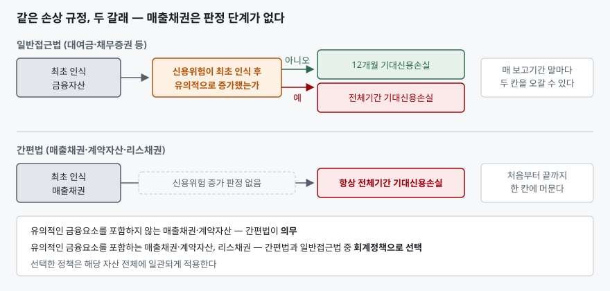
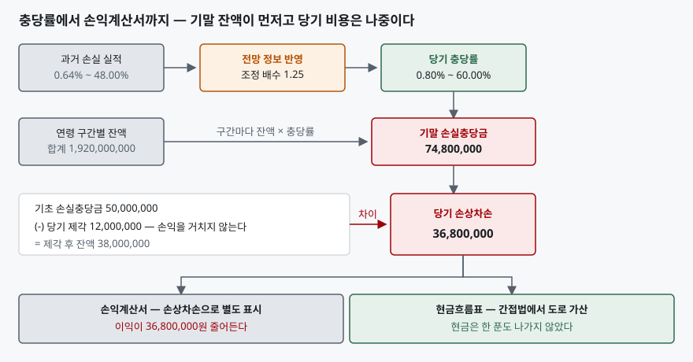

> 예제의 회사와 매출채권 금액, 연체 분포, 과거 손실 실적은 계산을 보이려고 만든 가상 자료다. 실재하는 회사가 아니다. 금액 단위는 원이고, 비교를 흐리지 않으려고 법인세 효과는 뺐다.

## 들어가며

재무상태표 맨 위쪽에서 매출채권 줄을 보면 괄호 안에 작은 숫자가 하나 더 붙어 있다. "매출채권(손실충당금 74,800,000원 차감 후)" 같은 표기다. 숫자가 작으니 보통은 넘긴다. 그런데 같은 업종의 두 회사를 나란히 놓고 매출액과 매출채권 잔액이 비슷한데 한쪽만 영업이익률이 눈에 띄게 낮을 때, 손익계산서를 한 줄씩 내려가다 보면 범인이 이 충당금인 경우가 있다. 더 헷갈리는 것은 충당금이 늘었는데 영업활동 현금흐름은 멀쩡한 해가 있고, 반대로 충당금은 그대로인데 현금흐름이 무너진 해가 있다는 점이다. 둘 다 정상이다. 다만 그 둘을 구분하려면 충당금이 어떤 순서로 계산되고 어느 재무제표에 어떻게 찍히는지를 알아야 한다. 매출채권 줄 하나를 제대로 읽으면 "못 받을 것 같다"는 회사의 판단과 "실제로 돈이 안 들어왔다"는 사실을 갈라서 볼 수 있다.

## 개념

### 손실충당금은 못 받은 돈이 아니라 못 받을 것 같은 돈이다

손실충당금을 "이미 떼인 금액"으로 읽으면 처음부터 어긋난다. 떼인 것이 확정된 금액은 제각(write-off)으로 장부에서 아예 지운다. 손실충당금은 아직 멀쩡히 살아 있는 채권에 대해 **앞으로 못 받을 것으로 예상되는 금액**을 미리 깎아 둔 것이다.

K-IFRS 제1109호는 이 금액을 기대신용손실이라 부르고, 부록 A에서 신용손실을 계약상 받기로 한 현금흐름과 실제로 받을 것으로 예상하는 현금흐름의 차이를 최초 유효이자율로 할인한 금액으로 정의한다. 기대신용손실은 그 신용손실을 **채무불이행 발생 위험으로 가중평균한** 값이다. 여기서 중요한 것은 가중평균이라는 말이다. 특정 거래처가 망할지 안 망할지를 맞히는 것이 아니라, 망할 확률을 반영한 기댓값을 잡는다. 그래서 거래처가 한 곳도 부도나지 않은 해에도 충당금은 0이 아니다.

### 매출채권에는 판정 단계가 없다

제1109호의 손상 규정은 원래 꽤 복잡하다. 금융자산을 최초 인식할 때는 12개월 기대신용손실만 잡아 두고(문단 5.5.5), 신용위험이 최초 인식 후 유의적으로 증가하면 전체기간 기대신용손실로 올린다(문단 5.5.3). 그 판정은 매 보고기간 말마다 다시 하고(문단 5.5.9), 판정 기준은 기대손실 금액의 변동이 아니라 **채무불이행이 일어날 위험의 변동**이다.

매출채권은 이 과정을 통째로 건너뛴다. 문단 5.5.15는 매출채권·계약자산·리스채권에 대해 **항상 전체기간 기대신용손실로** 손실충당금을 측정하도록 하는 간편법을 둔다. 유의적인 금융요소를 포함하지 않는 매출채권과 계약자산은 이 간편법이 선택이 아니라 의무이고, 유의적인 금융요소를 포함하는 매출채권과 리스채권은 간편법과 일반접근법 중 회계정책으로 고른다.

판정 단계를 없앤 이유는 실무적이다. 매출채권은 건수가 많고 회수기간이 짧다. 한 건마다 신용위험이 유의적으로 증가했는지를 따지는 비용이 그렇게 해서 얻는 정확도보다 크다. 어차피 전체기간이 1년도 안 되는 채권이라면 12개월 기대신용손실과 전체기간 기대신용손실이 크게 다르지도 않다.

## 구조



> **출처**: [한국회계기준원 — 기업회계기준서 제1109호 금융상품, 문단 5.5.3 신용위험이 유의적으로 증가한 경우, 문단 5.5.5 12개월 기대신용손실, 문단 5.5.9 유의적 증가의 평가, 문단 5.5.15 매출채권·계약자산·리스채권의 간편법](https://www.kasb.or.kr/front/board/ingAccountingList.do) · 문단 본문은 [K-IFRS 제1109호 전재본](https://accountingwiki.co.kr/standards/1109)에서 확인했다 (제3자 전재).

도식 위아래 두 줄의 차이는 가운데 칸 하나다. 위쪽에는 조건을 따지는 상자가 있고 아래쪽에는 그 자리가 비어 있다. 그 한 칸이 사라지면서 매출채권의 충당금 계산은 "연체가 얼마나 됐는가"만 보면 되는 기계적인 작업이 된다. 그리고 바로 그 기계적인 성격 때문에 설정률표라는 도구가 성립한다.

## 동작 원리

### 충당금 설정률표 — 연체 일수를 손실률로 바꾼다

적용지침 문단 B5.5.35는 문단 5.5.17의 원칙과 일관된다면 기대신용손실을 측정할 때 실무적 간편법을 쓸 수 있다고 하고, 그 예로 **충당금 설정률표**를 든다. 매출채권을 연체 일수 구간으로 나누고 구간마다 충당률을 매긴 다음 잔액에 곱하는 방식이다. 기준서는 연체 없음 1%, 30일 미만 2%처럼 예시 숫자까지 적어 두었지만 그 숫자를 그대로 쓰라는 뜻은 아니다. 같은 문단이 회사의 **과거 손실 경험**에서 출발하되 현재 상황과 미래 전망을 반영해 조정하도록 요구한다.

조정을 요구하는 근거는 문단 5.5.17이다. 기대신용손실은 세 가지를 만족해야 한다. 편의가 없고 **확률로 가중한** 금액일 것, **화폐의 시간가치**를 반영할 것, 그리고 과도한 원가나 노력 없이 이용할 수 있는 **합리적이고 뒷받침될 수 있는 정보**에 기초할 것. 세 번째 요구가 과거 실적만 베껴 쓰는 것을 막는다. 경기가 꺾일 것이 이미 보이는데 호황기의 손실률을 그대로 쓰면 뒷받침될 수 있는 정보를 썼다고 하기 어렵다.

### 기말 잔액이 먼저고 당기 비용은 나중이다

계산 순서를 거꾸로 알고 있으면 숫자가 맞지 않는다. 손익계산서의 손상차손을 먼저 정하고 그것을 충당금에 더하는 것이 아니다. **기말에 있어야 할 손실충당금 잔액을 먼저 구하고, 그 잔액에 맞추려고 필요한 금액이 당기 손상차손으로 떨어진다.**

```text
당기 손상차손 = 기말 필요 충당금 − (기초 충당금 − 당기 제각액)
```

이 식에서 제각이 손익을 거치지 않는다는 점이 따라 나온다. 제각은 매출채권 총액과 손실충당금을 같은 금액만큼 깎으므로 순장부금액을 건드리지 않고, 비용도 아니다. 떼인 비용은 그 채권에 충당금을 쌓던 과거에 이미 인식했다. 제각은 장부 정리일 뿐이다. 그래서 거래처 부도가 크게 터진 해에도 충당금을 충분히 쌓아 두었다면 손익계산서는 조용하다.



> **출처**: [한국회계기준원 — 기업회계기준서 제1109호 금융상품, 문단 5.5.17 기대신용손실 측정의 세 가지 요구, 문단 B5.5.35 충당금 설정률표](https://www.kasb.or.kr/front/board/ingAccountingList.do) · 손익계산서에 손상차손을 별도 표시하는 요구는 [기업회계기준서 제1001호 재무제표 표시 문단 82](https://accountingwiki.co.kr/standards/1001)에 있다 (제3자 전재). 숫자는 이 글의 [`code/output.txt`](code/output.txt) `[2]`~`[5]`에 있다.

## 실습 예제

전체 소스: [`code/`](code/) · 수행 기록: [`code/output.txt`](code/output.txt)

가나전자와 다라물산은 2026년 12월 31일 현재 매출채권 총액이 1,920,000,000원으로 같다. 둘 다 유의적인 금융요소를 포함하지 않는 매출채권이므로 간편법이 의무다.

```text
[2] 과거 손실 실적에서 충당률을 뽑는다 — 전망 조정 배수 1.25
    연령 구간        3년간 구간 통과액     미회수 금액   과거 손실률   당기 충당률
    연체 없음            5,000,000,000      32,000,000         0.64%         0.80%
    30일 이하            1,250,000,000      16,000,000         1.28%         1.60%
    31~90일                625,000,000      30,000,000         4.80%         6.00%
    91~180일               250,000,000      40,000,000        16.00%        20.00%
    180일 초과             125,000,000      60,000,000        48.00%        60.00%
```

왼쪽 두 열이 과거 3년 실적이다. 연체 없음 구간을 거쳐 간 채권 5,000,000,000원 중 끝내 못 받은 금액이 32,000,000원이니 과거 손실률은 0.64%다. 오른쪽 끝의 당기 충당률은 여기에 경기 둔화 전망을 단일 배수 1.25로 얹은 값이다. 배수 하나로 전 구간을 밀어 올리는 방식은 여러 선택지 중 하나이고 기준서가 특정 방법을 정해 두지는 않았다. 중요한 것은 **과거 실적에서 출발했고 전망을 반영했다는 사실을 설명할 수 있어야 한다**는 점이다.

```text
[3] 가나전자 — 충당금 설정률표를 적용한다
    연령 구간            매출채권 잔액      충당률      기대신용손실
    연체 없음            1,200,000,000       0.80%         9,600,000
    30일 이하              400,000,000       1.60%         6,400,000
    31~90일                180,000,000       6.00%        10,800,000
    91~180일                90,000,000      20.00%        18,000,000
    180일 초과              50,000,000      60.00%        30,000,000
    합계                 1,920,000,000                    74,800,000

[4] 다라물산 — 총액은 같고 분포만 다르다
    연령 구간            매출채권 잔액      충당률      기대신용손실
    연체 없음              900,000,000       0.80%         7,200,000
    30일 이하              420,000,000       1.60%         6,720,000
    31~90일                300,000,000       6.00%        18,000,000
    91~180일               180,000,000      20.00%        36,000,000
    180일 초과             120,000,000      60.00%        72,000,000
    합계                 1,920,000,000                   139,920,000

    매출채권 총액은 양쪽 다 1,920,000,000원으로 같은데
    손실충당금은 65,120,000원 더 크다 (1.87배)
```

두 회사의 매출채권 총액이 1원도 다르지 않은데 손실충당금은 1.87배로 갈린다. 매출액이 같다면 매출채권회전율도 같게 나온다. 즉 **비율 지표로는 두 회사가 구분되지 않는다.** 차이는 오직 연령 분포에 있고, 그 분포는 재무제표 본문이 아니라 주석의 연령분석표에 있다. 180일 초과 구간만 봐도 50,000,000원과 120,000,000원이고, 이 구간의 충당률이 60%라 금액 차이 70,000,000원이 그대로 충당금 차이의 대부분을 만든다.

```text
[5] 가나전자 손실충당금 계정 — 당기 손상차손이 거꾸로 구해진다
    기초 손실충당금              50,000,000
    (-) 당기 제각                12,000,000
    (+) 당기 손상차손            36,800,000
    기말 손실충당금              74,800,000
```

기초 50,000,000원에서 제각 12,000,000원을 빼면 38,000,000원이 남는다. 기말에 있어야 할 금액이 74,800,000원이니 모자란 36,800,000원이 당기 손상차손이다. 이 금액이 손익계산서에 들어간다. 제1001호의 포괄손익계산서 표시 항목 열거(문단 82)는 제1109호 제5.5절에 따라 결정된 손상차손을 **별도 항목으로** 들고 있으므로, 다른 판매비와관리비에 섞여 안 보이는 일은 없다.

```text
[6] 현금흐름표 영업활동(간접법) — 같은 답에 이르는 두 방식
    매출채권 총액   기초 1,500,000,000 → 기말 1,920,000,000
    순장부금액      기초 1,450,000,000 → 기말 1,845,200,000

    방식 A — 총액으로 본다
      (+) 손상차손 가산                      36,800,000
      (-) 매출채권 총액 증가(제각 제외)     432,000,000
      순 영향                              -395,200,000

    방식 B — 순장부금액으로 본다
      (+) 손상차손 가산                               0
      (-) 매출채권 순장부금액 증가          395,200,000
      순 영향                              -395,200,000

    틀린 방식 — 순액 증가를 쓰면서 손상차손까지 가산한다
      순 영향                              -358,400,000
      영업활동 현금흐름이 36,800,000원 과대계상된다
```

손상차손은 현금이 나가지 않는 비용이니 간접법에서 당기순이익에 도로 더한다. 여기까지는 감가상각비와 같다. 다른 점은 **같은 거래가 매출채권 증감에도 자국을 남긴다**는 것이다. 그래서 가산과 차감을 짝지어 써야 한다. 손상차손을 더했으면 매출채권은 총액 기준으로 차감하고, 순장부금액 기준으로 차감할 거라면 손상차손을 더하지 않는다. 둘을 섞으면 맨 아래 줄처럼 손상차손 금액만큼 영업활동 현금흐름이 부풀어 오른다. **충당금을 많이 쌓은 회사일수록 이 실수의 효과가 커진다**는 점이 고약하다.

## 실무에서 주의할 점

- **충당금이 늘었다고 거래처가 부실해졌다고 단정하지 않는다.** [2]의 전망 조정 배수 하나만 1.25에서 1.5로 올려도 충당금은 20% 늘어난다. 거래처 구성도 연체 분포도 그대로인데 숫자만 커진다. 주석에서 연령분석표와 구간별 충당률을 함께 봐야 분포가 나빠진 것인지 가정이 보수적으로 바뀐 것인지 가려진다.
- **매출채권회전율만으로는 회수의 질이 안 보인다.** [3]과 [4]의 두 회사는 회전율이 같다. 연체 구간에 얼마가 몰려 있는지는 평균 지표가 지워 버리는 정보이고, [매출채권·재고자산 회전율 글](../2026-10-01-receivables-inventory-turnover/index.md)에서 다룬 지표들이 놓치는 지점이 여기다.
- **제각이 많은 해에 충당금 잔액이 줄어드는 것은 정상이다.** 제각은 충당금을 깎는다. 기말 잔액만 전년과 비교하면 회사가 충당을 덜 쌓은 것처럼 보이지만, [5]처럼 계정 흐름을 펴 보면 당기 손상차손은 오히려 늘었을 수 있다. 주석의 손실충당금 변동표에서 기초·제각·환입·설정·기말을 모두 본다.
- **간접법 조정을 짝지어 쓴다.** [6]의 맨 아래 줄은 실제로 자주 나오는 실수다. 매출채권 증감을 순장부금액으로 집계하는 자동화 양식에 손상차손 가산을 따로 붙이면 그대로 이중 반영된다. 영업활동 현금흐름과 당기순이익의 차이를 설명할 때 조정 항목을 하나씩 짚어 보면 드러난다.
- **"적정 충당률"이라는 기준선은 없다.** 기준서는 과거 실적과 전망에 기초하라고만 하고 몇 퍼센트가 맞다고 정하지 않는다. 업종과 거래처 구성에 따라 적정 수준이 다르므로, 두 회사의 충당률을 비교할 때는 같은 연령 구간끼리 비교하고 거래처 부문이 비슷한지부터 확인한다.

## 정리

- 손실충당금은 떼인 돈이 아니라 못 받을 것으로 예상되는 금액이다. 부도가 한 건도 없어도 0이 되지 않는다.
- 매출채권은 간편법을 쓴다. 신용위험이 유의적으로 증가했는지 따지지 않고 처음부터 전체기간 기대신용손실로 측정한다.
- 충당률은 과거 손실 실적에서 출발해 현재 상황과 미래 전망으로 조정한 값이다. 기준서의 예시 숫자를 그대로 쓰는 것이 아니다.
- 계산 순서는 기말 필요 잔액이 먼저다. 그 잔액에 맞추려고 필요한 금액이 당기 손상차손이고, 제각은 손익을 거치지 않는다.
- 매출채권 총액과 회전율이 같아도 연령 분포가 다르면 충당금은 크게 갈린다. 분포는 주석의 연령분석표에서만 보인다.

## 참고 자료

- [한국회계기준원 — 시행 중인 K-IFRS 기준서 목록](https://www.kasb.or.kr/front/board/ingAccountingList.do) — 기업회계기준서 제1109호·제1001호 원문 발행처. 아래 전재 사이트는 문단을 바로 열기 위한 편의 링크다
- [IFRS Foundation — IFRS 9 Financial Instruments](https://www.ifrs.org/issued-standards/list-of-standards/ifrs-9-financial-instruments/) — 국제회계기준 원문 발행처
- [K-IFRS 제1109호 금융상품 — 문단 5.5.1 손실충당금 인식, 문단 5.5.3·5.5.5 전체기간과 12개월, 문단 5.5.9 신용위험 증가 평가, 문단 5.5.15 간편법, 문단 5.5.17 측정 요구](https://accountingwiki.co.kr/standards/1109) (제3자 전재)
- [K-IFRS 제1109호 부록 — 문단 B5.5.35 충당금 설정률표, 부록 A 신용손실·기대신용손실의 정의](https://accountingwiki.co.kr/standards/1109/b) (제3자 전재)
- [K-IFRS 제1001호 재무제표 표시 — 문단 82 포괄손익계산서에 표시할 항목, 그중 (2-1) 제1109호 제5.5절에 따른 손상차손](https://accountingwiki.co.kr/standards/1001) (제3자 전재)
