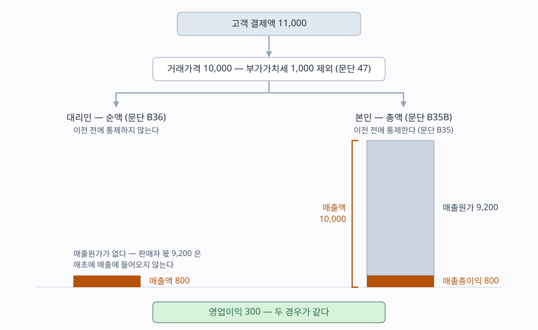

> 예제의 `가나플랫폼`·`다라커머스`·`마바여행`과 그 숫자는 계산을 보이려고 만든 가상 자료다. 단위는 백만원이다. K-IFRS 제1115호는 2018년 1월 1일 이후 최초로 시작되는 회계연도부터 적용됐다(문단 C1).

## 들어가며

쇼핑 앱 두 개를 깔아 쓰다 보면 둘이 거의 같아 보인다. 같은 화면에서 주문하고, 같은 택배로 받고, 반품도 같은 자리에서 누른다. 그런데 두 회사의 사업보고서를 나란히 열면 매출액이 한 자릿수 배수로 차이 난다. 보통은 여기서 "한쪽이 훨씬 큰 회사구나" 하고 접거나, 매출액을 분모로 쓰는 지표를 그대로 비교해 한쪽이 수익성이 좋다고 읽는다. 두 해석 모두 틀릴 수 있다. 회사가 그 거래에서 본인인지 대리인인지에 따라 똑같은 거래가 매출액 10,000으로도, 800으로도 찍히기 때문이다. 어느 쪽이 맞는 숫자냐가 아니라, 둘 다 기준서가 시키는 대로 쓴 숫자다.

## 개념

### 매출액은 "회사가 받을 권리를 갖는 금액"이다

K-IFRS 제1115호는 고객에게 약속한 재화나 용역을 이전하는 것을 나타내도록, 그 대가로 받을 권리를 갖게 될 것으로 예상하는 금액으로 수익을 인식하게 한다(문단 2). 거래가격을 정의하는 문단은 여기에 한 가지를 더 붙인다. 제삼자를 대신해서 회수한 금액은 거래가격에서 뺀다(문단 47). 부가가치세가 대표적이다. 고객이 11,000을 결제했어도 그중 1,000이 국가를 대신해 받아 납부하는 세금이면 회사의 매출액은 10,000이다.

본인·대리인 판단은 이 원칙을 한 번 더 적용한 것이다. 고객이 낸 돈 가운데 판매자에게 그대로 넘겨줄 몫이 "제삼자를 대신해 회수한 금액"에 가깝다면, 그 몫은 애초에 회사의 매출이 아니다.

### 판단의 기준은 통제다

고객에게 재화나 용역을 제공하는 데 다른 당사자가 관여하면, 회사는 자기가 한 약속의 성격을 가려야 한다(문단 B34). 정해진 재화나 용역 자체를 제공하기로 한 것이면 본인이고, 다른 당사자가 제공하도록 주선하기로 한 것이면 대리인이다. 판단은 계약 전체가 아니라 **고객에게 약속한 정해진 재화나 용역 각각에 대해** 한다. 그래서 한 계약 안에서 어떤 품목은 본인이고 다른 품목은 대리인일 수 있다.

가르는 선은 통제다. 고객에게 이전되기 전에 회사가 그 재화나 용역을 통제하면 본인이다(문단 B35). 그래서 절차는 두 단계가 된다. 고객에게 제공될 정해진 재화나 용역을 먼저 식별하고, 그것이 이전되기 전에 회사가 통제하는지를 판단한다(문단 B34A).

통제한다고 보는 형태를 기준서는 세 가지로 든다(문단 B35A). 다른 당사자에게서 받아 그대로 고객에게 넘기는 재화나 자산, 다른 당사자가 수행할 용역에 대한 권리로서 회사가 그 당사자에게 고객 용역 제공을 지시할 수 있는 것, 그리고 이후 고객에게 공급하면서 다른 재화나 용역과 결합하는 것이다. 셋째가 여행 상품이나 시공 계약처럼 여러 공급자의 산출물을 하나로 묶어 파는 경우다.

판단이 갈리면 금액이 갈린다. 본인이면 대가의 총액을 수익으로 인식하고(문단 B35B), 대리인이면 주선의 대가로 받을 보수나 수수료 금액을 수익으로 인식한다(문단 B36).

## 구조



> **출처**: [K-IFRS 제1115호 고객과의 계약에서 생기는 수익 — 문단 47 거래가격, B35 통제, B35B 본인의 총액 인식, B36 대리인의 수수료 인식](https://accountingwiki.co.kr/standards/1115) (제3자 전재). 숫자는 이 글의 [`code/output.txt`](code/output.txt) `[1]`·`[2]`에 있다.

기둥의 높이 차이가 이 글의 전부다. 왼쪽은 회사에 남는 몫만 매출이 되고, 오른쪽은 판매자에게 넘어갈 몫까지 한 번 매출을 거쳐 매출원가로 빠져나간다. 기둥 높이는 12.5배 차이 나지만 맨 아래 영업이익은 같다.

## 동작 원리

### 지표 셋은 통제 판단을 뒷받침하는 것이지 대신하지 않는다

통제하고 있음을 나타내는 지표로 기준서는 셋을 든다(문단 B37). 정해진 재화나 용역을 제공하기로 한 약속을 이행할 **주된 책임**이 회사에 있는가. **재고위험**이 회사에 있는가 — 고객에게 이전되기 전이든, 반품권처럼 이전된 뒤든. 그리고 가격을 결정할 **재량**이 회사에 있는가.

중요한 것은 이 셋의 성격이다. 문단 B37은 지표에 "이에 한정되지는 않는다"를 붙였고, 문단 B37A는 각 지표가 재화나 용역의 특성과 계약 조건에 따라 더 적합할 수도 덜 적합할 수도 있다고 적는다. 세 칸을 세어 둘 이상이면 본인이라고 정하는 표가 아니다. 판단은 어디까지나 문단 B35의 통제이고, 지표는 그 판단을 뒷받침하는 증거다.

가격 결정 재량에는 단서도 붙는다. 대리인도 추가 수익을 얻으려고 가격에 어느 정도 융통성을 가질 수 있다. 할인 쿠폰을 회사가 자기 돈으로 뿌린다고 해서 그것만으로 본인이 되지 않는다.

### 영업이익은 왜 움직이지 않는가

총액으로 쓰면 매출액과 매출원가가 같은 금액만큼 커진다. 판매자에게 줄 9,200이 매출에 들어오고 매출원가로 나가므로 매출총이익은 둘 다 800이다. 판매비와관리비가 같다면 영업이익도 같다. 판단이 바꾸는 것은 손익계산서의 **윗줄 두 개**이고, 세 번째 줄부터는 같다.

그래서 이 판단은 이익을 늘리지 않는다. 늘리는 것은 매출액, 그리고 매출액을 분모나 분자로 쓰는 모든 지표다.

## 실습 예제

가나플랫폼은 판매자와 구매자를 잇는 오픈마켓이고, 다라커머스는 같은 상품을 직접 사들여 판다. 두 회사의 한 해 고객 결제액이 11,000으로 같고, 판매자·공급자 몫 9,200과 판매비와관리비 500도 같다. 전체 소스: [`code/`](code/) · 수행 기록: [`code/output.txt`](code/output.txt)

```text
[2] 같은 거래를 두 방식으로 — 매출액만 갈리고 영업이익은 같다
                      가나플랫폼(대리인)  다라커머스(본인)          차이
                         순액 — 문단 B36  총액 — 문단 B35B
  매출액                             800            10,000        +9,200
  매출원가                             0             9,200        +9,200
  매출총이익                         800               800            +0
  판매비와관리비                     500               500            +0
  영업이익                           300               300            +0
```

매출액은 12.5배, 매출원가는 9,200 차이가 나지만 매출총이익 아래로는 한 칸도 다르지 않다.

```text
[3] 매출액을 분모로 쓰는 지표가 갈리는 폭
  매출총이익률                        100.0%              8.0%        12.5배
  매출액영업이익률                     37.5%              3.0%        12.5배
  거래가격 대비 영업이익률              3.0%              3.0%          같다
```

가나플랫폼의 매출총이익률 100%는 장사를 잘해서 나온 숫자가 아니다. 매출원가로 뺄 것이 애초에 매출에 들어오지 않아서 나온 숫자다. 두 회사를 같은 자로 재려면 분모를 매출액이 아니라 거래가격으로 바꿔야 하고, 그 순간 둘 다 3.0%로 만난다.

```text
[4] 거래액을 고정하고 직매입 비중만 올릴 때 — 매출은 늘고 이익은 그대로
  직매입 비중      직매입 매출   중개 수수료        매출액    매출총이익    영업이익
  10%                    1,000           720         1,720           800         300
  20%                    2,000           640         2,640           800         300
  30%                    3,000           560         3,560           800         300
  40%                    4,000           480         4,480           800         300
```

한 회사가 중개와 직매입을 함께 하면 매출액은 사업 규모가 아니라 **구성비**를 따라 움직인다. 거래가격 10,000이 네 경우 모두 같고 영업이익도 300으로 같은데, 매출액만 1,720에서 4,480까지 160% 늘었다. 직매입 품목을 늘리는 결정은 재고위험을 떠안는 결정이기도 하므로 사업적으로는 의미가 있지만, 그 의미가 매출 성장률에 찍히는 배수와 같지는 않다.

```text
[5] 문단 B37 의 세 가지 지표를 적용한 판단
  거래 형태                       주된 책임   재고위험    가격 재량   근거        판단
  가나플랫폼 — 오픈마켓 중개      판매자      판매자      판매자      B35·B37     대리인
  다라커머스 — 직매입 판매        회사        회사        회사        B35·B37     본인
  마바여행 — 항공·숙박 묶음 상품  회사        회사        회사        B35A(3)     본인
```

마바여행은 항공권과 숙박을 각각 사서 하나의 여행 상품으로 묶어 판다. 항공권만 떼어 보면 통제한다고 말하기 어렵지만, 고객에게 약속한 정해진 용역이 "묶인 여행 상품"이면 그것을 결합하는 쪽은 회사다(문단 B35A(3)). 식별 단계에서 무엇을 약속했는지가 먼저 정해져야 통제 판단이 따라온다는 것이 문단 B34A의 순서다.

## 실무에서 주의할 점

- **매출액으로 회사 크기를 재지 않는다.** 같은 거래 규모에서 매출액이 12.5배 갈리는 것이 [2]다. 중개업·유통업·광고 대행·여행업처럼 다른 당사자가 끼는 사업은 총액·순액 판단이 다르면 매출액이 비교 가능한 숫자가 아니다. 회사들이 거래액·총거래금액 같은 비재무 지표를 따로 공시하는 것도 이 때문인데, 이 지표는 기준서가 정의한 것이 아니므로 산정 방식이 회사마다 다르다. 산정 기준을 확인하고 쓴다.
- **매출액을 분모로 쓰는 지표는 분모가 같은지부터 본다.** 매출총이익률, 매출액영업이익률, 매출액 대비 연구개발비 비율이 모두 영향을 받는다. [3]처럼 분모를 거래가격으로 바꾸면 두 회사가 같은 값에서 만나는 경우가 있다.
- **회계정책이 바뀌면 매출 성장률이 끊긴다.** 사업 모델을 바꾸거나, 같은 거래에 대한 본인·대리인 판단을 다시 해서 총액에서 순액으로(또는 반대로) 옮기면 그 해 매출액이 계단처럼 움직인다. 기준서는 수행의무 이행 시기와 거래가격 결정에 쓴 판단을 공시하게 하므로(문단 123), 매출이 크게 움직인 해에는 회계정책 주석을 먼저 본다. [주석과 감사의견을 읽는 법](../2026-10-01-notes-and-audit-opinion/index.md)에서 본 순서가 여기서도 그대로 쓰인다.
- **지표 세 칸을 다수결로 세지 않는다.** 문단 B37A가 지표마다 적합성이 다르다고 적어 둔 이유다. 재고위험이 없어도 통합 용역을 제공하면 본인일 수 있고, 가격을 정해도 대리인일 수 있다.
- **한 계약 안에서도 판단이 갈린다.** 문단 B34는 정해진 재화나 용역 각각에 대해 판단하라고 한다. 상품은 직매입이고 배송은 중개인 계약이면 한쪽은 총액, 다른 쪽은 순액이 된다. 회사 단위로 "이 회사는 대리인"이라고 묶어 두면 틀린다.

## 정리

- 매출액은 받은 돈이 아니라 회사가 받을 권리를 갖는 금액이고, 제삼자를 대신해 회수한 금액은 빠진다(문단 47).
- 고객에게 이전되기 전에 회사가 그 재화·용역을 통제하면 본인이고 총액, 아니면 대리인이고 수수료만 순액으로 인식한다(문단 B35·B35B·B36).
- 지표 셋(주된 책임·재고위험·가격 결정 재량)은 통제 판단을 뒷받침하는 증거이지 체크리스트가 아니다(문단 B37·B37A).
- 판단이 바꾸는 것은 매출액과 매출원가뿐이고 매출총이익 아래로는 같다. 그래서 매출액 기준 지표만 갈린다.
- 거래액이 같아도 직매입 비중이 바뀌면 매출액이 움직인다. 매출 성장률을 사업 성장으로 바로 읽지 않는다.

## 참고 자료

- [한국회계기준원 — 시행 중인 K-IFRS 기준서 목록](https://www.kasb.or.kr/front/board/ingAccountingList.do) — 기업회계기준서 제1115호 고객과의 계약에서 생기는 수익 원문 발행처. 아래 전재 사이트는 문단을 바로 열기 위한 편의 링크다
- [IFRS Foundation — IFRS 15 Revenue from Contracts with Customers](https://www.ifrs.org/issued-standards/list-of-standards/ifrs-15-revenue-from-contracts-with-customers/) — 국제회계기준 원문 발행처
- [K-IFRS 제1115호 — 문단 2 핵심 원칙, 47 거래가격, 123 공시, B34·B34A 본인·대리인 판단, B35 통제, B35A 통제하는 재화·용역의 예, B35B 총액 인식, B36 순액 인식, B37·B37A 통제 지표, C1 최초 적용일](https://accountingwiki.co.kr/standards/1115) (제3자 전재)
- [수익 인식 5단계 — 묶어 판 상품의 매출은 언제 얼마씩 잡히는가](../2026-10-10-revenue-recognition-five-steps/index.md) — 같은 기준서의 5단계를 거래가격 배분 쪽에서 다룬 글
