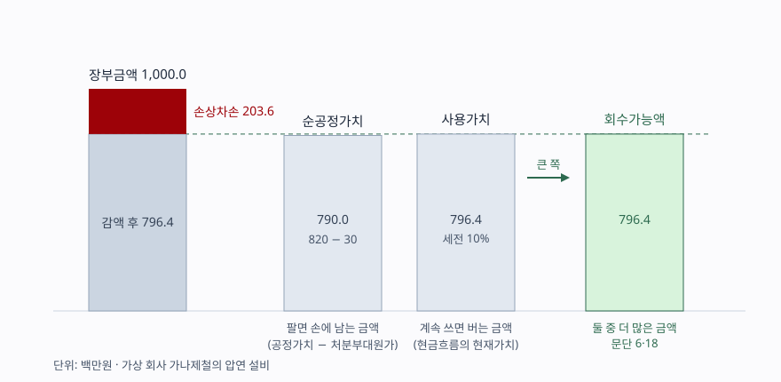
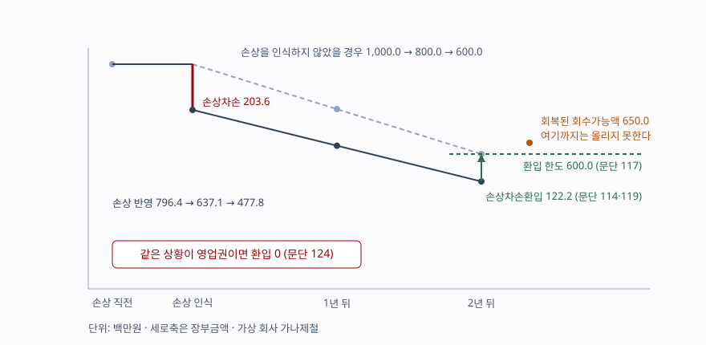

> 예제의 `가나제철`과 그 숫자는 계산을 보이려고 만든 가상 자료다. 단위는 백만원이다. 법인세와 이연법인세는 없다고 두었다.

## 들어가며

제조업 회사의 손익계산서에서 영업이익은 흑자인데 당기순이익이 크게 적자로 돌아선 해가 있다. 주석을 열면 유형자산손상차손 몇백억이라는 줄이 하나 있다. 보통은 여기서 "설비를 팔았나" 하고 넘어가거나, 그해 현금이 그만큼 빠져나간 것으로 읽는다. 둘 다 아니다. 설비는 그대로 공장에 있고 현금은 한 푼도 나가지 않았다. 바뀐 것은 그 설비로 앞으로 벌어들일 금액에 대한 회사의 추정뿐이다. 그 추정이 어떤 두 숫자를 비교해서 나오는지 알면, 그 적자가 사업이 꺾인 신호인지 회계 추정을 바꾼 결과인지 가릴 수 있다.

## 개념

### 손상은 "장부에 적힌 값만큼 못 거둔다"는 판단이다

K-IFRS 제1036호는 보고기간 말마다 자산손상 징후가 있는지 검토하게 한다(문단 9). 징후는 외부와 내부로 나뉜다(문단 12). 자산 가치가 눈에 띄게 하락했거나, 기술·시장·경제·법률 환경이 회사에 불리하게 바뀌었거나, 시장이자율이 올라 할인율에 영향을 줄 것으로 보이거나, 순자산 장부금액이 시가총액보다 큰 경우가 외부 징후다. 진부화나 물리적 손상, 자산의 사용 범위나 방법이 불리하게 바뀐 것, 내부보고에서 경제적 성과가 기대에 못 미치는 것이 내부 징후다.

징후가 없어도 해마다 검사해야 하는 자산이 있다(문단 10). 내용연수가 비한정인 무형자산, 아직 사용할 수 없는 무형자산, 그리고 사업결합으로 취득한 영업권이다. 유형자산은 여기에 들지 않으므로 징후가 있을 때만 회수가능액을 추정한다.

### 회수가능액 — 팔 때와 쓸 때 중 나은 쪽

회수가능액은 **공정가치에서 처분부대원가를 뺀 금액과 사용가치 중 더 많은 금액**이다(문단 6·18). 큰 쪽을 쓰는 이유는 분명하다. 회사는 그 자산을 팔 수도 있고 계속 쓸 수도 있으므로, 합리적으로 행동한다면 둘 중 더 나은 쪽을 고른다. 팔아서 790을 거둘 수 있다면 796을 벌어 주는 설비를 790에 팔지 않고, 반대로 계속 써서 757밖에 못 버는 설비라면 790에 파는 쪽을 택한다. 기준서가 큰 쪽을 회수가능액으로 정한 것은 그 선택지를 자산 가치에 반영한 것이다.

여기서 바로 따라오는 규칙이 하나 있다. 둘 중 하나가 이미 장부금액을 넘으면 그 자산은 손상되지 않았으므로 다른 하나를 추정할 필요가 없다(문단 19). 사용가치 추정은 품이 많이 드는 작업이므로 이 순서가 실무에서 의미가 있다.

### 사용가치는 현금흐름을 할인한 값이다

사용가치 측정은 두 단계다(문단 31). 계속 사용과 최종 처분에서 생길 미래현금유입과 유출을 추정하고, 그 현금흐름에 적절한 할인율을 적용한다. 추정에 반영할 요소는 문단 30이 든다. 미래현금흐름 추정치, 그 금액과 시기의 가능한 변동, 화폐의 시간가치, 불확실성을 떠안는 데 대한 가격, 비유동성 같은 그 밖의 요소다.

제약이 둘 붙는다. 재무예산이나 예측에 기초한 추정 대상 기간은 더 긴 기간이 정당화되지 않으면 최장 5년이고(문단 33(2)), 그 뒤 기간에 적용하는 성장률은 고정되거나 하락한다고 가정하며 장기 평균성장률을 넘을 수 없다(문단 33(3)·36). 성장률이 영이나 음수가 적절한 경우도 있다.

그리고 현금흐름에서 빼는 것이 둘 있다. 재무활동에서 생기는 현금유입·유출과 법인세환급액·법인세납부액이다(문단 50). 그래서 할인율도 세전이다(문단 55). 세후 현금흐름에 세후 할인율을 쓰는 평가 관행과 다른 지점이므로 주석의 가정을 읽을 때 세전인지 먼저 확인한다.

## 구조



> **출처**: [K-IFRS 제1036호 자산손상 — 문단 6 회수가능액·순공정가치의 정의, 18 둘 중 더 많은 금액, 59 손상차손의 인식](https://accountingwiki.co.kr/standards/1036) (제3자 전재). 숫자는 이 글의 [`code/output.txt`](code/output.txt) `[2]`에 있다.

두 기둥의 높이가 가까울수록 어느 쪽을 쓰느냐가 손상차손을 크게 바꾼다. 이 예제에서 둘의 차이는 6.4이고, 그만큼이 그대로 손상차손의 차이가 된다.

## 동작 원리

### 손상차손을 인식한 뒤에는 감가상각이 줄어든다

회수가능액이 장부금액에 못 미치면 장부금액을 회수가능액으로 감액하고(문단 59), 그 감액분을 곧바로 당기손익으로 인식한다(문단 60). 재평가모형을 적용하는 자산이면 재평가잉여금을 먼저 줄인다는 예외가 있다.

감액이 끝이 아니다. 손상차손을 인식한 뒤에는 수정된 장부금액에서 잔존가치를 뺀 금액을 남은 내용연수에 걸쳐 배분하도록 감가상각액을 조정한다(문단 63). 장부금액이 줄었으니 해마다 떨어지는 감가상각비도 줄어든다. 손상을 인식한 해에 비용이 몰리고 그다음 해부터는 비용이 가벼워지는 구조다. 설비를 다 쓸 때까지 더하면 두 경로의 비용 총액은 같다.

### 환입에는 천장이 있다

상황이 나아지면 손상차손을 되돌릴 수 있다. 보고기간 말마다 과거에 인식한 손상차손이 더는 존재하지 않거나 감소했을 수 있는 징후를 검토하고(문단 110·111), 회수가능액을 산정할 때 사용한 추정치가 달라진 경우에만 환입한다(문단 114). 환입액은 곧바로 당기손익으로 인식한다(문단 119).

천장은 문단 117이다. 환입으로 늘어나는 장부금액은 **과거에 손상차손을 인식하지 않았더라면 기록되었을 장부금액**, 곧 그동안의 감가상각을 반영한 금액을 넘을 수 없다. 회수가능액이 그보다 더 올라가도 그 위로는 올리지 못한다. 손상 회계가 자산을 다시 평가해 올리는 통로가 되지 않게 막아 둔 선이다.

영업권은 아예 다르다. 영업권에 인식한 손상차손은 후속 기간에 환입하지 않는다(문단 124). 같은 회수가능액 회복이 설비에서는 이익이 되고 영업권에서는 아무 일도 아니다. [영업권 글](../2026-10-10-goodwill-impairment-test/index.md)에서 본 손상차손 배분 순서와 함께 보면 영업권이 왜 한 방향으로만 깎이는지가 이어진다.

## 실습 예제

가나제철의 압연 설비는 취득원가 1,500, 감가상각누계액 500으로 장부금액이 1,000이고 잔존내용연수가 5년이다. 주요 제품의 시장이 축소되어 손상 징후가 생겼다. 전체 소스: [`code/`](code/) · 수행 기록: [`code/output.txt`](code/output.txt)

```text
[2] 회수가능액 — 둘 중 큰 금액 (문단 6·18)
  공정가치                               820.0
  처분부대원가                           -30.0
  순공정가치                             790.0
  사용가치 (세전 할인율 10%)             796.4
  회수가능액 — 큰 쪽은 사용가치          796.4
  장부금액                             1,000.0
  손상차손 (문단 59·60)                  203.6
```

순공정가치만 보고 끊었다면 손상차손이 210.0이 되어 6.4만큼 더 깎였을 것이다. 계속 쓰는 편이 파는 편보다 나으므로 회수가능액은 사용가치다.

```text
[3] 사용가치의 내역 — 세전 현금흐름을 세전 할인율로 할인한다 (문단 31·50·55)
  연도       사용 현금흐름   처분 현금흐름    현가계수      현재가치
  1년차              220.0             0.0      0.9091         200.0
  2년차              210.0             0.0      0.8264         173.6
  3년차              200.0             0.0      0.7513         150.3
  4년차              190.0             0.0      0.6830         129.8
  5년차              180.0            50.0      0.6209         142.8
  합계                                                         796.4
```

5년 말의 처분 현금흐름 50이 마지막 줄에 들어가 있다. 계속 사용에서 나오는 현금뿐 아니라 최종 처분에서 받을 현금도 사용가치에 넣는다는 것이 문단 31의 (1)이다.

```text
[4] 할인율이 바뀌면 손상차손이 갈린다 (문단 55)
  세전 할인율         사용가치    순공정가치    회수가능액       큰 쪽      손상차손
  8%                     838.7         790.0         838.7    사용가치         161.3
  10%                    796.4         790.0         796.4    사용가치         203.6
  12%                    757.5         790.0         790.0  순공정가치         210.0
```

할인율을 2%p 올리면 사용가치가 순공정가치 아래로 내려가, 회수가능액을 정하는 쪽이 바뀐다. 바뀌고 나면 할인율을 더 올려도 손상차손은 210.0에서 멈춘다. 순공정가치가 바닥을 받치기 때문이다. 손상차손 금액이 할인율 가정 하나에 161.3에서 210.0까지 움직인다는 사실 자체가, 이 숫자를 읽을 때 주석의 가정을 같이 봐야 하는 이유다.

```text
[5] 한쪽이 장부금액을 넘으면 다른 쪽을 추정하지 않는다 (문단 19)
  장부금액이 700.0 인 설비라면
    순공정가치                           790.0
    장부금액                             700.0
    순공정가치가 장부금액을 넘는다   → 손상되지 않았다
    사용가치                         추정하지 않는다
```

같은 설비라도 장부금액이 700이면 순공정가치 하나만으로 결론이 난다. 5년치 현금흐름을 추정하고 할인율을 정하는 작업이 통째로 빠진다.

```text
[6] 손상 인식 후 감가상각은 수정된 장부금액 기준이다 (문단 63)
  연도         손상 없었을 때 비용     손상 인식 시 비용          차이
  손상 연도                    0.0                 203.6         203.6
  1년차                      200.0                 159.3         -40.7
  2년차                      200.0                 159.3         -40.7
  3년차                      200.0                 159.3         -40.7
  4년차                      200.0                 159.3         -40.7
  5년차                      200.0                 159.3         -40.7
```

손상 연도에 203.6을 한 번에 털고 이후 5년 동안 해마다 40.7씩 비용이 줄어든다. 손상차손이 난 해의 이익만 보면 사업이 급격히 나빠진 것처럼 보이지만, 이듬해부터는 같은 사업에서 이익이 더 커 보인다. 손상 직후 몇 년의 이익률 개선을 사업 개선으로 읽으면 틀린다.

```text
[7] 환입과 그 한도 (문단 114·117·119·124)
  2년 뒤 손상 반영 장부금액                    477.8
  회복된 회수가능액                            650.0
  손상차손을 인식하지 않았을 경우의 장부금액         600.0
  환입 한도 — 둘 중 작은 쪽 (문단 117)         600.0
  손상차손환입 (문단 114·119)                  122.2
  한도가 없었다면 올릴 수 있었던 금액          172.2
```



> **출처**: [K-IFRS 제1036호 자산손상 — 문단 114 손상차손환입, 117 환입 한도, 119 당기손익 인식, 124 영업권 환입 금지](https://accountingwiki.co.kr/standards/1036) (제3자 전재). 숫자는 이 글의 [`code/output.txt`](code/output.txt) `[7]`에 있다.

회수가능액이 650까지 회복됐어도 장부금액은 600까지만 올라간다. 환입액 122.2는 회복분 172.2에서 한도에 걸린 50을 뺀 금액이다. 같은 상황이 영업권이면 환입액은 0이다.

## 실무에서 주의할 점

- **손상차손은 현금이 나간 비용이 아니다.** 현금흐름표의 영업활동 현금흐름에서 손상차손은 당기순이익에 다시 더해지는 비현금 항목이다. 이익은 적자인데 영업활동 현금흐름은 그대로인 해가 여기서 나온다. [이익과 현금이 갈리는 자리](../2026-09-30-cash-flow-profit-without-cash/index.md)에서 본 조정 항목에 손상차손이 들어간다.
- **금액보다 가정을 먼저 본다.** [4]에서 보듯 할인율 2%p 차이로 손상차손이 48.7 움직인다. 기준서는 손상차손이나 환입을 인식한 자산에 대해 회수가능액이 순공정가치인지 사용가치인지, 사용가치라면 적용한 할인율을 공시하게 한다(문단 130(5)·(7)). 영업권이나 비한정 내용연수 무형자산이 배분된 현금창출단위에는 추정 기간이 5년을 넘을 때의 정당화 사유와 성장률, 할인율까지 공시 대상이다(문단 134(4)). 손상차손 금액만 보고 사업을 판단하지 않는다.
- **손상 다음 해의 이익 개선을 사업 개선으로 읽지 않는다.** [6]에서 감가상각비가 해마다 40.7 줄어든다. 영업이익률이 올라간 것처럼 보이지만 매출도 원가 구조도 그대로다. 손상 이력이 있는 회사는 몇 년치 감가상각비 추이를 같이 본다.
- **환입 한도 때문에 손상은 완전히 되돌아오지 않는다.** [7]에서 650까지 회복됐어도 600까지만 올라간다. 설비가 다시 제값을 하게 돼도 재무상태표는 손상 전 궤적으로 돌아가지 않는다.
- **영업권인지 유형자산인지 먼저 가린다.** 환입 가능 여부가 정반대다(문단 114 대 124). 손상차손 주석에서 어느 자산에 얼마가 잡혔는지를 나눠 봐야 앞으로 되돌아올 수 있는 금액인지 판단할 수 있다.
- **개별 자산으로 쪼갤 수 없으면 현금창출단위로 묶는다.** 생산라인 한 대의 현금흐름을 따로 뽑을 수 없는 공정이 흔하다. 그럴 때는 그 자산이 속한 현금창출단위의 회수가능액을 산정한다(문단 22·66). 묶는 범위를 어떻게 잡느냐에 따라 손상 여부가 달라지므로, 공시된 단위 구분을 확인한다.

## 정리

- 회수가능액은 순공정가치와 사용가치 중 **더 많은 금액**이고, 장부금액이 그보다 크면 차액이 손상차손이다(문단 6·18·59).
- 둘 중 하나가 이미 장부금액을 넘으면 손상되지 않은 것이므로 다른 하나는 추정하지 않는다(문단 19).
- 사용가치는 세전 현금흐름을 세전 할인율로 할인한 값이고, 추정 기간은 원칙적으로 최장 5년이다(문단 31·33·50·55).
- 손상을 인식하면 그 뒤 감가상각비가 줄어든다. 손상 연도에 비용이 몰리고 이후 해의 이익이 커 보인다(문단 63).
- 환입은 손상차손을 인식하지 않았을 경우의 장부금액까지만 가능하고, 영업권은 아예 환입하지 않는다(문단 117·124).

## 참고 자료

- [한국회계기준원 — 시행 중인 K-IFRS 기준서 목록](https://www.kasb.or.kr/front/board/ingAccountingList.do) — 기업회계기준서 제1036호 자산손상 원문 발행처. 아래 전재 사이트는 문단을 바로 열기 위한 편의 링크다
- [IFRS Foundation — IAS 36 Impairment of Assets](https://www.ifrs.org/issued-standards/list-of-standards/ias-36-impairment-of-assets/) — 국제회계기준 원문 발행처
- [K-IFRS 제1036호 — 문단 6 정의, 9·10·12 손상검사와 징후, 18·19 회수가능액 산정, 22·66 현금창출단위, 30·31 사용가치, 33·36 추정 기간과 성장률, 50 제외하는 현금흐름, 55 세전 할인율, 59·60·63 손상차손과 이후 감가상각, 110·111·114·117·119 환입, 124 영업권 환입 금지, 126 금액 공시, 130 자산·현금창출단위별 공시, 134 영업권 배분 단위의 가정 공시](https://accountingwiki.co.kr/standards/1036) (제3자 전재)
- [영업권 — 인수 대가가 순자산보다 클 때 남는 숫자와 손상검사](../2026-10-10-goodwill-impairment-test/index.md) — 같은 기준서를 영업권 쪽에서 다룬 글
