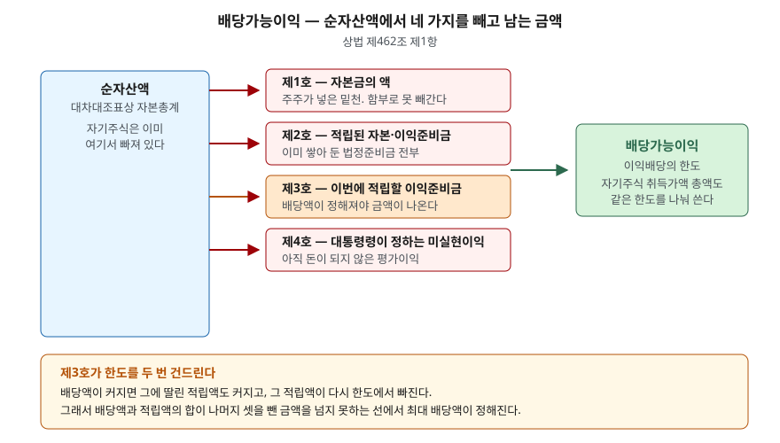
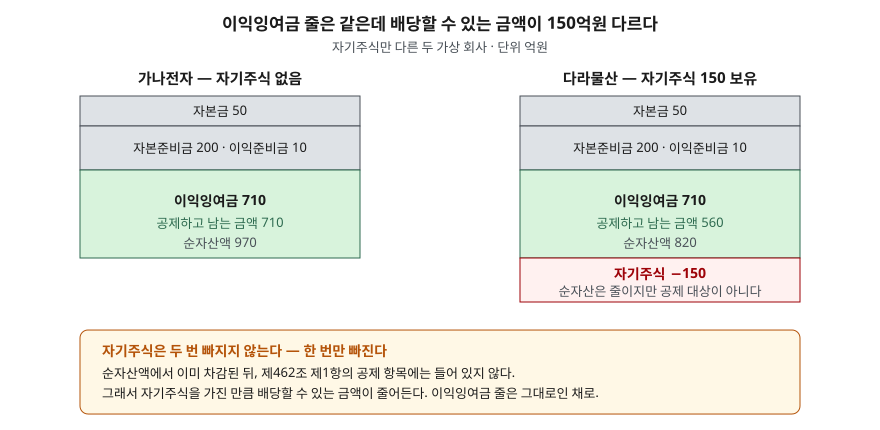

## 들어가며

배당을 얼마나 줄 수 있는 회사인지 가늠하려고 재무상태표를 펼쳤다고 하자. 이익잉여금
줄에 710억원이 찍혀 있다. 시가총액은 1,500억원이다. 이쯤 되면 "쌓아 둔 게 710억원이니
마음만 먹으면 꽤 줄 수 있겠다"는 계산이 선다.

그런데 같은 해 다른 회사의 재무상태표를 열었더니 이익잉여금이 똑같이 710억원인데
사업보고서가 밝힌 배당가능이익은 545억원이다. 165억원이 어디로 샜는지 재무상태표
어디를 봐도 그 숫자가 없다.

**이익잉여금 잔액은 배당 한도가 아니다.** 배당 한도는 상법이 따로 정한 계산식의 결과이고,
그 식은 재무상태표의 한 줄이 아니라 여러 줄을 건드린다. 그 식을 항목별로 뜯어 본다.

## 개념

상법 제462조 제1항은 회사가 배당할 수 있는 금액의 상한을 정한다. 대차대조표상
순자산액에서 네 가지를 뺀 금액이 그 한도다.

| 호 | 빼는 것 | 왜 빼는가 |
|---|---|---|
| 제1호 | 자본금의 액 | 주주가 넣은 밑천. 배당으로 돌려주면 회사의 밑천이 깎인다 |
| 제2호 | 그 결산기까지 적립된 자본준비금과 이익준비금의 합계액 | 법이 쌓아 두라고 한 몫. 채권자가 기대는 금액이다 |
| 제3호 | 그 결산기에 적립하여야 할 이익준비금의 액 | 이번 배당 때문에 새로 쌓아야 하는 몫 |
| 제4호 | 대통령령으로 정하는 미실현이익 | 아직 돈이 되지 않은 평가이익 |

식의 성격은 하나다. **회사가 번 돈 중에서, 채권자 몫으로 묶어 두기로 한 금액을 빼고
남은 것만 주주에게 보낸다.** 주식회사는 주주가 회사 빚을 책임지지 않으므로, 채권자가
믿을 것은 회사에 남아 있는 재산뿐이다. 배당 한도는 그 재산이 한 번에 빠져나가지
못하게 막는 울타리다.

결정 주체도 같은 조가 정한다. 이익배당은 주주총회 결의로 정하되, 정관에 따라
재무제표를 이사회가 승인하는 회사는 이사회 결의로 정한다(제2항). 한도를 넘겨 배당하면
회사채권자가 그 이익을 회사에 반환하라고 청구할 수 있다(제3항).

## 구조



> **출처**: [상법 제462조 이익의 배당](https://casenote.kr/%EB%B2%95%EB%A0%B9/%EC%83%81%EB%B2%95/%EC%A0%9C462%EC%A1%B0) (제3자 전재, 법률 제10600호, 2012-04-15 시행) — 원문 발행처 [국가법령정보센터](https://www.law.go.kr/)

도식에서 제3호만 색이 다르다. 나머지 셋은 결산을 마치면 금액이 정해져 있지만, 제3호는
**배당액이 정해져야 금액이 나온다.** 배당을 많이 하면 적립할 이익준비금도 많아지고,
그 적립액이 다시 한도에서 빠진다. 한도가 배당액에 두 번 닿는 셈이다. 이것이 뒤에서
한도를 10/11로 깎는다.

제4호의 미실현이익은 범위가 대통령령에 위임되어 있다. 이 글은 상법 시행령 조문 원문을
확인하지 못해 그 범위를 적지 않는다. 계산 예제에서도 전부 0으로 두었다.

## 동작 원리

### 이익잉여금과 공제 결과가 같아지는 경우

자본이 자본금·자본준비금·이익준비금·이익잉여금 넷으로만 이루어져 있다면, 제462조의
공제 결과는 **이익잉여금과 정확히 같아진다.** 순자산액이 그 넷의 합이고 앞의 셋을
도로 빼기 때문이다. 그래서 "이익잉여금이 곧 배당 한도"라는 어림이 자주 맞아떨어진다.

문제는 자본에 그 넷 말고 다른 줄이 있을 때다.

### 어긋나게 만드는 줄 — 자기주식



> **출처**: [상법 제462조 이익의 배당](https://casenote.kr/%EB%B2%95%EB%A0%B9/%EC%83%81%EB%B2%95/%EC%A0%9C462%EC%A1%B0) · [상법 제341조 자기주식의 취득](https://casenote.kr/%EB%B2%95%EB%A0%B9/%EC%83%81%EB%B2%95/%EC%A0%9C341%EC%A1%B0) (제3자 전재, 법률 제10600호, 2012-04-15 시행) — 원문 발행처 [국가법령정보센터](https://www.law.go.kr/)

자기주식은 자본에서 차감하는 항목이다. 그래서 **순자산액을 그만큼 줄인다.** 그런데
제462조 제1항 각 호 어디에도 자기주식이 없으므로 **빼 주지는 않는다.** 들어오는 쪽에서는
빠지고 나가는 쪽에서는 안 빠지니, 자기주식을 가진 금액만큼 한도가 깎인다.

자기주식이 자본의 어느 줄에 어떻게 앉는지는
[자기주식의 회계](../2026-11-02-treasury-stock-equity-accounting/index.md)에서 다뤘다.

같은 구조가 자본조정의 다른 음수 줄에도 그대로 적용된다. 자기주식처분손실이 쌓여 있으면
그만큼 순자산이 작고, 공제 항목에는 없으므로 한도가 더 깎인다.

### 적립 의무가 한도를 깎는 두 가지 모양

상법 제458조는 자본금의 2분의 1이 될 때까지 매 결산기 이익배당액의 10분의 1 이상을
이익준비금으로 적립하게 한다(주식배당은 제외). 이 적립액이 제462조 제1항 제3호다.

여기서 두 갈래가 생긴다.

- **적립 의무가 아직 많이 남은 회사**: 배당액 D에 대해 D/10을 적립해야 하므로
  `D + D/10 ≤ (나머지 셋을 뺀 금액)`이고, 최대 배당액은 그 금액의 **10/11**이다.
- **이익준비금이 자본금의 2분의 1에 가까운 회사**: 적립액이 상한에서 멈추므로
  `D + (남은 적립 의무) ≤ (나머지 셋을 뺀 금액)`이 되어, 상한만큼만 깎인다.

이익준비금이 이미 자본금의 2분의 1을 채운 회사는 적립 의무가 없어 제3호가 0이 된다.
오래된 회사일수록 이쪽이다.

## 실습 예제

가상 회사 셋으로 계산한다. **가나전자**와 **다라물산**은 자본 구성이 완전히 같고
다라물산만 자기주식 150억원을 들고 있다. **마바산업**은 자본금이 크고 이익준비금을
한 푼도 적립하지 않은 회사다.

```python
def max_dividend(self) -> tuple[float, float]:
    """배당액 D 와 그에 딸린 적립액의 합이 available 을 넘지 못한다."""
    # ① 적립 의무가 상한에 걸리지 않는 구간: D + D/10 <= available
    d_proportional = self.available * 10 / 11
    if d_proportional / 10 <= self.reserve_room:
        return d_proportional, d_proportional / 10
    # ② 적립액이 상한에서 멈추는 구간: D + reserve_room <= available
    return self.available - self.reserve_room, self.reserve_room
```

전체 소스: [`code/`](code/)

### 공제식 세우기

```text
[1] 상법 제462조 제1항의 공제 — 자기주식만 다른 두 회사
                                            가나전자        다라물산
  자본금                                   50.000      50.000
  자본준비금(주식발행초과금)                       200.000     200.000
  이익준비금 (적립 완료분)                        10.000      10.000
  이익잉여금                                710.000     710.000
  자기주식 (자본에서 차감)                         0.000    -150.000
  ──────────────────────────────────────────────────────────
  순자산액 (자본총계)                          970.000     820.000
  − 제1호 자본금                             50.000      50.000
  − 제2호 자본준비금+이익준비금                    210.000     210.000
  − 제4호 미실현이익                            0.000       0.000
  ──────────────────────────────────────────────────────────
  = 제3호를 빼기 전 금액                       710.000     560.000
```

이익잉여금 줄은 둘 다 710.000이다. 그런데 제3호를 빼기 전 금액은 710.000과 560.000으로
갈린다.

```text
[2] 이익잉여금 잔액과 갈리는 지점
                         이익잉여금        제3호 전 금액          차이        자기주식
  가나전자               710.000         710.000       0.000       0.000
  다라물산               710.000         560.000     150.000     150.000
```

차이 150.000이 자기주식 150.000과 한 자리도 다르지 않다. 앞에서 본 구조가 숫자로
그대로 나온 것이다.

### 적립 의무가 깎는 몫

```text
[3] 제458조 이익준비금 적립 의무 — 배당액의 10분의 1, 자본금의 2분의 1까지
                       자본금      자본금의 1/2       적립 완료        남은 적립 의무
  가나전자            50.000        25.000      10.000          15.000
  다라물산            50.000        25.000      10.000          15.000
  마바산업           500.000       250.000       0.000         250.000
```

가나전자와 다라물산은 자본금이 작아 적립 상한도 25.000이고, 이미 10.000을 쌓아 두어
남은 의무가 15.000뿐이다. 마바산업은 자본금 500.000에 적립액이 0이라 의무가 250.000
남아 있다. 이 차이가 최대 배당액의 모양을 가른다.

```text
[4] 최대 배당액 — 배당액과 적립액의 합이 [1] 의 금액을 넘지 못한다
                        제3호 전 금액        최대 배당액        딸린 적립액          합계           걸린 조건
  가나전자                 710.000       695.000        15.000     710.000       상한에서 멈춤
  다라물산                 560.000       545.000        15.000     560.000       상한에서 멈춤
  마바산업                 100.000        90.909         9.091     100.000     배당액의 1/10
```

가나전자는 695.000을 배당하고 15.000을 적립해 합이 정확히 710.000이다. 적립 상한이
15.000에서 멈추므로 한도는 그만큼만 깎였다. 다라물산도 같은 모양이고, 두 회사의 최대
배당액 차이 150.000은 다시 자기주식 금액과 같다.

마바산업은 다르다. 적립 의무가 250.000이나 남아 있어 상한에 걸리지 않으므로, 배당액의
10분의 1이 그대로 따라붙는다. 100.000의 10/11인 **90.909**까지만 배당할 수 있고 나머지
9.091은 적립으로 묶인다. **같은 100억원을 두고도 적립 여력에 따라 9억원이 더 묶인다.**

### 한도를 다시 여는 길

```text
[5] 준비금 감액 (제461조의2) — 자본금의 1.5배를 넘는 법정준비금은 줄일 수 있다
                          법정준비금 합계       자본금의 1.5배        감액 가능액        감액 후 최대 배당
  가나전자                   210.000          75.000       135.000           830.000
  다라물산                   210.000          75.000       135.000           680.000
  마바산업                   300.000         750.000         0.000            90.909
```

상법 제461조의2는 적립된 자본준비금과 이익준비금의 총액이 자본금의 1.5배를 넘으면,
주주총회 결의로 그 초과 금액 범위에서 감액할 수 있게 한다. 가나전자의 법정준비금
210.000은 자본금 50.000의 1.5배인 75.000을 135.000 넘는다. 이를 감액하면 제2호 공제가
그만큼 줄어 최대 배당액이 695.000에서 830.000으로 올라간다.

**감액은 회사에 돈을 더 만들어 주지 않는다.** 순자산액은 한 푼도 변하지 않고, 공제
항목이 줄어 한도만 올라간다. 주주에게 실제로 돈이 가려면 감액한 뒤 따로 배당 결의를
해야 한다.

마바산업은 자본금이 커서 1.5배 기준선인 750.000을 법정준비금 300.000이 넘지 못한다.
감액할 것이 없다.

## 실무에서 주의할 점

- **재무상태표의 이익잉여금을 배당 여력으로 읽지 않는다.** 자본에 자기주식이나 다른
  음수 항목이 있으면 두 숫자가 갈린다. 배당가능이익은 사업보고서의 이익잉여금처분계산서
  또는 주석에 따로 적힌다. 그 숫자를 본다.

- **자기주식 취득과 배당은 같은 주머니를 쓴다.** 상법 제341조 제1항 단서는 취득가액의
  총액이 직전 결산기 순자산액에서 제462조 제1항 각 호의 금액을 뺀 금액을 넘지 못하게
  한다. 배당 한도와 같은 식이다. 자기주식을 사면 그 해 배당 여력이 그만큼 줄고,
  이듬해에는 보유분만큼 한도가 또 깎인다.

- **적립 여력이 큰 회사는 한도의 10/11만 쓸 수 있다.** 자본금이 크고 이익준비금을
  덜 쌓은 회사가 여기 해당한다. 한도가 100억원이라도 90.909억원이 상한이다. 이익잉여금만
  보고 계산하면 이 9%를 놓친다.

- **법정준비금은 결손 보전 외에는 처분하지 못한다(제460조).** 그런데 제461조의2는
  1.5배 초과분의 감액을 따로 열어 두었다. 두 조문은 충돌하는 것이 아니라 막아 둔 문과
  열어 둔 문이다. 준비금이 자본금에 비해 유난히 두꺼운 회사는 감액 여지를 함께 본다.

- **한도를 넘긴 배당은 되돌려 받는다.** 제462조 제3항은 회사채권자에게 반환 청구권을
  준다. 받은 주주 입장에서도 확정된 돈이 아니다.

## 정리

- 배당 한도는 순자산액에서 자본금, 적립된 법정준비금, 이번에 적립할 이익준비금,
  미실현이익을 뺀 금액이다(상법 제462조 제1항).
- 자본이 자본금·법정준비금·이익잉여금으로만 되어 있으면 한도가 이익잉여금과 같아진다.
  자기주식 같은 음수 항목이 있으면 그만큼 갈린다.
- 이익준비금 적립 의무가 남아 있으면 한도의 10/11까지만 배당할 수 있고, 적립 상한에
  가까운 회사는 남은 의무만큼만 깎인다(제458조).
- 법정준비금이 자본금의 1.5배를 넘으면 초과분을 감액해 한도를 올릴 수 있다(제461조의2).
  순자산은 그대로다.
- 한도를 넘겨 배당하면 회사채권자가 반환을 청구할 수 있다(제462조 제3항).

## 참고 자료

- [국가법령정보센터](https://www.law.go.kr/) — 상법 원문 발행처. 아래 전재 링크는 조문을 바로 열기 위한 편의 링크다
- [상법 제462조 이익의 배당](https://casenote.kr/%EB%B2%95%EB%A0%B9/%EC%83%81%EB%B2%95/%EC%A0%9C462%EC%A1%B0) (제3자 전재, 법률 제10600호, 2012-04-15 시행) — 제1항 네 가지 공제, 제2항 결의 주체, 제3항 반환 청구
- [상법 제458조 이익준비금](https://casenote.kr/%EB%B2%95%EB%A0%B9/%EC%83%81%EB%B2%95/%EC%A0%9C458%EC%A1%B0) (제3자 전재, 2012-04-15 시행) — 자본금의 2분의 1까지, 이익배당액의 10분의 1 이상
- [상법 제460조 법정준비금의 사용](https://casenote.kr/%EB%B2%95%EB%A0%B9/%EC%83%81%EB%B2%95/%EC%A0%9C460%EC%A1%B0) (제3자 전재, 2012-04-15 시행) — 결손 보전 외 처분 제한
- [상법 제461조의2 준비금의 감소](https://casenote.kr/%EB%B2%95%EB%A0%B9/%EC%83%81%EB%B2%95/%EC%A0%9C461%EC%A1%B0%EC%9D%982) (제3자 전재, 2012-04-15 시행) — 자본금의 1.5배 초과분 감액
- [상법 제341조 자기주식의 취득](https://casenote.kr/%EB%B2%95%EB%A0%B9/%EC%83%81%EB%B2%95/%EC%A0%9C341%EC%A1%B0) (제3자 전재, 2012-04-15 시행) — 취득가액 총액이 같은 공제식의 한도를 따른다
- 숫자는 이 글의 [`code/output.txt`](code/output.txt) `[1]`~`[5]`에서 옮겼다
