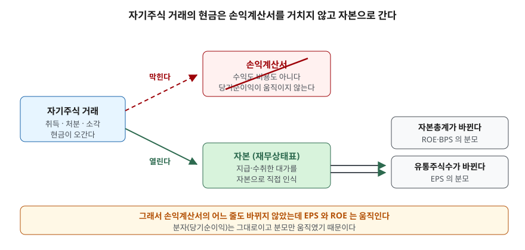
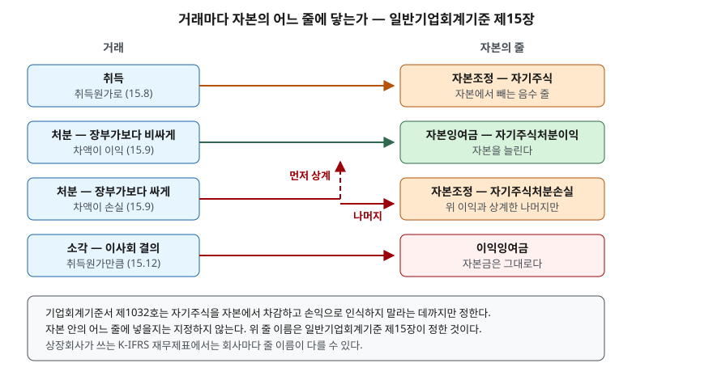

## 들어가며

어떤 회사가 자기주식을 150억원어치 사들였다는 공시를 보고 그 해 사업보고서를 열었다고
하자. 현금은 분명히 150억원이 나갔다. 그런데 손익계산서를 처음부터 끝까지 훑어도 그
150억원이 보이지 않는다. 영업비용에도 없고 영업외비용에도 없다. 당기순이익은 작년과
거의 같다.

이때 흔히 하는 일이 둘이다. 하나는 "비용 처리를 안 했나" 하고 주석을 뒤지는 것이고,
다른 하나는 숫자가 안 맞으니 그냥 넘어가는 것이다. 둘 다 같은 곳에서 멈춘다. 150억원이
어디로 갔는지 모르는 채로 그 회사의 ROE가 작년보다 0.76%p 올랐다는 사실만 남는다.

150억원은 재무상태표의 자본에 있다. 손익계산서를 한 번도 거치지 않고 거기로 갔다.
그리고 ROE가 오른 이유도 바로 그것이다.

## 개념

회사가 자기 주식을 사는 것은 **자본거래**다. 자산을 사는 것도, 비용을 쓰는 것도 아니다.

이유는 단순하다. 주식은 그 회사에 대한 지분이다. 회사가 자기 지분을 도로 사들이면
남는 것은 "회사가 자기 자신에 대해 갖는 권리"인데, 그런 권리는 밖에서 돈을 받아낼
수단이 되지 못한다. 자산의 정의에 들어가지 않는다. 그래서 자기주식은 자산이 아니라
**이미 받아 둔 자본을 주주에게 도로 내준 것**으로 본다.

기업회계기준서 제1032호 「금융상품: 표시」 문단 33이 이것을 세 가지로 끊어 정한다.
회사가 자기 지분상품을 도로 사들이면 그 지분상품은 자본에서 뺀다. 그것을 사거나 팔거나
발행하거나 소각하면서 생긴 차액은 당기손익에 넣지 않는다. 오간 대가는 자본에 바로 적는다.

세 문장 중 둘째가 이 글의 제목이다. **사도 비용이 아니고, 비싸게 팔아도 이익이 아니다.**

## 구조



> **출처**: [K-IFRS 제1032호 「금융상품: 표시」 문단 33·35](https://accountingwiki.co.kr/standards/1032) (제3자 전재) — 원문 발행처 [한국회계기준원](https://www.kasb.or.kr/front/board/ingAccountingList.do)

기준서가 막아 둔 것은 **손익계산서로 가는 길** 하나다. 현금이 오가는 것 자체를 막지는
않는다. 그래서 자기주식 거래는 현금흐름표에는 남는다 — 재무활동 현금흐름으로 잡힌다.
손익계산서에만 흔적이 없다.

그런데 자본총계와 유통주식수는 움직인다. 이 둘은 각각 ROE·BPS의 분모이고 EPS의
분모다. 분자인 당기순이익이 한 푼도 변하지 않았는데 세 지표가 전부 바뀌는 이유가
여기에 있다.

## 동작 원리

### 기준서는 "자본에서 차감"까지만 정한다

문단 33은 자기주식을 자본에서 차감하라고만 하고, **자본 안의 어느 줄**에 넣을지는
지정하지 않는다. 문단 34는 보유하는 자기주식의 금액을 기업회계기준서 제1001호
「재무제표 표시」에 따라 재무상태표나 주석에 별도로 공시하라고 덧붙인다. 즉 금액은
따로 보여야 하지만 줄 이름은 회사에 맡긴 셈이다.

줄 이름을 정해 놓은 것은 일반기업회계기준 제15장 「자본」이다. 상장회사는 K-IFRS를
쓰므로 이 장이 그대로 적용되지는 않지만, 자기주식 거래가 자본의 어디로 흩어지는지를
보여 주는 지도로는 이쪽이 훨씬 또렷하다.



> **출처**: [일반기업회계기준 제15장 「자본」 문단 15.8~15.12](https://www.accountingwiki.co.kr/kgaap/standards/15) (제3자 전재) — 원문 발행처 [한국회계기준원](https://www.kasb.or.kr/front/board/ingAccountingList.do) · [K-IFRS 제1032호 문단 33·34](https://accountingwiki.co.kr/standards/1032) (제3자 전재)

네 거래가 각각 닿는 곳은 이렇다.

| 거래 | 닿는 자본 항목 | 근거 |
|---|---|---|
| 취득 | 자본조정 — 자기주식 (취득원가) | 일반기업회계기준 15.8 |
| 처분이익 | 자본잉여금 — 자기주식처분이익 | 일반기업회계기준 15.9 |
| 처분손실 | 자기주식처분이익과 먼저 상계, 나머지는 자본조정 | 일반기업회계기준 15.9 |
| 소각 | 소각하는 주식의 취득원가만큼 이익잉여금 감소 | 일반기업회계기준 15.12 |

### 거래원가도 자본에서 뺀다

자기주식을 살 때 증권사에 내는 수수료는 어디로 갈까. 문단 35는 자본거래의 거래원가를
자본에서 차감해 회계처리하도록 정한다. 거래 자체가 손익계산서를 안 거치므로 그에 딸린
비용도 같은 길을 간다. 수수료만 판매비와관리비로 빠져나가는 일은 없다.

### 소각해도 자본금은 줄지 않는다

소각은 헷갈리기 쉬운 곳이다. 상법 제343조는 주식을 자본금 감소에 관한 규정에 따라서만
소각할 수 있다고 하면서, 단서로 회사가 보유한 자기주식은 취득 사유와 관계없이 이사회
결의로 소각할 수 있게 열어 둔다. 이 단서는 2026년 3월 6일 시행 개정으로 지금 모습이
됐다.

단서를 타고 소각하면 자본금 감소 절차를 밟지 않으므로 **자본금은 그대로다.** 줄어드는
것은 발행주식수와 이익잉여금이다. 감자차익이나 감자차손이 나오는 쪽은 자본금을 실제로
줄이는 유상감자이고, 그쪽은 일반기업회계기준 15.11이 따로 다룬다. 공시를 볼 때 자본금
줄이 그대로인데 발행주식수만 줄었다면 제343조 제1항 단서의 소각이다.

어느 쪽이든 **자본총계는 소각으로 바뀌지 않는다.** 자본조정의 음수(자기주식)가 사라진
만큼 이익잉여금이나 자본금이 같은 금액 줄어들기 때문이다. 소각은 자본 안에서 자리만
옮기는 거래다.

## 실습 예제

가상 회사 **가나전자**로 네 거래를 차례로 돌려 본다. 기초 자본은 자본금 50억원(액면
500원 × 1,000만주), 주식발행초과금 200억원, 이익준비금 25억원, 이익잉여금 725억원으로
자본총계 1,000억원이다. 연간 순이익은 150억원이고, 자기주식 거래와 무관하게 고정해 둔다.

```python
def retire(self, shares: int) -> dict:
    carrying = round(self.book_per_treasury * shares)
    self.equity["자기주식"] += carrying
    # 상법 제343조 제1항 단서의 소각 — 자본금 감소 규정을 따르지 않으므로 자본금은 그대로.
    # 일반기업회계기준 15.12 — 소각하는 주식의 취득원가만큼 이익잉여금을 줄인다.
    self.equity["이익잉여금"] -= carrying
    self.treasury_shares -= shares
    self.issued -= shares
    return {"자기주식": carrying, "이익잉여금": -carrying, "자본금": 0}
```

전체 소스: [`code/`](code/)

### 거래가 닿는 줄

```text
[2] 거래 네 건이 자본의 어느 줄을 움직이는가 (+ 는 자본을 늘림)
  ① 취득 1,000,000주 @ 15,000원 (수수료 0.3%)
      현금                  -150.450   (현금 유출입)
      자기주식                -150.450   (자본)
        이 중 거래원가            -0.450   (위 자기주식에 포함)
      손익계산서                   0.000   (어느 줄도 거치지 않는다)
  ② 처분 400,000주 @ 18,000원 — 장부가보다 비싸게
      현금                    72.000   (현금 유출입)
      자기주식                  60.180   (자본)
      자기주식처분이익              11.820   (자본)
      손익계산서                   0.000   (어느 줄도 거치지 않는다)
  ③ 처분 300,000주 @ 10,000원 — 장부가보다 싸게
      현금                    30.000   (현금 유출입)
      자기주식                  45.135   (자본)
      자기주식처분이익             -11.820   (자본)
      자기주식처분손실              -3.315   (자본)
      손익계산서                   0.000   (어느 줄도 거치지 않는다)
  ④ 남은 300,000주 소각 (상법 제343조 제1항 단서)
      자기주식                  45.135   (자본)
      이익잉여금                -45.135   (자본)
      손익계산서                   0.000   (어느 줄도 거치지 않는다)
```

취득 단가는 15,000원이지만 수수료 0.3%가 붙어 주당 장부금액은 15,045원이 된다. 이
장부금액이 이후 처분손익의 기준선이다. 18,000원에 판 400,000주는 60.180억원짜리를
72.000억원에 넘긴 것이므로 차액 11.820억원이 자본잉여금으로 간다. 10,000원에 판
300,000주는 45.135억원짜리를 30.000억원에 넘긴 것이라 15.135억원이 모자란데, 이 중
11.820억원은 앞서 쌓인 처분이익과 상계되어 사라지고 **남은 3.315억원만 자본조정에
자기주식처분손실로 남는다.**

### 자본 항목 표

```text
[3] 거래마다 다시 그린 자본 항목 (단위 억원)
                              기초        ① 취득    ② 처분(이익)    ③ 처분(손실)        ④ 소각
  자본금                     50.000      50.000      50.000      50.000      50.000
  주식발행초과금                200.000     200.000     200.000     200.000     200.000
  자기주식처분이익                 0.000       0.000      11.820       0.000       0.000
  이익준비금                   25.000      25.000      25.000      25.000      25.000
  이익잉여금                  725.000     725.000     725.000     725.000     679.865
  자기주식                     0.000    -150.450     -90.270     -45.135       0.000
  자기주식처분손실                 0.000       0.000       0.000      -3.315      -3.315
  ──────────────────────────────────────────────────────────────────────────────
  자본총계                 1,000.000     849.550     921.550     951.550     951.550
  발행주식수               10,000,000  10,000,000  10,000,000  10,000,000   9,700,000
  자기주식 수                       0   1,000,000     600,000     300,000           0
  유통주식수               10,000,000   9,000,000   9,400,000   9,700,000   9,700,000
```

표에서 읽을 것이 셋 있다.

**자본금 줄은 다섯 칸이 전부 50.000이다.** 150억원을 쓰고 두 번 팔고 소각까지 했는데
자본금은 한 번도 움직이지 않았다. 자본금은 액면총액을 적는 자리이고, 제343조 제1항
단서의 소각은 자본금 감소 절차가 아니기 때문이다.

**소각 칸에서 자본총계는 951.550 그대로다.** 자기주식 -45.135가 0이 되고 이익잉여금이
725.000에서 679.865로 같은 금액 줄었다. 자리만 옮겼다.

**자기주식처분손실 3.315는 소각 뒤에도 남아 있다.** 손실을 만든 주식은 이미 회사 밖으로
나갔지만 자본조정의 음수 줄은 그대로다. 이 금액은 이익잉여금 처분으로 상각하거나,
나중에 또 자기주식을 처분해 이익이 생기면 그것과 먼저 상계한다.

### 분자는 그대로, 분모만 움직인다

```text
[4] 순이익 150.000 억원은 네 번 모두 같다 — 움직인 것은 분모뿐이다
                             순이익        자본총계         유통주식수      EPS(원)       ROE      BPS(원)
  기초                     150.000   1,000.000    10,000,000       1,500   15.00%      10,000
  ① 취득                   150.000     849.550     9,000,000       1,667   17.66%       9,439
  ② 처분(이익)               150.000     921.550     9,400,000       1,596   16.28%       9,804
  ③ 처분(손실)               150.000     951.550     9,700,000       1,546   15.76%       9,810
  ④ 소각                   150.000     951.550     9,700,000       1,546   15.76%       9,810
```

순이익 열은 150.000이 다섯 번 반복된다. 그런데 ROE는 15.00%에서 17.66%까지 올랐다가
15.76%로 내려왔고, EPS는 1,500원에서 1,667원까지 갔다가 1,546원이 됐다.

**올린 것도 내린 것도 분모다.** 취득은 자본총계와 유통주식수를 동시에 줄여 두 지표를
같이 밀어 올렸고, 처분은 그 둘을 되돌려 놓았다. 소각 칸에서는 아무 지표도 안 움직인다 —
소각이 건드리는 것은 발행주식수이지 유통주식수가 아니고, 자본총계도 그대로이기 때문이다.

여기서 쓴 EPS는 기말 유통주식수로 나눈 값이다. 실제 공시는 기간 중 주식 수 변동을
반영한 가중평균유통주식수를 쓴다. 그 차이는
[자사주 매입과 소각 글](../../market/2026-10-08-share-buyback-cancellation/index.md)에서
다뤘다.

### 상계 순서가 바꾸는 것

```text
[5] 처분손실 상계 순서 — 같은 손실 15.135 억원이 자본잉여금 잔액에 따라 갈린다
  앞서 쌓인 자기주식처분이익                      상계된 금액          자본조정으로 남는 손실
                       0.000           0.000                15.135
                       5.000           5.000                10.135
                      11.820          11.820                 3.315
                      20.000          15.135                 0.000
```

같은 가격에 같은 수량을 팔아 손실 금액이 똑같아도, 그 회사가 전에 자기주식을 비싸게
팔아 둔 적이 있느냐에 따라 재무상태표에 남는 모양이 달라진다. 자본총계에 미치는 영향은
어느 경우든 같다 — 상계는 자본 안에서 두 줄을 맞비기는 것일 뿐이다.

## 실무에서 주의할 점

- **자기주식을 자산으로 적어 둔 표를 믿지 않는다.** 취득원가 150억원을 "투자자산"이나
  "기타자산"으로 올려 둔 요약표가 돌아다니는데, 기준서는 이를 자본에서 차감하도록
  정한다. 자산 쪽에 있으면 자산총계와 부채비율이 전부 틀어진다.

- **ROE가 올랐다고 수익성이 좋아진 것은 아니다.** 위 예제에서 ROE는 15.00%에서
  17.66%까지 올랐지만 회사가 번 돈은 150억원 그대로다. 자본을 줄여 분모를 깎았을 뿐이다.
  ROE를 볼 때는 [듀폰 분해](../../ratios/2026-10-02-dupont-roe-three-factors/index.md)처럼
  분자가 커진 것인지 분모가 작아진 것인지를 나눠 본다.

- **처분손실이 쌓인 자본조정 줄을 놓치지 않는다.** 이 줄은 자본총계를 깎고 있는데
  손익계산서에는 흔적이 없다. 몇 해에 걸쳐 자기주식을 샀다 팔았다 한 회사는 이
  줄이 꾸준히 커져 있을 수 있다.

- **소각과 처분은 되돌릴 수 있느냐가 다르다.** 보유 중인 자기주식은 다시 팔면 유통주식이
  되어 EPS가 되돌아간다. 위 예제의 ② ③이 그 되돌림이다. 소각한 주식은 다시 나오지
  못한다. 공시에서 "취득"만 보고 유통주식수가 영구히 줄었다고 읽으면 틀린다.

- **자기주식 취득에는 금액 한도가 있다.** 상법 제341조 제1항 단서는 취득가액의 총액이
  직전 결산기 순자산액에서 제462조 제1항 각 호의 금액을 뺀 금액을 넘지 못하게 한다.
  같은 한도를 배당과 나눠 쓰므로, 자기주식에 150억원을 쓰면 그만큼 배당 여력이 줄어든다.
  그 한도가 어떻게 계산되는지는
  [배당가능이익 글](../2026-11-02-distributable-profit-limit/index.md)에서 다룬다.

## 정리

- 자기주식 취득은 자본거래다. 자산도 비용도 아니고, 자본에서 차감한다 (K-IFRS 1032.33).
- 비싸게 팔아도 이익이 아니고 싸게 팔아도 손실이 아니다. 차액은 전부 자본 안에 남는다.
- 처분손실은 앞서 쌓인 자기주식처분이익과 먼저 상계하고, 남는 것만 자본조정에 적는다.
- 이사회 결의로 자기주식을 소각하면 자본금은 그대로이고 발행주식수와 이익잉여금이 줄어든다.
  자본총계는 바뀌지 않는다 (상법 제343조 제1항 단서).
- 손익계산서가 한 줄도 안 움직였는데 EPS와 ROE가 바뀐다면, 바뀐 것은 분모다.

## 참고 자료

- [한국회계기준원](https://www.kasb.or.kr/front/board/ingAccountingList.do) — 회계기준 원문 발행처. 아래 전재 링크는 문단을 바로 열기 위한 편의 링크다
- [K-IFRS 제1032호 「금융상품: 표시」 문단 33·34·35](https://accountingwiki.co.kr/standards/1032) (제3자 전재) — 자기주식의 자본 차감, 별도 공시, 자본거래 거래원가
- [일반기업회계기준 제15장 「자본」 문단 15.8~15.12](https://www.accountingwiki.co.kr/kgaap/standards/15) (제3자 전재) — 취득원가 자본조정, 처분손익의 상계 순서, 소각 처리
- [국가법령정보센터](https://www.law.go.kr/) — 상법 원문 발행처
- [상법 제343조 주식의 소각](https://casenote.kr/%EB%B2%95%EB%A0%B9/%EC%83%81%EB%B2%95/%EC%A0%9C343%EC%A1%B0) (제3자 전재, 법률 제21448호, 2026-03-06 시행) — 제1항 단서의 이사회 결의 소각
- [상법 제341조 자기주식의 취득](https://casenote.kr/%EB%B2%95%EB%A0%B9/%EC%83%81%EB%B2%95/%EC%A0%9C341%EC%A1%B0) (제3자 전재, 법률 제10600호, 2012-04-15 시행) — 취득가액 총액의 한도
- 숫자는 이 글의 [`code/output.txt`](code/output.txt) `[2]`~`[5]`에서 옮겼다
