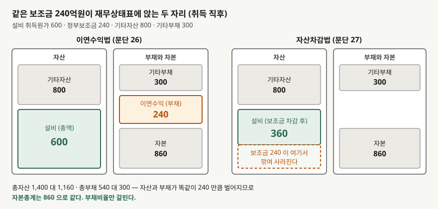
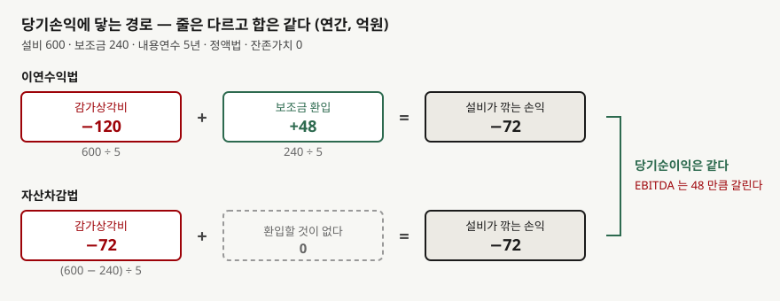

## 들어가며

설비 투자에 정부보조금을 받은 제조업 두 곳의 재무상태표를 나란히 폈다고 하자. 매출도
비슷하고 설비도 비슷한데 부채비율이 한쪽은 62%, 다른 쪽은 38%다. 20%포인트 넘게
차이가 나면 차입 구조가 다르다고 보는 것이 보통이다.

그런데 두 회사의 차입금 명세를 보면 금액이 같다. 부채 쪽에서 다른 것은 한 줄,
**'이연수익'**뿐이다. 한 회사에는 192억원이 적혀 있고 다른 회사에는 그 줄 자체가 없다.

받은 보조금 액수가 달라서가 아니다. 두 회사는 같은 금액을 받았고, 그 보조금을
재무제표에 **표시하는 방법**을 다르게 골랐을 뿐이다. 기준서가 둘 다 인정한다.

## 개념

기업회계기준서 제1020호는 정부보조금의 회계처리와 공시를 정한다. 보조금을 언제
인식하는지부터 먼저 본다. **부수되는 조건의 준수**와 **보조금의 수취** 모두에 대한
합리적인 확신이 있을 때까지는 인식하지 않는다. 돈이 들어왔다고 바로 수익이 되는 것이
아니고, 조건을 지킬 수 있다는 확신이 함께 필요하다.

인식한 보조금은 **보전하려 하는 관련원가를 비용으로 인식하는 기간에 걸쳐** 체계적인
기준에 따라 당기손익으로 인식한다. 주주지분에 직접 넣지 않는다. 설비를 사라고 준
돈이면 그 설비가 비용이 되는 기간, 즉 내용연수에 걸쳐 손익에 들어간다.

문제는 **그동안 그 금액을 재무상태표 어디에 두느냐**다. 문단 24는 두 자리를 모두 연다.

- **이연수익법** — 보조금을 이연수익(부채)으로 인식하고 자산의 내용연수에 걸쳐
  체계적인 기준으로 당기손익에 인식한다(문단 26)
- **자산차감법** — 자산의 장부금액을 계산할 때 보조금을 차감하고, 감가상각자산의
  내용연수에 걸쳐 **감가상각비를 감소시키는 방식**으로 당기손익에 인식한다(문단 27)

문단 25는 두 방법이 모두 인정된다고 못 박는다. 기준서가 어느 쪽을 권하지 않는다.

## 구조



> **출처**: 한국회계기준원 [기업회계기준서 제1020호 '정부보조금의 회계처리와 정부지원의 공시'](https://www.samili.com/acc/Kijun/Kijunjomun.asp?code=1978-1020) 문단 24~27 (제3자 전재, 2015-09-25 개정) — 원문 발행처 [한국회계기준원](https://www.kasb.or.kr/front/board/ingAccountingList.do), 대응 국제기준은 [IFRS Foundation](https://www.ifrs.org/issued-standards/list-of-standards/ias-20-accounting-for-government-grants-and-disclosure-of-government-assistance/)의 IAS 20

같은 보조금 240억원이 왼쪽에서는 **부채 한 줄**이 되고 오른쪽에서는 **자산에서 깎여
사라진다.** 왼쪽은 총자산 1,400억원에 총부채 540억원, 오른쪽은 총자산 1,160억원에
총부채 300억원이다.

여기서 중요한 것은 자산과 부채가 **똑같이 240억원씩** 벌어진다는 점이다. 자본총계는
양쪽 다 860억원이다. 주주에게 귀속되는 몫은 한 푼도 다르지 않다. 달라지는 것은
**분모와 분자로 쓰이는 총자산과 총부채의 크기**뿐이다.

## 동작 원리

### 손익으로 가는 경로



> **출처**: 한국회계기준원 [기업회계기준서 제1020호](https://www.samili.com/acc/Kijun/Kijunjomun.asp?code=1978-1020) 문단 26·27 (제3자 전재, 2015-09-25 개정) — 원문 발행처 [한국회계기준원](https://www.kasb.or.kr/front/board/ingAccountingList.do). 금액은 이 글의 `code/output.txt` `[1]`에서 옮겼다

이연수익법은 설비 전액 600억원을 5년에 나눠 감가상각비 120억원을 잡고, 이연수익
240억원을 5년에 나눠 48억원을 환입한다. 순효과는 −72억원이다.

자산차감법은 설비를 360억원으로 보고 5년에 나눠 감가상각비 72억원을 잡는다. 환입할
것이 없다. 순효과는 역시 −72억원이다.

**두 줄이 한 줄로 합쳐진 것뿐이다.** 그래서 당기순이익이 같다.

### 차이가 생겼다 사라지는 경로

이연수익 잔액은 매년 48억원씩 줄고, 설비 장부금액의 차이도 매년 48억원씩 줄어든다.
둘이 같은 속도로 줄기 때문에 **차이는 항상 같은 금액**이고, 내용연수가 끝나면 둘 다
0이 되어 두 재무상태표가 다시 만난다.

보조금을 받은 해에 차이가 가장 크고 해가 갈수록 좁혀진다. 설비 투자가 잦은 회사라면
새 보조금이 계속 들어오므로 차이가 쌓인 채로 유지된다.

## 실습 예제

가상 회사 **마바산업**으로 계산한다. 설비 600억원을 사면서 정부보조금 240억원을 받았고,
내용연수 5년, 잔존가치 0, 정액법이다. 매출은 해마다 1,000억원, 감가상각비와 보조금
환입을 빼기 전 영업이익은 200억원이다. 설비 말고 다른 자산이 800억원, 이연수익 말고
다른 부채가 300억원 있다.

**설비 외의 항목을 고정해 둔 단순 모형이다.** 연차별 절대 수준보다 두 방법의 **차이**를
본다. 두 방법의 과세소득이 같으므로 비교에서 법인세율은 0으로 두었다.

```python
def deferred_income_method(g: Grant, year: int) -> dict[str, float]:
    """문단 26 — 보조금을 이연수익으로 두고 내용연수에 걸쳐 당기손익에 인식한다."""
    depreciation = g.asset_cost / g.life
    grant_income = g.grant / g.life
    carrying = g.asset_cost - depreciation * year
    deferred = g.grant - grant_income * year
    return _wrap(g, depreciation, grant_income, carrying, deferred)


def deduction_method(g: Grant, year: int) -> dict[str, float]:
    """문단 27 — 장부금액에서 보조금을 차감하고 감가상각비를 그만큼 줄인다."""
    net_cost = g.asset_cost - g.grant
    depreciation = net_cost / g.life
    carrying = net_cost - depreciation * year
    return _wrap(g, depreciation, 0.0, carrying, 0.0)
```

전체 소스: [`code/`](code/)

### 손익 효과는 같다

```text
[1] 당기손익에 닿는 경로 — 두 방법의 순효과가 같다 (단위: 억원)
                 연간 금액         이연수익법         자산차감법
--------------------------------------------------
                 감가상각비         120.0          72.0
                보조금 환입          48.0           0.0
             설비가 깎는 손익         -72.0         -72.0
```

### 재무상태표는 매년 같은 금액씩 벌어진다

```text
[2] 재무상태표 — 해마다 벌어졌다가 5년 뒤 다시 만난다
    연차        설비(이연)        이연수익        설비(차감)       자산 차이       부채 차이
----------------------------------------------------------------------
     0         600.0       240.0         360.0       240.0       240.0
     1         480.0       192.0         288.0       192.0       192.0
     2         360.0       144.0         216.0       144.0       144.0
     3         240.0        96.0         144.0        96.0        96.0
     4         120.0        48.0          72.0        48.0        48.0
     5           0.0         0.0           0.0         0.0         0.0

  자산 차이와 부채 차이가 매년 같다. 그래서 자본총계는 두 방법이 같다.
```

자산 차이 칸과 부채 차이 칸이 한 줄도 어긋나지 않는다. 이 등식이 자본총계를 붙들어
둔다. 들어가며에서 본 이연수익 192억원이 1년 차 줄이다.

### 지표가 갈리는 자리

```text
[3] 1년 말 지표 — 순이익은 같고 재무상태표를 쓰는 지표가 갈린다
                항목         이연수익법         자산차감법          차이
----------------------------------------------------------
              영업이익         128.0         128.0         0.0
             당기순이익         128.0         128.0         0.0
            EBITDA         248.0         200.0        48.0
               총자산        1280.0        1088.0       192.0
               총부채         492.0         300.0       192.0
              자본총계         788.0         788.0         0.0
              부채비율          62.4          38.1        24.4
            총자산회전율         0.781         0.919      -0.138
```

읽을 것이 네 가지다.

- **당기순이익과 자본총계는 한 자리도 다르지 않다.** 표시 방법은 주주 몫을 바꾸지 않는다.
- **부채비율이 62.4%와 38.1%로 갈린다.** 24.4%포인트다. 차입금은 같은데 이연수익이
  부채로 계산되기 때문이다.
- **총자산회전율이 0.781과 0.919로 갈린다.** 같은 매출을 더 작은 자산으로 올린 것처럼
  보인다. 자산차감법 쪽이 효율적으로 보이는 셈인데, 설비도 매출도 같다.
- **EBITDA가 248억원과 200억원으로 48억원 갈린다.** 영업이익은 같은데 되더하는
  감가상각비가 120억원과 72억원으로 다르기 때문이다.

EBITDA 차이는 그대로 밸류에이션에 닿는다.
[EV/EBITDA](../../valuation/2026-10-03-ev-ebitda-debt-included/index.md)는 분모에 EBITDA를
쓰므로, 같은 EV에서 이연수익법 회사의 배수가 더 낮게 나온다. 게다가 이연수익이 부채로
집계되면 EV 자체도 달라질 수 있다.

### 연차에 따라 좁혀진다

```text
[4] 부채비율과 총자산회전율이 연차에 따라 좁혀진다
    연차        부채비율(이연)        부채비율(차감)           회전율(이연)           회전율(차감)
--------------------------------------------------------------------------
     0            62.8            34.9             0.714             0.862
     1            62.4            38.1             0.781             0.919
     2            62.0            41.9             0.862             0.984
     3            61.5            46.6             0.962             1.059
     4            60.8            52.4             1.087             1.147
     5            60.0            60.0             1.250             1.250
```

0년 차에 27.9%포인트였던 부채비율 차이가 해마다 줄어 5년 차에 0이 된다. **같은 두
회사를 다른 해에 비교하면 격차가 전혀 다르게 보인다**는 뜻이다. 보조금을 받은 직후가
가장 크고, 내용연수가 끝나면 비교가 다시 성립한다.

## 실무에서 주의할 점

- **부채 명세에서 이연수익을 찾는다.** 부채비율이 유난히 높은데 차입금이 적은 회사라면
  이연수익이나 계약부채 같은 비차입 부채가 들어 있을 수 있다. 차입 상환 부담을 보려는
  목적이라면 이연수익은 갚을 돈이 아니므로 따로 떼어 보는 쪽이 맞다.
  [자기자본비율과 차입금의존도](../../ratios/2026-10-14-equity-ratio-and-borrowing-dependency/index.md)에서
  차입금만 분리해 보는 지표를 다뤘다.

- **총자산회전율을 업계 안에서 비교할 때 표시 방법을 확인한다.** 보조금 비중이 큰
  업종, 예컨대 설비에 정부 지원이 많이 들어가는 업종에서는 회전율 차이의 상당 부분이
  회계 선택일 수 있다.
  [활동성 비율](../../ratios/2026-10-02-activity-ratios-three-years/index.md)을
  볼 때 같이 확인한다.

- **EBITDA를 쓸 때는 더 주의한다.** 감가상각비 자체가 두 배 가까이 갈리므로
  EBITDA 마진도 같이 갈린다. 설비투자 부담을 보려고 EBITDA와 CAPEX를 견주는
  [EBITDA 마진과 설비투자](../../ratios/2026-10-25-ebitda-margin-and-capex-gap/index.md)
  방식에서는 이 차이가 그대로 결론에 들어간다.

- **현금흐름표는 표시 방법과 무관하게 같다.** 문단 28은 자산의 취득과 보조금 수취를
  현금흐름표에 **별도 항목으로** 표시하게 한다. 재무상태표에서 차감 표시했더라도
  자산의 총투자를 보여주기 위해서다. 재무상태표가 갈려도 현금흐름표에서는
  같은 금액을 볼 수 있다. 이자·배당금처럼 칸이 갈리는 경우와 대비되는 지점이고,
  그쪽은 [이자와 배당금의 현금흐름 분류](../2026-11-03-interest-dividend-cash-flow-classification/index.md)에서 다뤘다.

- **수익관련보조금에도 같은 구조의 선택이 있다.** 문단 29는 당기손익의 일부로 별도
  계정이나 '기타수익'으로 표시하거나, 관련 비용에서 차감할 수 있게 한다. 비용에서
  차감하면 판매비와관리비가 작아 보이므로 **원가율·판관비율이 그만큼 낮게 나온다.**
  문단 31은 보조금의 효과를 공시하는 것이 일반적으로 적절하다고 적으므로 주석을 본다.

- **인식 요건을 늦게 충족하면 그 전 감가상각분은 돌아오지 않는다.** 보조금은 조건
  준수와 수취 양쪽에 합리적인 확신이 있어야 인식한다. 설비를 먼저 사고 요건을 나중에
  충족한 회사는 그 사이의 상각이 이미 지나간 뒤다.

## 정리

- 제1020호는 자산관련 정부보조금을 이연수익으로 표시하는 방법과 자산 장부금액에서
  차감하는 방법을 모두 인정한다(문단 24·25). 기준서가 어느 쪽을 권하지 않는다.
- 이연수익법은 감가상각비 120억원과 보조금 환입 48억원 두 줄로, 자산차감법은 감가상각비
  72억원 한 줄로 손익에 닿는다. 순효과는 둘 다 −72억원이다.
- 자산과 부채가 똑같은 금액만큼 벌어지므로 자본총계와 당기순이익은 같다. 갈리는 것은
  총자산·총부채를 쓰는 지표다.
- 1년 말에 부채비율 62.4%와 38.1%, 총자산회전율 0.781과 0.919, EBITDA 248억원과
  200억원으로 갈린다. 차이는 해마다 좁혀져 내용연수가 끝나면 사라진다.
- 현금흐름표는 문단 28이 자산 취득과 보조금 수취를 별도 항목으로 표시하게 하므로
  표시 방법과 무관하게 같다.

## 참고 자료

- [한국회계기준원](https://www.kasb.or.kr/front/board/ingAccountingList.do) — K-IFRS 기준서 발행처. 아래 전재 링크는 조문을 바로 열기 위한 편의 링크다
- [기업회계기준서 제1020호 '정부보조금의 회계처리와 정부지원의 공시'](https://www.samili.com/acc/Kijun/Kijunjomun.asp?code=1978-1020) (제3자 전재, 2015-09-25 개정) — 문단 24 두 가지 표시, 문단 25 둘 다 인정, 문단 26 이연수익, 문단 27 장부금액 차감, 문단 28 현금흐름표 별도 표시, 문단 29·31 수익관련보조금
- [IAS 20 Accounting for Government Grants and Disclosure of Government Assistance](https://www.ifrs.org/issued-standards/list-of-standards/ias-20-accounting-for-government-grants-and-disclosure-of-government-assistance/) — IFRS Foundation. 제1020호가 대응하는 국제기준이며, 인식 요건과 두 가지 표시 방법을 요약해 둔다
- 숫자는 이 글의 [`code/output.txt`](code/output.txt) `[1]`~`[4]`에서 옮겼다
