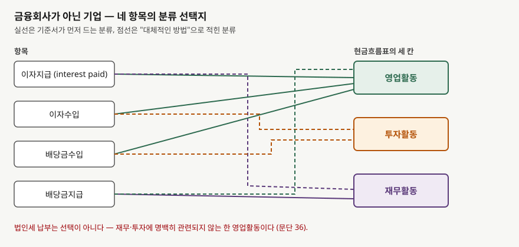
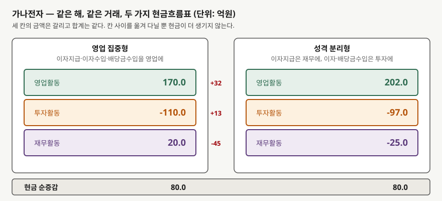

## 들어가며

차입이 많은 제조업 두 곳을 놓고 어느 쪽이 영업으로 현금을 더 잘 버는지 보려 했다고
하자. 사업보고서의 현금흐름표를 펴서 맨 윗줄 "영업활동으로 인한 현금흐름"을 읽는다.
한 곳은 170억원, 다른 곳은 190억원이다. 뒤쪽이 낫다는 결론이 선다.

그런데 두 회사의 손익계산서를 보면 앞쪽이 이자를 45억원, 뒤쪽이 60억원 낸다. 이자를
더 내는 회사가 영업현금흐름이 더 크다는 뜻이 되는데, 숫자를 다시 봐도 계산이 틀린
곳은 없다.

틀린 것은 계산이 아니라 **두 숫자가 같은 규칙으로 만들어졌다는 전제**다. 현금흐름표는
이자와 배당금을 어느 칸에 넣을지를 기업이 고르게 되어 있다. 고르는 순간 영업활동
현금흐름의 크기가 달라지고, 그 숫자를 쓰는 지표가 전부 따라 움직인다.

## 개념

기업회계기준서 제1007호는 현금흐름을 영업활동·투자활동·재무활동 셋으로 나눠 보고하게
한다. 대부분의 항목은 어느 칸인지가 정해져 있다. 매출채권 회수는 영업, 설비 취득은
투자, 차입금 상환은 재무다. 법인세 납부도 "재무활동과 투자활동에 명백히 관련되지
않는 한" 영업으로 못 박혀 있다(문단 36).

이자와 배당금만 다르다. 문단 31은 수취·지급을 각각 별도로 공시하고 **매 기간 일관성
있게** 영업·투자·재무 중 하나로 분류하라고만 한다. 어느 칸인지는 정하지 않는다.

문단 33은 그 이유를 그대로 적는다. 금융회사는 이자지급·이자수입·배당금수입을 영업으로
분류하지만, **다른 업종에서는 "분류방법에 대하여 합의가 이루어지지 않았다"**는 것이다.
합의가 없으니 기준서가 두 갈래를 모두 인정했다.

- 이자지급·이자수입·배당금수입이 당기순손익을 결정하는 데 영향을 미치므로 **영업활동**
- 이자지급은 재무자원을 획득하는 원가이므로 **재무활동**, 이자수입·배당금수입은
  투자자산에 대한 수익이므로 **투자활동**

배당금지급은 문단 34가 따로 다룬다. 재무자원을 획득하는 원가이므로 **재무활동**이
기본이고, 재무제표이용자가 영업활동현금흐름에서 배당금을 지급할 수 있는 기업의 능력을
판단하도록 돕기 위해 **영업활동**의 구성요소로 둘 수도 있다.

## 구조



> **출처**: 한국회계기준원 [기업회계기준서 제1007호 '현금흐름표'](https://www.samili.com/acc/Kijun/Kijunjomun.asp?code=1978-1007) 문단 31~34·36 (제3자 전재, 2024-11-22 개정) — 원문 발행처 [한국회계기준원](https://www.kasb.or.kr/front/board/ingAccountingList.do), 대응 국제기준은 [IFRS Foundation](https://www.ifrs.org/issued-standards/list-of-standards/ias-7-statement-of-cash-flows/)의 IAS 7

네 항목이 각각 두 갈래씩 열려 있으므로 조합은 열여섯 가지다. 실무에서는 보통 두 가지
묶음 중 하나를 쓴다. 이 글에서는 둘을 이렇게 부른다.

| | 이자지급 | 이자수입 | 배당금수입 | 배당금지급 |
|---|---|---|---|---|
| **영업 집중형** | 영업 | 영업 | 영업 | 재무 |
| **성격 분리형** | 재무 | 투자 | 투자 | 재무 |

문단 31의 "매 기간 일관성 있게"는 **한 회사가 해마다 바꾸지 못한다**는 뜻이다. 회사
안에서는 시계열 비교가 보장된다. 보장되지 않는 것은 **회사 사이의 비교**다.

## 동작 원리

분류를 바꾸면 현금이 더 생기거나 사라지는가. 그렇지 않다. 같은 돈이 어느 칸에
적히는지만 달라진다. 그래서 **세 칸의 합계인 현금 순증감은 항상 같다.**



> **출처**: 한국회계기준원 [기업회계기준서 제1007호 '현금흐름표'](https://www.samili.com/acc/Kijun/Kijunjomun.asp?code=1978-1007) 문단 31·33·34 (제3자 전재, 2024-11-22 개정) — 원문 발행처 [한국회계기준원](https://www.kasb.or.kr/front/board/ingAccountingList.do). 금액은 이 글의 `code/output.txt` `[2]`에서 옮겼다

영업 집중형에서 성격 분리형으로 옮기면 영업활동 칸에서 세 가지가 빠져나간다.

- 이자지급 45억원이 빠지므로 영업이 **커진다** (내던 돈이 재무로 갔다)
- 이자수입 8억원과 배당금수입 5억원이 빠지므로 영업이 **작아진다**

세 항목의 순효과는 `+45 − 8 − 5 = +32`억원이다. 이자를 많이 내고 이자수입이 적은
회사일수록 이 차이가 크다. **차입이 많은 회사일수록 분류 선택이 영업활동현금흐름을
크게 움직인다**는 뜻이고, 하필 그런 회사가 현금창출력을 따져 볼 일이 많은 회사다.

## 실습 예제

가상 회사 **가나전자**로 계산한다. 제조업이고 금융회사가 아니다. 당기순이익 120억원,
감가상각비 80억원, 운전자본 증가 30억원이고, 이자·배당 항목을 빼고 집계한 영업활동
현금흐름이 202억원이다. 그 해에 이자로 45억원을 내고 8억원을 받았으며, 보유 주식에서
배당금 5억원을 받고 주주에게 40억원을 지급했다. 설비에 110억원을 썼고 차입금이 순액
60억원 늘었다.

```python
def statement(c: Company, p: Policy) -> dict[str, float]:
    """세 활동의 현금흐름을 분류 정책에 따라 집계한다."""
    buckets = {"영업": c.core_operating, "투자": -c.capex, "재무": c.borrowing_net}
    buckets[p.interest_paid_to] -= c.interest_paid
    buckets[p.interest_received_to] += c.interest_received
    buckets[p.dividend_received_to] += c.dividend_received
    buckets[p.dividend_paid_to] -= c.dividend_paid
    buckets["합계"] = buckets["영업"] + buckets["투자"] + buckets["재무"]
    return buckets
```

전체 소스: [`code/`](code/)

### 같은 거래를 두 번 적는다

```text
[2] 가나전자 — 같은 해, 같은 거래를 두 가지로 작성 (단위: 억원)
              활동        영업 집중형        성격 분리형        차이
------------------------------------------------------
              영업         170.0         202.0     +32.0
              투자        -110.0         -97.0     +13.0
              재무          20.0         -25.0     -45.0
              합계          80.0          80.0      +0.0
```

합계 80.0은 한 자리도 움직이지 않는다. 영업이 32.0 늘어난 만큼 투자에서 13.0이 늘고
재무에서 45.0이 줄어 상쇄된다. **어느 쪽도 분식이 아니다.** 둘 다 기준서가 인정하는
작성이다.

### 영업현금흐름을 쓰는 지표가 같이 움직인다

```text
[3] 가나전자 — 영업활동현금흐름을 쓰는 지표가 같이 움직인다
                        지표        영업 집중형        성격 분리형        차이
----------------------------------------------------------------
                  영업활동현금흐름       170.000       202.000   +32.000
            영업현금흐름 / 당기순이익         1.417         1.683    +0.267
        잉여현금흐름 (OCF−CAPEX)        60.000        92.000   +32.000
             영업현금흐름 / 총차입금         0.340         0.404    +0.064
```

영업현금흐름을 분자로 쓰는 지표는 전부 따라 움직인다. 잉여현금흐름은 60.0과 92.0으로
**1.5배 넘게 벌어진다.** 영업현금흐름 대 총차입금은 0.340에서 0.404로 오르는데, 이
지표는 차입금을 영업으로 몇 년에 갚을 수 있는지를 보는 것이므로
[영업현금흐름 대 차입금 지표](../../ratios/2026-11-02-operating-cash-flow-debt-service-coverage/index.md)에서
다룬 기준선에 그대로 닿는다. 분류 하나로 기준선을 넘나들 수 있다는 뜻이다.

### 정책이 다른 두 회사를 그대로 비교하면

**다라물산**을 세운다. 이자·배당 전 영업활동현금흐름이 190억원으로 가나전자보다
낮고, 이자를 60억원 내고 4억원을 받으며, 배당금수입은 없다. 성격 분리형을 쓴다.

```text
[4] 정책이 서로 다른 두 회사를 그대로 비교하면 순위가 뒤집힌다
            회사          채택한 분류         공시된 OCF         영업 집중형 환산
----------------------------------------------------------------
          가나전자          영업 집중형           170.0             170.0
          다라물산          성격 분리형           190.0             134.0

  공시된 숫자만 보면 다라물산 190.0 이 더 크다 (가나전자 170.0).
  같은 기준으로 맞추면 가나전자 170.0 이 더 크다 (다라물산 134.0).
```

들어가며에서 본 그 숫자다. 공시된 대로 읽으면 다라물산이 20.0 앞서지만, 같은 기준으로
맞추면 가나전자가 36.0 앞선다. **순위가 뒤집힌다.**

맞추는 일 자체는 어렵지 않다. 문단 31이 이자와 배당금을 각각 별도로 공시하게 하므로
금액이 재무제표에 다 있다. 다라물산의 공시 영업현금흐름 190.0에서 이자지급 60.0을 빼고
이자수입 4.0을 더하면 134.0이다.

```python
def to_operating_heavy(c: Company, p: Policy, operating: float) -> float:
    """어떤 정책으로 작성된 영업활동현금흐름을 영업 집중형 기준으로 되돌린다.

    문단 31 이 이자·배당금을 각각 별도로 공시하게 하므로 이 환산이 가능하다.
    """
```

별도 공시 요구가 비교를 되살리는 장치인 셈이다. 선택을 허용하되 되돌릴 재료는 남긴다.

### 공식을 그대로 쓰면 이자가 두 번 센다

현금이자보상배율은 보통 `(영업활동현금흐름 + 이자지급액) ÷ 이자지급액`으로 쓴다.
영업활동현금흐름에 이자지급이 **이미 차감되어 있다**는 전제가 공식 안에 숨어 있다.
성격 분리형에서는 그 전제가 깨진다.

```text
[5] 현금이자보상배율 공식을 그대로 쓰면 성격 분리형에서 이자가 두 번 센다
                        계산        영업 집중형        성격 분리형
------------------------------------------------------
       (OCF + 이자지급) / 이자지급          4.78          5.49
            이자 분류를 보고 고친 값          4.78          4.49
```

공식을 그대로 돌리면 4.78과 5.49로 나와 성격 분리형 쪽이 이자를 더 넉넉히 감당하는
것처럼 보인다. 실제로는 이자지급이 영업에서 이미 빠진 적이 없는데 한 번 더 더해져
**45억원이 두 번 센 것**이다. 이자 분류를 확인하고 고치면 4.49로, 영업 집중형보다
오히려 낮다.

## 실무에서 주의할 점

- **현금흐름표 첫 줄을 다른 회사와 바로 빼지 않는다.** 주석에서 이자지급·이자수입·
  배당금수입·배당금지급이 어느 활동에 있는지 먼저 확인한다. 네 줄의 금액은 문단 31이
  별도 공시하게 해 두었으므로 반드시 찾을 수 있다.

- **차입이 많은 회사일수록 차이가 크다.** 가나전자는 이자지급이 45억원이어서 영업활동
  현금흐름이 32억원 갈렸다. 이자가 100억원대인 회사라면 그만큼 벌어진다. 무차입에
  가까운 회사는 분류를 바꿔도 거의 움직이지 않으므로 확인할 실익이 적다.

- **지표 공식에 숨은 전제를 확인한다.** 현금이자보상배율처럼 영업활동현금흐름에 이자를
  되더하는 공식은 이자가 영업에서 빠졌다고 가정한다. 성격 분리형 회사에 그대로 쓰면
  이자를 두 번 세고 지표가 좋아 보인다. 외부 데이터 제공자가 계산해 준 지표도 어느
  전제로 만들었는지 밝히지 않는 경우가 있다.

- **같은 회사의 시계열은 안전하다.** 문단 31이 매 기간 일관성을 요구하므로 한 회사의
  작년과 올해는 같은 규칙으로 작성된다. 비교가 깨지는 것은 회사 사이이지 해마다가
  아니다. 다만 분류 정책을 바꾸면 회계정책 변경으로 공시되므로 그 주석을 본다.

- **법인세를 같은 선택지로 착각하지 않는다.** 문단 36은 법인세 현금흐름을 재무·투자에
  명백히 관련되지 않는 한 영업으로 분류하게 한다. 이자·배당금과 달리 고르는 항목이
  아니다.

- **칸이 갈리는 선택과 금액이 갈리는 선택은 다르다.** 이자·배당금 분류는 같은 금액이
  다른 칸에 적히는 것이어서 합계가 보존된다. 표시 방법 선택이 재무상태표의 크기 자체를
  바꾸는 경우도 있는데,
  [정부보조금 표시 두 가지](../2026-11-03-government-grant-presentation-methods/index.md)가
  그쪽이다. 그 글의 보조금은 현금흐름표에서만큼은 표시 방법과 무관하게 총액으로 적힌다.

- **앞으로 바뀔 자리다.** IFRS Foundation은 2024년 4월 IFRS 18을 내면서 IAS 7에 이자와
  배당금 현금흐름의 분류에 관한 새 요구사항을 두었다고 적는다. 한국에서는 금융위원회가
  2025년 12월 17일 기업회계기준서 제1118호 '재무제표 표시와 공시'를 공포했고, 2027년
  1월 1일 이후 시작하는 회계연도부터 적용되며 2026년 1월 1일 이후 회계연도에 조기적용이
  허용된다. 다만 그 공포 내용에 제1007호는 들어 있지 않다. **지금 읽는 재무제표는
  이 글이 설명한 선택 구조로 작성된 것이다.**

## 정리

- 제1007호 문단 31은 이자와 배당금을 각각 별도로 공시하고 매 기간 일관성 있게 영업·
  투자·재무 중 하나로 분류하라고만 하고, 어느 칸인지는 정하지 않는다.
- 문단 33은 금융회사가 아닌 기업에 대해 "분류방법에 합의가 이루어지지 않았다"고 적고
  두 갈래를 모두 인정한다. 배당금지급은 문단 34가 재무 또는 영업으로 연다.
- 분류를 바꿔도 현금 순증감은 그대로다. 가나전자는 세 칸이 170.0/−110.0/20.0과
  202.0/−97.0/−25.0으로 갈렸지만 합계는 둘 다 80.0이다.
- 영업현금흐름을 쓰는 지표는 전부 따라 움직인다. 잉여현금흐름은 60.0과 92.0으로
  벌어지고, 정책이 다른 두 회사를 그대로 비교하면 순위가 뒤집힌다.
- 문단 31의 별도 공시 요구 덕분에 기준을 통일해 되돌릴 수 있다. 공시된 영업현금흐름에
  이자지급을 빼고 이자·배당금수입을 더하면 같은 잣대가 된다.

## 참고 자료

- [한국회계기준원](https://www.kasb.or.kr/front/board/ingAccountingList.do) — K-IFRS 기준서 발행처. 아래 전재 링크는 조문을 바로 열기 위한 편의 링크다
- [기업회계기준서 제1007호 '현금흐름표'](https://www.samili.com/acc/Kijun/Kijunjomun.asp?code=1978-1007) (제3자 전재, 2024-11-22 개정) — 문단 31 별도 공시와 일관성, 문단 33 이자지급·이자수입·배당금수입, 문단 34 배당금지급, 문단 36 법인세
- [IAS 7 Statement of Cash Flows](https://www.ifrs.org/issued-standards/list-of-standards/ias-7-statement-of-cash-flows/) — IFRS Foundation. 제1007호가 대응하는 국제기준이며, Standard history 절이 IFRS 18에 따른 이자·배당금 분류 요구사항 신설을 적는다
- [금융위원회 보도자료 — 기업회계기준서 제1118호 공포](https://www.fsc.go.kr/po010101/85886?curPage=60) (2025-12-18) — 2027-01-01 이후 시작하는 회계연도 적용, 2026-01-01 이후 회계연도 조기적용 허용
- 숫자는 이 글의 [`code/output.txt`](code/output.txt) `[1]`~`[5]`에서 옮겼다
