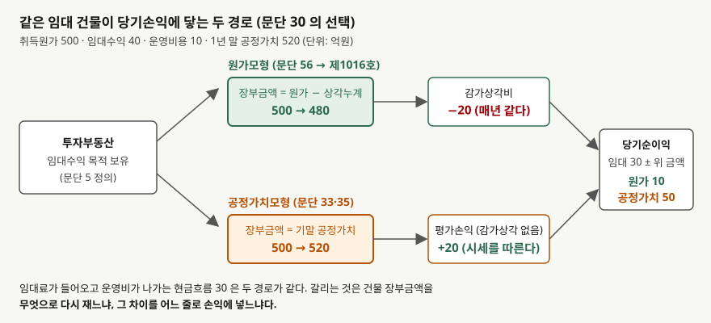
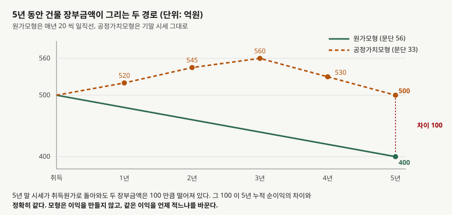

## 들어가며

부동산 임대 수입이 주된 회사 두 곳의 손익계산서를 나란히 폈다고 하자. 보유한 건물
규모도 임대료 수준도 비슷한데, 한쪽은 순이익이 해마다 거의 같은 숫자고 다른 쪽은
작년에 55억원이었다가 올해 0원이다. 올해 무슨 사고가 났나 싶어 임대 현황을 보면
공실도 없고 임대료도 그대로다.

차이는 건물의 **장부금액을 무엇으로 다시 재느냐**에 있다. 한 회사는 취득원가에서
감가상각을 빼 나가고, 다른 회사는 해마다 시세로 다시 잰다. 시세가 오른 해에는 그
차이가 이익으로, 내린 해에는 손실로 손익계산서에 들어간다. 올해 0원은 건물 시세가
30억원 내려 임대 이익 30억원을 상쇄한 결과다.

두 회사의 임대료 수입과 현금흐름은 같다. 기준서가 두 방법을 모두 인정하므로
어느 쪽도 잘못이 아니다. 다만 어느 모형을 골랐는지 모르고 순이익만 비교하면
한 회사는 안정적이고 다른 회사는 들쭉날쭉하다는 엉뚱한 결론이 나온다.

## 개념

기업회계기준서 제1040호는 **투자부동산**을 임대수익이나 시세차익 또는 둘 다를 얻기
위해 보유하는 부동산으로 정의한다(문단 5). 재화를 만들거나 관리 목적에 쓰는
자가사용부동산과 통상적 영업과정에서 팔 재고 부동산은 제외한다. 공장은 유형자산이고
남에게 세를 준 건물은 투자부동산이다.

인식 후 측정에서 기준서는 두 모형을 연다. 문단 30은 **공정가치모형**(문단 33~55)과
**원가모형**(문단 56) 중 하나를 선택해 **모든 투자부동산에** 적용하게 한다. 건물마다
다르게 고를 수 없다. 문단 32A가 특정 자산군의 수익과 연계된 부채가 있는 경우의 예외를
두지만, 보통 회사에는 해당하지 않는다.

- **공정가치모형** — 최초 인식 후 모든 투자부동산을 공정가치로 측정하고(문단 33),
  공정가치 변동으로 생기는 손익은 **발생한 기간의 당기손익**에 반영한다(문단 35).
  감가상각을 하지 않는다. 공정가치에 이미 가치 감소가 반영돼 있기 때문이다
- **원가모형** — 제1016호 유형자산의 원가모형을 따른다(문단 56). 취득원가에서
  감가상각누계액과 손상차손누계액을 뺀 금액이 장부금액이다

한 가지가 더 있다. 문단 32는 **원가모형을 쓰는 회사도 공시를 위해 공정가치를
측정해야 한다**고 적고, 문단 79는 원가모형 적용 시 투자부동산의 공정가치를 주석으로
공시하게 한다. 그래서 원가모형 회사의 주석에는 손익에 들어가지 않은 시세가 따로
적혀 있다. 반대 방향은 없다. 공정가치모형 회사는 취득원가 기준 감가상각액을 주석에
적을 의무가 없다.

## 구조



> **출처**: 한국회계기준원 [기업회계기준서 제1040호 '투자부동산'](https://www.samili.com/acc/Kijun/Kijunjomun.asp?code=1978-1040) 문단 5·30·33·35·56 (제3자 전재, 2021-04-23 개정) — 원문 발행처 [한국회계기준원](https://www.kasb.or.kr/front/board/ingAccountingList.do), 대응 국제기준은 [IFRS Foundation](https://www.ifrs.org/issued-standards/list-of-standards/ias-40-investment-property/)의 IAS 40

왼쪽 출발점은 같다. 임대 목적으로 보유한 건물 500억원이다. 위 경로는 원가모형이다.
장부금액이 취득원가에서 상각누계액을 뺀 값이 되고, 그 상각액 20억원이 매년 같은
크기로 손익에 들어간다. 아래 경로는 공정가치모형이다. 장부금액이 기말 공정가치가
되고, 직전 장부금액과의 차이 20억원이 그해 손익에 들어간다.

두 경로가 당기순이익에서 합류한다. 임대 이익 30억원은 양쪽이 같으므로 순이익의
차이는 전부 **건물 장부금액을 다시 잰 방식**에서 나온다. 원가모형 10억원, 공정가치모형
50억원이다.

## 동작 원리

### 손익이 흔들리는 폭이 다르다

원가모형의 감가상각비는 취득원가와 내용연수로 **취득 시점에 결정**된다. 시세가
오르든 내리든 매년 같은 금액이다. 그래서 임대료가 그대로면 순이익도 그대로다.

공정가치모형의 평가손익은 **그해 시세가 결정**한다. 시세가 오르면 이익, 내리면
손실이다. 임대 이익이 30억원인데 시세가 30억원 내리면 순이익이 0이 된다. 건물에서
나오는 현금은 한 푼도 달라지지 않았는데 손익계산서의 맨 아랫줄이 0으로 떨어진다.

### 누적 차이는 장부금액 차이와 같다



> **출처**: 한국회계기준원 [기업회계기준서 제1040호](https://www.samili.com/acc/Kijun/Kijunjomun.asp?code=1978-1040) 문단 33·56 (제3자 전재, 2021-04-23 개정) — 원문 발행처 [한국회계기준원](https://www.kasb.or.kr/front/board/ingAccountingList.do). 금액은 이 글의 `code/output.txt` `[1]`·`[2]`에서 옮겼다

두 모형은 이익을 만들거나 없애지 않는다. 건물을 500억원에 사서 언젠가 처분하면
그때까지의 총이익은 처분가에서 500억원을 뺀 값으로 같다. 모형이 바꾸는 것은 **그
이익을 어느 해에 적느냐**다. 그래서 어느 시점에서 보더라도 두 모형의 **누적 순이익
차이는 건물 장부금액 차이와 정확히 같다.** 시세가 5년 만에 취득원가로 돌아와도
원가모형은 상각으로 400억원까지 내려와 있으므로 100억원이 벌어져 있다.

이 등식 덕분에 원가모형 회사의 주석에 적힌 공정가치를 보면 **공정가치모형이었다면
자본이 얼마였을지** 바로 계산된다. 주석의 공정가치에서 장부금액을 빼면 된다.

## 실습 예제

가상 회사 **사하개발**로 계산한다. 임대용 건물을 500억원에 샀고, 원가모형이면
내용연수 25년, 잔존가치 0, 정액법이다. 임대수익은 해마다 40억원, 건물 운영비용은
10억원이다. 기말 공정가치는 520, 545, 560, 530, 500억원으로 3년 오르고 2년 내린다.
건물 말고 다른 자산이 300억원, 차입금이 400억원이고, 임대로 번 현금은 배당하지
않고 쌓인다고 둔다. 과세소득 차이를 끄기 위해 법인세는 0이다.

```python
def cost_model(b: Building, year: int) -> dict[str, float]:
    """문단 56 — 제1016호 원가모형. 감가상각비만 손익에 들어간다."""
    depreciation = b.cost / b.life
    carrying = b.cost - depreciation * year
    net_income = b.rent - b.operating_cost - depreciation
    return _wrap(b, year, carrying, depreciation, 0.0, net_income)


def fair_value_model(b: Building, year: int) -> dict[str, float]:
    """문단 33·35 — 매 기말 공정가치로 측정하고 변동분을 당기손익에 넣는다."""
    previous = b.cost if year == 1 else b.fair_values[year - 2]
    carrying = b.fair_values[year - 1]
    gain = carrying - previous
    net_income = b.rent - b.operating_cost + gain
    return _wrap(b, year, carrying, 0.0, gain, net_income)
```

전체 소스: [`code/`](code/)

### 손익에 들어가는 금액

```text
[1] 해마다 당기손익에 들어가는 금액 — 원가모형은 일정하고 공정가치모형은 시세를 따른다 (단위: 억원)
    연차        공정가치      감가상각(원가)    평가손익(FV)       순이익(원가)       순이익(FV)        영업현금흐름
--------------------------------------------------------------------------------------
     1       520.0         -20.0       +20.0          10.0          50.0          30.0
     2       545.0         -20.0       +25.0          10.0          55.0          30.0
     3       560.0         -20.0       +15.0          10.0          45.0          30.0
     4       530.0         -20.0       -30.0          10.0           0.0          30.0
     5       500.0         -20.0       -30.0          10.0           0.0          30.0

  영업현금흐름은 두 모형이 같다. 임대료가 들어오고 운영비가 나가는 것은 모형과 무관하다.
```

원가모형 줄은 다섯 해가 전부 10억원이다. 공정가치모형 줄은 55억원까지 올랐다가 4년
차에 0으로 떨어진다. 들어가며의 두 회사가 이 두 줄이다. 영업현금흐름 칸은 다섯 해
내내 두 모형이 같은 30억원이다.

### 누적 차이와 장부금액 차이

```text
[2] 누적 순이익의 차이는 장부금액의 차이와 항상 같다
    연차      누적NI(원가)      누적NI(FV)         누적 차이       장부금액 차이         자본 차이
----------------------------------------------------------------------------
     1          10.0          50.0          40.0          40.0          40.0
     2          20.0         105.0          85.0          85.0          85.0
     3          30.0         150.0         120.0         120.0         120.0
     4          40.0         150.0         110.0         110.0         110.0
     5          50.0         150.0         100.0         100.0         100.0
```

누적 차이 칸과 장부금액 차이 칸이 한 줄도 어긋나지 않는다. 3년 차에 120억원까지
벌어졌다가 시세가 내리면서 100억원으로 좁혀진다. 공정가치모형의 누적 순이익이 3년
차 이후 150억원에서 멈춰 있는 것도 보인다. 2년 동안 번 임대 이익 60억원을 평가손실
60억원이 전부 지웠다.

### 지표가 갈리는 자리

```text
[3] 1년 말 지표 — 같은 건물, 같은 임대료, 같은 차입금
            항목          원가모형        공정가치모형          차이
------------------------------------------------------
          장부금액         480.0         520.0        40.0
         당기순이익          10.0          50.0        40.0
        영업현금흐름          30.0          30.0         0.0
           총자산         810.0         850.0        40.0
          자본총계         410.0         450.0        40.0
          부채비율          97.6          88.9        -8.7
           ROE           2.4          11.1         8.7
```

```text
[4] 4년 말 지표 — 같은 건물, 같은 임대료, 같은 차입금
            항목          원가모형        공정가치모형          차이
------------------------------------------------------
          장부금액         420.0         530.0       110.0
         당기순이익          10.0           0.0       -10.0
        영업현금흐름          30.0          30.0         0.0
           총자산         840.0         950.0       110.0
          자본총계         440.0         550.0       110.0
          부채비율          90.9          72.7       -18.2
           ROE           2.3           0.0        -2.3
```

읽을 것이 셋이다.

- **1년 말에는 공정가치모형이 전부 좋아 보인다.** 순이익 50억원 대 10억원,
  ROE 11.1% 대 2.4%, 부채비율 88.9% 대 97.6%다. 같은 건물에서 같은 임대료를 받는데
  수익성과 안정성 지표가 모두 갈린다.
- **4년 말에는 순이익과 ROE가 뒤집힌다.** 시세가 내린 해라 공정가치모형의 ROE가
  0이다. 그런데 부채비율은 여전히 공정가치모형 쪽이 낮다. 자본총계에는 그동안 쌓인
  평가이익이 남아 있기 때문이다. 손익 지표와 재무상태 지표가 **다른 방향**을 가리킨다.
- **영업현금흐름은 어느 해를 봐도 같다.** 모형이 손익계산서와 재무상태표는 바꾸지만
  현금흐름표는 바꾸지 못한다. 영업현금흐름 대비 순이익, 즉
  [이익의 질](../../ratios/2026-10-07-free-cash-flow-after-capex/index.md)을 볼 때
  공정가치모형 회사는 시세가 오른 해에 순이익이 현금보다 훨씬 크게 나온다.

### 흔들림의 크기

```text
[5] 순이익의 흔들림 — 5년 동안 가장 좋은 해와 나쁜 해
            모형          최고          최저           폭
--------------------------------------------------
          원가모형        10.0        10.0         0.0
        공정가치모형        55.0         0.0        55.0
```

임대 이익이 30억원인 회사에서 순이익이 55억원 폭으로 움직인다. 시세 변동이 임대
이익보다 크면 공정가치모형 회사의 순이익은 **임대업 실적이 아니라 부동산 시장 지표**에
가까워진다.

## 실무에서 주의할 점

- **주석에서 어느 모형인지부터 확인한다.** 문단 75는 공정가치모형과 원가모형 중 무엇을
  적용했는지 주석으로 공시하게 한다. 임대 수입이 큰 회사의 PER이나 ROE를 비교할 때
  모형이 다르면 비교가 성립하지 않는다.
  [비율 분석이 틀리는 세 가지 경우](../../ratios/2026-10-14-ratio-distortions-industry-policy-timing/index.md)에서
  다룬 회계정책 차이가 이 자리에서 그대로 나온다.

- **원가모형 회사는 주석의 공정가치로 자본을 다시 잰다.** 문단 79는 원가모형 회사에
  투자부동산의 공정가치 공시를 요구한다. 공정가치에서 장부금액을 뺀 금액이 재무상태표에
  나오지 않은 **미실현 이익**이다. 이 금액을 자본총계에 더하면 공정가치모형 회사와
  같은 기준으로 [PBR](../../valuation/2026-10-03-pbr-below-book-value/index.md)을
  비교할 수 있다. 다만 공정가치 측정에 독립된 평가인을 쓰는 것은 문단 32가 권고할 뿐
  의무가 아니므로, 평가인 사용 여부도 문단 75가 공시하게 한다.

- **평가손익이 손익계산서 어느 줄에 있는지 본다.** 평가이익은 현금이 들어오지 않는
  이익이다. 영업이익 안에 있는지 그 아래 기타손익에 있는지는 회사의 표시 방식에
  따라 다르므로 주석과 손익계산서 구분을 확인한다. 영업현금흐름과 순이익이 크게
  벌어지면 [운전자본 증감](../../ratios/2026-10-25-working-capital-change-and-operating-cash-flow/index.md)과
  함께 이 평가손익을 먼저 찾는다.

- **모형 변경은 소급 적용이다.** 문단 31은 제1008호에 따라 더 목적적합한 정보를 줄
  때만 자발적 변경을 허용하고, 공정가치모형에서 원가모형으로 바꾸는 것은 그럴 가능성이
  매우 낮다고 적는다. 원가모형에서 공정가치모형으로 바꾸면 비교 표시되는 과거 숫자가
  다시 적힌다. 과거와 올해의 순이익 추세를 볼 때 그 사이에 모형이 바뀌었는지 본다.

- **공정가치모형도 시세가 내리면 손실이 그해 전부 들어간다.** 원가모형은 시세가
  내려도 회수가능액이 장부금액 아래로 떨어질 때만
  [손상차손](../2026-10-31-impairment-recoverable-amount/index.md)을 잡는다. 공정가치
  모형은 문단 35대로 내린 만큼이 바로 손실이다. 부동산 경기가 꺾이는 해에 두 회사의
  순이익이 반대 방향으로 벌어지는 이유다.

- **토지가 섞여 있으면 원가모형의 상각비가 작아진다.** 이 글은 건물만 두었다. 실제
  투자부동산은 토지와 건물이 함께이고 토지는 감가상각하지 않는다. 토지 비중이 큰
  회사는 원가모형에서도 장부금액이 거의 줄지 않으므로 두 모형의 차이가 평가손익
  쪽에서만 난다.

## 정리

- 제1040호 문단 30은 투자부동산에 공정가치모형과 원가모형 중 하나를 골라 전부에
  적용하게 한다. 공정가치모형은 변동분을 당기손익에 넣고(문단 35) 감가상각하지 않으며,
  원가모형은 제1016호대로 감가상각한다(문단 56).
- 원가모형 순이익은 다섯 해 내내 10억원이고 공정가치모형은 55억원에서 0원까지
  움직인다. 영업현금흐름은 둘 다 30억원으로 같다.
- 두 모형의 누적 순이익 차이는 장부금액 차이와 항상 같다. 모형은 이익의 크기가 아니라
  이익을 적는 해를 바꾼다.
- 1년 말에는 ROE가 11.1%와 2.4%로 공정가치모형이 높고, 4년 말에는 0%와 2.3%로
  뒤집힌다. 부채비율은 쌓인 평가이익 때문에 두 해 모두 공정가치모형이 낮다.
- 원가모형 회사는 문단 79에 따라 공정가치를 주석에 적는다. 그 금액에서 장부금액을 빼면
  두 회사를 같은 기준으로 다시 잴 수 있다.

## 참고 자료

- [한국회계기준원](https://www.kasb.or.kr/front/board/ingAccountingList.do) — K-IFRS 기준서 발행처. 아래 전재 링크는 조문을 바로 열기 위한 편의 링크다
- [기업회계기준서 제1040호 '투자부동산'](https://www.samili.com/acc/Kijun/Kijunjomun.asp?code=1978-1040) (제3자 전재, 2021-04-23 개정) — 문단 5 정의, 문단 30 모형 선택, 문단 31 모형 변경, 문단 32 공정가치 측정 의무, 문단 33·35 공정가치모형, 문단 56 원가모형, 문단 75·79 공시
- [IAS 40 Investment Property](https://www.ifrs.org/issued-standards/list-of-standards/ias-40-investment-property/) — IFRS Foundation. 제1040호가 대응하는 국제기준이며, 두 모형의 선택 구조를 요약해 둔다
- 숫자는 이 글의 [`code/output.txt`](code/output.txt) `[1]`~`[5]`에서 옮겼다
