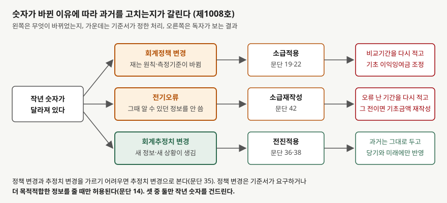
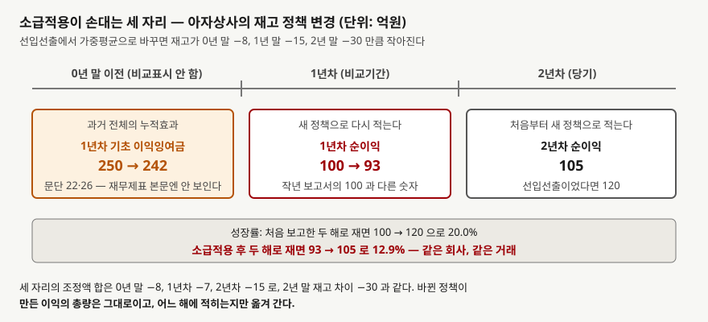

## 들어가며

작년 사업보고서에서 순이익 100억원을 확인하고 적어 두었다. 올해 보고서를 열어 전년
대비 성장률을 재려는데, 비교 칸에 적힌 작년 순이익이 93억원이다. 작년 보고서를 다시
열어 보니 분명히 100억원이다. 같은 회사의 같은 해 숫자가 두 보고서에서 다르다.

이럴 때 흔한 반응은 둘 중 하나다. 오타겠거니 하고 작년 보고서의 100억원을 그대로
쓰거나, 올해 보고서의 93억원으로 바꾸고 이유는 묻지 않는 것이다. 어느 쪽이든 성장률이
틀린다. 올해 순이익 105억원을 100억원과 비교하면 5%고 93억원과 비교하면 12.9%다.

작년 숫자가 바뀐 데는 기준서가 정한 이유가 있고, **이유에 따라 바뀌는 자리가 다르다.**
회계정책을 바꿨거나 전기에 오류가 있었으면 과거 숫자를 다시 적고, 추정치를 바꿨으면
과거는 그대로 둔다. 어느 쪽인지는 주석의 한 문단이 말해 준다.

## 개념

기업회계기준서 제1008호는 세 가지를 정의한다(문단 5).

- **회계정책** — 재무제표를 작성·표시하기 위해 적용하는 구체적인 원칙, 근거, 관습,
  규칙 및 관행. 재고 단위원가를 선입선출로 재는지 가중평균으로 재는지, 투자부동산을
  원가모형으로 재는지 공정가치모형으로 재는지가 정책이다
- **회계추정치** — 측정불확실성의 영향을 받는 재무제표상 화폐금액. 설비의 내용연수,
  매출채권의 기대신용손실, 재고의 순실현가능가치가 추정치다(문단 32)
- **전기오류** — 과거기간 재무제표를 작성할 때 **신뢰할 만한 정보를 이용하지 못했거나
  잘못 이용하여** 생긴 누락이나 왜곡표시. 그때 이용할 수 있었고 고려할 것이라고
  합리적으로 기대되는 정보여야 한다. 계산 실수, 정책 적용 오류, 사실의 간과, 부정이
  들어간다

셋을 가르는 기준은 **그 정보가 그때 있었는가**다. 정책 변경은 재는 원칙 자체를 바꾸는
것이고, 추정치 변경은 새 정보나 새 상황이 생겨 추정을 고치는 것이며(문단 34), 오류는
그때 이미 있던 정보를 쓰지 않은 것이다. 정책 변경과 추정치 변경을 가르기 어려우면
추정치 변경으로 본다(문단 35).

처리는 둘로 나뉜다. 정책 변경과 오류는 **소급**이고, 추정치 변경은 **전진**이다.

- **소급적용**(정책 변경) — 새 정책을 처음부터 적용한 것처럼, 비교표시되는 가장 이른
  과거기간의 자본 기초금액과 각 과거기간의 대응 금액을 조정한다(문단 19·22)
- **소급재작성**(오류) — 오류가 발생한 과거기간이 비교표시되면 그 재무정보를
  재작성하고, 그보다 앞서 발생했으면 가장 이른 과거기간의 기초금액을 재작성한다(문단 42)
- **전진적용**(추정치 변경) — 변경이 발생한 기간과 미래기간의 당기손익에 인식한다.
  과거기간과 연관되지 않으며 오류수정으로 보지 않는다(문단 34·36)

정책은 아무 때나 바꿀 수 없다. 기준서가 요구하거나, 바꾼 쪽이 **신뢰성 있고 더
목적적합한 정보**를 줄 때만 허용된다(문단 14).

## 구조



> **출처**: 한국회계기준원 [기업회계기준서 제1008호 '회계정책, 회계추정치 변경과 오류'](https://www.samili.com/acc/Kijun/Kijunjomun.asp?code=1978-1008) 문단 5·14·19·22·34~36·42 (제3자 전재, 2021-09-10 개정) — 원문 발행처 [한국회계기준원](https://www.kasb.or.kr/front/board/ingAccountingList.do), 대응 국제기준은 [IFRS Foundation](https://www.ifrs.org/issued-standards/list-of-standards/ias-8-accounting-policies-changes-in-accounting-estimates-and-errors/)의 IAS 8

왼쪽 세 상자가 "무엇이 바뀌었는가"고 가운데가 기준서의 처리, 오른쪽이 독자가 보는
결과다. 위 두 줄은 **작년 숫자를 건드리고** 아랫줄은 건드리지 않는다. 들어가며에서
작년 순이익이 93억원으로 바뀌어 있었다면 위 두 줄 중 하나다.

## 동작 원리

### 소급적용은 세 자리를 손댄다



> **출처**: 한국회계기준원 [기업회계기준서 제1008호](https://www.samili.com/acc/Kijun/Kijunjomun.asp?code=1978-1008) 문단 22·26 (제3자 전재, 2021-09-10 개정) — 원문 발행처 [한국회계기준원](https://www.kasb.or.kr/front/board/ingAccountingList.do). 금액은 이 글의 `code/output.txt` `[A]`에서 옮겼다

올해 보고서에는 당기와 비교기간, 보통 두 해가 실린다. 새 정책을 "처음부터 적용한
것처럼" 만들려면 세 자리를 고쳐야 한다.

1. **비교기간보다 앞선 기간**의 누적효과. 재무제표 본문에 그 해가 없으므로 비교표시되는
   가장 이른 기간의 **기초 이익잉여금**을 조정한다(문단 22·26). 자본변동표의 첫 줄
   "회계정책 변경 효과"가 이 자리다
2. **비교기간**. 새 정책으로 다시 적는다. 작년 보고서의 숫자와 달라진다
3. **당기**. 처음부터 새 정책으로 적는다

조정액 셋을 더하면 2년 말 재고 차이와 같다. 정책이 바꾸는 것은 **이익의 총량이 아니라
이익이 적히는 해**다. 그래서 두 해의 조정액이 같은 부호라도 크기가 다르면 성장률이
움직인다.

### 오류는 비용을 원래 기간으로 돌려보낸다

1년차에 잡았어야 할 비용을 빠뜨리고 2년차에 지급하면서 2년차 비용으로 잡았다면,
2년차 보고서에서 1년차 순이익은 그 금액만큼 줄고 2년차 순이익은 그만큼 는다. 두 해의
합은 그대로다. 비용이 **한 해에서 다른 해로 옮겨 갈 뿐**이다. 성장률은 양쪽에서
반대 방향으로 밀려 크게 흔들린다.

### 추정치 변경은 과거를 건드리지 않는다

설비 내용연수를 늘리면 변경한 기간 초의 장부금액을 새 잔여 내용연수로 나눈다(문단 38).
1년차 감가상각비는 그대로다. 작년 보고서와 올해 보고서의 1년차 숫자가 같다. 달라지는
것은 올해부터의 감가상각비다. 그래서 추정치 변경은 비교 숫자를 바꾸지 않으면서
**올해 이익만 올리거나 내린다.** 문단 39는 변경 내용과 금액을 공시하게 한다.

## 실습 예제

가상 회사 **아자상사**의 처음 보고한 숫자로 세 경우를 각각 계산한다. 1년차는 매출
1,000억원, 매출원가 700억원, 기타비용 200억원으로 순이익 100억원이고, 2년차는 매출
1,100억원, 매출원가 760억원, 기타비용 220억원으로 순이익 120억원이다. 처음 보고한
성장률은 20%다. 법인세는 비교를 단순하게 하려고 0으로 둔다.

```python
def policy_change() -> None:
    """[A] 매출원가 = 기초재고 + 매입 - 기말재고. 매입은 같으므로 재고 차이만 매출원가를 움직인다."""
    diff = {y: INVENTORY_WAVG[y] - INVENTORY_FIFO[y] for y in (0, 1, 2)}
    restated = {}
    for y in (1, 2):
        # 기초재고가 diff[y-1] 만큼 작아지면 매출원가도 그만큼 작아지고, 기말재고가 diff[y] 만큼 작아지면 그만큼 커진다
        cogs = REPORTED[y].cogs + diff[y - 1] - diff[y]
        restated[y] = Year(REPORTED[y].revenue, cogs, REPORTED[y].other_expense)
```

전체 소스: [`code/`](code/)

### 정책 변경 — 재고 단위원가를 바꾼다

재고 단위원가를 선입선출에서 가중평균으로 바꾼다. 기말 재고가 0년 말 100억원에서
92억원, 1년 말 120억원에서 105억원, 2년 말 140억원에서 110억원으로 작아진다고 둔다.
매입액은 같으므로 매출원가는 **기초 재고 차이와 기말 재고 차이의 변화분**만큼 움직인다.

```text
[A] 회계정책 변경 (선입선출 → 가중평균) — 소급적용, 문단 19·22
                항목        0년 말        1년 말        2년 말
------------------------------------------------------
          재고(선입선출)       100.0       120.0       140.0
          재고(가중평균)        92.0       105.0       110.0
             재고 차이        -8.0       -15.0       -30.0

                손익         처음 보고        소급적용 후            조정
------------------------------------------------------------
      1년차(비교) 매출원가         700.0         707.0          +7.0
       1년차(비교) 순이익         100.0          93.0          -7.0
      2년차(당기) 매출원가         760.0         775.0         +15.0
       2년차(당기) 순이익         120.0         105.0         -15.0

  1년차 기초 이익잉여금: 250.0 → 242.0 (-8.0)
  0년 말 이전에 쌓인 누적효과는 비교표시되는 가장 이른 기간의 기초 이익잉여금으로 들어간다 (문단 22·26)
  순이익 성장률: 처음 보고 20.0% → 소급적용 후 12.9%
```

들어가며의 93억원이 이 표의 1년차 순이익이다. 재고 차이가 8, 15, 30억원으로 해마다
벌어지므로 매출원가가 1년차 7억원, 2년차 15억원 커진다. 두 해가 같은 방향으로
조정됐는데도 크기가 다르니 성장률이 20%에서 12.9%로 내려간다. 0년 말의 8억원은 두 해
어디에도 안 보이고 기초 이익잉여금에서만 빠진다.

### 오류 수정 — 빠뜨린 비용을 돌려보낸다

```text
[B] 전기오류 수정 (1년차 비용 12 누락) — 소급재작성, 문단 42
                손익         처음 보고         재작성 후            조정
------------------------------------------------------------
       1년차(비교) 순이익         100.0          88.0         -12.0
       2년차(당기) 순이익         120.0         132.0         +12.0
            두 해 합계         220.0         220.0          +0.0

  1년 말 미지급비용(부채) +12.0, 1년 말 이익잉여금 -12.0 로 재작성
  순이익 성장률: 처음 보고 20.0% → 재작성 후 50.0%
```

12억원이 2년차에서 1년차로 옮겨 가자 성장률이 20%에서 50%로 뛴다. 두 해 합계는
220억원 그대로다. 오류 수정은 정책 변경보다 성장률을 더 크게 흔든다. 한 해는 내려가고
다른 해는 올라가기 때문이다.

### 추정치 변경 — 내용연수를 늘린다

```text
[C] 회계추정치 변경 (내용연수 5년 → 잔여 7년) — 전진적용, 문단 36·38
             감가상각비       변경 전 추정          변경 후            조정
------------------------------------------------------------
           1년차(비교)          40.0          40.0          +0.0
           2년차(당기)          40.0          22.9         -17.1
         3년차 이후 매년          40.0          22.9         -17.1

  2년차 초 장부금액 160.0 을 잔여 7년으로 나눈다. 1년차 숫자는 손대지 않는다
  2년차 순이익: 120.0 → 137.1 (+17.1)
```

1년차 줄이 그대로다. 2년차 초 장부금액 160억원을 7년으로 나누니 감가상각비가
40억원에서 22.9억원으로 줄고, 그만큼 올해 순이익이 는다. 작년 보고서와 올해 보고서의
비교 칸이 같으므로 독자는 숫자가 바뀐 것을 눈치채지 못한다. 대신 올해 이익이 17.1억원
좋아진 이유가 영업이 아니라 추정에 있다.

### 세 갈래가 손대는 자리

```text
[D] 세 갈래가 손대는 자리
              구분            처리       비교기간(1년차)        기초 이익잉여금          당기
--------------------------------------------------------------------------
           정책 변경          소급적용          다시 적는다            조정한다        새 정책
            전기오류         소급재작성          다시 적는다        오류 시점 따라       바로잡는다
          추정치 변경          전진적용             그대로             그대로        새 추정
```

## 실무에서 주의할 점

- **작년 보고서의 숫자를 올해 보고서의 비교 칸과 대조한다.** 다르면 주석에서 이유를
  찾는다. 문단 29는 자발적 정책 변경의 성격과 각 항목별 조정금액, 주당이익 조정금액을
  공시하게 하고, 문단 49는 오류의 성격과 수정금액을 같은 수준으로 공시하게 한다. 조정
  없이 숫자만 다르면 그 자체가 질문거리다.

- **성장률과 추세는 소급적용 후 숫자로 다시 잰다.** 작년 보고서의 100억원과 올해의
  105억원을 섞어 비교하면 서로 다른 정책으로 잰 숫자를 비교하는 것이다. 다만 비교기간
  하나만 다시 적히고 그 전 해들은 안 적히므로, 3년 이상 추세를 그릴 때는 앞쪽 해가
  옛 정책인 채로 남는다. 문단 26은 과거 재무자료 요약도 실무적으로 가능한 데까지
  소급하게 하지만, 사업보고서의 요약 재무정보가 전부 다시 적혀 있는지는 확인해야 한다.

- **오류 수정이 잦은 회사는 숫자 자체를 의심한다.** 오류는 그때 알 수 있던 정보를
  쓰지 않은 것이다. 문단 41은 특정한 의도대로 표시하려고 오류를 넣은 재무제표는
  기준서에 따라 작성된 것이 아니라고 못 박는다. 반복되는 재작성은
  [내부회계관리제도](../../disclosure/2026-10-29-icfr-audit-and-adverse-opinion/index.md)
  의견과 함께 본다.

- **추정치 변경은 비교 칸을 안 바꾸므로 더 찾기 어렵다.** 내용연수 연장, 충당금
  설정률 조정, 잔존가치 변경은 올해 이익만 움직인다. 문단 39가 변경 효과의 금액을
  공시하게 하므로 올해 이익 증가분 중 얼마가 추정 변경에서 왔는지 주석에서 뺀다.
  [감가상각](../2026-09-30-depreciation-non-cash-expense/index.md)에서 다룬 내용연수가
  이 자리의 가장 흔한 변수다.

- **정책과 추정의 경계에 있는 항목은 회사의 분류를 그대로 믿지 않는다.** 문단 35는
  측정기준의 변경은 정책 변경이고 구분이 어려우면 추정치 변경으로 본다고 적는다.
  추정치 변경으로 분류하면 과거를 안 고치고 공시도 가벼워진다. 재고 평가충당금
  설정률처럼 과거에 이미 있던 정보를 뒤늦게 반영한 것이라면 오류일 수 있다.

- **소급적용이 실무적으로 불가능하면 전진 적용한다.** 문단 23~25는 누적효과를
  결정할 수 없을 때 실무적으로 적용할 수 있는 가장 이른 기간부터 전진 적용하게 한다.
  이 경우 문단 29가 그 사유와 적용 시기를 공시하게 하므로, 비교 칸이 그대로인데
  정책이 바뀌었다면 이 공시를 찾는다.

## 정리

- 제1008호는 회계정책(원칙), 회계추정치(측정불확실성 아래의 금액), 전기오류(그때
  있던 정보를 안 쓴 것)를 정의하고(문단 5) 처리를 둘로 나눈다. 정책 변경은
  소급적용(문단 19·22), 오류는 소급재작성(문단 42), 추정치 변경은 전진적용(문단 36)이다.
- 소급은 비교기간보다 앞선 누적효과를 기초 이익잉여금에, 비교기간을 다시 적은 숫자에,
  당기를 새 정책에 둔다. 세 조정액의 합은 변경이 만든 총 차이와 같다.
- 재고 정책 변경으로 1년차 순이익이 100억원에서 93억원, 성장률이 20%에서 12.9%로
  바뀌었다. 비용 누락 오류 수정은 같은 100억원을 88억원으로 다시 적고 성장률을 50%로
  올렸다. 두 해 합계는 그대로다.
- 내용연수 연장은 1년차를 그대로 둔 채 2년차 순이익만 17.1억원 올렸다. 비교 칸이 안
  바뀌므로 주석의 변경 효과 공시(문단 39)로만 찾을 수 있다.
- 작년 보고서와 올해 보고서의 비교 칸이 다르면 주석의 조정금액(문단 29·49)을 찾고,
  성장률은 다시 적힌 숫자로 잰다.

## 참고 자료

- [한국회계기준원](https://www.kasb.or.kr/front/board/ingAccountingList.do) — K-IFRS 기준서 발행처. 아래 전재 링크는 조문을 바로 열기 위한 편의 링크다
- [기업회계기준서 제1008호 '회계정책, 회계추정치 변경과 오류'](https://www.samili.com/acc/Kijun/Kijunjomun.asp?code=1978-1008) (제3자 전재, 2021-09-10 개정) — 문단 5 정의, 문단 14 변경 허용 요건, 문단 19·22·26 소급적용, 문단 23~25 소급적용의 한계, 문단 29 공시, 문단 32·34~39 회계추정치와 그 변경, 문단 41·42·49 전기오류
- [IAS 8 Accounting Policies, Changes in Accounting Estimates and Errors](https://www.ifrs.org/issued-standards/list-of-standards/ias-8-accounting-policies-changes-in-accounting-estimates-and-errors/) — IFRS Foundation. 제1008호가 대응하는 국제기준이며, 2021년 회계추정치 정의 개정 이력을 확인할 수 있다
- 숫자는 이 글의 [`code/output.txt`](code/output.txt) `[A]`~`[D]`에서 옮겼다
