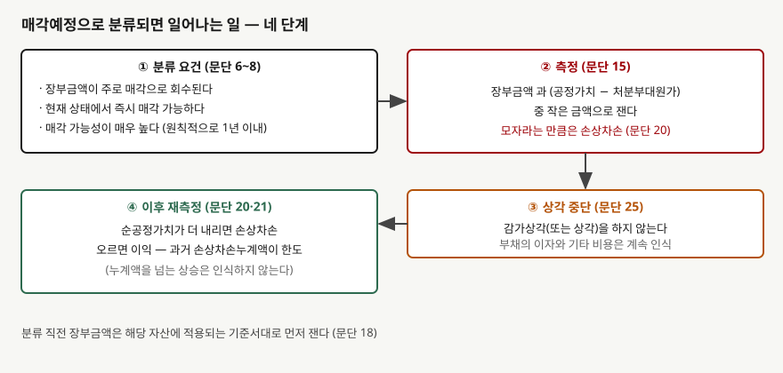
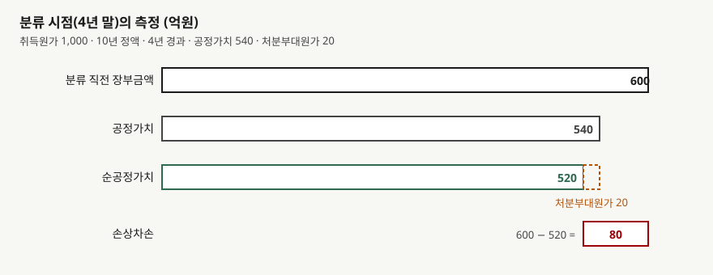

## 들어가며

사업 일부를 팔기로 이사회가 결정하고 인수 후보와 협상을 시작했다고 하자. 그 사업에 속한 설비는 아직 공장에 서 있고 가동도 한다. 결산 때 이 설비의 감가상각을 늘 하던 대로 해야 할까.

계속 사용하는 설비라면 그렇게 한다. 그런데 팔려고 내놓은 설비는 장부금액이 **쓰면서가 아니라 팔면서** 회수된다. 쓰는 동안 닳는 몫을 비용으로 나누는 것이 감가상각이므로, 쓰지 않고 팔 것이라면 그 나눔의 이유가 사라진다. 기준서는 이 경우를 별도 분류로 떼어 두었다.

분류하면 두 가지가 한꺼번에 바뀐다. 장부금액은 **순공정가치**까지 내려갈 수 있고, 그 뒤로 감가상각은 멈춘다. 두 효과가 손익을 반대 방향으로 흔드는 모양을 가상 회사의 설비 한 대로 따라간다. [앞 글](../2026-11-04-intangible-indefinite-life-no-amortisation/index.md)에서는 상각하지 않는 무형자산을 다뤘다. 이 글은 상각이 **멈추는 또 하나의 경우**다.

## 개념

기업회계기준서 제1105호는 비유동자산의 장부금액이 계속사용이 아니라 **매각거래를 통해 주로 회수될 것이라면** 매각예정으로 분류하게 한다(문단 6). 분류 요건은 세 가지다.

- 현재의 상태에서 통상적이고 관습적인 거래조건만으로 **즉시 매각 가능**하다(문단 7)
- **매각될 가능성이 매우 높다**(문단 7)
- 문단 9가 허용하는 경우를 제외하고는 분류 시점에서 **1년 이내에 매각이 완료**될 것으로 예상된다(문단 8)

'매각 가능성이 매우 높다'에는 요건이 붙는다. 적절한 지위의 경영진이 매각계획을 확약하고, 매수자를 찾고 계획을 이행하는 업무를 이미 시작해야 한다. 현행 공정가치에 비추어 합리적인 가격으로 적극 추진해야 하고, 계획이 크게 바뀌거나 철회될 가능성이 낮아야 한다(문단 8). 매각 완료가 기업이 통제할 수 없는 사유로 1년을 넘기는 경우도 문단 9에서 따로 다룬다.

분류하면 측정이 바뀐다. 매각예정 비유동자산은 **공정가치에서 처분부대원가를 뺀 금액과 장부금액 중 작은 금액**으로 잰다(문단 15). 분류 직전의 장부금액은 그 자산에 적용되는 기준서대로 먼저 측정한다(문단 18). 그 뒤 감가상각은 하지 않는다(문단 25).

## 구조



> **출처**: 한국회계기준원 [기업회계기준서 제1105호 '매각예정비유동자산과 중단영업'](https://www.samili.com/acc/Kijun/Kijunjomun.asp?code=1978-1105) 문단 6~8·15·18·20·21·25 (제3자 전재, 2021-04-23 개정) — 원문 발행처 [한국회계기준원](https://www.kasb.or.kr/front/board/ingAccountingList.do), 대응 국제기준은 [IFRS Foundation](https://www.ifrs.org/issued-standards/list-of-standards/ifrs-5-non-current-assets-held-for-sale-and-discontinued-operations/)의 IFRS 5

네 단계는 순서가 있다. 요건을 충족한 시점이 기준점이고, 그 시점에 측정과 상각 중단이 같이 일어난다. 이후에는 결산마다 순공정가치를 다시 보고 손상차손이나 환입을 인식한다.

한 가지가 따로 있다. 분류된 자산이 속한 처분자산집단의 **부채에 붙는 이자와 기타 비용은 계속 인식한다**(문단 25). 상각은 멈추어도 부채 쪽 비용까지 멈추는 것은 아니다.

## 동작 원리

### 작은 금액으로 재면 손실이 먼저 앞당겨진다

계속 사용하는 자산은 회수가능액이 장부금액을 밑돌 때만 손상을 본다. 매각예정 자산은 **순공정가치가 장부금액보다 낮기만 하면** 그 차이를 손상차손으로 인식한다(문단 20). 처분부대원가가 순공정가치 계산에 들어가기 때문에, 공정가치가 장부금액과 같더라도 부대원가만큼은 손실이 된다.



> **출처**: 한국회계기준원 [기업회계기준서 제1105호](https://www.samili.com/acc/Kijun/Kijunjomun.asp?code=1978-1105) 문단 15·20 (제3자 전재, 2021-04-23 개정) — 원문 발행처 [한국회계기준원](https://www.kasb.or.kr/front/board/ingAccountingList.do). 금액은 이 글의 `code/output.txt` `[1]`에서 옮겼다

### 분류 이후에는 상각이 없고 환입에는 한도가 있다

분류한 해의 장부금액은 새 측정액이다. 그 뒤 순공정가치가 오르면 이익을 인식하되 **과거에 인식한 손상차손누계액을 넘을 수 없다**(문단 21). 처음 취득원가나 분류 직전 장부금액을 넘는 이익을 올릴 수는 없다는 뜻이다. 상각이 멈추므로 장부금액은 해마다 줄지 않고, 순공정가치가 움직이는 만큼만 오르내린다.

## 실습 예제

가상 회사 **라마기계**가 취득원가 1,000억원, 내용연수 10년, 잔존가치 0의 정액법 설비를 갖고 있다. 4년 말에 매각예정으로 분류한다. 그 해 감가상각은 분류 전에 이미 인식했고, 분류 직전 장부금액은 600억원이다. 처분부대원가는 20억원이고 1년 안에 매각되므로 현재가치 계산은 생략한다(문단 17). 공정가치는 4년 말 540억원, 5년 말 580억원이다.

설비 말고 세전이익은 해마다 250억원이라고 둔다. 비교 대상은 **분류하지 않고 계속 사용한 경우**다. 세금과 표시 위치는 보지 않는 단순 모형이다. 손상차손이 손익계산서 어느 줄에 들어가는지는 이 글의 범위가 아니다.

```python
def held_for_sale(p: Plant) -> list[dict[str, float]]:
    """분류 연도 말부터 순공정가치와 장부금액 중 작은 금액으로 재고 상각을 멈춘다."""
    ...
        if year <= p.classified_year:
            carrying -= depreciation
            dep = depreciation
        else:
            dep = 0.0  # 문단 25 — 분류된 비유동자산은 감가상각하지 않는다
        ...
            elif net_fair > carrying and cumulative_loss > 0:
                reversal = min(net_fair - carrying, cumulative_loss)  # 문단 21
```

전체 소스: [`code/`](code/)

### 분류 시점의 측정

```text
[1] 분류 시점(4년 말)의 측정 — 장부금액과 순공정가치 중 작은 금액 (단위: 억원)
                  분류 직전 장부금액       600.0
                        공정가치       540.0
                      처분부대원가        20.0
                       순공정가치       520.0
                 측정액 (작은 금액)       520.0
                        손상차손        80.0
```

공정가치 540억원은 장부금액 600억원보다 60억원 낮은데, 손상차손은 80억원이다. 처분부대원가 20억원이 더 얹혔기 때문이다.

### 연차별 비교

```text
[2] 연차별 비교 — 계속 사용 대 매각예정 분류 (단위: 억원)
    연차       사용 상각       분류 상각       분류 손상       분류 환입       사용 장부       분류 장부
------------------------------------------------------------------------------
     1       100.0       100.0         0.0         0.0       900.0       900.0
     2       100.0       100.0         0.0         0.0       800.0       800.0
     3       100.0       100.0         0.0         0.0       700.0       700.0
     4       100.0       100.0        80.0         0.0       600.0       520.0
     5       100.0         0.0         0.0        40.0       500.0       560.0
```

4년 차에 장부금액이 80억원 벌어진다. 5년 차에는 분류한 쪽이 상각을 하지 않고 순공정가치 상승분 40억원을 환입해 장부금액이 560억원이 된다. 환입 한도는 누계 손상차손 80억원이므로 40억원은 한도 안이다.

### 세전이익

```text
[3] 세전이익과 5년 누적 — 설비 손익이 두 번 갈린다 (단위: 억원)
    연차       사용 세전이익       분류 세전이익
----------------------------------
     1         150.0         150.0
     2         150.0         150.0
     3         150.0         150.0
     4         150.0          70.0
     5         150.0         290.0

  세전이익 합계: 사용 750.0 / 분류 810.0 / 차이 60.0
  5년 말 장부금액 차이 60.0
  세전이익 차이 = 장부금액 차이: True
```

읽을 것이 세 가지다.

- **4년 차에는 분류한 쪽이 80억원 낮다.** 손상차손 80억원이 상각 100억원 위에 얹혔다.
- **5년 차에는 분류한 쪽이 140억원 높다.** 상각 100억원이 사라지고 환입 40억원이 들어왔다.
- **5년 누적 차이는 60억원이고 장부금액 차이와 같다.** 분류는 이익을 새로 만들지 않고 시점을 옮긴다. 상각을 멈춘 만큼 장부금액이 덜 줄었기 때문이다.

## 실무에서 주의할 점

- **분류 연도와 다음 해의 이익은 같은 방향으로 읽지 않는다.** 분류 연도에는 손상차손이 이익을 깎고, 다음 해에는 상각이 없어 이익이 올라 보인다. 영업 성과가 변한 것이 아니다.
  [영업이익과 순이익의 간극](../2026-09-30-operating-vs-net-income-gap/index.md)을 볼 때처럼 일회성 항목을 먼저 분리한다.

- **매각 계획이 바뀌면 상각이 돌아온다.** 이 글은 분류가 유지되는 경우만 계산했다. 매각 계획 변경 시의 재분류 처리는 문단 26~29에 있으나 이 글에서 확인하지 않았다. 해당 처리가 필요하면 기준서에서 직접 확인한다.

- **자산의 감가상각비가 갑자기 0이 된 이유는 주석에서 찾는다.** 설비가 줄지도 팔리지도 않았는데 상각비가 줄었다면 분류 변경일 수 있다.
  [감가상각의 비현금성](../2026-09-30-depreciation-non-cash-expense/index.md)에서 다룬 EBITDA 되더하기도 영향을 받는다.

- **중단영업과 같은 기준서에 있지만 다른 개념이다.** 제1105호는 매각예정 분류와 중단영업의 표시를 함께 정한다. 매각예정 분류는 자산 하나에도 해당하지만, 중단영업은 영업상 구별되는 현금흐름을 가진 구분단위여야 한다. 중단영업은
  [중단영업](../2026-10-13-discontinued-operations/index.md)에서 다뤘다.

- **손상 판단의 틀이 다르다.** 계속 사용 자산은 회수가능액(사용가치와 순공정가치 중 큰 금액)으로 판단하고, 매각예정 자산은 순공정가치만 본다. 계속 사용 쪽은
  [손상 회수가능액](../2026-10-31-impairment-recoverable-amount/index.md)에서 다뤘다.

- **환입 한도를 넘는 상승은 장부에 오르지 않는다.** 순공정가치가 처음 장부금액을 크게 웃돌아도 이익은 과거 손상차손누계액까지다. 이 글에서는 한도 안에서만 계산했다.

## 정리

- 장부금액이 주로 매각으로 회수될 비유동자산은 즉시 매각 가능하고 매각 가능성이 매우 높을 때 매각예정으로 분류한다(문단 6~8). 원칙적으로 1년 이내 매각이 요건이다.
- 분류하면 장부금액과 순공정가치 중 작은 금액으로 재고(문단 15), 이후 감가상각을 하지 않는다(문단 25).
- 가상 설비는 분류 시점에 장부금액 600억원이 순공정가치 520억원으로 내려가 손상차손 80억원이 생겼다. 5년 차에는 상각 100억원이 사라지고 40억원을 환입했다.
- 5년 누적 세전이익 차이 60억원은 5년 말 장부금액 차이와 같다. 분류는 이익의 시점을 옮긴다.
- 환입은 과거 손상차손누계액이 한도다(문단 21). 부채의 이자와 비용은 상각이 멈춘 뒤에도 계속 인식한다(문단 25).

## 참고 자료

- [한국회계기준원](https://www.kasb.or.kr/front/board/ingAccountingList.do) — K-IFRS 기준서 발행처. 아래 전재 링크는 조문을 바로 열기 위한 편의 링크다
- [기업회계기준서 제1105호 '매각예정비유동자산과 중단영업'](https://www.samili.com/acc/Kijun/Kijunjomun.asp?code=1978-1105) (제3자 전재, 2021-04-23 개정) — 문단 6~8 분류 요건, 문단 15·17·18 측정, 문단 20·21 손상차손과 환입, 문단 25 상각 중단
- [IFRS 5 Non-current Assets Held for Sale and Discontinued Operations](https://www.ifrs.org/issued-standards/list-of-standards/ifrs-5-non-current-assets-held-for-sale-and-discontinued-operations/) — IFRS Foundation. 제1105호가 대응하는 국제기준이다
- 숫자는 이 글의 [`code/output.txt`](code/output.txt) `[1]`~`[3]`에서 옮겼다
