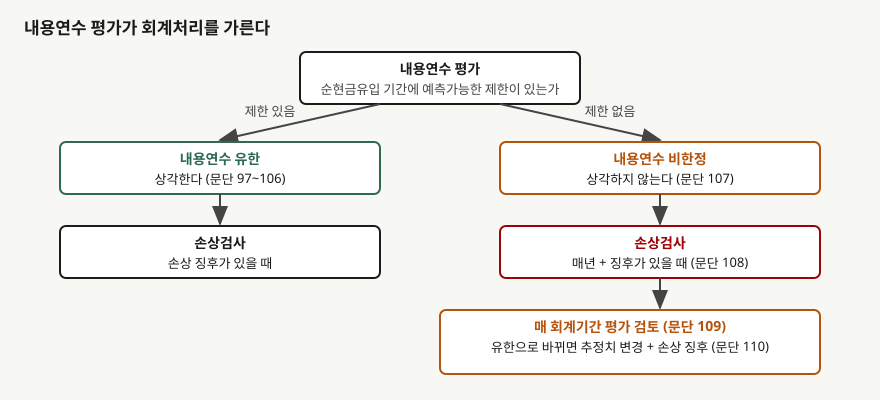
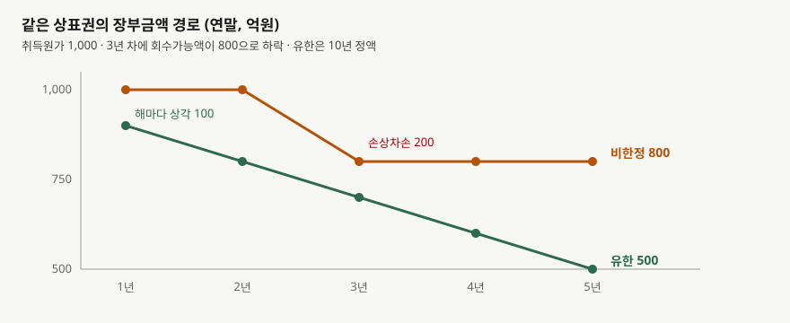

## 들어가며

같은 업종 두 회사의 손익계산서를 나란히 놓았다. 매출도 비슷하고 둘 다 1,000억원짜리 상표권을 갖고 있는데, 한쪽은 영업이익률이 해마다 20%이고 다른 쪽은 13%다. 영업 성과를 따져 봐도 차이가 없다. 같은 해의 영업이익 차이를 영업 실력으로 읽기 시작하면 결론이 틀어진다.

주석을 열어 보면 이유가 한 줄에 있다. 한 회사는 상표권의 내용연수를 **비한정**으로 보아 상각하지 않고, 다른 회사는 10년으로 보아 해마다 100억원을 상각한다. 100억원은 매출 1,500억원의 6.7%다. 영업이익률 차이 6.7%포인트가 그대로 이 한 줄에서 나온다.

반대편의 대가도 있다. 상각하지 않는 쪽은 **매년 손상검사**를 받는다. 상표 가치가 꺼지는 해에는 한꺼번에 큰 손실이 찍힌다. 두 회사의 5년을 따라가며 어느 해에 어느 쪽이 더 높아 보이는지 확인한다.

## 개념

기업회계기준서 제1038호는 무형자산의 내용연수가 유한한지 비한정인지를 먼저 평가하게 한다(문단 88). 기준은 **그 자산이 순현금유입을 창출할 것으로 기대되는 기간에 예측가능한 제한이 있는가**다. 제한이 없으면 비한정으로 본다.

이 평가로 회계처리가 갈린다(문단 89). 유한하면 상각하고, 비한정이면 상각하지 않는다(문단 107). 대신 비한정 자산은 **매년, 그리고 손상을 시사하는 징후가 있을 때** 회수가능액과 장부금액을 비교해 손상검사를 한다(문단 108).

'비한정'이 '영원'은 아니다. 문단 91은 '비한정'이 '무한'을 뜻하지 않는다고 적는다. 평가 시점의 표준적인 성능 수준을 유지하는 데 드는 미래 유지비용과, 그 비용을 부담할 능력과 의도만 반영해야 한다. 성능을 끌어올리는 계획된 추가 지출을 근거로 비한정이라고 결론 내리면 안 된다.

결정에 쓰는 요인은 여덟 가지가 예시로 나열된다(문단 90). 제품수명주기, 진부화, 산업 안정성, 경쟁자 전략, 유지비용 부담 능력, 법적 제한 같은 것들이다. 계약상·법적 권리에서 생긴 자산이라면 내용연수가 그 권리 기간을 넘을 수 없고, 갱신기간은 **유의적인 원가 없이 갱신될 것이 명백할 때만** 넣는다(문단 94·96).

## 구조



> **출처**: 한국회계기준원 [기업회계기준서 제1038호 '무형자산'](https://www.samili.com/acc/Kijun/Kijunjomun.asp?code=1978-1038) 문단 88~89·97~110 (제3자 전재, 2021-04-23 개정) — 원문 발행처 [한국회계기준원](https://www.kasb.or.kr/front/board/ingAccountingList.do), 대응 국제기준은 [IFRS Foundation](https://www.ifrs.org/issued-standards/list-of-standards/ias-38-intangible-assets/)의 IAS 38

두 갈래는 **상각 여부**와 **손상검사의 주기**에서 갈린다. 유한 쪽은 상각으로 장부금액이 해마다 내려가고, 손상검사는 징후가 있을 때만 한다. 비한정 쪽은 상각이 없는 대신 징후와 관계없이 매년 검사를 받고, 평가 자체도 매 회계기간 검토한다(문단 109).

## 동작 원리

### 장부금액이 내려가는 길이 다르다

상각은 사전에 정해 둔 속도로 장부금액을 깎는다. 손상차손은 **회수가능액이 장부금액 아래로 내려갔을 때만** 깎는다. 비한정 자산은 앞의 길이 없으므로 장부금액이 취득원가에 머물다가, 가치가 꺼지는 해에 한 번에 내려간다.



> **출처**: 한국회계기준원 [기업회계기준서 제1038호](https://www.samili.com/acc/Kijun/Kijunjomun.asp?code=1978-1038) 문단 97·107·108 (제3자 전재, 2021-04-23 개정) — 원문 발행처 [한국회계기준원](https://www.kasb.or.kr/front/board/ingAccountingList.do). 금액은 이 글의 `code/output.txt` `[1]`에서 옮겼다

### 유한 쪽은 손상차손이 없을 수도 있다

같은 하락이 와도 손상차손이 찍히는 쪽은 한 곳뿐이다. 3년 차에 회수가능액이 800억원으로 떨어졌을 때, 유한 쪽은 이미 상각이 두 번 지나 장부금액이 700억원이다. 회수가능액이 장부금액을 웃돌므로 손상차손이 없다. 비한정 쪽은 장부금액이 1,000억원 그대로라 차이 200억원이 그해 손실이 된다.

**상각이 장부금액을 미리 낮춰 둔 덕에 손상 충격을 흡수한 셈이다.** 이 흡수는 유한 쪽이 이미 영업이익에서 매년 100억원씩 치른 대가다.

### 평가는 매 기간 다시 한다

비한정이라는 평가가 계속 맞는지 매 회계기간 검토한다(문단 109). 사건과 상황이 그 평가를 더 뒷받침하지 못하면 유한으로 바꾸고, 이 변경은 오류 수정이 아니라 **회계추정치의 변경**으로 처리한다. 문단 110은 이 재평가 자체를 손상의 징후로 보게 한다. 유한으로 바꾸는 순간 손상검사를 하고, 장부금액이 회수가능액을 넘으면 그 초과액을 손상차손으로 인식한다.

## 실습 예제

가상 회사 **가나브랜드**와 **다라브랜드**가 같은 상표권을 갖고 있다. 취득원가 1,000억원, 매출 1,500억원, 상표권 상각·손상 전 영업이익 해마다 300억원이다. 가나브랜드는 비한정으로, 다라브랜드는 10년 정액으로 분류했다. 잔존가치는 0이다. 회수가능액은 1·2년 차 1,100억원, 3년 차부터 800억원이다.

**세금과 다른 비용은 고정한 단순 모형이다.** 두 회사의 영업 성과와 회수가능액이 같도록 만들었으므로, 보이는 차이는 분류에서만 온다. 유한 쪽은 징후가 3년 차에 생겼다고 보아 그해부터 손상검사를 한다.

```python
def indefinite(b: Brand) -> list[dict[str, float]]:
    """문단 107~108 — 상각하지 않고 매년 손상검사를 한다."""
    rows, carrying = [], b.cost
    for year in range(1, YEARS + 1):
        loss = max(0.0, carrying - b.recoverable[year - 1])
        carrying -= loss
        rows.append(_row(b, year, 0.0, loss, carrying))
    return rows
```

전체 소스: [`code/`](code/)

### 장부금액

```text
[1] 상표권 장부금액 — 비한정은 상각 없이 손상차손으로만 줄고 유한은 해마다 깎인다 (단위: 억원)
    연차       회수가능액      비한정 상각      비한정 손상      비한정 장부       유한 상각       유한 장부
------------------------------------------------------------------------------
     1      1100.0         0.0         0.0      1000.0       100.0       900.0
     2      1100.0         0.0         0.0      1000.0       100.0       800.0
     3       800.0         0.0       200.0       800.0       100.0       700.0
     4       800.0         0.0         0.0       800.0       100.0       600.0
     5       800.0         0.0         0.0       800.0       100.0       500.0
```

비한정 쪽은 3년 차에 한 번 내려간 뒤 800억원에 머문다. 유한 쪽은 1년 차 900억원에서 5년 차 500억원까지 직선으로 내려온다.

### 영업이익

```text
[2] 영업이익과 영업이익률 — 같은 상표권, 같은 성과 (단위: 억원, %)
    연차      비한정 영업이익       유한 영업이익       비한정 이익률        유한 이익률
--------------------------------------------------------------
     1         300.0         200.0          20.0          13.3
     2         300.0         200.0          20.0          13.3
     3         100.0         200.0           6.7          13.3
     4         300.0         200.0          20.0          13.3
     5         300.0         200.0          20.0          13.3
```

네 해는 비한정 쪽이 높고, **3년 차 한 해만 순서가 뒤집힌다.** 영업이익률로 보면 20%와 13.3%가 6.7%와 13.3%로 바뀐다. 이 해의 낮은 이익률은 영업 악화가 아니라 한 번에 인식한 손상차손 200억원이다.

### 5년 누적

```text
[3] 5년 누적 — 영업이익의 차이가 장부금액의 차이와 같다 (단위: 억원)
                    항목           비한정            유한        차이
------------------------------------------------------------
                상각비 합계           0.0         500.0    -500.0
               손상차손 합계         200.0           0.0     200.0
               영업이익 합계        1300.0        1000.0     300.0
            5년 말 장부금액         800.0         500.0     300.0

  영업이익 차이 300.0 = 장부금액 차이 300.0: True
```

비한정 쪽은 상각 500억원을 덜 치르고 손상차손 200억원을 더 치렀다. 순차액 300억원이 영업이익 누적 차이이면서 5년 말 장부금액 차이다. 이 등식은 분류가 **이익을 만들어 내는 것이 아니라 시점을 옮긴다**는 뜻이다. 상표권이 끝내 가치를 잃는 해에 비한정 쪽은 남은 장부금액 전액을 손실로 치른다.

## 실무에서 주의할 점

- **영업이익률을 비교할 때 무형자산 상각 여부를 먼저 본다.** 상각비가 큰 회사와 없는 회사를 곧바로 견주면 분류 효과가 영업 성과로 읽힌다. 상각 전 이익으로 견주는
  [EBITDA 마진과 설비투자](../../ratios/2026-10-25-ebitda-margin-and-capex-gap/index.md)에서 다룬 방식은 이 차이를 지운다. 대신 상각 부담을 빼고 보게 된다는 한계가 있다.

- **비한정 자산이 큰 회사는 손상차손이 몰려서 찍힐 수 있다.** 유한 자산이 상각으로 조금씩 치르는 것을 비한정 자산은 한 해에 치른다. 연도별 이익의 흔들림이 크면 손상차손 내역부터 본다.

- **손상검사의 가정은 회사가 정한다.** 회수가능액 추정에는 할인율과 미래 현금흐름이 들어간다. 추정 방법은
  [손상 회수가능액](../2026-10-31-impairment-recoverable-amount/index.md)에서, 영업권 쪽 검사는
  [영업권 손상검사](../2026-10-10-goodwill-impairment-test/index.md)에서 다뤘다. 영업권도 상각하지 않고 매년 검사하는 점이 같다.

- **'비한정'과 '유한'의 경계는 판단이다.** 문단 90의 요인이 예시이고 정량 기준이 없다. 같은 종류의 자산을 회사마다 다르게 분류할 수 있고, 분류 변경은 회계추정치 변경이라 과거 재무제표를 고치지 않는다.

- **손상차손환입은 영업권과 다르다.** 영업권의 손상차손은 환입하지 못하지만, 그 밖의 자산은 제1036호가 정한 조건에서 환입이 허용된다. 상각하지 않는 자산의 손익이 손상과 환입으로 오가는 경로는 이 글의 모형에 넣지 않았다.

- **연구개발 지출의 자산화와 짝으로 본다.** 무엇을 무형자산으로 올리느냐가
  [연구·개발비 자산화와 비용화](../2026-10-22-rnd-capitalisation-vs-expense/index.md)에서 갈리고, 올린 뒤 어떻게 줄이느냐가 이 글이다. 둘 다 이익의 시점을 옮긴다.

## 정리

- 제1038호는 무형자산의 내용연수가 유한한지 비한정인지 먼저 평가하게 하고(문단 88), 유한은 상각하고 비한정은 상각하지 않는다(문단 89·107).
- 비한정 자산은 매년, 그리고 징후가 있을 때 손상검사를 한다(문단 108). 평가의 타당성도 매 회계기간 검토한다(문단 109).
- 같은 상표권 1,000억원을 5년간 따라가면 비한정 쪽은 영업이익이 1,300억원, 유한 쪽은 1,000억원이다. 차이 300억원은 상각 500억원과 손상차손 200억원의 순차액이다.
- 3년 차에는 순서가 뒤집힌다. 비한정 쪽은 한 해에 손상차손 200억원이 찍히고, 유한 쪽은 상각으로 이미 낮아진 장부금액 덕에 손상차손이 없다.
- '비한정'은 '무한'이 아니다(문단 91). 분류는 이익을 만드는 것이 아니라 시점을 옮긴다.

## 참고 자료

- [한국회계기준원](https://www.kasb.or.kr/front/board/ingAccountingList.do) — K-IFRS 기준서 발행처. 아래 전재 링크는 조문을 바로 열기 위한 편의 링크다
- [기업회계기준서 제1038호 '무형자산'](https://www.samili.com/acc/Kijun/Kijunjomun.asp?code=1978-1038) (제3자 전재, 2021-04-23 개정) — 문단 88·89 내용연수 평가, 문단 90 결정 요인, 문단 91 비한정의 뜻, 문단 94·96 법적 권리와 갱신, 문단 107·108 비한정 자산의 비상각과 손상검사, 문단 109·110 평가 검토
- [IAS 38 Intangible Assets](https://www.ifrs.org/issued-standards/list-of-standards/ias-38-intangible-assets/) — IFRS Foundation. 제1038호가 대응하는 국제기준이다
- 숫자는 이 글의 [`code/output.txt`](code/output.txt) `[1]`~`[3]`에서 옮겼다
