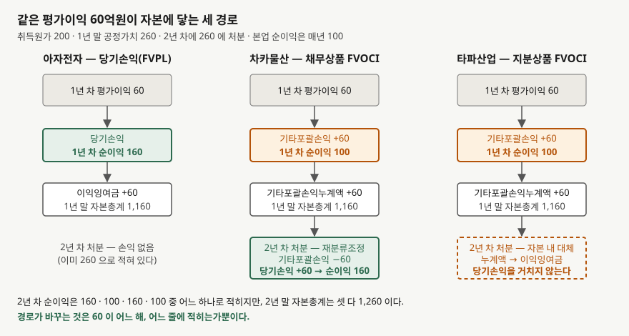
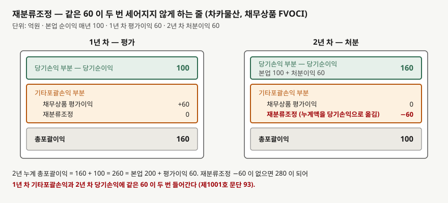

## 들어가며

같은 업종의 두 회사 사업보고서를 나란히 펴 놓았다고 하자. 작년에는 두 회사 모두 당기순이익이
100억원이었다. 올해는 한 곳이 160억원이고 다른 곳은 그대로 100억원이다. 이익이 60% 늘어난
회사가 먼저 눈에 들어오고, 후행 PER로 줄을 세우면 그쪽이 싸 보인다.

그런데 자본변동표를 보면 두 회사의 자본총계는 2년 동안 똑같이 늘었다. 주석을 더 읽으면 둘 다
2년 전에 산 같은 채권을 올해 같은 값에 팔았다. 다른 것은 한 회사가 그 채권의 평가이익을
작년에 당기순이익 아래 **'기타포괄손익'**이라는 줄에 적었고, 올해 팔면서 그 금액을
당기순이익으로 옮겨 적었다는 점이다. 60억원의 이익이 올해 새로 생긴 것이 아니라 **작년에
적힌 줄에서 올해 다른 줄로 옮겨 온 것**이다.

보통은 당기순이익 한 줄만 보고 넘어간다. 그러면 이 60억원이 어느 해의 성과인지, 다른 회사에서는
같은 금액이 당기순이익에 들어오기는 하는지 알 수 없다. 기타포괄손익이 무엇이고 재분류조정이
어떤 일을 하는지 알면 두 회사를 같은 자리에 놓고 비교할 수 있다.

## 개념

기업회계기준서 제1001호 '재무제표 표시'의 용어 정의(문단 7)는 세 가지를 나눠 정한다.

- **당기순손익** — 수익에서 비용을 차감한 금액. 기타포괄손익의 구성요소는 뺀다
- **기타포괄손익** — 다른 기준서에서 요구하거나 허용하여 **당기손익으로 인식하지 않은**
  수익과 비용 항목. 재분류조정을 포함한다
- **재분류조정** — 당기나 과거 기간에 기타포괄손익으로 인식되었으나 **당기손익으로 재분류된** 금액

셋의 관계는 단순하다. 수익과 비용은 당기손익 아니면 기타포괄손익 둘 중 한 곳에 적히고, 둘을
합친 것이 총포괄손익이다. 어느 쪽에 적을지는 제1001호가 정하지 않는다. 그 항목을 다루는 개별
기준서가 정한다. 같은 정의 문단이 기타포괄손익에 들어가는 항목을 열거하는데, 유형자산
재평가잉여금의 변동, 확정급여제도의 재측정요소, 해외사업장 재무제표 환산손익, 기타포괄손익-공정가치
측정 금융자산의 손익, 현금흐름위험회피에서 위험회피수단 평가손익의 효과적인 부분 같은 것들이다.

기타포괄손익을 표시할 때는 두 집단으로 나눠야 한다. 기타포괄손익 부분의 표시 문단(82A)은
항목을 **후속적으로 당기손익으로 재분류되지 않는 항목**과 **특정 조건을 충족하는 때에
후속적으로 재분류되는 항목**으로 묶어 표시하게 한다. 이 구분이 이 글의 축이다. 같은
기타포괄손익이라도 나중에 당기순이익으로 돌아오는 것과 영영 돌아오지 않는 것이 있고,
포괄손익계산서는 그 둘을 처음부터 갈라 적는다.

## 구조



> **출처**: 한국회계기준원 [기업회계기준서 제1001호 '재무제표 표시'](https://www.samili.com/acc/Kijun/Kijunjomun.asp?code=1978-1001) 문단 7·82A·93 (제3자 전재, 2023-10-13 개정), [기업회계기준서 제1109호 '금융상품'](https://www.samili.com/acc/Kijun/Kijunjomun.asp?code=1978-1109) 문단 5.7.5·5.7.10·B5.7.1 (제3자 전재, 2025-10-17 개정) — 원문 발행처 [한국회계기준원](https://www.kasb.or.kr/front/board/ingAccountingList.do). 금액은 이 글의 `code/output.txt` `[1]`·`[2]`에서 옮겼다

세 회사가 같은 증권을 200억원에 사서 1년 말에 260억원으로 평가했다. 평가이익 60억원이 자본에
닿는 길이 셋이다. 당기손익-공정가치로 측정하면 그 해 당기순이익에 바로 들어가 이익잉여금이
된다. 기타포괄손익-공정가치로 측정하면 당기순이익을 건너뛰고 기타포괄손익에 적혀 자본의
**기타포괄손익누계액**에 쌓인다. 1년 말 자본총계는 셋 다 1,160억원이다.

갈림길은 2년 차 처분에서 생긴다. 채무상품이면 누계액 60억원이 **재분류조정**으로 당기손익에
들어오고, 지분상품이면 당기손익을 거치지 않고 자본 안에서 이익잉여금으로 자리만 옮긴다. 2년 말
자본총계는 또 셋 다 1,260억원이다. 경로가 바꾸는 것은 60억원이 어느 해 어느 줄에 적히는가뿐이다.

## 동작 원리

### 재분류조정이 하는 일



> **출처**: 한국회계기준원 [기업회계기준서 제1001호 '재무제표 표시'](https://www.samili.com/acc/Kijun/Kijunjomun.asp?code=1978-1001) 문단 82A·92~94 (제3자 전재, 2023-10-13 개정) — 원문 발행처 [한국회계기준원](https://www.kasb.or.kr/front/board/ingAccountingList.do). 금액은 이 글의 `code/output.txt` `[1]`·`[3]`에서 옮겼다

재분류조정 문단(93)이 이유를 적는다. 재분류조정은 조정액이 당기손익으로 재분류되는 기간의
기타포괄손익에 포함되는데, 그 금액은 과거 기간에 미실현이익으로 기타포괄손익에 이미 인식됐을
수 있다. 그래서 **총포괄손익에 이중으로 포함되지 않도록**, 실현되어 당기손익으로 옮기는
기간의 기타포괄손익에서 같은 금액을 차감한다.

차카물산의 2년 차가 그 모습이다. 처분이익 60억원이 당기손익에 들어오면서 당기순이익이
160억원이 되고, 기타포괄손익 부분에 재분류조정 −60억원이 적혀 총포괄이익은 100억원이 된다.
1년 차 총포괄이익 160억원과 더하면 2년 누계 260억원이고, 이것은 본업 200억원에 평가이익
60억원을 **한 번만** 더한 값이다. 재분류조정 줄이 없으면 280억원이 된다.

재분류조정은 포괄손익계산서 본문에 표시하거나 주석에 표시할 수 있다(문단 94). 주석으로 보내면
본문의 기타포괄손익 항목은 재분류조정을 반영한 뒤의 금액으로 적힌다. 어느 쪽이든 공시는
해야 한다(문단 92).

### 돌아오는 항목과 돌아오지 않는 항목

어느 항목이 돌아오는지는 제1001호가 아니라 개별 기준서가 정한다(문단 93). 제1001호는 예시만
든다. 재분류조정의 예시 문단(95)은 해외사업장을 매각할 때와 현금흐름위험회피의 예상거래가
당기손익에 영향을 미칠 때를 들고, 재분류가 없는 항목의 문단(96)은 재평가잉여금의 변동과
확정급여제도의 재측정요소는 당기손익으로 재분류하지 않는다고 적는다. 재평가잉여금은 자산을
쓰는 동안이나 제거할 때 **이익잉여금으로 대체**할 수 있는데, 이것은 자본 안에서 자리를
옮기는 것이지 재분류조정이 아니다.

금융자산은 제1109호가 정한다. 같은 '기타포괄손익-공정가치'인데 둘로 갈린다.

| | 채무상품 FVOCI | 지분상품 FVOCI |
|---|---|---|
| 근거 | 문단 4.1.2A — 사업모형과 현금흐름 조건으로 **정해진다** | 문단 5.7.5 — 최초 인식 시 **선택**하고 취소할 수 없다 |
| 보유 중 평가손익 | 기타포괄손익 (문단 5.7.10) | 기타포괄손익 (문단 5.7.5) |
| 당기손익에 들어가는 것 | 유효이자율법 이자·손상·외환손익 (문단 5.7.10) | 배당금 (문단 5.7.6) |
| 처분 시 | 누계액을 **재분류조정으로 당기손익에** (문단 5.7.10) | 당기손익으로 **이전하지 않는다**. 자본 안에서 누적손익을 옮길 수는 있다 (문단 B5.7.1) |
| 82A의 집단 | 재분류되는 항목 | 재분류되지 않는 항목 |

채무상품 쪽은 문단 5.7.11이 뜻을 설명한다. 기타포괄손익-공정가치로 측정해도 당기손익에
인식하는 금액은 **상각후원가로 측정했더라면 인식했을 금액과 같다.** 재무상태표는 공정가치로
적고 손익계산서는 상각후원가처럼 적는 것이고, 그 둘의 차이가 기타포괄손익에 쌓였다가 처분할
때 당기손익으로 들어온다. 지분상품 쪽은 그런 대응 관계가 없다. 처분해도 당기손익에 처분손익이
생기지 않으므로, 보유 주식을 팔아 큰 차익을 남긴 회사라도 그 사실이 당기순이익에는 보이지
않는다. 세 분류 자체는
[금융자산 세 분류](../2026-10-12-financial-assets-three-classes/index.md)에서 다뤘다.

## 실습 예제

가상 회사 셋으로 계산한다. **아자전자**는 증권을 당기손익-공정가치로, **차카물산**은 채무상품
기타포괄손익-공정가치로, **타파산업**은 지분상품 기타포괄손익-공정가치 지정으로 잡았다. 셋 다
1년 초 자본총계 1,000억원(전부 이익잉여금), 본업 순이익 매년 100억원, 증권 취득원가 200억원,
1년 말 공정가치 260억원, 2년 차에 260억원에 처분이다. 세 경로의 과세소득 합계가 같으므로
비교에서 법인세율은 0으로 두었다.

```python
def fvoci_debt(gain: float) -> list[YearResult]:
    """채무상품 FVOCI (제1109호 문단 4.1.2A·5.7.10) — 처분할 때 재분류조정으로 당기손익에 들어온다."""
    y1 = YearResult(OPERATING_INCOME, gain, 0.0, OPENING_EQUITY + OPERATING_INCOME, gain)
    # 처분이익 gain 이 당기손익에 잡히고, 같은 금액이 기타포괄손익에서 재분류조정으로 빠진다
    y2 = YearResult(
        OPERATING_INCOME + gain,
        0.0,
        -gain,
        y1.retained_earnings + OPERATING_INCOME + gain,
        y1.accumulated_oci - gain,
    )
    return [y1, y2]


def fvoci_equity(gain: float) -> list[YearResult]:
    """지분상품 FVOCI 지정 (제1109호 문단 5.7.5·B5.7.1) — 처분해도 당기손익으로 돌아오지 않는다."""
    y1 = YearResult(OPERATING_INCOME, gain, 0.0, OPENING_EQUITY + OPERATING_INCOME, gain)
    y2 = YearResult(
        OPERATING_INCOME,
        0.0,
        0.0,
        y1.retained_earnings + OPERATING_INCOME + gain,  # 자본 내 대체 — 손익을 거치지 않는다
        y1.accumulated_oci - gain,
    )
    return [y1, y2]
```

전체 소스: [`code/`](code/)

### 같은 60억원이 세 경로로 적힌다

```text
[1] 포괄손익계산서 — 같은 60억원이 세 경로로 적힌다 (단위: 억원)
        회사              경로    연도     당기순이익    OCI 발생     재분류조정     총포괄이익
------------------------------------------------------------------------
      아자전자      당기손익(FVPL)     1       160         0         0       160
      아자전자      당기손익(FVPL)     2       100         0         0       100
      차카물산      채무상품 FVOCI     1       100        60         0       160
      차카물산      채무상품 FVOCI     2       160         0       -60       100
      타파산업      지분상품 FVOCI     1       100        60         0       160
      타파산업      지분상품 FVOCI     2       100         0         0       100
```

총포괄이익 칸은 세 회사가 매년 같다. 1년 차 160억원, 2년 차 100억원이다. 갈리는 것은
당기순이익 칸이다. 아자전자는 1년 차에 160억원, 차카물산은 2년 차에 160억원이고, 타파산업은
두 해 다 100억원이다. 들어가며의 두 회사가 차카물산과 타파산업이다.

### 자본총계는 매년 같다

```text
[2] 연말 자본 구성 — 자본총계는 세 회사가 매년 같다
        회사              경로    연도       이익잉여금       기타포괄손익누계액      자본총계
----------------------------------------------------------------------
      아자전자      당기손익(FVPL)     1        1160               0      1160
      아자전자      당기손익(FVPL)     2        1260               0      1260
      차카물산      채무상품 FVOCI     1        1100              60      1160
      차카물산      채무상품 FVOCI     2        1260               0      1260
      타파산업      지분상품 FVOCI     1        1100              60      1160
      타파산업      지분상품 FVOCI     2        1260               0      1260
```

1년 말에 차카물산과 타파산업은 이익잉여금 1,100억원과 기타포괄손익누계액 60억원으로 나뉘어
있고, 아자전자는 이익잉여금 하나에 1,160억원이 다 들어 있다. 2년 말에는 셋 다 이익잉여금
1,260억원이다. 타파산업의 60억원은 당기손익을 거치지 않고 누계액에서 이익잉여금으로 옮겨
갔다. 이 이동은 자본변동표에만 보이고 포괄손익계산서에는 나타나지 않는다.

### 누계로 보면 한 번만 센다

```text
[3] 2년 누계 — 당기순이익은 갈리고 총포괄이익은 같다
        회사              경로        순이익 누계        OCI 누계      총포괄이익 누계
--------------------------------------------------------------------
      아자전자      당기손익(FVPL)           260             0           260
      차카물산      채무상품 FVOCI           260             0           260
      타파산업      지분상품 FVOCI           200            60           260
```

차카물산의 기타포괄손익 누계가 0인 것은 1년 차 +60억원과 2년 차 재분류조정 −60억원이
상쇄됐기 때문이다. 타파산업은 재분류조정이 없으므로 기타포괄손익 누계 60억원이 그대로 남고,
그만큼 순이익 누계가 200억원에서 멈춘다. 타파산업의 60억원은 **앞으로도 당기순이익에
들어오지 않는다.**

### ROE가 갈리는 자리

```text
[4] ROE — 분자를 당기순이익으로 쓰느냐 총포괄이익으로 쓰느냐 (기초 자본총계 기준, %)
        회사              경로    연도        기초자본      ROE(순이익)      ROE(총포괄이익)
--------------------------------------------------------------------------
      아자전자      당기손익(FVPL)     1        1000          16.0            16.0
      아자전자      당기손익(FVPL)     2        1160           8.6             8.6
      차카물산      채무상품 FVOCI     1        1000          10.0            16.0
      차카물산      채무상품 FVOCI     2        1160          13.8             8.6
      타파산업      지분상품 FVOCI     1        1000          10.0            16.0
      타파산업      지분상품 FVOCI     2        1160           8.6             8.6
```

흔히 쓰는 ROE는 당기순이익을 분자에 둔다. 그러면 1년 차에 아자전자 16.0%, 나머지 둘
10.0%로 갈리고, 2년 차에는 차카물산만 13.8%로 올라간다. 분자를 총포괄이익으로 바꾸면 세
회사가 두 해 모두 같다. 분모는 처음부터 같았다. 기타포괄손익누계액이 자본총계에 들어가기
때문에 **평가이익이 분자에서 빠진 해에도 분모에는 들어간다.** 그래서 순이익 기준 ROE는
기타포괄손익으로 적은 회사에 불리하게 나온다.
[ROE와 ROA](../../ratios/2026-10-01-roe-vs-roa/index.md)의 분모 이야기가 여기에 닿는다.

## 실무에서 주의할 점

- **당기순이익이 뛴 해에는 재분류조정부터 찾는다.** 기타포괄손익 부분에 재분류조정이 큰 음수로
  적혀 있으면 순이익 증가분의 일부는 과거 기간에 이미 생긴 평가이익이다. 후행 PER은 그 해
  당기순이익을 분모에 쓰므로, 재분류조정만큼 낮게 나온다.
  [PER](../../valuation/2026-10-02-per-trailing-vs-forward/index.md)에서 분모에 무엇을
  넣느냐의 문제로 다룬 것과 같은 자리다.

- **지분상품 처분은 순이익에 보이지 않는다.** 문단 B5.7.1에 따라 당기손익으로 이전하지
  않으므로, 보유 주식을 팔아 자금을 마련해도 당기순이익은 움직이지 않는다. 자본변동표에서
  기타포괄손익누계액이 줄고 이익잉여금이 늘어난 것으로만 보인다.
  [자본변동표](../2026-10-07-equity-changes-statement/index.md)를 같이 봐야 하는 이유다.

- **문단 82A의 두 집단을 나눠서 본다.** 재분류되지 않는 항목에 쌓인 금액은 앞으로도 당기순이익에
  들어오지 않는다. 재평가잉여금과 확정급여 재측정요소가 그렇다. 자본은 늘었는데 EPS에는
  영영 반영되지 않는 금액이 있다는 뜻이다.
  [유형자산 재평가모형](../2026-10-22-ppe-revaluation-model/index.md)과
  [퇴직급여](../2026-10-22-pension-dc-vs-db/index.md)에서 각각 그 금액이 생기는 자리를 다뤘다.

- **기타포괄손익누계액은 PBR과 ROE의 분모에 들어간다.** 평가이익이 많이 쌓인 회사는
  순자산이 커져 PBR이 낮아 보이고, 순이익 기준 ROE도 낮아 보인다. `[4]`의 1년 차가 그
  모습이다. 비교할 때는 총포괄이익 기준 ROE를 같이 보거나, 누계액을 빼고 다시 계산한다.

- **법인세 표시 방법을 확인한다.** 기타포괄손익 항목은 법인세 효과를 차감한 순액으로 표시할
  수도 있고, 세전 금액으로 표시하고 법인세를 한 줄로 합쳐 표시할 수도 있다(문단 91). 두 회사가
  다른 방법을 쓰면 항목 금액을 바로 견줄 수 없다. 법인세 효과 금액 자체는 어느 쪽이든
  공시된다(문단 90).

- **재분류조정과 자본 내 대체를 구분한다.** 둘 다 기타포괄손익누계액을 줄이지만, 재분류조정은
  당기손익을 거치고 자본 내 대체는 거치지 않는다. 포괄손익계산서에 재분류조정 줄이 있으면
  전자, 자본변동표에만 이동이 보이면 후자다.

## 정리

- 제1001호 문단 7은 당기손익으로 인식하지 않은 수익·비용을 기타포괄손익으로, 그중 뒤에
  당기손익으로 옮기는 금액을 재분류조정으로 정의한다. 어느 항목이 돌아오는지는 개별 기준서가 정한다.
- 문단 82A는 기타포괄손익을 재분류되지 않는 항목과 재분류되는 항목으로 나눠 표시하게 한다.
  채무상품 FVOCI는 처분 시 재분류조정으로 돌아오고(제1109호 문단 5.7.10), 지분상품 FVOCI는
  돌아오지 않는다(문단 B5.7.1).
- 재분류조정은 실현된 해의 기타포괄손익에서 같은 금액을 빼서 총포괄손익에 이중으로 들어가지
  않게 한다(문단 93). 차카물산의 2년 차 재분류조정 −60억원이 그 줄이다.
- 세 경로의 자본총계는 매년 같고(1,160억원·1,260억원), 당기순이익만 160·100·160·100으로
  갈린다. 순이익 기준 ROE는 10.0%와 16.0%로 갈리고 총포괄이익 기준 ROE는 같다.
- 같은 조달이 자본과 부채로 갈리는 자리는
  [영구채와 상환우선주](../2026-11-04-perpetual-bond-vs-redeemable-preferred/index.md)에서 다룬다.
  이 글이 자본 안의 줄을 다뤘다면 그 글은 자본의 경계를 다룬다.

## 참고 자료

- [한국회계기준원](https://www.kasb.or.kr/front/board/ingAccountingList.do) — K-IFRS 기준서 발행처. 아래 전재 링크는 조문을 바로 열기 위한 편의 링크다
- [기업회계기준서 제1001호 '재무제표 표시'](https://www.samili.com/acc/Kijun/Kijunjomun.asp?code=1978-1001) (제3자 전재, 2023-10-13 개정) — 문단 7 기타포괄손익·재분류조정·당기순손익 정의, 문단 82A 두 집단 표시, 문단 90·91 법인세 표시, 문단 92~94 재분류조정 공시와 표시, 문단 95·96 재분류되는 항목과 되지 않는 항목의 예
- [기업회계기준서 제1109호 '금융상품'](https://www.samili.com/acc/Kijun/Kijunjomun.asp?code=1978-1109) (제3자 전재, 2025-10-17 개정) — 문단 5.7.5 지분상품 FVOCI 선택, 문단 5.7.6 배당금, 문단 5.7.10·5.7.11 채무상품 FVOCI의 재분류, 문단 B5.7.1 지분상품 누적손익의 자본 내 이전
- [IAS 1 Presentation of Financial Statements](https://www.ifrs.org/issued-standards/list-of-standards/ias-1-presentation-of-financial-statements/) — IFRS Foundation. 제1001호가 대응하는 국제기준
- [IFRS 9 Financial Instruments](https://www.ifrs.org/issued-standards/list-of-standards/ifrs-9-financial-instruments/) — IFRS Foundation. 제1109호가 대응하는 국제기준
- 숫자는 이 글의 [`code/output.txt`](code/output.txt) `[1]`~`[4]`에서 옮겼다
