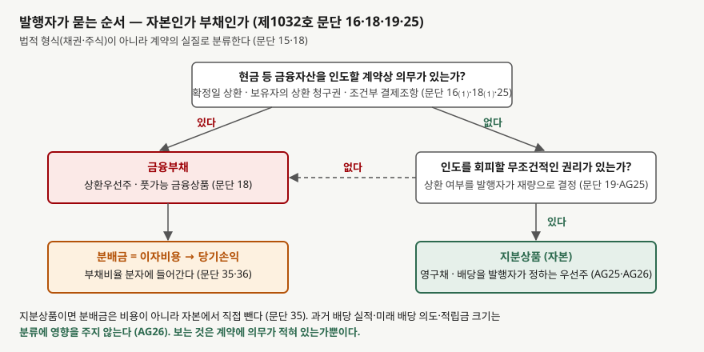
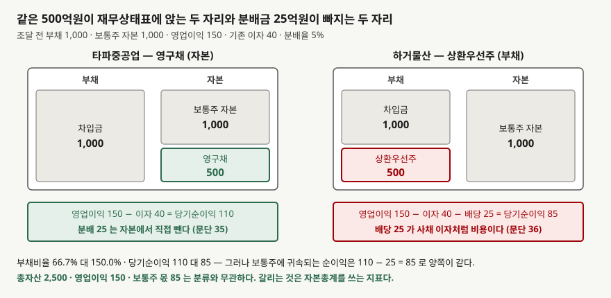

## 들어가며

부채비율이 높아 보이는 회사의 공시를 읽다가 '신종자본증권 발행 결정'이라는 제목을 봤다고
하자. 금리가 붙어 있고 만기가 30년이며 5년 뒤부터 발행자가 조기상환할 수 있다고 적혀 있다.
채권처럼 생겼는데 다음 분기 재무상태표를 보면 그 금액이 부채가 아니라 **자본**에 들어가
있고, 부채비율은 조달 전보다 내려가 있다.

반대 경우도 있다. 어떤 회사의 우선주는 이름이 주식인데 재무상태표에서 **부채**로 잡혀 있고,
우선주 배당이 손익계산서에서 이자비용 줄에 섞여 있다. 보통은 '채권은 부채, 주식은 자본'으로
읽고 넘어가는데, 그렇게 읽으면 두 회사의 부채비율과 당기순이익을 전부 잘못 비교하게 된다.

기준서는 이름으로 가르지 않는다. 계약에 **돈을 줘야 할 의무**가 적혀 있는지로 가른다. 그
기준 하나가 부채비율·이자보상배율·당기순이익·ROE를 한꺼번에 움직이고, 그런데도 움직이지
않는 지표가 하나 있다.

## 개념

기업회계기준서 제1032호 '금융상품: 표시'의 용어 정의(문단 11)는 **금융부채**를 거래상대방에게
현금 등 금융자산을 인도하기로 한 계약상 의무 등으로, **지분상품**을 기업의 자산에서 모든
부채를 차감한 후의 잔여지분을 나타내는 계약으로 정의한다. 발행자는 최초 인식시점에
**계약의 실질**과 이 정의에 따라 금융상품을 금융부채·금융자산·지분상품으로 분류한다(문단 15).

지분상품이 되는 조건은 분류 문단(16)에 있다. 두 조건을 모두 충족해야 한다.

- 거래상대방에게 현금 등 금융자산을 인도할 계약상 의무와, 잠재적으로 불리한 조건으로
  금융자산·금융부채를 교환할 계약상 의무를 **포함하지 않는다**
- 자기지분상품으로 결제하는 계약이면 변동 가능한 수량을 인도할 의무가 없는 비파생상품이거나,
  확정 수량을 확정 금액과 교환하는 파생상품이다

이 글에서 보는 것은 첫째 조건이다. 금융부채와 지분상품을 가르는 중요한 특성은 발행자가
보유자에게 **현금 등 금융자산을 인도해야 할 계약상 의무를 부담하는지**다(문단 17). 지분상품
보유자가 배당을 받을 자격이 있다는 것만으로는 발행자가 반드시 인도해야 하는 것이 아니므로
의무가 아니다.

분류는 법적 형식이 아니라 실질을 따른다(문단 18). 같은 문단이 예를 든다. 확정된 시점에 확정된
금액을 발행자가 의무적으로 상환해야 하는 우선주, 또는 보유자가 상환을 청구할 수 있는 우선주는
**금융부채**다. 이름이 주식이어도 그렇다.

## 구조



> **출처**: 한국회계기준원 [기업회계기준서 제1032호 '금융상품: 표시'](https://www.samili.com/acc/Kijun/Kijunjomun.asp?code=1978-1032) 문단 15~19·25·35·36, 적용지침 AG25·AG26 (제3자 전재, 2021-04-23 개정) — 원문 발행처 [한국회계기준원](https://www.kasb.or.kr/front/board/ingAccountingList.do), 대응 국제기준은 [IFRS Foundation](https://www.ifrs.org/issued-standards/list-of-standards/ias-32-financial-instruments-presentation/)의 IAS 32

첫 물음은 계약상 의무가 있는가다. 있으면 금융부채다. 없어 보여도 한 번 더 묻는다. 기업이
인도를 **회피할 수 있는 무조건적인 권리**를 가지고 있지 않다면 그 의무는 금융부채의 정의를
충족한다(문단 19). 거래상대방이 상환을 요구할 수 있는 조건이 붙어 있으면 발행자에게 회피할
권리가 없으므로 부채다.

우선주 적용지침(AG25)이 두 갈래를 나란히 적는다. 특정 시점에 상환하거나 보유자의 선택에 따라
상환해야 하는 우선주는 발행자가 금융자산을 이전할 의무가 있으므로 금융부채의 특성을 가진다.
반면 **현금으로 상환할 수 있는 권리가 발행자에게 있는** 우선주는 발행자에게 현재의무가 없으므로
금융부채의 정의를 충족하지 못한다. 상환할지를 발행자가 재량으로 정하기 때문이다. 영구채가
자본이 되는 자리가 여기다. 만기가 없거나 아주 길고, 상환 여부를 발행자가 정하며, 이자 지급도
발행자가 미룰 수 있게 설계된 증권은 보유자에게 돈을 줘야 할 의무가 계약에 없다.

## 동작 원리

### 분류가 분배금의 자리를 정한다

이자, 배당, 손익의 회계처리 문단(35)이 두 길을 적는다. 금융부채인 금융상품과 관련하여 생기는
이자·배당·손익은 **수익이나 비용으로 당기손익에** 인식한다. 지분상품 보유자에 대한 분배는
**자본으로 직접** 인식한다.

같은 절의 다음 문단(36)이 결과를 못 박는다. 금융상품의 분류 결과에 따라 그 금융상품에서
생기는 이자·배당·손익을 당기손익으로 인식할지가 결정되고, **전체가 부채로 인식된 주식에
지급되는 배당은 사채의 이자와 마찬가지로 비용**으로 인식한다. 이름이 배당이어도 손익계산서에서
이자비용과 같은 자리에 선다. 비용으로 분류하는 배당은 다른 부채에서 생기는 이자와 함께 표시해도
되고 별도 항목으로 표시해도 된다(문단 40).

반대로 자본으로 분류된 영구채의 이자는 비용이 아니다. 당기순이익을 계산할 때 빠지지 않고,
배당처럼 자본에서 직접 빠진다. 당기순이익이 커 보이는 이유다.

### 보통주 몫을 셀 때는 다시 만난다

당기순이익은 갈리지만 **보통주에 귀속되는** 순이익은 갈리지 않는다. 기업회계기준서 제1033호
'주당이익'의 분자 문단(12)은 기본주당이익을 계산할 때 지배기업의 보통주에 귀속되는 금액을
당기순손익에서 **자본으로 분류된 우선주에 대한 세후 배당금과 유사한 효과를 조정한 금액**으로
정한다. 자본으로 분류된 증권에 준 분배금은 비용에서 빠졌으므로 여기서 뺀다. 부채로 분류된
우선주의 배당은 이미 비용으로 들어가 있으므로 다시 빼지 않는다(문단 13).

그래서 영구채 이자를 비용에서 빼지 않은 회사와 상환우선주 배당을 비용으로 뺀 회사는
당기순이익에서는 분배금만큼 벌어지고, 보통주 귀속 순이익에서는 같은 값이 된다. 분류는
보통주 주주의 몫을 바꾸지 않는다. 바꾸는 것은 **그 몫에 닿기 전까지 숫자가 어느 줄을 거치는가**다.

### 분류에 영향을 주지 않는 것

우선주 적용지침(AG26)은 분류 결정에 영향을 미치지 않는 사항을 여섯 가지 든다. 과거의 배당
실적, 미래의 배당 의도, 배당을 못 할 때 보통주 가격에 미칠 부정적 영향, 발행자의 적립금
금액, 당기순손익에 대한 발행자의 예상, 당기순손익에 영향을 줄 수 있는 발행자의 능력이다.
해마다 빠짐없이 이자를 지급해 온 영구채라도, 계약에 의무가 없으면 자본이다. 반대로
발행자가 상환을 이행하지 못할 가능성이 있더라도 계약상 의무가 무효화되지는 않는다(AG25).

조건부 결제조항은 따로 다룬다(문단 25). 주가지수·이자율·부채비율처럼 발행자와 보유자 모두가
통제할 수 없는 미래 사건에 따라 현금으로 결제해야 하는 금융상품은, 발행자가 인도를 회피할
무조건적 권리가 없으므로 원칙적으로 금융부채다. 그 조항이 실질적으로 유효하지 않거나
청산하는 경우에만 결제가 요구되는 때가 예외다.

## 실습 예제

가상 회사 둘로 계산한다. **타파중공업**은 영구채로, **하거물산**은 상환우선주로 각각 500억원을
조달했다. 조달 전에는 두 회사가 같다. 차입금 1,000억원(이자 4%, 연 40억원), 보통주 자본
1,000억원, 영업이익 150억원, 보통주 1억 주다. 분배율은 양쪽 다 5%로 연 25억원이다. 분배금의
손금 인정 여부는 세법이 정하므로 비교에서 법인세율은 0으로 두었다.

```python
def statements(issuer: Issuer, raised: float = RAISED) -> dict[str, float]:
    distribution = raised * COUPON
    if issuer.classified_as_equity:
        liabilities = BASE_LIABILITIES
        equity = BASE_EQUITY + raised
        interest_expense = BASE_INTEREST  # 분배금은 비용이 아니다 — 문단 35
        net_income = (OPERATING_PROFIT - interest_expense) * (1 - TAX_RATE)
        ordinary_income = net_income - distribution  # 보통주 몫을 셀 때는 뺀다 — 제1033호 문단 12
    else:
        liabilities = BASE_LIABILITIES + raised
        equity = BASE_EQUITY
        interest_expense = BASE_INTEREST + distribution  # 배당이 이자처럼 비용이 된다 — 문단 36
        net_income = (OPERATING_PROFIT - interest_expense) * (1 - TAX_RATE)
        ordinary_income = net_income
```

전체 소스: [`code/`](code/)

### 같은 500억원이 다른 칸에 앉는다



> **출처**: 한국회계기준원 [기업회계기준서 제1032호 '금융상품: 표시'](https://www.samili.com/acc/Kijun/Kijunjomun.asp?code=1978-1032) 문단 35·36 (제3자 전재, 2021-04-23 개정), [기업회계기준서 제1033호 '주당이익'](https://www.samili.com/acc/Kijun/Kijunjomun.asp?code=1978-1033) 문단 12 (제3자 전재, 2015-09-25 개정) — 원문 발행처 [한국회계기준원](https://www.kasb.or.kr/front/board/ingAccountingList.do). 금액은 이 글의 `code/output.txt` `[1]`·`[2]`에서 옮겼다

```text
[1] 조달 직후 재무상태표 — 같은 500 이 다른 칸에 앉는다 (단위: 억원)
              회사         총부채        자본총계         총자산     부채비율(%)
----------------------------------------------------------------
           타파중공업        1000        1500        2500        66.7
            하거물산        1500        1000        2500       150.0
```

총자산은 2,500억원으로 같다. 들어온 현금이 같기 때문이다. 500억원이 오른쪽 어느 칸에
앉느냐만 다르고, 그 한 칸이 부채비율을 66.7%와 150.0%로 가른다. 조달 전 부채비율은 둘 다
100%였다. 한 회사는 돈을 빌리고 부채비율이 **내려갔고**, 다른 회사는 올라갔다.

### 분배금 25억원이 빠지는 자리

```text
[2] 영업이익에서 보통주 몫까지 — 분배금 25 가 빠지는 자리가 다르다
                  항목           타파중공업            하거물산
----------------------------------------------------
                영업이익             150             150
         이자비용(배당 포함)              40              65
               당기순이익             110              85
        자본에서 직접 뺀 분배              25               0
          보통주 귀속 순이익              85              85
              EPS(원)              85              85
```

하거물산은 배당 25억원이 이자비용에 섞여 당기순이익이 85억원이다. 타파중공업은 이자비용이
기존 차입금의 40억원뿐이라 당기순이익이 110억원이고, 25억원은 손익계산서 아래 자본변동표에서
빠진다. 그런데 보통주 귀속 순이익 줄에서 둘은 85억원으로 만난다. EPS도 85원으로 같다.
[기본 EPS와 희석 EPS](../../valuation/2026-10-08-diluted-eps-convertible-bonds/index.md)에서
본 분자가 여기서 하는 일이다.

### 갈리는 지표와 갈리지 않는 지표

```text
[3] 지표 — 자본총계를 쓰는 지표는 갈리고 보통주 기준 지표는 같다
                지표           타파중공업            하거물산          차이
--------------------------------------------------------------
              부채비율            66.7           150.0       -83.3
            이자보상배율            3.75            2.31        1.44
             당기순이익             110              85          25
         ROE(자본총계)             7.3             8.5        -1.2
          ROE(보통주)             8.5             8.5         0.0
            EPS(원)              85              85           0
```

읽을 것이 셋이다.

- **부채비율과 이자보상배율이 크게 갈린다.** 부채비율은 83.3%포인트 차이고, 이자보상배율은
  분모에 배당이 들어가느냐로 3.75배와 2.31배가 된다.
  [이자보상배율](../../ratios/2026-10-02-interest-coverage-ratio/index.md)을 볼 때 분모의
  이자비용에 부채로 분류된 우선주 배당이 들어 있는지 확인해야 하는 이유다.
- **자본총계 기준 ROE는 거꾸로 갈린다.** 타파중공업은 분자가 110억원으로 크지만 분모도
  1,500억원으로 커서 7.3%다. 하거물산은 85억원을 1,000억원으로 나눠 8.5%다. 당기순이익이 큰
  쪽의 ROE가 낮다.
- **보통주 기준으로 다시 계산하면 같다.** 분자에서 분배금을 빼고 분모에서 영구채를 빼면
  둘 다 8.5%다. 보통주 주주가 받는 몫은 분류와 무관하다.

### 조달 금액이 커질수록 벌어진다

```text
[4] 조달 금액에 따른 부채비율 — 자본 분류는 내려가고 부채 분류는 올라간다 (%)
       조달 금액         영구채(자본)       상환우선주(부채)      차이(%p)
--------------------------------------------------------
           0           100.0           100.0         0.0
         250            80.0           125.0         45.0
         500            66.7           150.0        83.3
         750            57.1           175.0       117.9
        1000            50.0           200.0       150.0
```

같은 금액을 조달했는데 한쪽은 부채비율이 떨어지고 다른 쪽은 오른다. 조달 금액이 자본과
같은 1,000억원이 되면 50.0%와 200.0%로 네 배 차이가 난다. 두 회사의 상환 부담은 같다. 둘 다
해마다 분배금 5%를 내야 하고, 둘 다 원금 500억원이 투자자 손에 돌아갈 날을 계약이 정해 뒀거나
발행자가 정한다.

## 실무에서 주의할 점

- **자본 명세에서 '신종자본증권'을 찾는다.** 자본총계 안에 보통주 몫이 아닌 금액이 있으면
  부채비율·자기자본비율을 그대로 비교할 수 없다. 차입 부담을 보려는 목적이면 그 금액을
  부채 쪽으로 옮겨 다시 계산한다.
  [자기자본비율과 차입금의존도](../../ratios/2026-10-14-equity-ratio-and-borrowing-dependency/index.md)에서
  분모를 고르는 문제로 다뤘다.

- **이자보상배율의 분모를 확인한다.** 부채로 분류된 우선주 배당은 이자비용에 섞여 있을 수도
  있고 별도 항목일 수도 있다(문단 40). 자본으로 분류된 영구채 이자는 아예 비용에 없다. 세
  회사를 비교하면 분모가 세 가지 방식으로 적혀 있을 수 있다.

- **ROE는 보통주 기준으로 다시 계산한다.** 분자는 보통주 귀속 순이익, 분모는 보통주 자본이다.
  영구채가 자본에 들어가 있으면 분모가 부풀고, 영구채 이자가 비용에서 빠져 있으면 분자가
  부푼다. 둘을 같이 걷어내야 `[3]`의 8.5%가 나온다.
  [ROE와 ROA](../../ratios/2026-10-01-roe-vs-roa/index.md)의 분모 문제가 여기서 한 번 더 생긴다.

- **영구채의 조기상환 조건을 읽는다.** 발행자에게 상환 권리가 있으면 자본이지만, 상환하겠다는
  의도를 주주에게 공식적으로 통지하면 의무가 생길 수 있다(AG25). 통지 뒤에는 분류가 바뀐다.

- **조건부 결제조항은 부채 쪽으로 기운다.** 상장 실패나 부채비율 초과 같은 사건이 생기면
  상환해야 한다는 조항이 있으면, 발행자가 통제할 수 없는 사건이므로 원칙적으로 금융부채다(문단 25).
  조항이 실질적으로 유효하지 않다는 판단은 예외다.

- **상법과 기준서의 자본은 다르다.** 기준서가 자본으로 분류했다고 해서 배당 가능한 금액이
  늘어나는 것은 아니다. 배당가능이익은 상법이 따로 정한다.
  [배당가능이익](../2026-11-02-distributable-profit-limit/index.md)에서 다뤘다.

## 정리

- 제1032호 문단 16은 현금 등 금융자산을 인도할 계약상 의무가 없어야 지분상품이라고 정한다.
  이름이 채권인지 주식인지가 아니라 계약에 의무가 있는지로 가른다(문단 15·18).
- 보유자가 상환을 청구할 수 있거나 확정일에 상환해야 하는 우선주는 부채이고(문단 18, AG25),
  발행자가 상환을 결정하는 영구채는 자본이다(문단 19, AG25). 과거 배당 실적이나 의도는
  분류에 영향을 주지 않는다(AG26).
- 부채로 분류되면 분배금이 이자처럼 비용이 되고(문단 36), 자본으로 분류되면 자본에서 직접
  빠진다(문단 35). 그래서 당기순이익은 110억원과 85억원으로 갈린다.
- 부채비율은 66.7%와 150.0%, 이자보상배율은 3.75배와 2.31배로 갈리지만, 보통주 귀속
  순이익과 EPS는 85로 같다(제1033호 문단 12).
- 자본 안의 줄이 갈리는 자리는
  [기타포괄손익과 재분류조정](../2026-11-04-oci-and-reclassification-adjustments/index.md)에서
  다룬다. 그 글이 자본 안의 줄을 다루고 이 글은 자본의 경계를 다룬다.

## 참고 자료

- [한국회계기준원](https://www.kasb.or.kr/front/board/ingAccountingList.do) — K-IFRS 기준서 발행처. 아래 전재 링크는 조문을 바로 열기 위한 편의 링크다
- [기업회계기준서 제1032호 '금융상품: 표시'](https://www.samili.com/acc/Kijun/Kijunjomun.asp?code=1978-1032) (제3자 전재, 2021-04-23 개정) — 문단 11 금융부채·지분상품 정의, 문단 15 실질에 따른 분류, 문단 16 지분상품의 조건, 문단 17 계약상 의무, 문단 18 법적 형식과 실질, 문단 19 무조건적인 권리, 문단 25 조건부 결제조항, 문단 35·36·40 이자·배당의 회계처리, AG25·AG26 우선주 분류
- [기업회계기준서 제1033호 '주당이익'](https://www.samili.com/acc/Kijun/Kijunjomun.asp?code=1978-1033) (제3자 전재, 2015-09-25 개정) — 문단 12 보통주 귀속 당기순손익의 조정, 문단 13 부채로 분류된 우선주 배당
- [IAS 32 Financial Instruments: Presentation](https://www.ifrs.org/issued-standards/list-of-standards/ias-32-financial-instruments-presentation/) — IFRS Foundation. 제1032호가 대응하는 국제기준
- [IAS 33 Earnings per Share](https://www.ifrs.org/issued-standards/list-of-standards/ias-33-earnings-per-share/) — IFRS Foundation. 제1033호가 대응하는 국제기준
- 숫자는 이 글의 [`code/output.txt`](code/output.txt) `[1]`~`[4]`에서 옮겼다
