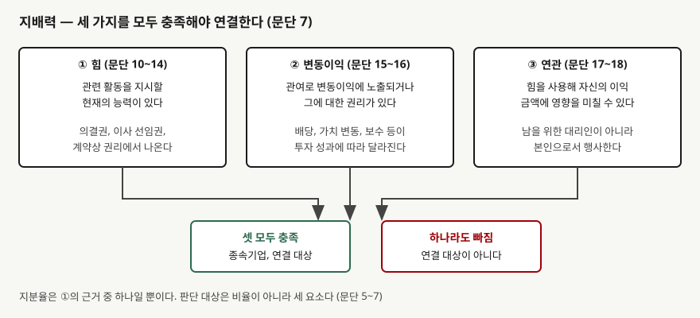
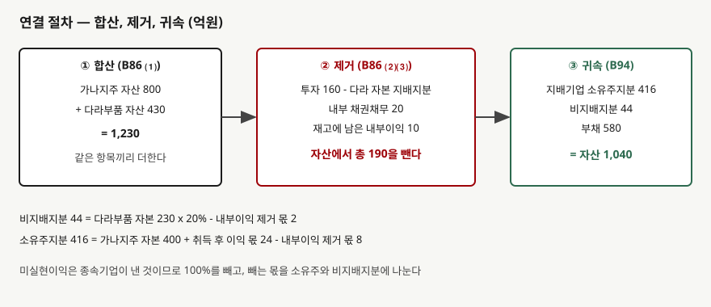

## 들어가며

같은 그룹 회사 두 곳의 재무제표를 앞에 놓고 비교하는 일은 흔하다. 지주회사의 부채비율이 낮아 보여서 안심했는데, 연결 기준 숫자를 열어 보니 훨씬 높은 경우가 있다. 지주회사 별도 장부에는 자회사 주식이 투자자산 한 줄로만 들어 있고, 자회사가 진 빚은 어디에도 없기 때문이다.

그러면 어떤 회사까지가 "자회사"여서 한 장에 합쳐지는가. 많은 사람이 먼저 지분율을 본다. 50%를 넘으면 연결하고 못 넘으면 안 한다는 식이다. 그 기준은 자주 맞지만, 기준서가 묻는 것은 비율이 아니다.

이 글은 연결 대상을 가르는 **지배력의 세 요소**를 먼저 보고, 연결이 결정된 뒤 장부가 어떻게 합쳐지는지를 가상 회사의 숫자로 계산한다. [앞 글](../2026-11-04-held-for-sale-depreciation-stops/index.md)이 자산 하나의 분류였다면, 이 글은 회사 단위의 경계를 정하는 글이다.

## 개념

기업회계기준서 제1110호는 투자자가 피투자자를 **지배하는지** 평가해 지배기업인지 정하게 한다. 피투자자에 어떤 방식으로 관여하는지는 상관없다(문단 5). 지배의 정의는 한 문장이다. 투자자가 피투자자에 관여함으로써 변동이익에 노출되거나 그에 대한 권리가 있고, 자신의 힘으로 그 변동이익에 영향을 미칠 수 있을 때 지배한다(문단 6).

문단 7은 이를 세 가지 모두를 충족해야 한다는 조건으로 나눈다.

- **힘**: 피투자자의 관련 활동을 지시할 수 있는 현재의 능력이 있다(문단 10~14)
- **변동이익**: 관여에서 생기는 이익이 피투자자 성과에 따라 변한다. 배당만이 아니라 가치 변동과 보수도 포함된다(문단 15~16)
- **연관**: 그 힘을 써서 자신의 이익 금액에 영향을 미치는 능력이 있다(문단 17~18)

지분율이 직접 나오지 않는다. 의결권은 **힘의 근거 중 하나**일 뿐이다. 그래서 과반을 갖고도 지배하지 못하는 경우와, 과반이 안 되는데도 지배하는 경우가 둘 다 생긴다. 한국회계기준원의 질의회신 요약에도 과반 미만이어도 이사회 구성 등의 증거로 관련 활동을 지시할 힘이 있으면 종속기업으로 본 사례가 실려 있다.

## 구조



> **출처**: 한국회계기준원 [기업회계기준서 제1110호 '연결재무제표'](https://www.samili.com/acc/Kijun/Kijunjomun.asp?code=1978-1110) 문단 5~7, 적용지침 B2 (제3자 전재, 2024-11-22 개정) — 원문 발행처 [한국회계기준원](https://www.kasb.or.kr/front/board/ingAccountingList.do), 대응 국제기준은 [IFRS Foundation](https://www.ifrs.org/issued-standards/list-of-standards/ifrs-10-consolidated-financial-statements/)의 IFRS 10

세 요소가 AND로 이어진다. 하나라도 비면 연결하지 않는다. 이때 연결 대상이 아니라는 말이 그 회사에 영향이 없다는 뜻은 아니다. 지배는 없지만 유의적인 영향력이 있으면 지분법 대상이 될 수 있고,
[지분법 글](../2026-10-12-equity-method-associates/index.md)에서 다뤘다.

연결이 결정되면 지배기업은 지배력을 얻은 시점부터 잃기 전까지 종속기업의 수익과 비용을 연결재무제표에 넣는다(적용지침 B88). 연결재무제표의 합산은 세 가지를 한다. 같은 항목을 더하고, 지배기업의 투자와 종속기업 자본 중 지배기업 몫을 서로 상계하고, 연결실체 안의 거래에서 생긴 자산·부채·수익·비용을 모두 제거한다(적용지침 B86).

## 동작 원리

### 판단은 요소별로 하고 비율은 증거로 쓴다

지분율 60%에 이사 과반 선임권이 있고 예산과 대표 선임을 정할 수 있으면 세 요소가 모두 나온다. 지분율이 40%라도 나머지 60%가 잘게 흩어져 있고 총회에서 실제로 행사된 의결권의 과반을 일관되게 가져오면 힘이 인정될 수 있다. 반대로 60%를 갖고도 핵심 활동의 결정권이 계약상 다른 투자자에게 있으면 힘이 없다. 어느 쪽이든 **관련 활동이 무엇이고 누가 그것을 지시하는지**를 먼저 따진다.

### 연결 절차는 합산, 제거, 귀속의 세 단계다



> **출처**: 한국회계기준원 [기업회계기준서 제1110호](https://www.samili.com/acc/Kijun/Kijunjomun.asp?code=1978-1110) 적용지침 B86·B94 (제3자 전재, 2024-11-22 개정) — 원문 발행처 [한국회계기준원](https://www.kasb.or.kr/front/board/ingAccountingList.do). 금액은 이 글의 `code/output.txt` `[2]`에서 옮겼다

**합산**은 단순히 더하는 일이다. **제거**는 두 번 세지 않으려는 작업이다. 지배기업 장부의 종속기업투자 100원과 종속기업 장부의 자본 100원은 같은 돈을 양쪽에서 센 것이다. 연결실체 안에서 서로 주고받은 채권과 채무도 밖에서 보면 아무것도 아니다. 재고자산이나 유형자산에 아직 남아 있는 내부거래 이익은 밖에 판 것이 아니므로 연결재무제표에서 뺀다.

**귀속**은 남은 자본을 누구의 것으로 볼지 정한다. 지배기업이 100%를 갖지 않으면 나머지는 **비지배지분**이다. 당기순손익과 기타포괄손익의 각 구성요소는 지배기업 소유주와 비지배지분에 나누어 귀속시킨다(적용지침 B94).

## 실습 예제

가상 회사 **가나지주**가 **다라부품**의 지분 80%를 갖고 있다. 취득일 다라부품의 자본은 200억원이고 공정가치와 같아 영업권이 없다. 취득 후 다라부품은 이익을 30억원 쌓았고, 그중 10억원은 가나지주에 판 부품에서 나왔는데 그 부품이 가나지주의 재고에 아직 있다. 두 회사 사이에 외상 거래 20억원도 남아 있다.

```python
@property
def consolidate(self) -> bool:
    return self.power and self.exposure and self.use  # 세 가지 모두 충족해야 한다

owners = ga_equity + post_acq * stake - unrealised * stake
nci = da_equity * (1 - stake) - unrealised * (1 - stake)
```

전체 소스: [`code/`](code/)

### 지배력 판단표

```text
[1] 지배력 세 요소 판단 — 지분율만으로 정해지지 않는다
  사례     지분율     힘    변동이익     영향력  결과
----------------------------------------------------
   가     60%     O         O        O  연결  (이사 과반 선임, 예산·대표 결정)
   나     40%     O         O        O  연결  (나머지는 분산, 총회 실제 의결권의 과반)
   다     60%     X         O        X  연결 제외  (핵심 활동은 계약상 다른 투자자가 결정)

  사례 나: 지분율 40%, 총회에서 행사된 의결권 중 비중 69.0% (가정)
```

사례 나와 다에서 지분율은 판단을 거꾸로 만든다. 40%가 연결되고 60%가 제외된다. 사례 다는 변동이익에 노출되어도 힘이 없어 나머지 요소가 이어지지 않는다. 사례 나의 69.0%는 나머지 주주 60% 중 평균 30%만 총회에 나온다는 이 글의 가정에서 나온 숫자이고, 실제 판단에서는 과거 참석 형태가 그렇게 꾸준했는지를 증거로 따진다.

### 연결 합산과 제거

```text
[2] 연결 절차 — 가나지주가 다라부품 80%를 지배하는 경우 (단위: 억원)
                가나지주      다라부품        합산        제거        연결
------------------------------------------------------------
        현금     300.0      60.0     360.0       0.0     360.0
    종속기업투자     160.0       0.0     160.0    -160.0       0.0
      재고자산     100.0     120.0     220.0     -10.0     210.0
      기타자산     240.0     250.0     490.0     -20.0     470.0
     자산 합계     800.0     430.0    1230.0    -190.0    1040.0

  부채 400.0 + 200.0 - 내부채무 20.0 = 580.0
  지배기업 소유주지분 400.0 + 취득 후 이익 몫 24.0 - 내부이익 제거 몫 8.0 = 416.0
  비지배지분 230.0 x 20% - 내부이익 제거 몫 2.0 = 44.0
  부채 + 자본 = 1040.0, 자산 = 1040.0, 일치: True
```

합산한 자산 1,230억원에서 190억원이 빠진다. 투자 160억원은 다라부품 취득일 자본 200억원의 80%와 서로 상계된다. 기타자산 20억원은 내부 채권이고 같은 금액의 부채도 같이 사라진다. 재고자산 10억원은 내부거래 이익이다. 마지막에 자산 1,040억원이 부채와 자본의 합과 일치한다.

비지배지분 44억원은 다라부품 자본 230억원의 20%인 46억원에서 내부이익 제거 몫 2억원을 뺀 값이다. 내부이익 10억원은 종속기업이 냈으므로 100%를 빼되, 소유주와 비지배지분이 8억원과 2억원으로 나누어 부담한다.

### 연결 전후의 부채비율

```text
[3] 연결 전후 비율 — 같은 두 회사, 다른 부채비율
  가나지주 별도 부채비율      100.0%  (부채 400 / 자본 400)
  연결 부채비율               126.1%  (부채 580 / 자본 460)
```

별도 기준 100.0%가 연결에서는 126.1%다. 자본 총액에는 비지배지분 44억원이 들어 있다. 부채비율을 비교할 때는 둘 중 어느 쪽 재무제표 숫자인지부터 확인해야 한다. 별도와 연결의 차이는
[연결과 별도 재무제표](../../disclosure/2026-10-07-consolidated-vs-separate/index.md)에서 다뤘다.

## 실무에서 주의할 점

- **지분율이 50%에 가깝다고 결론을 내리지 않는다.** 이 글의 사례처럼 40%가 연결되고 60%가 제외될 수 있다. 판단표는 요소별로 근거를 적는다.

- **의결권이 분산돼 있으면 과거 행태를 본다.** 사례 나의 힘은 나머지 주주의 참석이 꾸준히 낮다는 가정에서 나왔다. 어느 해 참석이 늘면 다시 판단한다는 뜻이다. 이 글은 재평가 시점의 세부 규정(문단 8~9)을 확인하지 않았다.

- **연결에서 내부거래가 빠지면 매출과 매입이 같이 줄어든다.** 별도 재무제표를 그대로 더하면 같은 거래가 양쪽에서 부풀어 오른다. 내부거래 규모가 큰 그룹일수록 연결 매출이 별도 합계보다 작다.
  [관련당사자 공시](../2026-10-25-related-party-disclosures-consolidation/index.md)에서 이 구조를 다뤘다.

- **비지배지분은 부채가 아니라 자본에 표시한다.** 연결 자본 460억원 안에 소유주 416억원과 비지배지분 44억원이 함께 있다. 그래서 ROE를 계산할 때 어느 자본을 쓰는지에 따라 값이 달라진다. 이 글에서 계산하지 않은 영역이므로 쓸 때는 기준서 표시 규정을 확인한다.

- **연결 제외가 영향력 없음을 뜻하지 않는다.** 사례 다는 변동이익에 노출되어 있다. 연결하지 않아도 지분법이나 금융자산 기준서가 적용될 수 있다.

- **연결 영업권은 이 글에 넣지 않았다.** 취득가가 공정가치 순자산 몫과 다르면 영업권이 생긴다. 이 글은 취득가를 몫과 같게 두어 영업권을 0으로 했다.
  [영업권 손상검사](../2026-10-10-goodwill-impairment-test/index.md)를 같이 본다.

## 정리

- 연결 대상은 지분율이 아니라 지배력으로 정한다. 지배력은 힘, 변동이익, 연관의 세 요소를 모두 충족해야 한다(문단 5~7).
- 판단 결과는 지분율과 뒤집힐 수 있다. 이 글의 가정에서 60%는 제외되고 40%는 연결된다.
- 연결은 합산, 제거, 귀속의 세 단계다. 합산 후 투자·자본 상계, 내부 채권채무, 재고에 남은 내부이익을 제거한다(적용지침 B86).
- 가상 회사 가나지주는 합산 자산 1,230억원에서 190억원이 빠져 1,040억원이 된다. 소유주지분 416억원, 비지배지분 44억원이다.
- 별도 부채비율 100.0%가 연결에서는 126.1%다. 비교하는 숫자가 별도인지 연결인지 먼저 확인한다.

## 참고 자료

- [한국회계기준원](https://www.kasb.or.kr/front/board/ingAccountingList.do) — K-IFRS 기준서 발행처. 아래 전재 링크는 조문을 바로 열기 위한 편의 링크다
- [기업회계기준서 제1110호 '연결재무제표'](https://www.samili.com/acc/Kijun/Kijunjomun.asp?code=1978-1110) (제3자 전재, 2024-11-22 개정) — 문단 5~7 지배력, 적용지침 B2·B86·B88·B94
- [IFRS 10 Consolidated Financial Statements](https://www.ifrs.org/issued-standards/list-of-standards/ifrs-10-consolidated-financial-statements/) — IFRS Foundation. 제1110호가 대응하는 국제기준이다
- 숫자는 이 글의 [`code/output.txt`](code/output.txt) `[1]`~`[3]`에서 옮겼다
