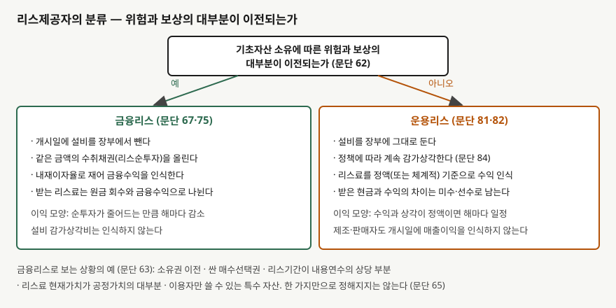
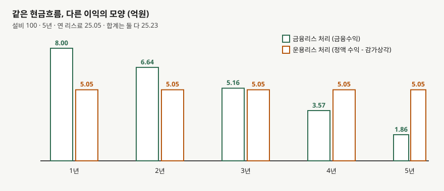

## 들어가며

설비를 빌려 쓰는 쪽의 장부는 [앞 글](../2026-10-10-lease-liability-right-of-use/index.md)에서 따라갔다. 쓰는 쪽은 리스 종류를 가리지 않고 사용권자산과 리스부채를 올린다. 그런데 같은 계약을 빌려주는 쪽에서 보면 장부가 한 가지 모양이 아니다.

공장 설비를 5년 동안 빌려주고 거의 원금 전액을 리스료로 돌려받는 계약이 있다. 건물 한 층을 3년만 빌려주고 그 뒤에는 다른 임차인을 구하는 계약이 있다. 둘 다 "리스료를 받는다"는 점은 같지만, 앞의 계약에서 설비는 사실상 팔린 것과 비슷하고 뒤의 계약에서 건물은 여전히 빌려주는 쪽의 자산이다. 장부에 설비를 계속 둘지, 내릴지를 정하는 일이 곧 분류다.

이 글은 그 분류 기준과, 분류에 따라 같은 설비에서 재무상태표와 손익계산서가 어떻게 달라지는지를 가상 회사의 숫자로 따라간다. 결론부터 적으면, **받는 현금이 같아도 이익이 해마다 나뉘는 모양이 달라진다.** 5년 합계는 같다.

## 개념

기업회계기준서 제1116호는 리스제공자에게 각 리스를 금융리스 아니면 운용리스로 분류하게 한다(문단 61). 기준은 한 줄이다. 기초자산의 소유에 따른 **위험과 보상의 대부분을 이전하면 금융리스**, 이전하지 않으면 운용리스다(문단 62). 이용자 쪽에는 이 구분이 없지만 제공자 쪽에는 남아 있다.

구분은 계약서의 이름이 아니라 거래의 실질로 한다(문단 63). 같은 문단이 금융리스로 분류되는 상황을 다섯 가지 든다.

- 리스기간이 끝나기 전에 소유권이 이용자에게 이전된다
- 공정가치보다 충분히 싼 값으로 살 수 있는 선택권이 있고, 행사할 것이 상당히 확실하다
- 소유권이 넘어가지 않아도 리스기간이 경제적 내용연수의 상당 부분을 차지한다
- 리스료의 현재가치가 기초자산 공정가치의 대부분에 해당한다
- 기초자산이 특수해서 그 이용자만 큰 변경 없이 쓸 수 있다

문단 64는 이용자가 해지할 때 제공자의 손실을 부담하거나, 잔존자산의 공정가치 변동이 이용자에게 귀속되는 경우 같은 **지표**를 더한다. 어느 쪽도 한 가지만으로 정해지지는 않는다. 다른 속성을 볼 때 위험과 보상의 대부분이 넘어가지 않는다는 점이 분명하면 운용리스로 본다(문단 65). 분류는 리스약정일에 하며, 리스변경이 없으면 추정치가 바뀌어도 다시 판단하지 않는다(문단 66).

## 구조



> **출처**: 한국회계기준원 [기업회계기준서 제1116호 '리스'](https://www.samili.com/acc/Kijun/Kijunjomun.asp?code=1978-1116) 문단 61~65·67·75·81·82·84·86 (제3자 전재, 2023-05-12 개정) — 원문 발행처 [한국회계기준원](https://www.kasb.or.kr/front/board/ingAccountingList.do), 대응 국제기준은 [IFRS Foundation](https://www.ifrs.org/issued-standards/list-of-standards/ifrs-16-leases/)의 IFRS 16

분류 뒤의 처리는 정반대 방향이다. **금융리스는 설비를 장부에서 내리고** 개시일에 리스순투자와 같은 금액의 수취채권으로 바꾼다(문단 67). 그 뒤로 리스료는 설비 사용료가 아니라 **채권의 원금 회수와 이자**로 읽힌다. 운용리스는 **설비가 장부에 그대로 있다.** 리스료는 수익이고, 설비의 감가상각비는 그 수익을 얻는 데 든 원가로 비용이 된다(문단 82).

이 글은 리스이용자 회계의 시행일(2019-01-01 이후 시작하는 회계연도)과 같은 기준서를 쓴다. 제공자 회계는 종전 기준서(제1017호)에서 실질이 크게 바뀌지 않았다고 기준서 개요가 적는다. 달라진 것은 이용자 쪽이다.

## 동작 원리

### 금융리스는 내재이자율로 채권을 굴린다

리스순투자는 **내재이자율**로 잰다(문단 68). 내재이자율은 리스료와 무보증잔존가치의 현재가치 합이 기초자산 공정가치와 리스개설직접원가의 합과 같아지는 이자율이다. 개시일에 순투자는 설비 공정가치와 같고, 해마다 `기초 순투자 × 이자율`만큼 금융수익이 생기며, 받는 리스료에서 그 수익을 뺀 나머지가 순투자를 줄인다. 금융수익은 순투자에 **일정한 기간수익률**을 반영하게 인식한다(문단 75). 순투자가 줄어드니 수익도 해마다 줄어든다.

이 점이 [사채 유효이자율법](../2026-10-12-bonds-effective-interest/index.md)과 같은 계산이다. 빌려주는 쪽은 대출을 해 준 쪽의 장부와 비슷하게 남는다. 순투자에는 금융자산 기준서의 제거와 손상 요구사항도 적용된다(문단 77).

### 운용리스는 리스료를 평평하게 펴서 인식한다

운용리스 리스료는 **정액 기준이나 다른 체계적인 기준**으로 수익이 된다(문단 81). 기초자산의 효익이 줄어드는 모양을 더 잘 나타내는 기준이 있으면 그것을 쓴다. 리스료가 해마다 올라가는 계약에서 정액을 쓰면, 초기에는 받은 현금보다 수익이 크고 그 차이가 미수리스료로 쌓였다가 뒤에 풀린다. 설비의 감가상각은 제공자 자신의 비슷한 자산 정책과 같아야 한다(문단 84). 제조자나 판매자가 운용리스를 맺는 것은 판매가 아니므로 개시일에 매출이익을 인식하지 않는다(문단 86).

## 실습 예제

가상 회사 **마바리스**는 취득원가이자 공정가치가 100억원인 설비를 가졌다. 두 계약을 놓고 비교한다.

- **금융리스**: 5년, 매년 말 같은 금액을 받는다. 내재이자율 8%, 무보증잔존가치는 없다. 설비 내용연수도 5년이다.
- **운용리스**: 3년, 매년 말 20·25·30억원을 받는다. 내용연수 10년이고 계약이 끝나면 마바리스가 설비를 그대로 보유한다.

```python
def finance_lease(payment: float, years: int) -> list[dict[str, float]]:
    net = COST  # 문단 67: 개시일에 설비를 빼고 같은 금액의 수취채권을 올린다
    for year in range(1, years + 1):
        income = net * RATE  # 문단 75: 순투자에 일정한 기간수익률을 곱한다
        end = net + income - payment
        ...
        net = end
```

전체 소스: [`code/`](code/)

### 분류 판단에 쓰는 숫자

```text
[0] 분류 판단에 쓰는 숫자 — 문단 63 ⑷ 리스료의 현재가치 대 공정가치 (단위: 억원)
        공정가치    100.00
       연 리스료     25.05  (5년, 매년 말)
        현재가치    100.00  (내재이자율 8%)
   현재가치/공정가치    100.0%
   리스기간/내용연수5년/5년 = 100%
```

문단 63의 상황 중 두 가지가 한꺼번에 들어맞는다. 리스료의 현재가치가 공정가치의 100%이고, 리스기간이 내용연수 전체다. 한 계약에 지표가 겹치면 금융리스 분류에 이견이 줄어든다.

### 금융리스: 순투자 상각표

```text
[1] 금융리스 — 리스순투자 상각표 (단위: 억원)
  연차        기초 순투자      금융수익(8%)        리스료 수취        기말 순투자
------------------------------------------------------------
   1        100.00          8.00         25.05         82.95
   2         82.95          6.64         25.05         64.55
   3         64.55          5.16         25.05         44.66
   4         44.66          3.57         25.05         23.19
   5         23.19          1.86         25.05          0.00

  금융수익 합계 25.23 = 리스료 합계 125.23 - 원금 100.00
```

1년 차 리스료 25.05억원 중 8.00억원만 수익이고 17.05억원은 채권 원금 회수다. 5년 차에는 수익이 1.86억원까지 내려간다. 마바리스의 손익계산서에는 설비 감가상각비가 없고, 재무상태표에서 설비 100억원이 있던 자리를 82.95억원짜리 수취채권이 이어받는다.

### 운용리스: 정액 수익과 감가상각

```text
[2] 운용리스 — 3년 계약, 내용연수 10년, 리스료 20/25/30 (단위: 억원)
  연차       받은 현금        리스수익(정액)       감가상각비        이익       설비 장부       미수리스료
------------------------------------------------------------------------------
   1       20.00           25.00       10.00     15.00       90.00        5.00
   2       25.00           25.00       10.00     15.00       80.00        5.00
   3       30.00           25.00       10.00     15.00       70.00        0.00

  3년 말 설비 장부금액 70.00 — 마바리스가 계속 보유하고 감가상각한다
```

받은 현금은 20·25·30으로 달라도 수익은 매년 25.00억원이다. 1년 차에는 수익이 현금보다 5.00억원 많아 미수리스료가 5.00억원 생기고, 3년 차에 현금이 5.00억원 더 많아지며 0으로 풀린다. 설비는 3년 뒤에도 70.00억원으로 남아 있다.

### 같은 현금흐름을 두 방식으로 처리하면

```text
[3] 같은 현금흐름 — 금융리스 대 운용리스로 처리했을 때의 연도별 이익 (단위: 억원)
  연차         금융리스 이익         운용리스 이익
--------------------------------------
   1            8.00            5.05
   2            6.64            5.05
   3            5.16            5.05
   4            3.57            5.05
   5            1.86            5.05
--------------------------------------
  합계           25.23           25.23
  합계 차이 0.00
```

운용리스로 처리했다고 가정한 쪽은 매년 리스료 25.05억원에서 감가상각 20.00억원을 뺀 5.05억원이 남는다. 금융리스 쪽은 8.00억원으로 시작해 1.86억원까지 내려간다. 합계는 둘 다 25.23억원이다. 분류는 이익의 총액이 아니라 **초기에 얼마를 인식하는지**를 정한다.



> **출처**: 한국회계기준원 [기업회계기준서 제1116호](https://www.samili.com/acc/Kijun/Kijunjomun.asp?code=1978-1116) 문단 75·81·82 (제3자 전재, 2023-05-12 개정) — 원문 발행처 [한국회계기준원](https://www.kasb.or.kr/front/board/ingAccountingList.do). 금액은 이 글의 `code/output.txt` `[3]`에서 옮겼다

## 실무에서 주의할 점

- **초기 이익 비교는 분류를 맞춘 뒤에 한다.** 금융리스를 많이 하는 제공자는 계약 초기에 이익이 앞서 나오고, 운용리스 비중이 큰 제공자는 이익이 평평하다. 같은 영업을 하는 두 회사의 마진이 다르게 보이는 이유가 사업이 아니라 분류일 수 있다.
  [영업이익과 순이익의 간극](../2026-09-30-operating-vs-net-income-gap/index.md)을 읽을 때처럼 구성부터 분리한다.

- **감가상각이 있느냐가 EBITDA를 바꾼다.** 금융리스 제공자는 설비를 내렸으므로 감가상각비가 없고 이익이 금융수익으로 잡힌다. 운용리스 제공자는 감가상각비를 더해 EBITDA를 계산한다.
  [EBITDA 마진](../../ratios/2026-10-25-ebitda-margin-and-capex-gap/index.md)을 비교할 때 업종 안에서 리스 구성이 다른지 확인한다.

- **분류는 약정일에 정해지고 추정이 바뀌어도 그대로다.** 설비 내용연수나 잔존가치 추정이 바뀌어도, 이용자의 채무불이행이 생겨도 새로 분류하지 않는다(문단 66). 분류를 다시 보려면 리스변경이 있어야 한다.

- **잔존가치는 금융리스 수익에 다시 영향을 준다.** 리스총투자에 쓴 추정 무보증잔존가치를 정기적으로 검토하고, 줄었으면 수익 배분액을 조정하며 감소액은 바로 인식한다(문단 77). 이 글의 계산은 잔존가치가 0이라 이 조정을 보지 않았다.

- **이용자 쪽 장부와 짝을 맞춰 읽는다.** 같은 계약에서 이용자는 항상 사용권자산과 리스부채를 올리지만, 제공자는 운용리스면 설비를 그대로 둔다. 연결 범위 안에서 한 회사가 이용자이고 다른 회사가 제공자면 내부거래로 제거한다.

- **기준선이 숫자로 주어지지 않는다.** 문단 63의 "대부분", "상당 부분"은 숫자 기준을 정하지 않는다. 이 글에서도 100%를 예로 썼을 뿐, 몇 퍼센트부터 금융리스라는 기준선은 기준서에 없다.

## 정리

- 리스제공자는 소유에 따른 위험과 보상의 대부분이 이전되면 금융리스, 아니면 운용리스로 분류한다(문단 61·62). 분류는 약정일에 한다(문단 66).
- 금융리스는 설비를 내리고 리스순투자 채권을 올린다. 금융수익은 순투자에 일정한 기간수익률을 곱해 인식하므로 해마다 줄어든다(문단 67·75).
- 운용리스는 설비를 장부에 두고 감가상각하며 리스료를 정액(또는 체계적) 기준으로 수익 인식한다(문단 81·82).
- 가상 회사의 같은 현금흐름은 금융리스 처리에서 8.00억원으로 시작해 1.86억원으로 줄고, 운용리스 처리에서는 해마다 5.05억원이다. 합계는 둘 다 25.23억원이다.
- 분류는 총이익이 아니라 이익이 나뉘는 시점과, 재무상태표에 남는 자산의 종류를 정한다.

## 참고 자료

- [한국회계기준원](https://www.kasb.or.kr/front/board/ingAccountingList.do) — K-IFRS 기준서 발행처. 아래 전재 링크는 조문을 바로 열기 위한 편의 링크다
- [기업회계기준서 제1116호 '리스'](https://www.samili.com/acc/Kijun/Kijunjomun.asp?code=1978-1116) (제3자 전재, 2023-05-12 개정) — 문단 61~66 분류, 문단 67·68·75·77 금융리스, 문단 81~86 운용리스
- [IFRS 16 Leases](https://www.ifrs.org/issued-standards/list-of-standards/ifrs-16-leases/) — IFRS Foundation. 제1116호가 대응하는 국제기준이다
- 숫자는 이 글의 [`code/output.txt`](code/output.txt) `[0]`~`[3]`에서 옮겼다
