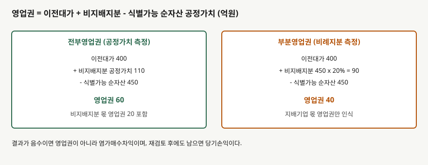

## 들어가며

인수 뉴스에 나오는 영업권을 "산 가격에서 장부 순자산을 뺀 값"으로 외우는 사람이 많다. 100%를 사는 거래라면 거의 맞다. 하지만 80%만 사는 경우에는 같은 거래인데 영업권이 두 가지로 나올 수 있다. 어느 쪽을 쓰는지 모르면 두 회사의 연결 재무제표를 비교할 때 영업권과 자본이 이유 없이 달라 보인다.

그 갈림은 남아 있는 20%, 곧 비지배지분을 **무엇으로 재는가**에서 나온다. 앞 글 [비지배지분](../2026-11-06-nci-consolidated-statements/index.md)이 취득 이후의 귀속이었다면, 이 글은 취득일의 측정이다.

이 글은 가상 회사로 영업권의 계산식과 두 측정 방법의 차이, 이전대가가 순자산보다 낮을 때 생기는 염가매수차익을 계산한다.

## 개념

기업회계기준서 제1103호는 취득일에 **영업권을 이전대가, 비지배지분 금액, 이미 보유한 지분의 공정가치의 합에서 식별가능 순자산의 취득일 공정가치를 뺀 값**으로 측정한다(문단 32). 이 글은 이미 보유한 지분이 없는 경우만 다룬다.

핵심은 비지배지분의 측정이다. 문단 19는 비지배지분이 현재 소유지분이고 청산 시 순자산 비례 몫을 받을 권리가 있으면, 취득자가 **거래마다** 두 방법 중 하나를 고르게 한다. 하나는 공정가치로 재는 것이고, 다른 하나는 피취득자의 식별가능 순자산 중 비례 몫으로 재는 것이다. 앞의 방법이 전부영업권, 뒤의 방법이 부분영업권으로 불린다. 이 용어는 기준서의 공식 용어가 아니라 업계에서 쓰는 이름이다.

## 구조



> **출처**: 한국회계기준원 [기업회계기준서 제1103호 '사업결합'](https://www.samili.com/acc/Kijun/Kijunjomun.asp?code=1978-1103) 문단 19·32 (제3자 전재) — 원문 발행처 [한국회계기준원](https://www.kasb.or.kr/front/board/ingAccountingList.do). 금액은 이 글의 `code/output.txt` `[1]`에서 옮겼다

두 방법의 식은 같고 비지배지분 항만 다르다. 비지배지분을 공정가치로 재면 시장에서 그 20% 지분이 얼마에 거래될지를 반영한다. 순자산 비례로 재면 장부상 몫만 반영한다. 공정가치에는 보통 영업권 가치가 섞여 있으므로 앞쪽 금액이 크다.

## 동작 원리

### 차이는 비지배지분 몫 영업권이다

가나전자가 라마화학 지분 80%를 이전대가 400억원에 샀고, 식별가능 순자산 공정가치가 450억원이라고 하자. 비지배지분을 순자산 비례로 재면 90억원이라 영업권은 400+90-450으로 40억원이다. 같은 지분의 공정가치를 110억원으로 평가하면 영업권은 60억원이 된다. 차이 20억원은 비지배지분 110억원과 90억원의 차이와 같다.

지배기업 몫으로 나누어 보면 이전대가 400억원에서 순자산의 80%인 360억원을 뺀 40억원은 두 방법에서 같다. 전부영업권이 더 늘리는 것은 비지배지분에 대응하는 영업권뿐이다. 그래서 자산 합계는 510억원과 490억원으로 갈리고, 그 차이는 전액 비지배지분(110억원과 90억원)에 반영된다.

### 음수가 나오면 영업권이 아니다

이전대가가 330억원이면 부분영업권 식은 330+90-450으로 -30억원이다. 문단 34는 이 경우 식별 자산·부채와 측정이 모두 맞게 이루어졌는지 **재검토**하게 하고, 재검토 뒤에도 남으면 취득일에 **염가매수차익**을 당기손익으로 인식하게 한다(문단 36). 비지배지분을 공정가치로 재면 330+110-450으로 -10억원이다. 영업권이 아니라는 점은 같고 차익 금액만 30억원과 10억원으로 달라진다.

## 실습 예제

```python
def goodwill(consideration: float, nci: float) -> float:
    return consideration + nci - NET_ASSETS_FV
```

전체 소스: [`code/`](code/)

```text
[1] 영업권 = 이전대가 + 비지배지분 - 식별가능 순자산 공정가치
  이전대가 400, 식별가능 순자산 450, 지분율 80%
              비지배지분 측정     비지배지분     영업권      자산
           공정가치(전부영업권)     110.0    60.0   510.0
         순자산 비례(부분영업권)      90.0    40.0   490.0
  영업권 차이 20.0 = 비지배지분 110 - 90
```

```text
[2] 이전대가가 낮은 경우 — 이전대가 330
  부분영업권 방식: 330 + 90 - 450 = -30.0
  전부영업권 방식: 330 + 110 - 450 = -10.0
  같은 거래라도 비지배지분 측정에 따라 염가매수차익 금액이 30과 10으로 갈린다
```

연결 재무상태표의 자산은 순자산 450억원과 영업권을 합친 값이다. 이 글의 가정에서 전부영업권은 510억원, 부분영업권은 490억원이다. 지배기업이 낸 돈은 400억원으로 같고 차이는 비지배지분 항에만 나타난다.

## 실무에서 주의할 점

- **같은 지분율이라도 영업권이 다를 수 있다.** 두 회사의 영업권을 비교할 때는 비지배지분 측정 정책을 주석에서 확인한다. 측정은 거래마다 고르므로 한 회사 안에서도 섞인다.
- **비지배지분 공정가치는 추정이다.** 지분 비례 금액보다 높게 나올 수도 낮게 나올 수도 있다. 이 글의 110억원은 두 방법의 차이를 보이려고 둔 가정이다.
- **음수 결과는 바로 이익이 아니다.** 식별·측정을 재검토하는 절차가 먼저다. 이 글은 재검토 자체의 세부 요건은 다루지 않았다.
- **영업권은 상각하지 않고 손상검사한다.** 전부영업권이면 손상차손이 지배기업과 비지배지분에 나뉘는데, 이 글은 그 배분을 계산하지 않았다. [영업권 손상검사](../2026-10-10-goodwill-impairment-test/index.md)를 같이 본다.
- **이 글은 이미 보유한 지분이 없는 취득만 다룬다.** 단계적 취득이면 계산식에 이전 보유 지분이 더해진다. 문단 번호는 인용 시점 기준서를 따랐다.

## 정리

- 영업권은 이전대가 + 비지배지분 - 식별가능 순자산 공정가치다(문단 32).
- 비지배지분은 공정가치(전부영업권) 또는 순자산 비례 몫(부분영업권) 중 거래마다 고른다(문단 19).
- 가상 사례에서 영업권은 60억원과 40억원이고, 차이 20억원은 비지배지분 항의 차이와 같다.
- 지배기업 몫 영업권은 두 방법에서 같다.
- 결과가 음수면 재검토 뒤 염가매수차익을 당기손익으로 인식한다(문단 34·36). 금액은 측정 방법에 따라 달라진다.

## 참고 자료

- [한국회계기준원](https://www.kasb.or.kr/front/board/ingAccountingList.do) — K-IFRS 기준서 발행처. 아래 전재 링크는 조문을 바로 열기 위한 편의 링크다
- [기업회계기준서 제1103호 '사업결합'](https://www.samili.com/acc/Kijun/Kijunjomun.asp?code=1978-1103) (제3자 전재) — 문단 19·32·34·36
- [IFRS 3 Business Combinations](https://www.ifrs.org/issued-standards/list-of-standards/ifrs-3-business-combinations/) — IFRS Foundation
- 숫자는 이 글의 [`code/output.txt`](code/output.txt) `[1]`~`[3]`에서 옮겼다
