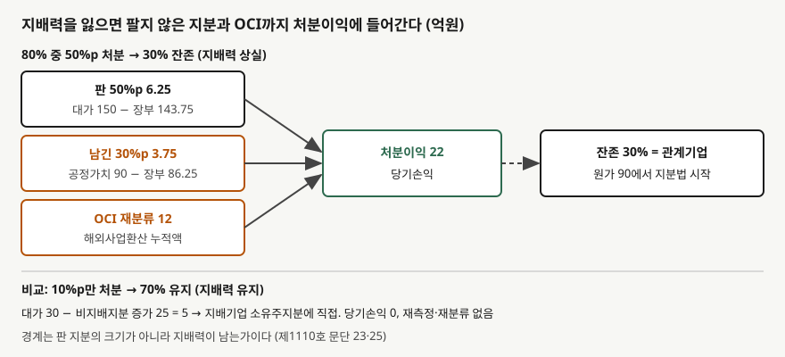

## 들어가며

자회사 지분 일부를 팔았다는 공시가 나온 분기에, 판 지분의 장부금액과 매각 대금을 비교해 처분이익을 어림해 보는 경우가 많다. 그런데 연결 손익계산서에 찍힌 처분이익이 그 어림보다 몇 배 큰 경우가 있다. 아래 예제에서 판 지분만으로 계산한 이익은 6.25억원이고, 실제 연결 처분이익은 22억원이다.

차이는 팔지 않은 지분과, 과거에 자본에 쌓아 둔 기타포괄손익에서 나온다. 지배력을 잃는 순간 기준서는 회사 전체를 한 번 처분한 것으로 본다. 판 것만 손익이 되는 게 아니라는 점을 모르면 그해 순이익을 반복될 이익처럼 읽게 된다.

이 글은 [단계적 취득 글](../2026-11-06-step-acquisition-remeasure-previous-stake/index.md)의 반대 방향, 곧 **지배력을 잃는 날**을 다룬다. 지배력을 얻을 때 기존 지분을 재측정했듯 잃을 때는 남는 지분을 재측정한다.

## 개념

기업회계기준서 제1110호는 지배기업이 종속기업에 대한 지배력을 상실하면 세 가지를 하게 한다(문단 25). 종전 종속기업의 자산과 부채를 연결재무상태표에서 제거하고, 남아 있는 투자는 **지배력을 상실한 때의 공정가치**로 인식하며, 종전 지배지분에 귀속되는 지배력 상실 손익을 인식한다.

남은 지분의 공정가치는 그 뒤 처리의 출발점이 된다. 남은 지분이 관계기업이 되면 관계기업 투자를 최초 인식하는 시점의 원가로 보고, 단순 투자 주식이 되면 제1109호의 금융자산 최초 인식 공정가치로 본다(문단 25).

여기서 경계가 되는 것은 판 지분의 크기가 아니라 **지배력이 남는가**다. 지배력을 유지한 채 지분이 줄면 소유주 사이의 자본거래로 처리하고(문단 23), 지배력을 잃어야 비로소 손익이 생긴다. 같은 회사의 지분을 팔더라도 10%p를 팔 때와 50%p를 팔 때 회계 처리가 완전히 다르다.

## 구조



> **출처**: 한국회계기준원 [기업회계기준서 제1110호 '연결재무제표'](https://www.samili.com/acc/Kijun/Kijunjomun.asp?code=1978-1110) 문단 23·25, 적용지침 B98·B99 (제3자 전재, 2024-11-22 개정) — 원문 발행처 [한국회계기준원](https://www.kasb.or.kr/front/board/ingAccountingList.do). 금액은 이 글의 `code/output.txt` `[1]`·`[2]`에서 옮겼다

위쪽이 지배력 상실이다. 처분이익 22억원에는 실제로 판 지분에서 나온 6.25억원 외에, 팔지 않은 30% 지분의 재측정 3.75억원과 기타포괄손익 재분류 12억원이 섞여 있다. 주황색 두 칸은 현금이 들어오지 않은 부분이다. 아래쪽 지배력 유지 사례에서는 같은 성격의 차이가 손익이 아니라 자본으로 간다.

## 동작 원리

### 제거하고 인식하고 차이를 손익으로

적용지침 B98은 계산 순서를 네 단계로 적는다. 지배력 상실일의 종속기업 자산(영업권 포함)과 부채의 장부금액, 그리고 비지배지분의 장부금액을 제거한다. 받은 대가의 공정가치와 남은 투자의 공정가치를 인식한다. 종속기업과 관련해 기타포괄손익으로 인식했던 금액을 재분류하거나 이익잉여금으로 대체한다. 모든 차이는 지배기업에 귀속되는 당기손익으로 인식한다.

가나전자가 다라물산 지분 80%를 갖고 있고, 연결 기준 다라물산 순자산이 250억원, 취득 때 생긴 영업권이 30억원, 비지배지분이 50억원이다. 50%p를 150억원에 팔면 남는 30%의 공정가치는 같은 주당 가격으로 90억원이다. 제거하는 지배기업 몫 장부금액은 280억원에서 비지배지분 50억원을 뺀 230억원이고, 인식하는 것은 대가 150억원과 잔존 지분 90억원의 합 240억원이다. 차이 10억원에 재분류 12억원을 더해 처분이익은 22억원이다.

### 처분이익을 출처별로 나누면

230억원은 지배기업이 가진 80%의 장부금액이므로 1%p에 2.875억원이다. 판 50%p의 장부금액은 143.75억원이라 대가 150억원과의 차이는 6.25억원이다. 남긴 30%p의 장부금액은 86.25억원이라 공정가치 90억원과의 차이는 3.75억원이다. 이 3.75억원은 아무것도 팔지 않은 지분에서 생긴 이익이다.

기준서가 이렇게 하는 이유는 지배력 상실을 **종속기업 전체를 처분하고 남는 지분을 공정가치로 새로 산 것**으로 보기 때문이다. 투자자가 들고 있는 것이 "자산과 부채 전부를 연결하는 종속기업"에서 "관계기업 주식 하나"로 바뀌므로, 그 전환 시점의 가치로 새 출발점을 잡는다.

### 기타포괄손익은 직접 처분한 것처럼

적용지침 B99는 종속기업과 관련한 기타포괄손익을 **지배기업이 관련 자산이나 부채를 직접 처분했을 때와 같은 기준으로** 처리하게 한다. 해외사업환산 누적액은 해외사업을 처분할 때 당기손익으로 재분류되는 항목이므로 12억원 전부가 처분이익에 들어간다. 반대로 재평가잉여금처럼 처분 때 이익잉여금으로 바로 대체하는 항목은 당기손익을 거치지 않는다.

### 지배력을 유지하면 손익이 없다

같은 회사에서 10%p만 30억원에 팔아 지분율이 70%가 되면 지배력은 그대로다. 이때는 비지배지분을 순자산 비례 몫인 25억원만큼 늘리고, 받은 대가와의 차이 5억원을 지배기업 소유주지분에 직접 인식한다(문단 23, 적용지침 B96). 당기손익은 0이고, 잔존 지분 재측정도 해외사업환산 누적액의 재분류도 없다.

## 실습 예제

```python
derecognised = NET_ASSETS + GOODWILL - NCI_CARRYING  # 지배기업 몫 230
gain = proceeds + retained_fv - derecognised + FX_RESERVE_PARENT

nci_increase = NET_ASSETS * sold  # 지배력 유지: 손익 대신 자본
diff = proceeds - nci_increase
```

전체 소스: [`code/`](code/)

```text
[1] 지배력 상실 — 80% 중 50%p를 150에 처분, 30% 잔존 (제1110호 B98)
  제거
    종속기업 자산·부채 순액 (영업권 포함)    280.0
    비지배지분 장부금액                      -50.0
    = 지배기업 몫 장부금액                   230.0
  인식
    받은 대가                                150.0
    잔존 30% 지분 공정가치                   90.0
  차이                                        10.0
  해외사업환산 누적 OCI 재분류                12.0
  지배력 상실 처분이익 (당기손익)             22.0

  처분이익을 출처별로 나누면
    판 50%p   대가 150.0 - 장부 143.75 =   6.25
    남긴 30%p 공정가치 90.0 - 장부 86.25 =   3.75
    OCI 재분류                          =  12.00
    합계                                 =  22.00
```

```text
[2] 비교 — 10%p만 30에 처분해 70%로 지배력 유지 (제1110호 문단 23)
  비지배지분 증가 = 순자산 250 x 10% = 25.0
  받은 대가 30.0 - 비지배지분 증가 25.0 = 5.0
  차이 5.0는 지배기업 소유주지분에 직접 인식 — 당기손익 0
  잔존 지분 재측정 없음, 해외사업환산 누적액도 당기손익으로 재분류하지 않음
  지분율 80% -> 70%, 비지배지분 50.0 -> 75.0
```

`[1]`의 22억원 중 현금이 들어온 거래에서 나온 것은 6.25억원뿐이다. 나머지 15.75억원은 평가와 재분류다. `[2]`는 주당 가격이 같은 거래인데도 손익이 없다. 처분 규모가 아니라 지배력의 유무가 처리를 가른다.

## 실무에서 주의할 점

- **처분이익에는 팔지 않은 지분의 평가이익이 섞여 있다.** 판 지분 장부금액과 대가만 비교한 어림은 연결 처분이익과 다르다. 주석에서 잔존 지분 재측정액이 따로 공시되는지 본다.
- **재분류된 기타포괄손익은 새로 번 이익이 아니다.** 과거에 자본에 쌓아 둔 환산차이가 이번에 손익계산서를 지나갔을 뿐이다. 총포괄이익 기준으로 보면 같은 금액이 기타포괄손익에서 빠지므로 총포괄이익에는 영향이 없다.
- **지배력 경계 근처의 처분은 회계 결과가 크게 다르다.** 지분율이 비슷해도 지배력을 잃었느냐에 따라 손익이 22억원과 0으로 갈린다. 지배력 판단은 지분율만이 아니라 [연결 범위 글](../2026-11-05-consolidation-scope-control-three-elements/index.md)의 세 요소로 한다.
- **여러 번에 나눠 팔아도 하나로 볼 수 있다.** 적용지침 B97은 동시에 체결했거나 서로를 전제로 한 약정, 그 자체로는 경제적으로 정당화되지 않는 약정 등을 단일 거래로 처리해야 하는 신호로 든다. 지배력을 유지하는 처분을 먼저 해서 손익을 피하는 구조로 쪼갤 수 없다는 뜻이다.
- **이 글의 숫자는 단순화한 가정이다.** 법인세, 중단영업 표시, 지배력 유지 처분 때 비지배지분에 다시 배분되는 기타포괄손익 몫은 넣지 않았다. 지배력 유지 사례의 비지배지분 증가는 영업권을 빼고 순자산 비례로만 계산했다.

## 정리

- 지배력을 잃으면 종속기업 자산·부채와 비지배지분을 제거하고, 대가와 잔존 지분 공정가치를 인식해 차이를 당기손익으로 본다(제1110호 문단 25, 적용지침 B98).
- 종속기업 관련 기타포괄손익은 직접 처분한 것처럼 처리해, 환산차이는 당기손익으로 재분류하고 재평가잉여금은 이익잉여금으로 대체한다(적용지침 B99).
- 가상 사례의 처분이익 22억원은 판 지분 6.25억원, 남긴 지분 재측정 3.75억원, 재분류 12억원으로 나뉜다.
- 지배력을 유지한 처분은 자본거래라 당기손익이 0이고, 차이 5억원은 지배기업 소유주지분에 직접 간다(문단 23).

## 참고 자료

- [한국회계기준원](https://www.kasb.or.kr/front/board/ingAccountingList.do) — K-IFRS 기준서 발행처. 아래 전재 링크는 조문을 바로 열기 위한 편의 링크다
- [기업회계기준서 제1110호 '연결재무제표'](https://www.samili.com/acc/Kijun/Kijunjomun.asp?code=1978-1110) (제3자 전재, 2024-11-22 개정) — 문단 23·25, 적용지침 B96~B99
- [IFRS 10 Consolidated Financial Statements](https://www.ifrs.org/issued-standards/list-of-standards/ifrs-10-consolidated-financial-statements/) — IFRS Foundation
- 숫자는 이 글의 [`code/output.txt`](code/output.txt) `[1]`·`[2]`에서 옮겼다
