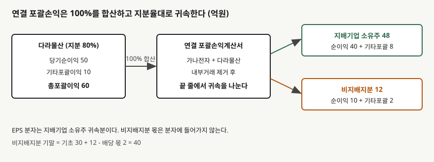

## 들어가며

연결 재무제표를 처음 읽을 때 가장 먼저 걸리는 줄이 "비지배지분"이다. 지분을 80%만 갖고 있는데 자회사의 매출과 자산이 100% 들어 있고, 그 아래에서 20%가 따로 빠진다. 지분율만큼만 반영하면 될 것 같은데 왜 전부 합친 뒤 다시 나누는지가 헷갈린다.

그래서 연결 순이익을 그대로 발행주식 수로 나눠 EPS를 구하는 실수가 생긴다. 자회사 이익의 20%는 지배회사 주주의 몫이 아닌데 분자에 들어간다. 아래 예제에서는 이 실수만으로 주당 100원이 부풀려진다.

이 글은 [연결 범위 글](../2026-11-05-consolidation-scope-control-three-elements/index.md)에서 연결이 결정된 뒤, 포괄손익과 자본에서 **비지배지분이 어떻게 나뉘고 움직이는지**를 가상 회사로 계산한다. 짝이 되는 [영업권 글](../2026-11-06-goodwill-full-vs-partial/index.md)은 취득 시점의 측정을 다룬다.

## 개념

**비지배지분**은 종속기업의 자본 중 지배기업에 직접 또는 간접으로 귀속되지 않는 부분이다. 기업회계기준서 제1110호는 지배기업이 종속기업을 100%가 아니어도 **자산·부채·수익·비용을 전부 연결**하게 한다(적용지침 B86). 지배하는 이상 그 회사의 자원 전체를 지배기업이 통제하기 때문이다. 대신 남의 몫은 따로 보여 준다.

표시는 두 곳이다. 재무상태표에서는 비지배지분을 **자본 안에** 지배기업 소유주지분과 구분해 표시한다(문단 22). 부채가 아니다. 포괄손익계산서에서는 당기순손익과 기타포괄손익의 각 구성요소를 지배기업 소유주와 비지배지분에 나누어 귀속시킨다(적용지침 B94).

## 구조



> **출처**: 한국회계기준원 [기업회계기준서 제1110호 '연결재무제표'](https://www.samili.com/acc/Kijun/Kijunjomun.asp?code=1978-1110) 문단 22, 적용지침 B86·B94 (제3자 전재) — 원문 발행처 [한국회계기준원](https://www.kasb.or.kr/front/board/ingAccountingList.do). 금액은 이 글의 `code/output.txt` `[1]`에서 옮겼다

합산은 100%, 귀속은 지분율이다. 손익계산서 맨 아래에서야 두 몫이 갈리므로 매출·영업이익·영업현금흐름은 비지배지분 몫을 포함한 전체 수치다. 영업이익률 같은 비율을 볼 때 분모도 전체이고 분자도 전체라 일관되지만, ROE처럼 자본을 쓰는 비율은 분자와 분모가 같은 몫을 가리키는지 확인해야 한다.

## 동작 원리

### 귀속은 지분율로, 그러나 지분율이 전부는 아니다

가나전자가 다라물산 지분 80%를 갖고, 다라물산이 순이익 50억원과 기타포괄이익 10억원을 냈다고 하자. 지배기업 소유주 몫은 40억원과 8억원, 비지배지분 몫은 10억원과 2억원이다. 잠재적 의결권 등 다른 요소가 없는 단순한 경우이며, 우선주나 파생상품이 얽히면 귀속 비율이 지분율과 달라질 수 있다.

배당은 흐름이 다르다. 다라물산이 10억원을 배당하면 가나전자가 받는 8억원은 연결 안에서 내부 이동이라 제거되고, 밖으로 나가는 2억원만 비지배지분을 줄인다. 그래서 비지배지분은 기초 30억원에서 순이익 몫 10억원, 기타포괄 몫 2억원을 더하고 배당 몫 2억원을 빼 40억원이 된다.

### EPS는 지배기업 소유주 몫만 쓴다

기업회계기준서 제1033호는 기본주당이익의 분자를 지배기업의 보통주에 귀속되는 손익으로 정한다. 가나전자의 자체 이익을 120억원, 발행주식을 1,000만주로 가정하면 지배기업 소유주 귀속 순이익은 160억원이라 EPS는 1,600원이다. 연결 순이익 170억원을 그대로 쓰면 1,700원이 되어 비지배지분 10억원만큼 부풀려진다.

### 손실이 크면 비지배지분이 음수가 된다

비지배지분이 0이 되면 귀속을 멈출 것 같지만 그렇지 않다. 적용지침 B94는 비지배지분이 적자 잔액이 되더라도 총포괄손익을 귀속시키도록 한다. 다라물산이 손실 200억원을 내면 자본은 150억원에서 -50억원이 되고, 비지배지분은 기초 30억원에 손실 몫 -40억원을 더해 -10억원이 된다.

## 실습 예제

```python
nci_end = nci_start + ni_nci + oci_nci - div_nci
eps_right = (parent_own_ni + ni_parent) / parent_shares

removed = nci_carrying * (bought_share / NCI_RATE)
diff = price - removed  # 손익이 아니라 지배기업 소유주지분을 줄인다
```

전체 소스: [`code/`](code/)

```text
[1] 연결 포괄손익 귀속 — 다라물산 당기순이익 50, 기타포괄이익 10, 배당 10
                    지배기업 소유주     비지배지분      합계
         당기순이익          40.0      10.0    50.0
        기타포괄이익           8.0       2.0    10.0
         총포괄이익          48.0      12.0    60.0

  비지배지분 기초 30.0 + 순이익 몫 10.0 + 기타포괄 몫 2.0 - 배당 몫 2.0 = 기말 40.0

  연결 당기순이익 170.0 전부를 쓴 값  1,700원 (틀림)
  지배기업 소유주 귀속 160.0를 쓴 값  1,600원
```

```text
[2] 큰 손실 — 다라물산 당기순손실 200
  비지배지분 기초 30.0 + 손실 몫 -40.0 = 기말 -10.0
  비지배지분이 음수(적자) — 손실 귀속을 0에서 멈추지 않는다
```

### 지배력을 유지한 채 지분을 더 사면

```text
[3] 지배력을 유지한 채 지분 10%p 추가 취득 — 지급 22
  비지배지분 장부금액 40.0 중 50%를 제거 = 20.0
  지급액 22.0 - 제거액 20.0 = 차이 2.0
  차이는 손익이 아니라 지배기업 소유주지분에서 2.0를 줄인다 (영업권·손익 없음)
  지분율 80% -> 90%, 비지배지분 40.0 -> 20.0
```

비지배지분 40억원 중 절반에 해당하는 20억원을 없애고, 낸 돈 22억원과의 차이 2억원은 지배기업 소유주지분에서 줄인다. 지배력이 그대로이면 소유주와의 거래이므로 손익도 영업권도 생기지 않는다(문단 23, 적용지침 B96).

## 실무에서 주의할 점

- **EPS 분자를 연결 순이익으로 두지 않는다.** 이 글의 가정에서 100원 차이가 난다. 분자는 항상 지배기업 소유주 귀속분이다.
- **비지배지분은 부채가 아니라 자본이다.** 부채비율을 계산할 때 비지배지분을 자본에 넣느냐 뺀느냐에 따라 값이 달라진다. 비교 대상이 같은 정의를 쓰는지 확인한다.
- **비지배지분이 음수가 될 수 있다.** 자본이 얇은 종속기업이 적자를 내면 연결 자본 안에 마이너스 줄이 생긴다. 오류가 아니라 기준서가 정한 결과다.
- **지분 추가 취득은 손익이 아니다.** 낸 돈과 비지배지분 장부금액의 차이는 자본 안에서 처리된다. 이 차이를 영업권이나 손익으로 읽지 않는다.
- **이 글의 숫자는 단순화한 가정이다.** 내부거래 이익 제거, 취득 시 영업권, 우선주는 넣지 않았다. 문단 번호는 인용 시점의 기준서 본문을 따랐으므로 개정되면 달라질 수 있다.

## 정리

- 비지배지분은 종속기업 자본 중 지배기업 몫이 아닌 부분이고, 연결재무상태표의 **자본 안에** 구분해 표시한다(문단 22).
- 자산·부채·수익·비용은 100% 합산하고, 포괄손익은 지배기업 소유주와 비지배지분에 귀속시킨다(적용지침 B86·B94).
- 가상 사례에서 총포괄이익 60억원은 소유주 48억원, 비지배지분 12억원으로 나뉜다.
- EPS는 지배기업 소유주 귀속분만 쓴다. 연결 순이익을 쓰면 1,700원, 맞는 값은 1,600원이다.
- 손실이 커지면 비지배지분이 -10억원처럼 음수가 되고, 지배력을 유지한 추가 취득의 차이는 자본에서 처리한다.

## 참고 자료

- [한국회계기준원](https://www.kasb.or.kr/front/board/ingAccountingList.do) — K-IFRS 기준서 발행처. 아래 전재 링크는 조문을 바로 열기 위한 편의 링크다
- [기업회계기준서 제1110호 '연결재무제표'](https://www.samili.com/acc/Kijun/Kijunjomun.asp?code=1978-1110) (제3자 전재) — 문단 22·23, 적용지침 B86·B94·B96
- [IFRS 10 Consolidated Financial Statements](https://www.ifrs.org/issued-standards/list-of-standards/ifrs-10-consolidated-financial-statements/) — IFRS Foundation
- 숫자는 이 글의 [`code/output.txt`](code/output.txt) `[1]`~`[3]`에서 옮겼다
